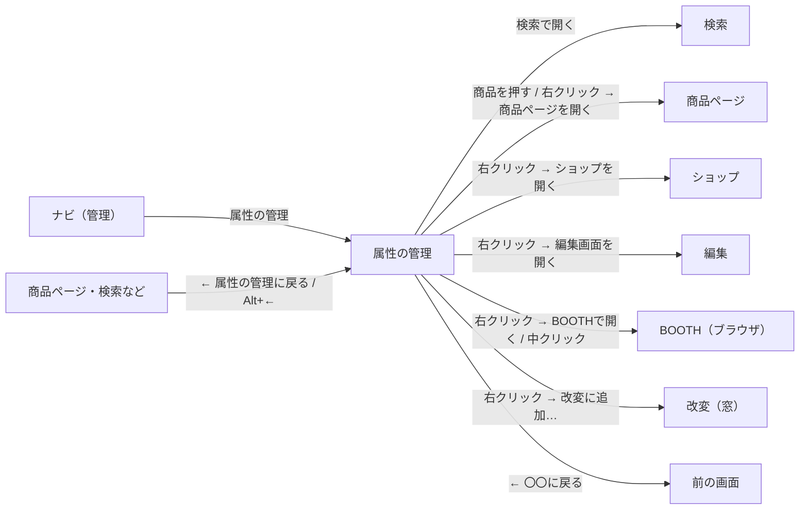

# 属性の管理：目的ごとの操作の経路（2026-11-15・案）

入口はナビの「管理」の下の「属性の管理」と、戻る・進む（「← 属性の管理に戻る」・Alt+←）。ほかの画面から直に来るボタンは無い（検索の絞り込みの「属性の管理で属性を追加すると選べます。」は文だけ）。
コードを読んで書いた物で、画面で確かめていない。手数はクリック・キー・打つ（1語）・ドラッグをそれぞれ1。右クリックのメニューの子（▸）を開くのも1。確認の窓の「OK」も1。
**頻度の列はユーザが付ける**（毎回／時々／まれ）。

場所：
- 上の帯＝画面の一番上の「属性の管理」の見出しと、右端の「読み直す」がある行
- 左の欄＝左の「属性を検索・追加」の欄・「表示順」の3つのボタン・属性の一覧
- 右の札＝右の上の、選んだ属性の大きな名前・「名前を変更」・右上の赤い「削除」・メモの欄がある札
- 商品の札＝その下の三角と「この属性を持つ商品 n 件」の見出し・「カード｜リスト」「高い順｜低い順」「並び：横｜縦」・探す欄と、開くと並ぶ商品
- 下の札＝無い（「編集画面での扱い」は 2026-11-18 から右上の「属性」の札へ）
- 注意の欄＝右の一番上の黄色い「一覧に無い属性」の欄（そういう名前がある時だけ出る）
- 右下＝右の欄の一番下の大きさのスライダー
- 右クリック＝左の一覧の属性の行の右クリック／カードの右クリック
- 窓＝「名前を変更」「属性を統合する」の窓と、確認の窓

右の欄の操作は、先に左の一覧で属性の行を押して選ぶ（1手）。下の表の手数はこの1手を含む。

## 探す・見る

| # | 目的 | 手順（画面の文言で） | 手数 | 場所 | 別の経路 | 頻度 |
|---|---|---|---|---|---|---|
| A1 | 属性を名前で探して開く | 「属性を検索・追加」の欄に打つ → 一覧の行を押す | 2 | 左の欄 | 打った名前とぴったり同じなら Enter で選ばれる（同じ名前が無いと Enter で追加になる。気付いた事） | |
| A2 | ある商品に付けた属性を探す | 欄に商品名を打つ → 行に「・商品 n 件」と出た行を押す | 2 | 左の欄 | メモで当たった行は「・メモ」 | |
| A3 | 属性の件数と平均を見る | 一覧を見る（行に「平均 n %」と件数）／行を押す（「n 件の商品に付いています（平均 n %）」） | 0〜1 | 左の欄→右の札 | — | |
| A4 | この属性を持つ商品を、値の高い順に見る | 行を押す → 商品の札の三角 | 2 | 左の欄→商品の札 | 開いた状態はほかの属性へ移っても残る（2回目からは1手）。評価の無い属性は三角が押せない | |
| A5 | 値の低い物から見直す | 行を押す →「低い順」（閉じていれば三角も） | 2〜3 | 左の欄→商品の札 | 向きは属性をまたいで残る | |
| A6 | 並ぶ向きを替える | 「並び：」の「横」か「縦」（リストの時だけ） | 1 | 商品の札 | — | |
| A7 | 中の商品の見え方を替える | 「カード」か「リスト」／ 右下のスライダーをドラッグ | 1 | 商品の札・右下 | 評価の無い属性では押せない | |
| A8 | この属性を持つ商品の中を探す | 行を押す →「この属性を持つ商品の中を探す」に打つ | 2 | 左の欄→商品の札 | 探している間は開いて見せる。欄の下に「「…」に当たる商品 n 件」 | |
| A9 | 商品のページを開く | 行を押す → 三角 → 商品を押す | 3 | 左の欄→商品の札 | カードの時はカードを押す | |
| A10 | この属性を持つ商品を検索画面で見る | 行を押す → 名前の下の「検索で開く」 | 2 | 左の欄→右の札 | 一覧の行の右クリック →「検索で開く」（2）。評価の無い属性は押せない | |
| A11 | 中の商品から BOOTH・ショップ・編集画面・Unity などへ進む | 三角を開く → カード（リストなら行）を右クリック → 項目（「BOOTHで開く」「ショップを開く」「編集画面を開く」「Unity」▸ など） | 4〜5 | 商品の札→右クリック | BOOTH はカードの中クリック。リストの見方の行にも同じ右クリックと中クリックがある | |

## 作る・書く

| # | 目的 | 手順（画面の文言で） | 手数 | 場所 | 別の経路 | 頻度 |
|---|---|---|---|---|---|---|
| A12 | 属性を足す | 「属性を検索・追加」の欄に名前を打つ →「追加」 | 2 | 左の欄 | Enter。同じ名前があると欄の下に「「…」は既にあります。」 | |
| A13 | 属性にメモを書く | 行を押す → 右の札の「メモ」の欄に打つ | 2 | 左の欄→右の札 | 押さずに保存される | |
| A14 | 編集画面に、この属性を最初から並べる | 行を押す →「編集画面に最初から並べる」（右上の札・「検索で開く」の右） | 2 | 左の欄→属性の札 | 商品を開いていても押せる | |
| A15 | 最初から並べるのをやめる | 行を押す →「最初から並べるのをやめる」 | 2 | 左の欄→属性の札 | 付けた評価は残る | |

## 直す

| # | 目的 | 手順（画面の文言で） | 手数 | 場所 | 別の経路 | 頻度 |
|---|---|---|---|---|---|---|
| A16 | 属性の名前を変える | 行を押す → 名前の横の「名前を変更」→ 窓で新しい名前を打つ →「名前を変える」 | 4 | 右の札→窓 | 一覧の行の右クリック →「名前を変更」（4） | |
| A17 | 2つの属性を1つにまとめる | 行を押す →「名前を変更」→ 窓で既にある名前を選ぶ →「統合する」→「属性を統合する」の窓（両方に値がある商品があれば、残す値を選ぶ）→「統合する」→ 確認で OK | 6〜7 | 右の札→窓→窓→窓 | 右クリック →「名前を変更」から同じ | |

## 消す

| # | 目的 | 手順（画面の文言で） | 手数 | 場所 | 別の経路 | 頻度 |
|---|---|---|---|---|---|---|
| A18 | 属性を削除する（付けた評価も消える） | 行を押す → 右上の赤い「削除」→ 確認で OK | 3 | 右の札→窓 | 一覧の行の右クリック →「この属性を削除」→ OK（3） | |

## 並べる・整える

| # | 目的 | 手順（画面の文言で） | 手数 | 場所 | 別の経路 | 頻度 |
|---|---|---|---|---|---|---|
| A19 | 一覧を名前順・件数順で見る | 「表示順」の「名前順」か「件数順」 | 1 | 左の欄 | 選ぶと検索・編集の候補の順も同じに書き換わる | |
| A20 | 検索と編集の候補に出る属性の順を決める | 一覧の行をドラッグ | 1 | 左の欄 | 既定が「候補の並べ替え」なので、そのままドラッグできる。名前順・件数順にしていたら先に「候補の並べ替え」（+1） | |
| A21 | 左の欄の幅を変える | 左の欄と右の境目をドラッグ | 1 | 境目 | 境目のダブルクリックで既定の幅に戻る [推測] | |

## 一覧に無い属性を直す（注意の欄が出ている時だけ）

| # | 目的 | 手順（画面の文言で） | 手数 | 場所 | 別の経路 | 頻度 |
|---|---|---|---|---|---|---|
| A22 | 商品に残っている名前を、そのまま一覧に戻す | 注意の欄の「一覧に追加」 | 1 | 注意の欄 | — | |
| A23 | 商品に残っている名前を、既にある属性へまとめる | 注意の欄の「既にある属性へ統合する」の欄で候補を選ぶ →「属性を統合する」の窓で「統合する」→ 確認で OK | 3〜4 | 注意の欄→窓→窓 | — | |
| A24 | 商品に残っている名前を外す | 注意の欄の「外す」→ 確認で OK | 2 | 注意の欄→窓 | — | |

## その他

| # | 目的 | 手順（画面の文言で） | 手数 | 場所 | 別の経路 | 頻度 |
|---|---|---|---|---|---|---|
| A25 | ほかで変えた分を読み直す | 「読み直す」 | 1 | 上の帯 | — | |
| A26 | 来た画面へ戻る | 「← 〇〇に戻る」 | 1 | 上の帯 | Alt+←・マウスの戻る。前の画面が無い時はボタンが出ない | |

## 画面の間の行き来

## 見るだけの部品

見出し「属性の管理」・「属性 n 件」・「値は商品ごとに 0〜100 で付けます。名前の変更と削除は、この属性を持つ商品の書き換えを伴います。」・欄の下の書き方の案内（乗せると詳しく）・「「…」に当たる属性 n 件」・一覧の行の件数（0なら「未評価」）と「平均 n %」（無ければ「評価なし」）「・メモ」「・商品 n 件」・一覧の上の知らせ（削除・統合の結果）・右の札の「属性」と大きな名前・「n 件の商品に付いています（平均 n %）」・名前の下の知らせ・「打ち終えると保存されます。」・「この属性を持つ商品 n 件」・評価が無い時の「どの商品にも付いていないので、並べ方と絞り込みには使えません。…」・「「…」に当たる商品 n 件」・商品の値の札「85 %」（リストは名前の右、カードは右上）・「編集画面での扱い」と説明・その下の知らせ・空の一覧の文・注意の欄の説明と「n 件の商品が参照」・行の頭の「⋮⋮」（候補の並べ替えの時だけ）。

## 部品の一覧

| 部品（画面の文言） | 場所 | 操作 | 起きる事 | 出る条件 | ID・ファイル:行 |
|---|---|---|---|---|---|
| 「← 〇〇に戻る」 | 上の帯 | クリック | 前の画面へ | 戻る先がある時 | — `AttributeManageView.xaml:31` |
| 読み直す | 上の帯 | クリック | 一覧と右の欄を読み直す | いつも | — `AttributeManageView.xaml:44` |
| 属性を検索・追加（欄・「追加」） | 左の欄 | 打つ・Enter・クリック | 打つと絞る。「追加」で足す。Enter は同じ名前があれば選び、無ければ足す | いつも | `AttributeFilterInput` `AttributeManageView.xaml:67`・`Controls/SearchAddBox.xaml.cs:102` |
| 名前順・件数順・候補の並べ替え | 左の欄 | クリック | 一覧の並びを替え、候補の順も書き換える | いつも（既定は候補の並べ替え） | — `AttributeManageView.xaml:88-95` |
| 属性の行 | 左の欄 | クリック・ドラッグ | 選ぶ／並べ替え（候補の並べ替えの時だけ） | 属性がある時 | `AttributeRow` `AttributeManageView.xaml:113` |
| 右クリック「名前を変更」 | 右クリック | クリック | 名前を変える窓 | いつも | `AttributeMenu.Rename` `AttributeManageView.xaml:136` |
| 右クリック「検索で開く」 | 右クリック | クリック | 検索画面へ | 評価がある時に押せる | `AttributeMenu.ShowItems` `AttributeManageView.xaml:139` |
| 右クリック「この属性を削除」 | 右クリック | クリック | 確認して削除 | いつも | `AttributeMenu.Delete` `AttributeManageView.xaml:144` |
| 境目 | 左右の間 | ドラッグ・ダブルクリック | 左の欄の幅を変える・戻す | いつも | — `AttributeManageView.xaml:57` |
| 左の一覧を畳むつまみ（‹ ›） | 境の線の右上 | クリック | 左の一覧を畳む（縦の見出しの帯だけ）・広げる。畳んだかは次の起動にも残る（次のバージョンから） | いつも | AttributeManageView.xaml・PaneCollapseToggle |
| 一覧に追加 | 注意の欄 | クリック | 名前を一覧に足す | 一覧に無い名前がある時 | `AttributeOrphanAdd` `AttributeManageView.xaml:256` |
| 外す | 注意の欄 | クリック | 確認して商品から外す | 同上 | `AttributeOrphanRemove` `AttributeManageView.xaml:258` |
| 既にある属性へ統合する（欄） | 注意の欄 | 打つ・選ぶ | 統合の窓 → 確認してまとめる | 同上 | `AttributeOrphanMerge` `AttributeManageView.xaml:262` |
| 名前を変更 | 右の札 | クリック | 名前を変える窓 | 選んでいる時 | — `AttributeManageView.xaml:286` |
| 検索で開く | 右の札 | クリック | 検索画面へ | 選んでいる時（評価が無いと押せない） | — `AttributeManageView.xaml:294` |
| 削除 | 右の札の右上 | クリック | 確認して削除 | 選んでいる時 | — `AttributeManageView.xaml:305` |
| メモ | 右の札 | 打つ | 打ち止めて保存 | 選んでいる時 | — `AttributeManageView.xaml:315` |
| 三角（この属性を持つ商品） | 商品の札 | クリック | 商品を開閉 | 評価が無いと押せない | `AttributeItemsToggle` `AttributeManageView.xaml:332` |
| カード・リスト | 商品の札 | クリック | 商品の並べ方 | 評価が無いと押せない | — `AttributeManageView.xaml:343-348` |
| 高い順・低い順 | 商品の札 | クリック | 値の向き | 同上 | — `AttributeManageView.xaml:354-357` |
| 並び：横・縦 | 商品の札 | クリック | 並ぶ向き | 同上 | — `AttributeManageView.xaml:363-368` |
| この属性を持つ商品の中を探す | 商品の札 | 打つ | 商品を絞る | 同上 | — `AttributeManageView.xaml:378` |
| 商品の行（リスト） | 商品の札の中 | クリック・乗せる | 商品ページ／大きめの絵 | 開いた時 | `ManageItemOpen` `ManageResources.xaml:250` |
| 商品のカード | 商品の札の中 | クリック・中クリック・右クリック | 商品ページ／BOOTH／カードのメニュー（検索画面と同じ項目。「非表示にする」は押すとこの画面も読み直す） | カードの見方で開いた時 | `CardMenu.*` `ItemCardResources.xaml:29-126`・`AttributeManageView.xaml:432` |
| 編集画面に最初から並べる／最初から並べるのをやめる | 属性の札 | クリック | 編集画面に最初から並べるかを切り替え | 選んでいる時 | — `AttributeManageView.xaml:297` |
| カードの大きさ／行の高さ | 右下 | ドラッグ | 中の商品の大きさ（全画面で共有） | カード／リストで出し分け | `ItemCardSize`・`ItemListRowHeight` `ItemCardResources.xaml:800` |
| 窓「名前を変更」：新しい名前・「名前を変える／統合する」・「キャンセル」 | 窓 | 打つ・選ぶ・クリック | 既にある名前を選ぶと統合 | 名前を変更を押した時 | — `RenameTagDialog.xaml:16-44` |
| 窓「属性を統合する」：残す値（「「…」に入っている値を残す」「「…」の値で上書きする」）・「統合する」・「キャンセル」 | 窓 | 選ぶ・クリック | 残す値を決めて次の確認へ | 統合の時（値の選びは両方に値がある商品がある時だけ） | — `MergeAttributeDialog.xaml:15-41` |

## 気付いた事

- **同じ事に経路が2つ以上ある物**：「名前を変更」「検索で開く」「削除」は、右の札と一覧の行の右クリックの両方にある。「編集画面に最初から並べる」は右クリックに無く、右上の「属性」の札のボタンだけ。属性を足すのは「追加」と Enter。商品ページへは商品を押すのとカードの右クリックの「商品ページを開く」。
- **隠れて見つけにくい物**：
  - 左の欄で Enter を押すと、打った名前とぴったり同じ属性が無ければ**探すのではなく属性を足す**（`SubmitFilterAsync` → `AddAsync`。タグの管理と同じ）。この欄は商品名でも当たるので、商品名を打って Enter すると、商品名の属性ができる。
  - 「名前順」「件数順」を押すと候補の順も書き換わり、手で並べた順はそこで消える。属性は既定が「候補の並べ替え」なので、手で並べた順を持っている人が多い [推測]。
  - 一覧の行の右クリックのメニュー・カードの右クリック・カードの中クリック（BOOTH）・境目のダブルクリック。
  - 商品の行は、リストの見方でもカードと同じ右クリックのメニューと中クリック（BOOTH を開く）がある（2026-11-18）。
  - 三角の開き方・値の向きは属性をまたいで残り、並ぶ向きは閉じても残る。開いたまま別の属性へ移ると、すぐ商品が並ぶ。
- **手数が多い目的、端と端を行き来する目的**：
  - 2つの属性の統合は窓が3枚（「名前を変更」→「属性を統合する」→ 確認）で6〜7手。統合という入口は無く、名前を変える窓で既にある名前を選ぶ。
  - 注意の欄は右の一番上で、そこで直した結果は左の一覧の上に出る。
- **文言の揺れ**：
  - 左の欄の吹き出しは「属性の名前とメモを探します。」だが、商品名でも当たる（行に「・商品 n 件」が出る）。
  - 件数0の言い方は「未評価」、平均の無い時は「評価なし」、右の札は「まだどの商品にも付いていません。」。タグの管理は「未使用」。
  - 右の札の削除は「削除」、右クリックは「この属性を削除」、確認の窓の題は「属性を削除する」。
  - 名前を変える窓は、題の帯が「名前を変更」、中の見出しが「属性の名前を変更」、決めるボタンが「名前を変える」。統合の時は「統合する」が2つの窓に続けて出る。
  - 注意の欄のボタンは「外す」、確認の窓の題は「参照を外す」（内部の言葉に近い）。
  - 見出しの説明は「書き換えを伴います」、タグの管理は「すべて書き換えます」。
- **タグの管理との違い**（2画面は揃える決め事）：属性の商品の札には「すべて広げる」が無く三角1つ、値の向き・並ぶ向きのボタンがある。表示順の既定が違う（タグは名前順、属性は候補の並べ替え）。通知から来る入口は属性の管理には無い（通知の文は両方を言う。tags.md の [要確認]）。
