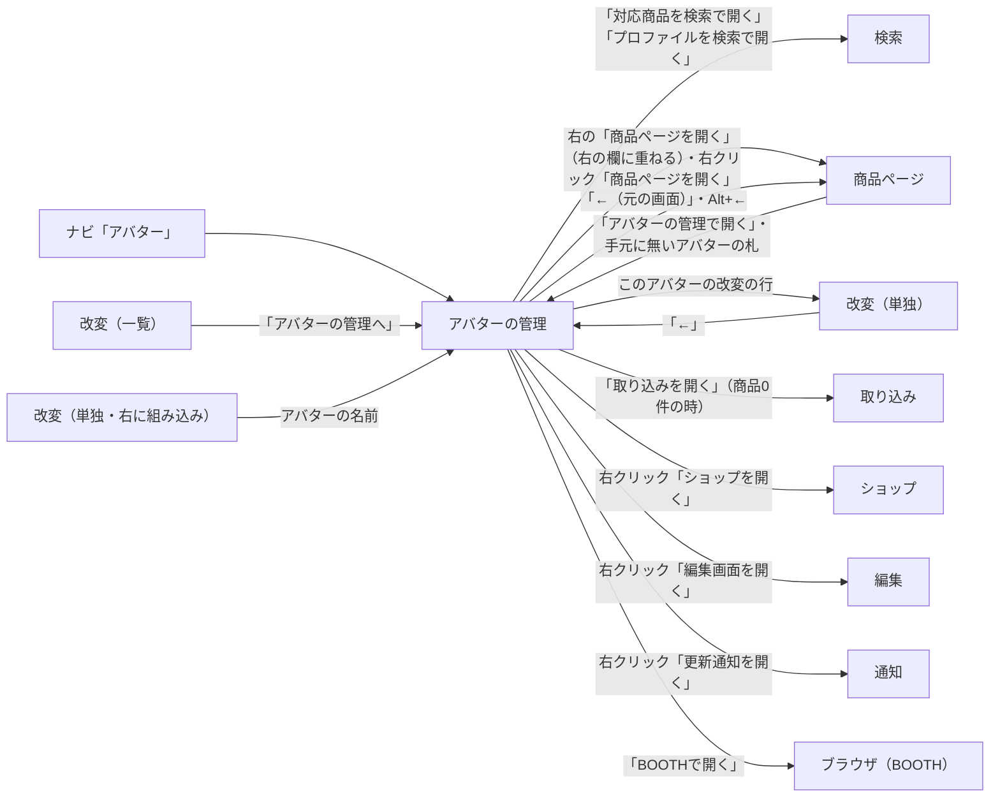

# アバターの管理：目的ごとの操作の経路（2026-11-15・案）

入口はナビの「アバター」（「管理」の段）。ほかに、商品ページの「アバターの管理で開く」、手元に無いアバターの札、改変の画面の「アバターの管理へ」とアバターの名前から、そのアバターを選んだ状態で来る。
コードを読んで書いた物で、画面で確かめていない。手数はクリック・キー・打つ（1語）・ドラッグをそれぞれ1。右クリックのメニューの子（▸）を開くのも1。
**頻度の列はユーザが付ける**（毎回／時々／まれ）。

場所：
- 上の帯＝画面の一番上の「アバターの管理」の題と、右端の「対応アバターを検出する」がある行（その下に、押した後だけ結果の文の行が出る）
- 切り替え＝左の欄の一番上の「アバター（n）」「共通素体（n）」「変換（n）」の3つのボタン。押すと左の一覧と右の欄が丸ごと替わる
- 左の一覧＝切り替えの下の一覧（アバターの時は「名前・ID・呼び方で探す」の欄、共通素体の時は「追加する共通素体の名前」の欄、変換の時は「まとめて確認済みにする」が上に付く）
- 右の欄＝左で選んだ1つの詳細
- 右クリック＝左の一覧の行・カードの右クリックのメニュー（中身は検索のカードと同じ）
- 窓＝確かめの窓・まとめて決める窓

## アバター：探す・見る（切り替え「アバター」）

| # | 目的 | 手順（画面の文言で） | 手数 | 場所 | 別の経路 | 頻度 |
|---|---|---|---|---|---|---|
| A1 | 名前でアバターを探して詳細を見る | 「名前・ID・呼び方で探す」に打つ → 行を押す | 2 | 左の一覧→右の欄 | 0件なら「絞り込みを消す」で戻す | |
| A2 | 一覧の見え方を替える | 「カード」か「リスト」を押す ／ 右下の大きさのつまみをドラッグ | 1 | 左の一覧 | — | |
| A3 | 一覧のまとまりを畳む（所有している・名前が挙がった・扱わない） | まとまりの見出し（例「所有しているアバター（12）」）の三角を押す | 1 | 左の一覧 | — | |
| A4 | 左の一覧の幅を替える | 左と右の境目をドラッグ | 1 | 境目 | 境目のダブルクリックで戻す [推測] | |
| A5 | このアバターに対応する商品を探す | 右の欄の「対応商品を検索で開く」 | 1 | 右の欄→検索 | — | |
| A6 | このアバター用の変換のプロファイルを探す | 右の欄の「プロファイルを検索で開く」 | 1 | 右の欄→検索 | 商品ページの同じ名前のボタン | |
| A7 | アバターの商品ページ（手元のファイル・改変）を見る | 右の欄の「商品ページを開く」（右の欄に商品ページを重ねる。左の選びは残る。戻るのは右の頭の「← 一覧に戻る」か Alt+←） | 1 | 右の欄 | 右クリック →「商品ページを開く」（2）。手元に無い時はボタンが出ない | |
| A8 | BOOTH のページを見る | 右の欄の「BOOTHで開く」 | 1 | 右の欄 | 右クリック →「BOOTHで開く」（2）／カードを中クリック [推測] | |
| A9 | 商品IDを写す | 右の欄の ID の字を押す | 1 | 右の欄 | 右クリック →「リンクをコピー」（URL） | |
| A10 | 判定の元（カテゴリ・確かめた日）を取り直す | 右の欄の ID の横の「商品情報を取り直す」 | 1 | 右の欄 | — | |

## アバター：直す（切り替え「アバター」で1体を選んだ後）

| # | 目的 | 手順 | 手数 | 場所 | 別の経路 | 頻度 |
|---|---|---|---|---|---|---|
| A11 | 表示する名前を変える | 「名前を変更」→ 打つ →「変更」 | 3 | 右の欄 | 「変更」の代わりに Enter。やめるのは「キャンセル」か Esc | |
| A12 | 名前を BOOTH の名前に戻す | 「BOOTHの名前に戻す」 | 1 | 右の欄 | 手で名前を付けた時だけ出る | |
| A13 | 前に呼ばれていた名前を表示名にする | 「呼ばれていた名前。押すと名前の欄に入ります。」の下の名前を押す →「変更」 | 2 | 右の欄 | 名前が要るアバター（名前が決まっていない時）だけ出る | |
| A14 | 取り込んでいないアバターを所有として扱う | 「所有しているものとして扱う」 | 1 | 右の欄 | 外すのは同じ場所の「所有の指定を外す」。ファイルで持っている時は出ない | |
| A15 | 共通素体に入れる・移す | 「共通素体」の欄で候補を押す（無い名前は打って Enter） | 1〜2 | 右の欄 | 切り替え「共通素体」→ 素体を選ぶ →「追加するアバターの名前」で選ぶ（4） | |
| A16 | 共通素体から外す | 「共通素体」の欄の右の「外す」 | 1 | 右の欄 | 切り替え「共通素体」→ 素体 → 行の「外す」か右クリック「この素体から外す」 | |
| A17 | 間違った呼び方を検出に使わない | 「呼び方（n）」を広げる → 呼び方の札の「×」 | 2 | 右の欄 | — | |
| A18 | 検出できなかった呼び方を足す | 「呼び方（n）」を広げる → 欄に打つ →「呼び方を追加」 | 3 | 右の欄 | 「呼び方を追加」の代わりに Enter | |
| A19 | 消した呼び方を戻す | 「呼び方（n）」を広げる →「検出に使わない呼び方」の「戻す」 | 2 | 右の欄 | — | |
| A20 | アバターかどうかを手で決める | 「アバターかどうか」の「アバターとして扱う」か「アバターとして扱わない」 | 1 | 右の欄（下の方） | 自動に戻すのは「自動の判定に任せる」 | |
| A21 | 検出では分からない事を残す | 「メモ」の欄に打つ（少し待つと残る） | 1 | 右の欄（下の方） | — | |

## アバター：改変（切り替え「アバター」で1体を選んだ後）

| # | 目的 | 手順 | 手数 | 場所 | 別の経路 | 頻度 |
|---|---|---|---|---|---|---|
| A22 | このアバターの改変を作る | 「このアバターの改変」の欄に名前を打つ →「作る」 | 2 | 右の欄 | 「作る」の代わりに Enter。同じ名前があれば窓で聞く（+1）。改変の画面「アバター」の見方の行の「改変を作る」→ 右で名前 →「改変を作る」 | |
| A23 | このアバターの改変を開く | 改変の行（絵か名前）を押す | 1 | 右の欄→改変の画面（単独） | 改変の画面で、アバターの見方の行の下 | |
| A24 | 改変に何を使ったかをここで覗く | 改変の行の左の三角 | 1 | 右の欄 | 中の使ったものの名前を押すとその改変が開く | |

## アバター：検出・その他

| # | 目的 | 手順 | 手数 | 場所 | 別の経路 | 頻度 |
|---|---|---|---|---|---|---|
| A25 | 取り込んだ商品から対応アバターを探し直す | 「対応アバターを検出する」 | 1 | 上の帯 | 1体も無い時は、空の表示の文が同じボタンを指す。商品が0件なら「取り込みを開く」 | |
| A26 | 検出をやめる | 主の窓の長い作業の帯で止める [推測] | 1 | 窓の下の帯 [推測] | — | |
| A27 | 元の商品ページへ戻る | 上の帯の左の「←（元の画面）」 | 1 | 上の帯 | Alt+←・マウスの戻る。商品ページの札から来た時だけ出る | |
| A28 | アバターの商品をお気に入りにする・編集画面で直す・ショップを見る | 右クリック →「お気に入りに追加」／「編集画面を開く」／「ショップを開く」 | 2 | 右クリック | カードなら星も [推測] | |
| A29 | アバターの商品を Unity へ入れる・ファイルを開く | 右クリック →「Unity」▸ →「Unityへ送る…」／「開く」▸ →「エクスプローラで開く…」 | 3〜4 | 右クリック | 商品ページから | |

## 共通素体（切り替え「共通素体」）

| # | 目的 | 手順 | 手数 | 場所 | 別の経路 | 頻度 |
|---|---|---|---|---|---|---|
| A30 | 共通素体を作る | 「共通素体（n）」→「追加する共通素体の名前」に打つ →「追加」 | 3 | 切り替え→左の一覧 | 「追加」の代わりに Enter。アバターの右の欄の「共通素体」の欄に無い名前を打って Enter（入れながら作る） | |
| A31 | 素体の名前を変える | 「共通素体（n）」→ 素体の行 →「名前を変更」→ 打つ →「変更」 | 5 | 切り替え→左の一覧→右の欄 | 同じ名前の素体があれば窓でまとめるか聞く（+1） | |
| A32 | 素体を使っているアバターを足す | 素体を選んだ後、「追加するアバターの名前」で候補を選ぶ | 2 | 右の欄 | A15（アバターの側から） | |
| A33 | 素体の中のアバターの並びを決める | 素体を選んだ後、「この素体を使っているアバター」の行をドラッグ | 1 | 右の欄 | 戻すのは「既定の順に戻す」（並べ替えた時だけ出る） | |
| A34 | 素体の中のアバターを開く | 素体を選んだ後、「この素体を使っているアバター」の行を押す | 1 | 右の欄 | 切り替え「アバター」に移る。Alt+← で素体に戻る | |
| A35 | 素体そのものの配布商品を結ぶ | 素体を選んだ後、「素体の名前を含む商品」の「素体の商品に設定」 | 1 | 右の欄 | 候補に無ければ「素体の商品のIDかURL」に打つ →「素体の商品を設定」（2）。空にして押すと外れる | |
| A36 | 共通素体を消す | 素体を選んだ後、「削除」→ 窓で OK | 2 | 右の欄→窓 | 左の一覧の行の右クリック →「削除」→ 窓 | |

## 変換のプロファイル（切り替え「変換」）

| # | 目的 | 手順 | 手数 | 場所 | 別の経路 | 頻度 |
|---|---|---|---|---|---|---|
| A37 | 見つけた通りでよい物を1件ずつ確認して進む | 「変換（n）」→「決めていない」の行を押す →「確認済みにして次へ」を続けて押す | 3〜 | 切り替え→左の一覧→右の欄 | Ctrl+Enter（左の一覧に居ても効く）。確認待ちが無い時は押せない（吹き出し「確認待ちのつなぎ先がありません。」） | |
| A38 | 見つけた物をまとめて確認する | 「まとめて確認済みにする（n 件）」→ 窓でチェックを確かめる →「確認済みにする（n 件）」 | 2〜 | 左の一覧→窓 | — | |
| A39 | つなぎ先を1つだけ確認済みにする | つなぎ先の札に乗せる → 出た「✓」を押す | 1 | 右の欄 | 札の右クリック →「確認済みにする」（2） | |
| A40 | つなぎ先を外す（次からも推さない） | つなぎ先の札に乗せる → 出た「×」を押す | 1 | 右の欄 | 札の右クリック →「外す」（2） | |
| A41 | つなぎ先を選ぶ（決まっていない行） | 「つなぎ先のアバターか共通素体」に打つ → 候補を押す | 2 | 右の欄 | 商品ページの「変換扱い」の欄 | |
| A42 | 変換の向きを替える | 向きの字（「順方向」など）を右クリック →「順方向」「逆方向」「両方向」（既定の向きに「（既定）」） | 2 | 右の欄 | つなぎ先が無い行は押せない（「つなぎ先を選ぶと変えられます」）。既定と違う時は「既定に戻す」で戻す | |
| A43 | 外したつなぎ先を戻す | 「外したつなぎ先」の見出し（件数付き）を広げる →「戻す」 | 2 | 右の欄 | — | |
| A44 | プロファイルでない物を外す | 「プロファイルではない」 | 1 | 右の欄 | 「変換扱い」の「扱わない」（進まない） | |
| A45 | 決めずに次へ | 「後で」 | 1 | 右の欄 | 左の一覧で次の行を押す | |
| A46 | 自動の判定に戻す・プロファイルとして扱う | 「変換扱い」の「自動の判定」か「扱う」 | 1 | 右の欄 | 商品ページの「変換扱い」 | |
| A47 | 想定のアバターを商品の絵・説明で確かめる | 右の欄の大きな絵を見る →「商品ページを開く」か「BOOTHで開く」 | 1 | 右の欄 | — | |

## 画面の間の行き来

## 見るだけの部品

上の帯の説明の文「対応アバターの名前と共通素体、変換ツールのプロファイルを管理します」／検出の途中経過と結果の行／「読み込んでいます…」／空の時の文（「打ち込んだ言葉に当てはまるアバターがありません。…」「対応アバターは、取り込んだ商品の説明文やタグから見つけます。…」）／行・カードの対応数の札と素体の名前（推した素体は薄い字の「名前から「…」」）／「この名前の商品は手元にありません」／右の欄の正式名・カテゴリ・確かめた日／対応数「対応している商品 n 件・共通素体経由 n 件」と所有の文（「所有している（ファイルあり）」など）／「見つかった場所：…」／推した素体の文／今の扱い「今の扱い：アバター（自動の判定）」など／素体の「アバター n（所有 n）」「この素体向けと書かれた商品 n 件」「素体の商品：…」／変換の行の札「確認待ち n・未設定 n」／変換の「変換扱い」の今の状態の文・入っているファイル・見つけた理由／各欄の下の知らせ（「…を作りました。」「既にあります」など）

## 部品の一覧

| 部品（画面の文言） | 場所 | 操作 | 起きる事 | 出る条件 | ID・ファイル:行 |
|---|---|---|---|---|---|
| ←（元の画面の名前） | 上の帯 | 押す | 前の画面へ戻る | 戻り先がある時 | AvatarsView.xaml:275 |
| 対応アバターを検出する（検出中は「検出しています…」） | 上の帯 | 押す | 手元の説明文・タグから検出。カテゴリ不明は BOOTH に問い合わせる | いつも。長い作業中は押せない（吹き出し） | AvatarsView.xaml:284 |
| 絞り込みを消す | 左の一覧（0件の時） | 押す | 探す欄を空に | 探して0件の時 | AvatarsView.xaml:318 |
| 取り込みを開く | 左の一覧（空の時） | 押す | 取り込みの画面へ | 商品が0件の時 | AvatarsView.xaml:329 |
| 左右の境目 | 境目 | ドラッグ | 左の幅を替える | いつも | AvatarsView.xaml:343 |
| 左の一覧を畳むつまみ（‹ ›） | 境の線の右上 | クリック | 左の一覧を畳む（縦の見出しの帯だけ）・広げる。畳んだかは次の起動にも残る（次のバージョンから） | いつも | AvatarsView.xaml・PaneCollapseToggle |
| アバター（n） | 切り替え | 押す | アバターの見方へ | いつも | AvatarsView.xaml:355 |
| 共通素体（n） | 切り替え | 押す | 共通素体の見方へ | いつも | AvatarsView.xaml:369 |
| 変換（n） | 切り替え | 押す | 変換の見方へ | いつも | AvatarsConversionMode・AvatarsView.xaml:384 |
| まとめて確認済みにする（n 件） | 左の一覧の上 | 押す | 窓で確かめて、確認待ちをまとめて確認済みに | 変換の時 | AvatarsConversionBulk・AvatarsView.xaml:407 |
| カード／リスト | 左の一覧の上 | 押す | 一覧の形を替える | アバターの時 | AvatarsView.xaml:416・419 |
| 名前・ID・呼び方で探す | 左の一覧の上 | 打つ | 名前・商品ID・正式名・呼び方で絞る | アバターの時 | AvatarsView.xaml:426 |
| 追加する共通素体の名前／追加 | 左の一覧の上 | 打つ・押す・Enter | 共通素体を作る（消した名前なら戻す） | 共通素体の時 | AvatarBaseAddInput・AvatarBaseAdd・AvatarsView.xaml:441-449 |
| 大きさのつまみ | 左の一覧の右下 | ドラッグ | カード・行の大きさ | アバターの時 | AvatarsView.xaml:463 |
| アバターの一覧の行・カード | 左の一覧 | 押す・Enter・中クリック | 右に詳細（中クリックは BOOTH の商品ページ） | アバターの時 | AvatarRow・AvatarsView.xaml:30・480 |
| まとまりの見出しの三角 | 左の一覧 | 押す | 畳む・広げる | アバター・変換の時 | AvatarsView.xaml:508・561 |
| 行・カードの右クリック（商品ページを開く・ショップを開く・編集画面を開く・選ぶ・お気に入り・改変に追加…・更新通知を開く・既読にする・開く ▸・Unity ▸・BOOTHで開く・リンクをコピー・非表示にする ほか） | 右クリック | 押す | 検索のカードと同じ。「改変に追加…」は押した1件だけ。「選ぶ」は押せない [推測] | アバターの時。手元に無いアバターでは多くが押せない [推測] | CardMenu.*・ItemCardResources.xaml:40-110 |
| 共通素体の行 | 左の一覧 | 押す | 右に素体の詳細 | 共通素体の時 | AvatarBaseRow・AvatarsView.xaml:54 |
| 共通素体の行の右クリック「削除」 | 右クリック | 押す | 窓で確かめて消す | 共通素体の時 | AvatarBaseRowMenu.Delete・AvatarsView.xaml:37 |
| 変換の一覧の行 | 左の一覧 | 押す | 右に変換の詳細 | 変換の時 | AvatarsConversionList・AvatarsView.xaml:551 |
| 名前を変更（アバター） | 右の欄 | 押す | 名前の欄に替わる | アバターを選んだ時 | AvatarRename・AvatarsView.xaml:639 |
| BOOTHの名前に戻す | 右の欄 | 押す | 手で付けた名前を消す | 手で名前を付けた時 | AvatarsView.xaml:643 |
| 名前の欄／変更／キャンセル（アバター） | 右の欄 | 打つ・押す・Enter・Esc | 名前を変える・やめる | 名前を変更を押した後 | AvatarNameInput・AvatarRenameCommit・AvatarsView.xaml:650-664 |
| 商品IDの字 | 右の欄 | 押す・中クリック | ID をコピー（中クリックは BOOTH の商品ページ） | アバターを選んだ時 | AvatarIdCopy・AvatarsView.xaml:676 |
| 商品情報を取り直す | 右の欄 | 押す | BOOTH から取り直す（ファイルは落とさない） | アバターを選んだ時 | AvatarsView.xaml:687 |
| 呼ばれていた名前の札 | 右の欄 | 押す | 名前の欄に入れる | 名前が要るアバターで候補がある時 | AvatarsView.xaml:716 |
| 対応商品を検索で開く | 右の欄 | 押す | 検索へ（素体経由も含む） | アバターを選んだ時 | AvatarsView.xaml:732 |
| プロファイルを検索で開く | 右の欄 | 押す | 検索の条件「プロファイル」で開く | アバターを選んだ時 | AvatarShowProfiles・AvatarsView.xaml:736 |
| 商品ページを開く（アバター） | 右の欄 | 押す | 商品ページを右の欄に重ねる | 手元にある時 | AvatarsView.xaml:741 |
| BOOTHで開く（アバター） | 右の欄 | 押す | ブラウザで BOOTH | アバターを選んだ時 | AvatarsView.xaml:745 |
| 所有しているものとして扱う／所有の指定を外す | 右の欄 | 押す | 手で所有にする・外す | ファイルで持っていない時 | AvatarsView.xaml:762 |
| 共通素体の欄（素体を選ぶか、名前を打ってEnter） | 右の欄 | 打つ・選ぶ・Enter | 素体に入れる・無ければ作って入れる | アバターを選んだ時 | AvatarsView.xaml:785 |
| 外す（素体から） | 右の欄 | 押す | 素体から外す | アバターを選んだ時 | AvatarsView.xaml:791 |
| 呼び方（n） | 右の欄 | 押す | 畳む・広げる | アバターを選んだ時 | AvatarsView.xaml:813 |
| 呼び方の札の × | 右の欄 | 押す | 検出に使わない呼び方へ移す | 呼び方を広げた時 | AvatarAliasRemove・AvatarsView.xaml:833 |
| 追加する呼び方の欄／呼び方を追加 | 右の欄 | 打つ・押す・Enter | 呼び方を足す | 呼び方を広げた時 | AvatarsView.xaml:845-859 |
| 戻す（呼び方） | 右の欄 | 押す | 消した呼び方を戻す | 消した呼び方がある時 | AvatarAliasRestore・AvatarsView.xaml:879 |
| 新しい改変の名前（例：普段着）／作る | 右の欄 | 打つ・押す・Enter | 改変を作る。同じ名前なら窓で聞く | アバターを選んだ時 | AvatarsView.xaml:906-919 |
| 改変の行（絵・名前・中の使ったもの） | 右の欄 | 押す | 改変の画面（単独）を開く | 改変がある時 | AvatarModImage・AvatarModLink・AvatarModMemberLink・AvatarsView.xaml:941-1013 |
| 改変の行の三角 | 右の欄 | 押す | 使ったものを畳む・広げる | 改変がある時 | AvatarModToggle・AvatarsView.xaml:984 |
| メモ | 右の欄 | 打つ | 少し待つと残る | アバターを選んだ時 | AvatarsView.xaml:1037 |
| 自動の判定に任せる／アバターとして扱う／アバターとして扱わない | 右の欄 | 押す | アバターかどうかを決める | アバターを選んだ時 | AvatarsView.xaml:1067-1075 |
| 名前を変更（素体）／名前の欄／変更／キャンセル | 右の欄 | 押す・打つ・Enter・Esc | 素体の名前を変える（使っている商品も書き換える）。同じ名前があれば窓でまとめるか聞く | 素体を選んだ時 | AvatarBaseRename・AvatarBaseNameInput・AvatarBaseRenameCommit・AvatarsView.xaml:180-200 |
| 素体の商品に設定 | 右の欄 | 押す | 候補の商品を素体の配布商品に結ぶ | 素体の名前を含む商品がある時 | AvatarBaseCandidateUse・AvatarsView.xaml:218 |
| 素体の商品のIDかURL／素体の商品を設定 | 右の欄 | 打つ・押す・Enter | 配布商品を結ぶ。空なら外す | 素体を選んだ時 | AvatarBaseItemId・AvatarBaseSetItemId・AvatarsView.xaml:232-243 |
| 削除（素体） | 右の欄 | 押す | 窓で確かめて消す（元に戻せない） | 素体を選んだ時 | AvatarBaseDelete・AvatarsView.xaml:256 |
| （目的なし・画面に出ない）衣装の互換を広げる | 右の欄 | — | Collapsed で隠してある | 出ない | AvatarsView.xaml:248 |
| 追加するアバターの名前 | 右の欄 | 打つ・選ぶ | 素体にアバターを足す（候補から） | 素体を選んだ時 | AvatarBaseMemberInput・AvatarsView.xaml:1101 |
| 既定の順に戻す | 右の欄 | 押す | 持っているアバターが先・名前の順に戻す | 並べ替えた時 | AvatarBaseMemberOrderReset・AvatarsView.xaml:1121 |
| この素体を使っているアバターの行 | 右の欄 | 押す・ドラッグ | そのアバターを開く・並べ替える | 素体を選んだ時 | AvatarBaseMemberRow・AvatarsView.xaml:1138-1146 |
| 外す（素体の中の行）／右クリック「この素体から外す」 | 右の欄・右クリック | 押す | 素体から外す | 素体を選んだ時 | AvatarBaseMemberRemove・AvatarBaseMemberMenu.Remove・AvatarsView.xaml:1162・45 |
| 商品ページを開く（変換） | 右の欄 | 押す | 商品ページを右の欄に重ねる（重ねている間は Ctrl+Enter が効かない） | 変換で選んだ時 | AvatarsConversionOpenItem・AvatarsView.xaml:1201 |
| ← 一覧に戻る | 右の頭（商品ページを重ねた時） | 押す（Alt+← も） | 重ねる前の右の欄に戻す（流した位置もそのまま） | 右の「商品ページを開く」で開いた時 | RightPaneBack・RightPaneItemResources.xaml |
| BOOTHで開く（変換） | 右の欄 | 押す | ブラウザで BOOTH。手元だけの商品は押せない | 変換で選んだ時 | AvatarsConversionOpenBooth・AvatarsView.xaml:1205 |
| 自動の判定／扱う／扱わない | 右の欄 | 押す | 変換扱いを決める | 変換で選んだ時 | ItemConversionMode.*・ItemConversionPanel.xaml:35-45 |
| 向きの字の右クリック「順方向」「逆方向」「両方向」「既定に戻す」 | 右の欄 | 右クリック・押す | 向きを替える | つなぎ先がある行 | ItemConversionDirection.*・ItemConversionPanel.xaml:72-87 |
| つなぎ先の札の ✓ ／ ×（乗せた時・フォーカスがある時だけ） | 右の欄 | 押す | 確認済みにする／外す | 確認待ちの札（✓）・札（×） | ItemConversionConfirm・ItemConversionRemove・ItemConversionPanel.xaml:117-128 |
| つなぎ先の札の右クリック「確認済みにする」「外す」 | 右クリック | 押す | ✓ ／ × と同じ | 札がある時 | ItemConversionMenu.*・ItemConversionPanel.xaml:103-107 |
| つなぎ先のアバターか共通素体 | 右の欄 | 打つ・選ぶ | つなぎ先を決める | つなぎ先の無い行 | ItemConversionChoose・ItemConversionPanel.xaml:131 |
| 外したつなぎ先の見出し／戻す | 右の欄 | 押す | 広げる／戻す（確認済みになる） | 外した物がある時 | ItemConversionRejectedExpander・ItemConversionRestore・ItemConversionPanel.xaml:159-173 |
| 確認済みにして次へ（Ctrl+Enter） | 右の欄 | 押す・キー | 確認待ちを確認済みにして次へ | 変換で選んだ時。確認待ちが無いと押せない | AvatarsConversionDecide・AvatarsView.xaml:1215・13 |
| プロファイルではない | 右の欄 | 押す | 扱わないにして次へ | 変換で選んだ時 | AvatarsConversionNotProfile・AvatarsView.xaml:1230 |
| 後で | 右の欄 | 押す | 何も変えずに次へ | 変換で選んだ時 | AvatarsConversionLater・AvatarsView.xaml:1234 |
| （窓）つなぎ先ごとのチェック／決めるボタン／キャンセル | 窓 | 押す | チェックした物を確認済みに | まとめて決めるを押した時 | ConfirmConversionsRow・ConfirmConversionsCommit・ConfirmConversionsDialog.xaml:33-53 |

## 気付いた事

- **同じ事に経路が2つ以上ある物**
  - 共通素体に入れる・外すが、アバターの側（右の欄の「共通素体」の欄と「外す」）と素体の側（「追加するアバターの名前」・行の「外す」・行の右クリック「この素体から外す」）の両方にある。
  - 共通素体を消すのが、右の欄の「削除」と左の行の右クリック「削除」の2つ。
  - 共通素体を作るのが、素体の見方の「追加」と、アバターの右の欄で無い名前を打って Enter の2つ。
  - 改変を作るのが、この画面の「作る」と、改変の画面の右の欄の「改変を作る」と、「改変に追加…」の窓の「新しい改変を作って、そこに追加」の3つ。
  - 「商品ページを開く」「BOOTHで開く」が、右の欄と右クリックの両方にある。
  - つなぎ先の確認・外すが、乗せた時の ✓ ×、札の右クリック、「確認済みにして次へ」、「まとめて確認済みにする」の4通り。
- **隠れて見つけにくい物**
  - 「確認済みにして次へ」の Ctrl+Enter は、画面のどこにも書いていない。
  - 変換の向きは、向きの字の右クリックだけで替えられる。字は押せる見た目ではない。
  - つなぎ先の ✓ と × は、乗せた時かフォーカスがある時だけ出る。
  - 素体の中のアバターの並べ替えはドラッグだけ。キーで動かす手段は見当たらない [推測]。
  - 呼び方の足し・消し・戻しは、畳んだ「呼び方（n）」の中にある（普段は畳んである）。
  - 「商品情報を取り直す」は、ID の行の右に小さく置いてある。
  - 「呼ばれていた名前」の札は、名前が決まっていないアバターの時だけ出る。
- **手数が多い・画面を行き来する目的**
  - 素体の名前を変える（A31）は5手。素体の見方へ切り替えないと出ない。
  - アバターの側から素体の中の並びを見る・直すには、切り替え「共通素体」へ移って素体を選び直す（行を押すと「アバター」の見方へ移り、戻るは Alt+←）。
  - 「このアバターの改変」の行を押すと、単独の改変の画面へ移る。改変の画面の一覧で同じ形の行を押すと、右に出るだけで画面は移らない。見た目が同じで、行き先が違う。
  - 変換で「確認済みにして次へ」を押す所は右の欄の下で、件数の多い商品だと流した先にある [推測]。
- **文言の揺れ**
  - ナビは「アバター」、画面の題は「アバターの管理」。ほかの画面のボタンは「アバターの管理へ」（改変）と「アバターの管理で開く」（商品ページ）で、2通り。
  - 切り替えの「アバター（n）」と、ナビの「アバター」が同じ語。
  - 改変を作るボタンが、この画面では「作る」、改変の画面では「改変を作る」。
  - 外す・削除：素体から「外す」（戻せる）、つなぎ先を「外す」（次からも推さない）、呼び方の「×」（消す。戻せる）、素体の「削除」（戻せない）。
  - 変換の「扱わない」（変換扱いのボタン・左の一覧のまとまりの名前）と、「プロファイルではない」（下のボタン）が同じ結果を違う名前で呼ぶ。進むかどうかだけが違う。
