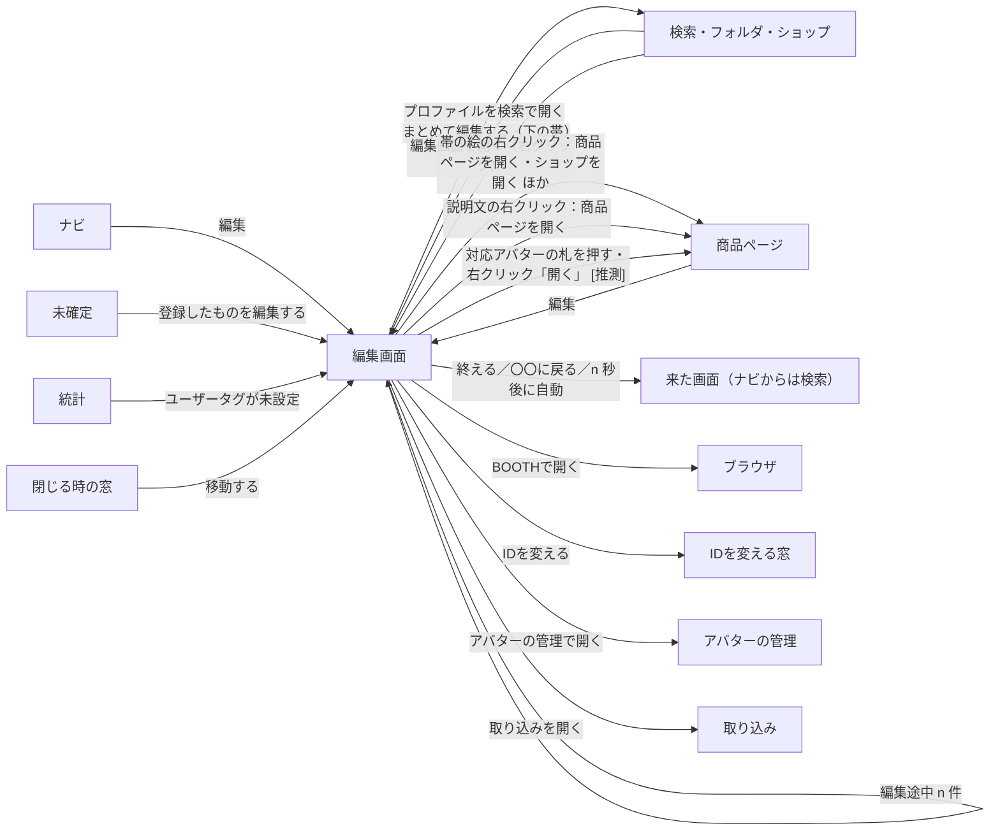

# 編集画面：目的ごとの操作の経路（2026-11-15・案）

入口：ナビの「編集」（未編集＝ユーザータグが未設定の商品を順に。前回の続きがあればそこから）／検索・フォルダ・ショップの下の帯の「まとめて編集する」／カードの右クリック「編集画面を開く」／商品ページの「編集」／未確定の「登録したものを編集する」／統計の「ユーザータグが未設定」の行／アプリを閉じる時の窓の「移動する」。
どの入口でも同じ画面で、選んだ商品を**1件ずつ順に**埋める（複数件に同じ値を一度に入れる部品は無い）。1件だけ指定して来た時は、順番が1件の編集になる。
コードを読んで書いた物で、画面で確かめていない。手数はクリック・キー・打つ（1語）・ドラッグをそれぞれ1。右クリックのメニューの子（▸）を開くのも1。
**頻度の列はユーザが付ける**（毎回／時々／まれ）。

場所：
- 上の帯＝画面の一番上の段。左に「編集」「n / m 件」と進み具合のバー（書きかけがあれば「編集途中 n 件」）、右に「商品情報を取り直す」「BOOTHで開く」「保存して次へ」「〇〇に戻る」（来た画面の名前。ナビから来た順番は「検索に戻る」）
- 続く商品の帯＝上の帯の2段目。左に「1件目へ」「最初の未保存へ」、右に順番の商品の小さな絵（設定で絵を消すとボタンだけ残る）
- 左の列＝画面の左の広い列。上から説明の1行「この列は押した時点で保存されます。…」、画像、商品の札（★・商品名・ショップ名・ID・「IDを変える」・右上の「編集」・BOOTHのタグ）、対応アバター、ローカルファイル、動画、商品説明
- 左の上の1行＝左の列を下へ流して商品名が見えなくなった時に、左の列の上に重なる1行（★・名前・ショップ名）
- 右の欄＝画面の右の入力の列。上から「← 前へ」「スキップ」、ユーザータグ（畳める・畳んだかは次の起動まで覚える）、属性（同）、購入したバリエーション（畳める）、バリエーション分け（畳める）、メモ、入手日、「更新を通知する」「非表示にする」、アバター、保存の結果の1行、下の「← 前へ」「スキップ」「保存して次へ」
- 終わりの表示＝順番を終えた時に画面の中央に出る「編集するものがありません」と下のボタン
- 窓＝ほかの窓（IDを変える・ファイルを選ぶ・商品として登録など）
- キー＝キーボードの割り当て（設定で変えられる）

保存の仕方が2つある：右の欄（と左の「編集」で開く商品名・ショップ・カテゴリ）は「保存して次へ」で書く。左の列のほかの物と、右の欄の「アバター」の欄・「追加…」は押した時点で書く。

## 進む・戻る

| # | 目的 | 手順（画面の文言で） | 手数 | 場所 | 別の経路 | 頻度 |
|---|---|---|---|---|---|---|
| A1 | 入れた内容を保存して次の商品へ | 上の帯の「保存して次へ」 | 1 | 上の帯 | 右の欄の一番下の「保存して次へ」／Ctrl+Enter（入力欄の中でも効く） | |
| A2 | 今の商品は後回しにして次へ | 右の欄の上の「スキップ」（入力は書きかけとして残る） | 1 | 右の欄 | 右の欄の一番下の「スキップ」／Ctrl+N | |
| A3 | 前の商品へ戻る | 右の欄の上の「← 前へ」（今の入力は書きかけとして残る。1件目では押せない） | 1 | 右の欄 | 右の欄の一番下の「← 前へ」／Ctrl+P／Alt+←・マウスの戻る（直前に開いていた商品へ） | |
| A4 | 順番の中の好きな商品へ飛ぶ | 続く商品の帯の絵を押す（乗せると大きな絵・名前・「保存済み」などが出る） | 1 | 続く商品の帯 | 絵の外へ流れている時は帯の上でホイール（横に送る） | |
| A5 | 順番の頭へ戻る | 続く商品の帯の「1件目へ」 | 1 | 続く商品の帯 | — | |
| A6 | 飛ばした物を頭から片付ける | 続く商品の帯の「最初の未保存へ」 | 1 | 続く商品の帯 | 帯の絵で薄い物（飛ばした物）を押す | |
| A7 | 書きかけのまま離れた商品だけをやり直す | 上の帯の「編集途中 n 件」（書きかけがある時だけ出る）→ 書きかけの商品だけの順番で開き直す | 1 | 上の帯 | ナビの「編集」の札「編:」の数で有無が分かる。アプリを閉じる時の窓の「移動する」 | |
| A8 | 編集をやめて元の画面へ | 上の帯の「〇〇に戻る」（まとめて編集から来た時は「検索に戻る」。選んでいた物は残る） | 1 | 上の帯 | Alt+←（前の商品が無い時。[推測]）・ナビで別の画面へ | |
| A9 | 全部終えた後に元の画面へ | 終わりの表示の「〇〇に戻る」（ナビから来た時は「検索に戻る」、ほかは来た画面の名前） | 1 | 終わりの表示 | 待つと「n 秒後に〇〇に戻ります。」で自動で戻る。止めるのは「ここに留まる」（設定「編集が終わったら検索に戻る」を切ると自動では戻らない） | |

## タグ・属性・メモを付ける（右の欄。「保存して次へ」で書く）

| # | 目的 | 手順 | 手数 | 場所 | 別の経路 | 頻度 |
|---|---|---|---|---|---|---|
| A10 | ユーザータグを付ける | 「ユーザータグを追加（例：衣装）」の欄に打つ → 候補を↑↓で選ぶ → Enter（候補に無い語は新しいユーザータグになる） | 2〜3 | 右の欄 | 候補を押す | |
| A11 | ユーザータグに小分類を付ける | 付けたタグの枠の「小分類を追加」に打つ → Enter | 2 | 右の欄 | — | |
| A12 | ユーザータグ・小分類を外す | タグの枠の右の「外す」／小分類の札の ✕ | 1 | 右の欄 | ✕ は Tab で並びに入り、矢印で移って Enter・Space | |
| A13 | 属性を評価する | 並んでいる属性の行のスライダーを動かす（触るまで「—」で、保存されない） | 1 | 右の欄 | スライダーの上で ←→（1）・PageUp/PageDown（25）・Home/End（0/100） | |
| A14 | 並んでいない属性を足す | 「属性を追加（例：かっこいい）」に打つ → Enter → スライダー | 3 | 右の欄 | 最初から並べる属性は「属性の管理」で決める | |
| A15 | 属性を外す（未評価に戻す） | 属性の行の「外す」 | 1 | 右の欄 | — | |
| A16 | メモ・入手日を書く | 「メモ」の欄に打つ／「入手日」の欄に 2026-09-20 の形で打つ（空欄は薄い字の日付を使う） | 1 | 右の欄 | メモは商品ページでも書ける | |
| A17 | 更新の通知を止める・検索に出さない | 「更新を通知する」／「非表示にする」のチェック | 1 | 右の欄 | 非表示はカードの右クリック「非表示にする」でも（そちらはすぐ効く） | |

## 買った物を記録する（右の欄。「保存して次へ」で書く）

| # | 目的 | 手順 | 手数 | 場所 | 別の経路 | 頻度 |
|---|---|---|---|---|---|---|
| A18 | 買ったバリエーションに印を付け、払った額を直す | 「購入したバリエーション」を開く（畳んでいれば）→ 行のチェック → 「¥」の欄を打ち直す（空欄は0円） | 2〜3 | 右の欄 | 印が1つも無いと見出しに「未選択」 | |
| A19 | 貰った・贈った物として記録する | 行の「自分用」のプルダウン →「貰った」か「贈った」 | 2 | 右の欄 | — | |
| A20 | 買った日を入れる | 行の「買った日」（贈った日・貰った日）の欄に打つ（空欄は「入手日と同じ」） | 1 | 右の欄 | — | |
| A21 | 同じバリエーションをもう1回買った記録を足す・消す | 行の「＋ 追加購入」→ 下に出た段の額・種類・日付を入れる／消すのは段の「この記録を削除」 | 2〜4 | 右の欄 | — | |
| A22 | バリエーションがどのアバター向けかを決める | 買った行の「対応」の右の「アバターを追加」に打つ → Enter ／名前から見つけた札を押して確認済みにする（乗せると ✓・×） | 1〜2 | 右の欄 | 決めていない行は「未選択」「未確認」の札。違う候補は札の × | |
| A23 | ファイルがどのバリエーションの物かを決める | 「バリエーション分け」を開く →「ファイルごと」で行の右のプルダウンから選ぶ | 3 | 右の欄 | 「バリエーションごと」に替えて、行の「ファイルを選択…」から選ぶ。外すのは札の ✕。買ったのが1つだけ・ファイルが1つ以下なら見出しが灰色で開けない | |
| A24 | 新しいファイルをバリエーションに付ける | 「バリエーション分け」→「バリエーションごと」→ 行の「追加…」→ 窓でファイルを選ぶ（紐付けはその場で書く） | 4 | 右の欄→窓 | 左の列のローカルファイルの「追加…」（商品に付けるだけ） | |

## 商品の情報を直す・確かめる（左の列。多くは押した時点で書く）

| # | 目的 | 手順 | 手数 | 場所 | 別の経路 | 頻度 |
|---|---|---|---|---|---|---|
| A25 | 商品名・ショップ・カテゴリを直す | 商品の札の右上の「編集」→ 欄に打つ（ショップ・カテゴリは欄を触ると候補のボタンが出る）→「保存して次へ」 | 3〜 | 左の列→上の帯 | 開いた後の同じボタンは「閉じる」（閉じても打った内容は残る） | |
| A26 | お気に入りにする・外す | 商品名の前の ★ | 1 | 左の列 | 左の上の1行の ★／帯の絵の右クリック | |
| A27 | 画像を足す・並べ替える・サムネイルにする・消す | 画像の列の「＋」→ 窓でファイル ／ 小さな絵を右クリック →「前へ移動」「この画像をサムネイルにする」「この画像を削除」など | 2〜3 | 左の列 | 画像をドロップ・貼り付け。大きな絵の下の「削除」。前後の絵は ‹ ›・←→ | |
| A28 | 対応アバターを確かめる・足す・外す | 対応アバターの欄で札を押す（確認済み）／「すべて確認済みにする」／「＋ 追加」→ 打つ → 選ぶ／札の × | 1〜3 | 左の列 | 札の右クリック「確認済みにする」「外す」。外した物は畳んだ欄の「戻す」 | |
| A29 | 手元のファイル・フォルダを確かめる・付ける・外す | ローカルファイルの欄を開く →「追加…」／行の「開く ▾」→「エクスプローラで開く」／「外す」 | 2〜3 | 左の列 | 外したファイルは「この商品に戻す」。見つからない行は「取り込みを開く」 | |
| A30 | 商品のIDを写す・別のIDへ移す | ID の字を押す（コピー）／「IDを変える」→ 窓 | 1／2〜 | 左の列→窓 | — | |
| A31 | BOOTHの最新の情報を取り直す | 上の帯の「商品情報を取り直す」（打ちかけの入力は残る） | 1 | 上の帯 | — | |
| A32 | BOOTHのページで確かめる | 上の帯の「BOOTHで開く」（BOOTHに無い商品では押せない） | 1 | 上の帯 | 帯の絵の右クリック「BOOTHで開く」 | |
| A33 | 説明文を読みやすい高さにする・リンク先を扱う | 「商品説明」の下の縁のつまみをドラッグ（ダブルクリックで既定に戻す）／リンクを右クリック →「商品ページを開く」「商品として登録…」など | 1〜2 | 左の列 | 文を選んで右クリック「選んだ範囲の商品をまとめて登録…」 | |
| A34 | この商品をアバターとして扱う | 右の欄の「アバター」の「アバターとして登録」（押した時点で書く） | 1 | 右の欄 | 登録後は「アバターの管理で開く」「プロファイルを検索で開く」「登録を外す」 | |
| A35 | 入力の欄を広げる・狭める | 左の列と右の欄の境目をドラッグ（ダブルクリックで戻す） | 1 | 境目 | 設定の「すべて元の幅に戻す」 | |

## 画面の間の行き来

## 見るだけの部品
上の帯の「編集」と「n / m 件」と進み具合のバー／帯の絵の印（右下の緑の ✓＝保存済み・左上の橙の点＝編集途中・薄い＝飛ばした・青い枠＝今の商品）／「取り直しています…」などの取り直しの結果の1行／左の列の頭の説明「この列は押した時点で保存されます。右の欄は「保存して次へ」で保存します。」／カテゴリの字・ショップ名・BOOTHのタグの数／「BOOTHに無い商品なので、空欄にすると仮のIDが名前の代わりに表示されます。」／右の欄の各見出しの説明文／「未選択」（購入・バリエーション分けの見出し）・「未指定」（ファイルの行）・「未確認」「未選択」（対応の行）・「BOOTHに現存しない」の札／「現在 ¥…」・「n ファイル紐付け済」／「この商品に付いたファイルがありません。…」「まだファイルを付けていません。」／保存の結果の1行（困った時だけ赤）／終わりの表示の「編集するものがありません」「ユーザータグが未設定の商品が対象です。」

## 部品の一覧

左の列の画像・対応アバター・ローカルファイル・動画・アバターの欄は商品ページと同じ部品（`ItemGalleryPanel`・`ItemAvatarsPanel`・`ItemFilesPanel`・`ItemVideosPanel`・`AvatarRegistrationPanel`）。編集画面では「使う」操作（ファイルの「Unity ▾」・「一時的に展開して開く」）を出さない（`ItemViewModel` の `ShowsUseActions`＝`forEditing` の逆。`ItemViewModel.Files.cs:299`・`:400`）。ここでは編集画面の物と、共有部品は目的に出た物だけを書く。

| 部品（画面の文言） | 場所 | 操作 | 起きる事 | 出る条件 | ID・ファイル:行 |
|---|---|---|---|---|---|
| 編集途中 n 件 | 上の帯 | 押す | 書きかけのある商品だけの順番で開き直す | 書きかけがある時 | EditView.xaml:217・EditViewModel.Drafts.cs:64 |
| 商品情報を取り直す | 上の帯 | 押す | BOOTHの情報を取り直す（BOOTHに無い商品では押せない） | 商品を開いている時 | EditView.xaml:346 |
| BOOTHで開く | 上の帯 | 押す | ブラウザで開く | いつも（BOOTHに無い商品では灰色） | EditView.xaml:349 |
| 保存して次へ（上） | 上の帯 | 押す・Ctrl+Enter | 保存して次へ | いつも（商品が無い・保存中は灰色） | EditView.xaml:353 |
| 〇〇に戻る（来た画面の名前・長い名前は切って吹き出しに全部） | 上の帯 | 押す | 順番を閉じて来た画面へ（ナビからの順番は記録を消す）。保存していない入力は書きかけに控え、下の帯で知らせる | いつも | EditFinish・EditView.xaml:355・EditViewModel.cs:1271 |
| 1件目へ | 続く商品の帯 | 押す | 1件目へ。今の入力は書きかけに残す | いつも（1件目では灰色） | EditView.xaml:239 |
| 最初の未保存へ | 続く商品の帯 | 押す | 保存していない最初の商品へ | いつも | EditView.xaml:241 |
| 続く商品の絵 | 続く商品の帯 | 押す・乗せる・ホイール・右クリック | その商品へ／大きな絵と状態／横送り／カードと同じメニュー（BOOTHで開く・リンクをコピー・商品ページを開く・ショップを開く・編集画面を開く・選ぶ・お気に入り・改変に追加…・開く ▸・Unity ▸・非表示にする など） | 設定「編集画面の上に、続く商品を小さな絵で並べる」が入っている時 | EditQueueTile・EditView.xaml:270・ItemCardResources.xaml:29〜126 |
| ここに留まる／〇〇に戻る | 終わりの表示 | 押す | 自動で戻るのを止める／戻る | 順番を終えた時（「ここに留まる」は数えている間だけ） | EditView.xaml:376・377 |
| 境目 | 左の列と右の欄の間 | ドラッグ・ダブルクリック | 右の欄の幅を変える・戻す | 商品を開いている時 | EditView.xaml:395 |
| 左の列の画像（＋・右クリックの「前へ移動」「後ろへ移動」「この画像をサムネイルにする」「サムネイルの指名を外す」役割 ▸「BOOTH」「改変例」「その他」「この画像を削除」「画像を追加…」・‹ ›・削除・画像取得を優先） | 左の列 | 押す・右クリック・ドロップ | 画像の追加・並べ替え・削除（その場で書く） | 商品を開いている時 | GalleryAdd・GalleryTile・GalleryRemoveImage・GalleryFetchImages・ItemGalleryPanel.xaml:92〜326 |
| 編集／閉じる | 左の列の商品の札の右上 | 押す | 商品名・ショップ・カテゴリの欄を開く・閉じる | いつも | EditView.xaml:425 |
| ★ | 左の列の商品名の前 | 押す・Enter・Space | お気に入りの切り替え（その場で書く） | いつも | EditFavorite・EditView.xaml:436 |
| ★（左の上の1行） | 左の上の1行 | 押す | 同上 | 左の列を流して商品名が隠れた時 | EditCompactFavorite・ItemCompactBar.xaml:32 |
| ID の字 | 左の列 | 押す・中クリック | IDをコピー（中クリックは BOOTH の商品ページ） | いつも | EditView.xaml:466 |
| IDを変える | 左の列 | 押す | 窓で別のIDへ移す | いつも | EditView.xaml:471 |
| 商品名・ショップ・ショップのURL・カテゴリの欄、ショップ・カテゴリの候補のボタン | 左の列 | 打つ・押す | 「保存して次へ」で書く | 「編集」で開いた時（候補は欄を触った時） | EditView.xaml:497・522・559・568・611・643 |
| BOOTHのタグ（n） | 左の列 | 畳む・開く | 札を見せる | いつも | EditBoothTagsExpander・EditView.xaml:655 |
| 対応アバターの欄（札・「すべて確認済みにする」・「表示する」・「＋ 追加」・「閉じる」・×・札の右クリック「開く」「確認済みにする」「外す」・説明文にある共通素体の「追加」×・外した物の「戻す」） | 左の列 | 押す・打つ・右クリック | 確認・追加・外す（その場で書く） | 商品を開いている時（後から組む） | ItemAvatarConfirm・ItemAvatarConfirmAll・ItemAvatarAdd・ItemBaseMentionAdd・ItemRejectedAvatarRestore・ItemAvatarsPanel.xaml:37〜462 |
| ローカルファイルの欄（開く・折りたたむ・「追加…」・「Unityで画像を選択…」・「開く ▾」→「エクスプローラで開く」「パスをコピー」・「外す」・「この商品に戻す」・「古い版の記録を片付ける」・「取り込みを開く」） | 左の列 | 押す | 紐付け・外す・開く（その場で書く） | 商品を開いている時。「Unityで画像を選択…」は選べる画像がある時 [推測：編集画面でも出る] | ItemFilesToggle・ItemAttachFiles・ItemSelectImageInUnity・ItemFolderOpenMenu・ItemFolderUnregister・ItemFileImportLink・ItemFilesPanel.xaml:177〜476 |
| （目的なし）動画の欄 | 左の列 | 畳む・押す | 動画をブラウザで開く | 説明文に YouTube がある時 [推測] | ItemVideosExpander・ItemVideoOpen・ItemVideosPanel.xaml:25・39 |
| 商品説明（右クリック・下の縁のつまみ） | 左の列 | 右クリック・ドラッグ・ダブルクリック | リンクを開く・コピー・商品として登録／高さを変える・戻す | いつも | EditView.xaml:696・700・docs/spec/item-page-text-menu.md |
| ← 前へ（上・下） | 右の欄 | 押す・Ctrl+P | 前の商品へ（書きかけに残す） | 2件目以降 | EditView.xaml:726・1260 |
| スキップ（上・下） | 右の欄 | 押す・Ctrl+N | 書きかけに残して次へ | 商品を開いている時 | EditView.xaml:727・1261 |
| ユーザータグを追加（例：衣装） | 右の欄 | 打つ・↑↓・Enter | タグを積む | いつも | EditTagInput・EditView.xaml:736 |
| 外す（タグ） | 右の欄 | 押す | タグと配下の小分類を外す | タグを付けた時 | EditTagRemove・EditView.xaml:751 |
| 小分類の ✕／小分類を追加 | 右の欄 | 押す／打つ・Enter | 小分類を外す・足す | タグを付けた時 | EditSubRemove・EditSubInput・EditView.xaml:777・798 |
| 属性を追加（例：かっこいい） | 右の欄 | 打つ・Enter | 属性の行を足す | いつも | EditAttributeInput・EditView.xaml:815 |
| 属性のスライダー／外す | 右の欄 | ドラッグ・キー／押す | 評価する／未評価に戻す | 行がある時 | EditAttributeSlider・EditAttributeRemove・EditView.xaml:838・854 |
| 購入したバリエーション（n 件） | 右の欄 | 畳む・開く | 行を見せる | いつも | EditPurchasesExpander・EditView.xaml:872 |
| 行のチェック・¥ の欄・自分用／貰った／贈った・買った日の欄・＋ 追加購入 | 右の欄 | 押す・打つ・選ぶ | 購入の記録 | 行ごと（印が無いと値段の段は灰色） | EditVariationPurchased・EditVariationPrice・EditVariationKind・EditVariationPurchasedAt・EditVariationAddPurchase・EditView.xaml:905〜966 |
| 追加購入の段（¥・種類・日付・この記録を削除） | 右の欄 | 打つ・押す | 2回目以降の購入の記録・消す | 「＋ 追加購入」の後 | EditExtraPrice・EditExtraKind・EditExtraPurchasedAt・EditExtraRemove・EditView.xaml:987〜1017 |
| 対応（アバターを追加・札の ✕・名前から見つけた札・✓・×） | 右の欄 | 打つ・押す | バリエーションの対応アバターを決める | 買った行だけ（後から組む） | EditVariationTargetInput・EditVariationTargetRemove・EditVariationTargetCandidate・EditVariationTargetReject・EditView.xaml:46〜152 |
| バリエーション分け | 右の欄 | 畳む・開く | 中を見せる | いつも（買ったのが1つ・ファイル1つ以下なら灰色） | EditFileSortExpander・EditView.xaml:1047 |
| ファイルごと／バリエーションごと | 右の欄 | 選ぶ | 中の見せ方を替える | 開いた時 | EditView.xaml:1072・1074 |
| ファイルの行のプルダウン | 右の欄 | 選ぶ | ファイルのバリエーションを決める | 「ファイルごと」 | EditFileSortChoice・EditView.xaml:1092 |
| ファイルを選択…／追加…／付けたファイルの ✕ | 右の欄 | 選ぶ／押す | 今あるファイルを付ける／新しいファイルを紐付けて付ける／外す | 「バリエーションごと」 | EditVariationFileChoice・EditVariationAddFiles・EditLinkedFileUnlink・EditView.xaml:1125・1141・1167 |
| メモ | 右の欄 | 打つ | メモ | いつも | EditMemo・EditView.xaml:1197 |
| 入手日 | 右の欄 | 打つ | 入手日 | いつも | EditView.xaml:1207 |
| 更新を通知する／非表示にする | 右の欄 | 押す | 通知・検索に出さない | いつも | EditView.xaml:1217・1219 |
| アバターとして登録／アバターの管理で開く／プロファイルを検索で開く／登録を外す | 右の欄 | 押す | 登録簿に書く（その場で）・ほかの画面へ | 状態による | EditRegisterAvatar・EditOpenInAvatars・EditShowProfiles・EditUnregisterAvatar・AvatarRegistrationPanel.xaml:34〜48 |
| 保存して次へ（下） | 右の欄の一番下 | 押す | 上の帯と同じ | いつも | EditView.xaml:1262 |

## 気付いた事

- 同じ事に経路が2つ以上ある物
  - 「保存して次へ」は上の帯と右の欄の一番下、「← 前へ」「スキップ」は右の欄の上と下に2組ずつある（加えて Ctrl+Enter・Ctrl+P・Ctrl+N）。上の帯には「前へ」「スキップ」が無く、右の欄の上には「保存して次へ」が無い。
  - お気に入りの ★ は左の列と左の上の1行に2つ。続く商品の帯の絵の右クリックにもある。
  - 書きかけに戻る経路は「編集途中 n 件」・続く商品の帯の橙の点の絵・ナビの「編:」の札・閉じる時の窓・編集の外へ出た時の下の帯「続きを編集」（ユーザ判断 2026-11-18）の5つ。
- 隠れて見つけにくい物
  - 続く商品の帯の絵の右クリックは、カードと同じ長いメニュー（「編集画面を開く」「選ぶ」「非表示にする」も含む）。編集画面の中で「編集画面を開く」「選ぶ」が何をするかは画面から読めない [推測：検索の選択に効く]。
  - 帯の上のホイールは横送り（ほかの所では縦）。乗せた時だけの大きな絵と状態。
  - 画像の操作は小さな絵の右クリックに集めてある。対応の候補の ✓・× は乗せた時だけ見える。
  - 商品名・ショップ・カテゴリは「編集」を押すまで欄が無い。商品説明の高さのつまみ、ID の字を押すとコピー。
  - Ctrl+Enter・Ctrl+N・Ctrl+P はボタンの吹き出しにしか書いていない（「保存して次へ」の吹き出しは無い）。
- 保存の仕方の食い違い
  - 左の列の頭の説明は「この列は押した時点で保存されます」だが、同じ列の「編集」で開く商品名・ショップ・カテゴリは「保存して次へ」で書かれる。逆に右の欄の「アバターとして登録」とバリエーションの行の「追加…」（紐付け）は押した時点で書く。
- 手数が多い目的・端と端を行き来する目的
  - 1件を仕上げると、右の欄を上から下まで流し（タグ → 属性 → 購入 → バリエーション分け → メモ）、最後は一番下か右上の「保存して次へ」へ戻る。
  - 商品名を直す時は、左の列の「編集」→ 左で打つ → 右上か右の欄の一番下の「保存して次へ」と、左右を渡る。
  - バリエーションに新しいファイルを付けるのは、畳んだ欄を開く → 見せ方を替える → 行の「追加…」→ 窓で4手。
- 「まとめて」について
  - 「まとめて編集する」で来ても、1件ずつ順に埋める画面で、複数件に同じタグ・属性・非表示を一度に入れる部品は無い。`docs/spec/item-page.md` の編集画面の節は「一括操作は ユーザータグの追加・削除／属性の一括設定／非表示 だけ」と書いているが、画面にもコードにも見当たらない。
  - 終わりの表示の「ユーザータグが未設定の商品が対象です。」は、どの入口でも出る（指定して来た順番でも）。1件だけ開いて「保存して次へ」を押すと、この表示になり、数秒後に来た画面へ戻る（「保存して終える」に当たる1手は無い）。
- 文言の揺れ
  - 同じ「今の入力は書きかけに残す」動きを、スキップは「入力を書きかけのまま、次の商品へ進みます」、「1件目へ」は「いま開いている商品の入力は保存しません」、「最初の未保存へ」は「今の入力は保存しません」と言う。上の帯のボタンは「編集途中 n 件」、帯の絵の吹き出しは「編集途中（保存していない入力があります）」、コードは書きかけ。
  - まだ決めていない印が「未選択」（購入の見出し・バリエーション分けの見出し・対応の行）・「未指定」（ファイルの行）・「未確認」（対応の行）の3つ。
  - 外す操作が「外す」（ボタン）・✕（札）・×（候補の札）・「この記録を削除」・「登録を外す」と分かれる。
  - 入口の呼び名が「編集」（ナビ・商品ページ）・「編集画面を開く」（右クリック）・「まとめて編集する」（下の帯）・「登録したものを編集する」（未確定）と4つ。画面の中にも左の列の「編集」ボタン（商品名などを開く）があり、画面名と同じ語。
- 終える経路
  - 「終える」はナビから来た順番の記録を消す（次にナビの「編集」で入ると積み直し）。指定して来た順番では消さない。ボタンは行き先を名乗る（「〇〇に戻る」・ユーザ判断 2026-11-18。前は「終える」）。記録を消すかの違いは画面に出ない。
