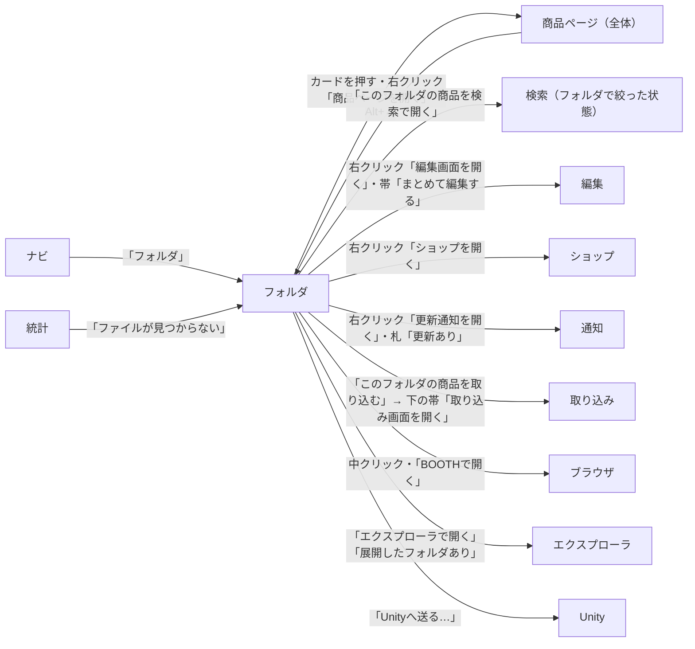

# フォルダ：目的ごとの操作の経路（2026-11-15・案）

入口はナビの「フォルダ」（ショップの下）と、統計の「ファイルが見つからない」の行。ほかの画面からフォルダを指して来る道は無い（戻る＝Alt+← で戻った時だけ、前に選んでいた行を選び直して開く）。
コードを読んで書いた物で、画面で確かめていない。手数はクリック・キー・打つ（1語）・ドラッグをそれぞれ1。右クリックのメニューの子（▸）を開くのも1。
**頻度の列はユーザが付ける**（毎回／時々／まれ）。

場所：
- 左の上＝左の欄の一番上の「フォルダ」の見出しの行（右に「ファイル名｜商品名」の切り替え）と、その下の絞り込みの欄・「商品を表示する」「管理対象」「未確定」のチェック
- 左の木＝左の欄のフォルダの木（▸▾ の三角・フォルダの行・ファイルの行・「?」の未確定の行）。左の下＝左の欄の一番下の状態の1行
- 右の頭＝フォルダかドライブの行を選んだ時の右の上（見出し・パス・件数・ボタンの列・監視・未確定の黄色い枠・「この下を…で探す」欄とカード／リストの切り替え）
- 右の一覧＝右の頭の下のカード（先頭に子フォルダのカード、続けて直下の商品）かリスト。右下＝大きさのスライダー。帯＝選んでいる時に右の下に出るまとめて操作の帯
- 右の商品ページ＝木の商品のファイルを選んだ時に右に出る商品ページ（戻るは隠れる）。右の未確定＝木の「?」の行を選んだ時に右に出る未確定の画面の右側
- 右クリック＝カード・リストの行・木の商品のファイルの行で出る、検索画面と同じメニュー。フォルダ（木の行・子フォルダのカード・リストのフォルダの行）ではフォルダのメニュー（2026-11-18）。窓＝確かめの窓

## 辿る・探す

| # | 目的 | 手順（画面の文言で） | 手数 | 場所 | 別の経路 | 頻度 |
|---|---|---|---|---|---|---|
| A1 | フォルダを辿って、中に何があるか見る | 左の木のフォルダの行の「▸」→ 開いた子の行を押す → 右に直下の商品と子フォルダが並ぶ | 2 | 左の木→右の一覧 | 右の子フォルダのカードを押して降りる（A4） | |
| A2 | 名前（ファイル名・商品名・フォルダ名）で木を絞る | 左の上の「ファイル名・商品名・フォルダ名で探す」に打つ → 当たった行を押す | 2 | 左の上→左の木 | — | |
| A3 | 今のフォルダの下を、商品名・ショップ名などで探す | 右の頭の「この下を、商品名・ショップ名・ファイル名・フォルダ名で探す」に打つ | 1 | 右の頭 | このフォルダで絞った検索画面へ移る（A24） | |
| A4 | 子フォルダへ降りる | 右の一覧の子フォルダのカード（上に「フォルダ」、下にパス）を押す | 1 | 右の一覧 | 左の木の「▸」→ 子の行（2）。押すと左の木の絞り込みの文字は消える | |
| A5 | 親のフォルダへ上がる | 左の木で親の行を押す | 1 | 左の木 | 右には上へ戻るボタンが無い。Alt+← は「前に選んでいた行」へ戻る（親とは限らない） | |
| A6 | 同じ中身のファイルが置いてある別の場所へ移る | ファイルの行の右端の札「ほかに n か所」 | 1 | 左の木 | — | |
| A7 | ファイル名ではなく商品名で木を読む | 左の上の「商品名」（戻すのは「ファイル名」） | 1 | 左の上 | （「管理対象」を切っている間は押せない） | |
| A8 | 木をフォルダだけにする | 左の上の「商品を表示する」を切る | 1 | 左の上 | — | |
| A9 | 木に出すファイルを、管理対象だけ／未確定だけにする | 左の上の「管理対象」か「未確定」を切る | 1 | 左の上 | （「商品を表示する」を切っている間は押せない） | |
| A10 | 見つからないファイル・外付けの物を探す | 左の木を辿り、灰色の行と「見つかりません」「取り外しているドライブ」を見る | 2〜 | 左の木 | 統計の「ファイルが見つからない」の行から来る（木の最初の形で開くだけ） | |
| A11 | 左の木の幅を変える | 左の欄と右の境目をドラッグ | 1 | 境目 | — | |

## 商品を見る・扱う

| # | 目的 | 手順（画面の文言で） | 手数 | 場所 | 別の経路 | 頻度 |
|---|---|---|---|---|---|---|
| A12 | 木のファイルの商品を、木を見たまま開く・直す | 左の木の商品のファイルの行を押す → 右に商品ページ（編集もその場で） | 1 | 左の木→右の商品ページ | — | |
| A13 | 右のカードから商品ページへ | 右の一覧のカードを押す（画面全体が商品ページに替わる。戻るのは Alt+←） | 1 | 右の一覧 | 右クリック →「商品ページを開く」（2）。木のファイルの行なら A12 で右に開く | |
| A14 | BOOTH の商品ページを開く | カードを中クリック | 1 | 右の一覧 | 右クリック →「BOOTHで開く」（2）。木の商品のファイルの行の右クリックも同じ（2） | |
| A15 | お気に入りにする・外す | カードの星 | 1 | 右の一覧 | 右クリック →「お気に入りに追加」（2）・帯「お気に入りに追加」 | |
| A16 | 商品のファイルをエクスプローラで開く | 木の商品のファイルの行かカードを右クリック →「開く ▸」→「エクスプローラで開く…」 | 3 | 右クリック | ファイルの置き場のフォルダの行を押す →「エクスプローラで開く」（2。A21） | |
| A17 | zip を展開したフォルダを開く | zip の行の下の「展開したフォルダあり」 | 1 | 左の木 | — | |
| A18 | 1件を Unity へ送る | 木の商品のファイルの行かカードを右クリック →「Unity ▸」→「Unityへ送る…」→ 窓で選んで送る | 4 | 右クリック→窓 | 「改変に追加して送る…」「Unityで選択…」も同じ「Unity ▸」の中 | |
| A19 | 商品を非表示にする | 右クリック →「非表示にする」 | 2 | 右クリック | 下の帯の「非表示を解除」で戻す | |
| A20 | カードとリストを替える・大きさを替える | 右の頭のカード／リストの切り替え ／ 右下のスライダーをドラッグ | 1 | 右の頭・右下 | — | |

## フォルダに対して

| # | 目的 | 手順（画面の文言で） | 手数 | 場所 | 別の経路 | 頻度 |
|---|---|---|---|---|---|---|
| A21 | フォルダをエクスプローラで開く | 左の木のフォルダの行を押す → 右の頭の「エクスプローラで開く」 | 2 | 左の木→右の頭 | （取り外したドライブの下では押せない） | |
| A22 | フォルダを取り込み直す（新しいファイルを拾う） | 左の木のフォルダの行を押す →「このフォルダの商品を取り込む」→ 進み具合は下の帯（「取り込み画面を開く」で取り込み画面へ） | 2 | 左の木→右の頭→下の帯 | 取り込み画面でフォルダを選ぶ | |
| A23 | フォルダを監視する・やめる | 左の木のフォルダの行を押す → 右の頭の「監視：…」の枠の「監視フォルダにする」／「監視をやめる」 | 2 | 左の木→右の頭 | 取り込み画面の監視の一覧 | |
| A24 | このフォルダの商品を検索画面で絞って見る | 左の木のフォルダの行を押す →「このフォルダの商品を検索で開く」 | 2 | 左の木→右の頭 | 検索画面の条件でフォルダを入れる | |

## 未確定を片付ける

| # | 目的 | 手順（画面の文言で） | 手数 | 場所 | 別の経路 | 頻度 |
|---|---|---|---|---|---|---|
| A25 | 未確定のファイル1つの商品を決める | 左の木の「?」の行を押す → 右の未確定で候補を選ぶ・確定 | 2〜 | 左の木→右の未確定 | ナビの「未確定」 | |
| A26 | フォルダの下の未確定だけを並べて決める | 左の木のフォルダの行を押す → 黄色い枠の「未確定として開く」→ 右の未確定で決める | 3〜 | 左の木→右の頭→右の未確定 | — | |
| A27 | フォルダの下の未確定をまとめて管理対象から外す | 左の木のフォルダの行を押す →「この下の未確定 n 件を管理対象から除外する」→ 窓「OK」 | 3 | 左の木→右の頭→窓 | 1件ずつなら右の未確定から | |
| A28 | 片付けていない未確定がどこにあるか知る | 左の木の行の右の黄色い札「未確定 n」／「未確定あり」を見て辿る | 2〜 | 左の木 | 「未確定」を切っていると札は「未確定あり」だけ（右の頭・子フォルダのカードにも） | |

## まとめて

| # | 目的 | 手順（画面の文言で） | 手数 | 場所 | 別の経路 | 頻度 |
|---|---|---|---|---|---|---|
| A29 | 何件か選んでまとめて操作する | カードの左上の選ぶ箱（リストは選ぶ列）→ 下の帯の「お気に入りに追加」「改変に追加…」「全てUnityへ送る…」「まとめて編集する」など | 2 | 右の一覧→帯 | Ctrl+クリック・Shift+クリック・右クリック「選ぶ」。全部は Ctrl+A か帯「すべて選択」 | |
| A30 | 選んだのを全部外す | 帯の「選択を解除」 | 1 | 帯 | Esc・Ctrl+Shift+A | |
| A31 | 1件を改変に足す | 右クリック →「改変に追加…」→ 窓で改変を選ぶ | 3 | 右クリック→窓 | 帯「改変に追加…」 | |
| A32 | 1件を編集画面で直す | 右クリック →「編集画面を開く」 | 2 | 右クリック | 帯「まとめて編集する」・木のファイルの行なら右の商品ページでその場で直す | |

## 画面の間の行き来

木のファイルの行と「?」の行は画面を移らず、右に商品ページ・未確定を組み込む。

## 見るだけの部品

左の上の見出し「フォルダ」／木の行の右の「商品 n」「商品 n・未確定 n」と黄色い札「未確定 n」「未確定あり」（吹き出し「この下に未確定のファイルがあります。左の「未確定」をオンにすると表示されます。」）／木の行の2行目（商品名で出す時の元のファイル名・「（フォルダごと登録した商品）」・「記録では X:」・「X: として記録したものを D: で表示しています」・「このフォルダの直下」）／商品のファイルの行の小さな絵（乗せると大きな絵と商品名）／ファイルの行の右端の札「見つかりません」「取り外しているドライブ」／字下げの縦線（最後の子で止まる）／灰色の行／左の下の状態の1行（「n 件を管理対象から除外しました。」・読めなかった理由）／木が空の時の文（「まだ手元のファイルがありません。「取り込み」でフォルダを選ぶと、ここに置き場所ごとに並びます。」・「当てはまるものがありません。探す言葉を変えてみてください。」・「表示するファイルがありません。「管理対象」か「未確定」をオンにしてみてください。」・「読み込んでいます…」）／右が空の時の「左の木から、フォルダかファイルを選ぶと、ここに表示されます。」／右の頭の「フォルダ」・見出し・パス・「この下に 商品 n 件・未確定 n 件」・札「取り外しているか、見つかりません」・「監視：監視中／監視していません」・監視をやめた時の「監視をやめました。取り込んだものはそのまま残ります。」・黄色い枠の説明文・「非表示・R-18 を表示しない設定で n 件を表示していません。」／右の一覧が空の時の文（「この下に「…」に当てはまる商品・フォルダはありません。」ほか）／帯の「n 件を選択中」

## 部品の一覧

FV＝`Chmonos.App/Views/FolderView.xaml`、FB＝`Chmonos.App/Views/FolderBrowserView.xaml`、VM＝`Chmonos.App/ViewModels/FolderViewModel.cs`、BR＝`Chmonos.App/ViewModels/FolderBrowser.cs`、ICR＝`Chmonos.App/Views/ItemCardResources.xaml`。行番号は a9084801。カード・リスト・帯・右クリックの中身は検索画面と同じ部品で、詳しくは [search.md](search.md) の「部品の一覧」 の行。

| 部品（画面の文言） | 場所 | 操作 | 起きる事 | 出る条件 | ID・ファイル:行 |
|---|---|---|---|---|---|
| 「ファイル名」｜「商品名」 | 左の上 | 押す | 木のファイルの行の1行目をファイル名／商品名に。アプリを閉じても覚える（ui-state） | 「管理対象」を木に出していない間は薄く押せない | FolderRowNames.File／FolderRowNames.Item・FV:233-247 |
| 「ファイル名・商品名・フォルダ名で探す」の欄 | 左の上 | 打つ | 木全体を名前で絞る（0.25秒待って） | いつも | —・FV:254 |
| 「商品を表示する」 | 左の上 | 切り替え | 切るとフォルダだけの木 | いつも | —・FV:264 |
| 「管理対象」「未確定」 | 左の上 | 切り替え | 木に出すファイルの種類 | 「商品を表示する」が入の時だけ押せる | —・FV:267-270 |
| 三角「▸」「▾」 | 左の木 | 押す | 開く・畳む（アプリを閉じるまで覚える） | 子のある行 | FolderRowToggle・FV:80 |
| フォルダ・ドライブ・根の行 | 左の木 | 押す／右クリック | 右の頭と右の一覧を出す／フォルダのメニュー（広げる・折りたたむ・下の階層まで広げる・下の階層まで折りたたむ・検索で開く・エクスプローラで開く・取り込む・監視） | いつも | FolderTreeRow・FV:46-56・VM:1275 |
| 商品のファイルの行（フォルダごと登録した商品も） | 左の木 | 押す／右クリック | 右に商品ページ／カードと同じメニュー | 「商品を表示する」「管理対象」が入 | FolderTreeRow・FV:129・CardMenu |
| 「?」の未確定の行 | 左の木 | 押す | 右に未確定（そのファイルだけ） | 「未確定」が入 | FolderTreeRow・FV:172・VM:1292 |
| 札「ほかに n か所」 | 左の木（ファイルの行の右端） | 押す | 同じ中身の別の場所の行へ移る（絞り込みの文字を消す） | 別の場所にもある時 | FolderRowShowOther・FV:112・VM:1259 |
| 「展開したフォルダあり」 | 左の木（zip の行の下） | 押す | 横の展開したフォルダをエクスプローラで開く | zip の横に展開したフォルダがある時 | FolderRowRevealExtracted・FV:119 |
| 左と右の境目 | 境目 | ドラッグ | 左の木の幅を変える。ダブルクリックで既定の幅に戻す | いつも | PaneSplitter・FV:207 |
| 左の一覧を畳むつまみ（‹ ›） | 境の線の右上 | クリック | 左の一覧を畳む（縦の見出しの帯だけ）・広げる。畳んだかは次の起動にも残る（次のバージョンから） | いつも | FolderView.xaml・PaneCollapseToggle |
| 「このフォルダの商品を検索で開く」（主ボタン） | 右の頭 | 押す | 検索画面へ移り、フォルダの条件で絞る | フォルダ・ドライブを選んだ時 | —・FB:102・VM:414 |
| 「エクスプローラで開く」 | 右の頭 | 押す | そのフォルダを開く | 取り外している時は押せない | —・FB:106・VM:424 |
| 「このフォルダの商品を取り込む」 | 右の頭 | 押す | 取り込みを始める（画面は移らず、下の帯に進み具合と「取り込み画面を開く」） | 取り外している時は押せない | —・FB:110・VM:1504 |
| 「監視フォルダにする」／「監視をやめる」 | 右の頭（「監視：」の枠） | 押す | 監視の足し・外し。やめた時だけ下に1行の知らせ | いつも | —・FB:132・VM:1516 |
| 「未確定として開く」 | 右の頭（黄色い枠） | 押す | この下の未確定だけを右の未確定に出す | この下に未確定があり「未確定」が入の時 | —・FB:155・VM:437 |
| 「この下の未確定 n 件を管理対象から除外する」 | 右の頭（黄色い枠） | 押す | 窓（「管理対象から除外する」。既定はキャンセル）→ OK でまとめて除外、左の下に結果 | 同上 | —・FB:158・VM:1540 |
| 「この下を、商品名・ショップ名・ファイル名・フォルダ名で探す」の欄 | 右の頭 | 打つ | この下の全部から探す（0.2秒待って） | いつも | QueryBox・FB:180 |
| カード／リストの切り替え | 右の頭（探す欄の右） | 押す | 右の一覧の形 | いつも | ItemViewMode.Cards／List・FB:186 |
| 子フォルダのカード | 右の一覧 | 押す／右クリック | 木の中でそのフォルダへ移って選ぶ／フォルダのメニュー（開閉の項目は出さない。リストのフォルダの行も同じ） | 子フォルダがある時 | FolderCard・FB:27-76・VM:1410 |
| 商品のカード・リストの行・星・選ぶ箱・中クリック | 右の一覧 | 押す ほか | 検索画面と同じ。カードを押すと画面全体が商品ページへ | 直下に商品がある時 | ItemCard ほか・FB:22・BR:551 |
| 右クリックのメニュー（BOOTHで開く・リンクをコピー・商品ページを開く・ショップを開く・編集画面を開く・選ぶ・お気に入り・改変に追加…・更新通知を開く・既読にする・開く ▸・Unity ▸・非表示にする） | 右クリック | 押す | 検索画面と同じ | カード・リストの行・木の商品のファイルの行 | CardMenu.*・ICR:16-130・VM:1606-1627 |
| （目的なし）右クリックの「選ぶ」を木の行で押す | 右クリック | 押す | 木の行は選ぶ対象でないので、何が起きるか分からない [推測] | 木の商品のファイルの行 | CardMenu.Select |
| 選択の帯（すべて選択・選択を解除・お気に入りに追加・改変に追加…・全てUnityへ送る…・まとめて編集する ほか） | 帯 | 押す | 検索画面と同じ | 1件以上選んだ時・Unity へ送っている時 | FB:197・ICR ItemSelectionBar |
| 大きさのスライダー | 右下 | ドラッグ | カードの大きさ・行の高さ（全画面で1つ） | いつも | ItemCardSize／ItemListRowHeight・FB:194 |
| Esc | どこでも | キー | 右の一覧（か右の未確定）の選択を外す | 選んでいる時 | VM:1633-1652 |
| Alt+← | どこでも | キー | 前の画面へ。この画面に戻ると前に選んでいた行を選び直す | — | MainViewModel.History.cs:359 |
| Ctrl+A・Ctrl+Shift+A・Ctrl+Shift+I | 右の一覧 | キー | 全選択・全解除・反転 | — | docs/spec/ui-keyboard.md:18 |

## 気付いた事

- 同じ事に経路が2つ以上ある物
  - 子フォルダへ降りる：木の「▸」→ 行、右の子フォルダのカード。商品ページへ：木のファイルの行（右に組み込む）と、右のカード（画面全体が替わる）で、行き先の形が違う。
  - エクスプローラで開く：右の頭のボタン（フォルダ）、右クリックの「開く ▸」（商品のファイル）、「展開したフォルダあり」（zip の横）。
  - 未確定を片付ける：「?」の行（1件）、「未確定として開く」（フォルダの下の全部）、ナビの「未確定」。
  - 探す：左の上の絞り込み（木全体・名前だけ）と、右の頭の探す欄（このフォルダの下・ショップ名でも当たる）が別にあり、当たる範囲も違う。
- 隠れて見つけにくい物
  - フォルダの行と子フォルダのカードは右クリックで何も出なかった（商品のファイルの行だけメニューが出た）。右の頭のボタンと同じ操作をフォルダのメニューに置いた（2026-11-18・open.md 90・92 行）。
  - 右には上の階層へ戻るボタンが無い。上がるのは左の木だけ。
  - 「ほかに n か所」「見つかりません」は行の下の小さな字で、上下どちらの行の話か読み取りにくかった。行の右端の札にした（2026-11-18・open.md 98 行）。「展開したフォルダあり」は今も行の下の小さい下線の文字。
  - 「未確定」を切ると、未確定は数も案内も消え、黄色い「未確定あり」の札だけになる（「未確定として開く」「除外する」のボタンも出ない）。
  - 中クリックで BOOTH、Ctrl／Shift+クリックで選ぶ、境目のダブルクリックで幅を戻す、はどこにも書いていない。
- 手数が多い・端と端を行き来する物
  - フォルダへの操作（エクスプローラ・取り込み・監視・検索で開く・未確定の除外）は全部「左の木で行を押す → 右の頭へ」で、左端と右の上を往復する。
  - 右の子フォルダのカードを押すと、左の木もそのフォルダまで開いて動く（右だけ見ている人には、左が勝手に動いて見える [推測]）。
  - 1件を Unity へ送るのは右クリック → ▸ → 項目 → 窓の4手。
- 文言の揺れ
  - ボタンの「このフォルダの商品を検索で開く」と、仕様（folder-view.md）の「このフォルダで絞り込んで検索」。「このフォルダの商品を取り込む」と、仕様の「このフォルダのアイテムを取り込む」、ボタンの吹き出しの「このフォルダを取り込みます」。
  - 監視の状態の「監視していません」と、ボタンの「監視フォルダにする」（「監視する」ではない）。
  - 左の上の欄は「絞り込む」、右の頭の欄は「探す」だった。検索画面では「絞り込み」は条件の欄の事なので、左の上も「探す」に揃えた（2026-11-18・open.md 94 行）。
  - 「未確定 n」（木の札）・「未確定あり」・「未確定のファイルが n 件あります」と、黄色い枠の説明文が指す「「管理対象から除外する」」（ボタンの実際の文言は「この下の未確定 n 件を管理対象から除外する」）。
  - 右の頭の札「取り外しているか、見つかりません」と、木の行の「取り外しているドライブ」「見つかりません」。
