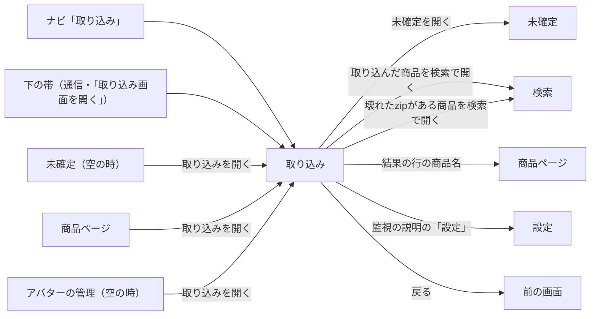

# 取り込み：目的ごとの操作の経路（2026-11-15・案）

入口：左のナビの「取り込み」／窓の一番下の通信の帯（押すと取り込み画面）／下の帯の「取り込み画面を開く」（ドロップした後）／未確定の空表示の「取り込みを開く」／アバターの管理の空表示の「取り込みを開く」／商品ページの見つからないファイルの「取り込みを開く」／起動時に商品が0件で未確定も無い時。監視の新着の下の帯の［取り込む］は、画面を移さずに始める。
確かめの窓のボタンは、窓の種類で「はい／いいえ」か「OK／キャンセル」（コードの MessageBox の種類から書いた。自前の窓の文言は見ていない [推測]）。OS の選ぶ窓のボタン名（「フォルダーの選択」）も [推測]。
コードを読んで書いた物で、画面で確かめていない。手数はクリック・キー・打つ（1語）・ドラッグをそれぞれ1。右クリックのメニューの子（▸）を開くのも1。
**頻度の列はユーザが付ける**（毎回／時々／まれ）。

場所：画面は縦1本のスクロールで、上から次の順に並ぶ。
上の帯＝画面の一番上の「取り込み」の題の行（戻るのボタン）／枠＝「フォルダかファイルをここにドロップ」の点線の枠／新着の知らせ＝枠の下の青い枠「新しいファイルが n 件あります」（監視フォルダに新着がある時だけ）／消えた監視の知らせ＝黄色の枠（監視フォルダが見つからない時だけ）／対象の欄＝「取り込み対象」の欄／監視の欄＝「監視フォルダ」の欄／探した結果の欄＝「見つからないファイルを探した結果」（探した後だけ）／履歴の欄＝「取り込み元の履歴」／進み具合の欄（取り込み中だけ）／裏の取得の欄＝「使っていない間の取得」（裏で取得している時だけ）／結果の欄＝「結果」（取り込みが終わった後）／展開先の欄＝「展開先とみなしたフォルダ」（見つかった時だけ）／右クリック＝各一覧の行の右クリック／窓＝確かめの窓・選ぶ窓／下の帯＝窓の一番下の帯（どの画面でも出る）

## 取り込む

| # | 目的 | 手順（画面の文言で） | 手数 | 場所 | 別の経路 | 頻度 |
|---|---|---|---|---|---|---|
| A1 | ダウンロードしたフォルダ・ファイルを取り込む | エクスプローラから窓の上へドラッグ（フォルダなら、窓「監視フォルダにしますか」で「はい」か「いいえ」） | 1〜2 | どの画面でも→窓 | 設定「ファイルやフォルダをドロップしたら、そのまま取り込みを始める」（既定は入）を切っていれば、続けて対象の欄の「開始」（+1）。取り込み画面以外で落とすと画面は移らず、下の帯に進み具合と「取り込み画面を開く」 | |
| A2 | フォルダを選んで取り込む | 枠の「フォルダを選択」→ 選ぶ窓でフォルダを選ぶ →「フォルダーの選択」→ 窓「監視フォルダにしますか」→ 対象の欄の「開始」 | 5 | 枠→窓→対象の欄 | A1。選んだだけでは始まらない（ドロップと違う） | |
| A3 | 前に取り込んだフォルダをもう一度取り込む | 履歴の欄の見出しの三角で開く（既定は閉じる・2026-11-18）→ 行の「対象に追加」→ 対象の欄の「開始」 | 3（開いていれば2） | 履歴の欄→対象の欄 | 履歴の行の右クリック →「取り込み対象に追加」（3）。設定にも「取り込み元の履歴」の一覧がある（追加は取り込み画面だけ） | |
| A4 | 取り込み中に、さらにフォルダを足す | ドロップする ／ 対象の欄に積んで「今の取り込みに追加」（実行中の「開始」の名前） | 1／2 | 枠・対象の欄 | 「n 件を今の取り込みに追加しました。」の1行が「開始」の下に出る | |
| A5 | 積んだ物を取り消す（まだ順番が来ていない分） | 対象の欄の行の「外す」 | 1 | 対象の欄 | 行の右クリック →「取り込み対象から外す」（2） | |
| A6 | 取り込みを止める | 進み具合の欄の右上の「中断」（この取り込みで新しく登録した商品があれば、窓「中断する」） | 1〜2 | 進み具合の欄→窓 | 対象の欄の「開始」の隣の「中断」。新しく登録した商品が無ければ窓は出ない | |
| A32 | 中断して、この取り込みで新しく登録した商品を消す | 「中断」→ 窓「中断して、この取り込みで新しく登録した n 件を削除する」 | 2 | 進み具合の欄→窓 | 止まり切ってから消し、結果を「開始」の下に出す（名前やメモを入れた商品は残す。ファイルは消さずに未確定に戻す。2026-11-19・open 119、未確定に戻すのは 2026-11-20） | ImportStackNotice |
| A7 | 前回止まった取り込みの続きをする | 対象の欄の青い枠の「続きから進む」 | 1 | 対象の欄 | 下の帯の「続きから進む」（どの画面でも）。押すとそのまま始まる | |
| A8 | 前回の続きをやめる（帯を消す） | 対象の欄の「続きを捨てる」→ 窓「取り込みの続きを捨てる」で「OK」 | 2 | 対象の欄→窓 | 下の帯の「続きを捨てる」。窓の既定はキャンセル | |
| A9 | 取り込みの進み・残り時間を見る | 進み具合の欄を見る（段・件数・バー・残りの見込み・減速中の黄色の枠） | 0 | 進み具合の欄 | 他の画面からは下の通信の帯を押すとここへ来る | |

## 監視フォルダ

| # | 目的 | 手順 | 手数 | 場所 | 別の経路 | 頻度 |
|---|---|---|---|---|---|---|
| A10 | よく使うフォルダを監視フォルダにする | フォルダをドロップ → 窓「監視フォルダにしますか」で「はい」 | 2 | 枠→窓 | 「フォルダを選択」で選んでも同じ窓が出る。取り込まずに監視だけなら監視の欄の見出しの「フォルダを追加…」（2・取り込み対象に入れない。中のまだ取り込んでいない数を言う）。フォルダビューの切り替え（聞かれない） | |
| A11 | 監視フォルダに増えたファイルを取り込む（知らせが出た時） | 新着の知らせの「取り込み対象に追加」→ 対象の欄の「開始」 | 2 | 新着の知らせ→対象の欄 | 監視の欄の「新しいファイルを取り込む」（1・そのまま始まる）。開いている間の監視が入なら下の帯の［取り込む］ | |
| A12 | 知らせが無くても、監視フォルダの新しいファイルを今取り込む | 監視の欄の「新しいファイルを取り込む」 | 1 | 監視の欄 | 結果はボタンの右の1行（「新しいファイルはまだ書き込み中です。」など） | |
| A13 | 監視フォルダの新着の知らせを黙らせる | 新着の知らせの「知らせなくてよい」 | 1 | 新着の知らせ | 下の帯の［×］も同じ。新しいファイルが増えればまた出る | |
| A14 | 監視をやめる | 監視の欄の行の「外す」 | 1 | 監視の欄 | 行の右クリック →「監視から外す」（2）。設定の「監視フォルダ」の「外す」。直後は下の帯の「監視を再開」で戻せる | |
| A15 | 監視フォルダを名前を変えた・移した後に付け直す | 監視の欄の行の「外す」→ 新しい場所をドロップ → 窓で「はい」 | 3 | 監視の欄→枠→窓 | 黄色の枠「名前を変えたか移したなら、監視から外して新しい場所をドロップしてください。」がこの手順を言う | |
| A16 | 起動時・開いている間に自動で取り込むようにする | 監視の欄の説明の文字リンク「設定」→ 設定でチェックを入れる | 2 | 監視の欄→設定 | ナビの「設定」から（同じ所） | |

## 見つからないファイル

| # | 目的 | 手順 | 手数 | 場所 | 別の経路 | 頻度 |
|---|---|---|---|---|---|---|
| A17 | 移した・名前を変えたファイルを商品に付け直す | 監視の欄の「見つからないファイルを探す…」→ 窓「見つからないファイルを探す」で探すフォルダのチェックを確かめる →「探す」 | 2〜3 | 監視の欄→窓 | 監視フォルダが既定でチェック済み。結果の要約はボタンの右の1行、中身は探した結果の欄 | |
| A18 | 監視していない場所も含めて探す | 「見つからないファイルを探す…」→ 窓の「フォルダを追加…」→ 選ぶ窓で選ぶ →「探す」 | 4〜5 | 監視の欄→窓→窓 | 足した場所はこの回だけ（監視には入らない） | |
| A19 | 付け直した・見つからなかったファイルを確かめる | 探した結果の欄の見出し（三角）を開く → 行を見る | 1 | 探した結果の欄 | 20件を超える見出しは畳んで出る。行に乗せると全部の場所の吹き出し | |
| A20 | 結果の商品を開いて確かめる | 探した結果の欄の行の商品名（下線の文字）を押す | 1 | 探した結果の欄→商品ページ | — | |
| A21 | 移したフォルダ（登録したフォルダ）を新しい場所に付け直す | 探した結果の欄の「見つからない登録フォルダ」の行の候補の「この場所にする」 | 1〜2 | 探した結果の欄 | 候補が無ければ、移した先を A18 で足して探し直す | |

## 結果から次へ

| # | 目的 | 手順 | 手数 | 場所 | 別の経路 | 頻度 |
|---|---|---|---|---|---|---|
| A22 | 取り込んだ商品を一覧で見る | 結果の欄の「取り込んだ商品を検索で開く」 | 1 | 結果の欄→検索 | ナビの「検索」で取り込み日の新しい順に並べる（2〜3） | |
| A23 | 商品が決まらなかったファイルを片付けに行く | 結果の欄の「未確定を開く」 | 1 | 結果の欄→未確定 | ナビの「未確定」（札に件数） | |
| A24 | 壊れたzipがある商品を確かめる | 結果の欄の「壊れたzipがある商品を検索で開く」 | 1 | 結果の欄→検索 | — | |
| A25 | 展開したフォルダを消して容量を空ける | 展開先の欄の行のチェック（か「選択を切り替え」）→「ごみ箱へ移動」→ 窓「展開先フォルダの削除」で「OK」 | 3〜 | 展開先の欄→窓 | 消した後の1行で「ごみ箱を空にすると ○○ 空きます。」 | |

## そのほか

| # | 目的 | 手順 | 手数 | 場所 | 別の経路 | 頻度 |
|---|---|---|---|---|---|---|
| A26 | 取り切れなかった画像・古くなった情報を今取る | 対象の欄の「足りない情報を取得」 | 1 | 対象の欄 | 起動時に自動で始まる（設定で切れる）。進み具合は裏の取得の欄と下の通信の帯 | |
| A27 | フォルダの場所をエクスプローラで開く | 対象・監視・履歴の欄の行の「エクスプローラで開く」 | 1 | 各欄 | 行の右クリック →「エクスプローラで開く」（2）。場所が無い時は押せず、吹き出しで理由 | |
| A28 | 履歴から行を消す | 履歴の欄の行の「消す」 | 1 | 履歴の欄 | 行の右クリック →「履歴から消す」（2）。設定の「取り込み元の履歴」の「外す」。直後は下の帯の「取り込み元に戻す」で戻せる | |
| A29 | 元の画面へ戻る | 上の帯の戻るのボタン | 1 | 上の帯 | Alt+←・マウスの戻るボタン | |
| A30 | 展開したフォルダの中のファイルを取り込む時に、元のzipで取り込む | （A1・A2 の後に出る）窓「展開先のファイル」で「はい」（zipに差し替える）か「いいえ」（そのまま） | 1 | 窓 | 自動で始めた時は聞かずにそのまま取り込み、通知に出す | |
| A31 | 積んだまま始めていない対象を始める（ほかの画面で対象に入れて移ってきた時など） | 対象の欄の上の帯「まだ始めていない対象が n 件あります」の［開始］ | 1 | 対象の欄 | 対象の欄の「開始」（一覧の全部を取り込む）。帯は取り込み中は出ない・起動をまたがない（2026-11-19・open 122） | ImportStartNotStarted |

## 画面の間の行き来

## 見るだけの部品

題の横の説明「フォルダやファイルをスキャンして、zipから商品IDを特定します」・枠の説明・取り込み対象と履歴の空表示・監視の欄の説明（設定で出し分け）・「新しいファイルを取り込む」と「見つからないファイルを探す…」の右の結果の1行・「開始」の下の積んだ知らせ・中断の文（「前回は n / N 件まで進んで中断しました」）・消えた監視の黄色の枠・進み具合（段・小さな段・件数・バー・「アプリを閉じても…」・残りの見込み3つ・今の詳細・減速中の黄色の枠）・裏の取得の欄（件数・バー・説明）・赤いエラーの枠・結果の欄（対応アバターの検出の青い枠・BOOTHに無かった物の黄色い枠・読めなかった物の黄色い枠・数のタイル9つ「スキャンしたファイル」「中身を確かめた」「確かめを省いた」「展開先として除外」「新規に取得」「取得済みだった」「未確定」「取得した画像」「管理済みで再掲せず」）・探した結果の欄の上の「探せなかった場所」の文・展開先の欄の選択の件数と大きさ・ごみ箱へ移した結果の行

## 部品の一覧

| 部品（画面の文言） | 場所 | 操作 | 起きる事 | 出る条件 | ID・ファイル:行 |
|---|---|---|---|---|---|
| 戻る（前の画面の名前） | 上の帯 | クリック | 前の画面へ | 戻れる時 | —・ImportView.xaml:43 |
| （窓全体へのドロップ） | どこでも | ドラッグ | 対象に積む（既定はそのまま始める）。フォルダなら監視を聞く | いつも | —・MainViewModel.Drop.cs:73 |
| フォルダを選択 | 枠 | クリック | 選ぶ窓（複数可）→ 対象に積む・監視を聞く。始めない | いつも | ImportChooseFolder・ImportView.xaml:63 |
| 取り込み対象に追加 | 新着の知らせ | クリック | 新着を対象に積む。始めない | 監視の新着がある時 | ImportTakeWatchedNew・ImportView.xaml:84 |
| 知らせなくてよい | 新着の知らせ | クリック | 今の顔ぶれを知らせない | 同上 | ImportDismissWatchedNew・ImportView.xaml:91 |
| 外す | 対象の欄の行 | クリック | 対象から外す（実行中なら未走査分を取り下げ） | 行がある時 | ImportFolderRemove・ImportView.xaml:148 |
| エクスプローラで開く | 対象・監視・履歴の欄の行 | クリック | 場所を開く | 行がある時。場所が無いと押せない | ImportRowReveal・ImportView.xaml:157・308・593 |
| 右クリック：エクスプローラで開く／取り込み対象から外す | 対象の欄の行 | 右クリック | 行のボタンと同じ | 同上 | —・ImportView.xaml:133・142 |
| 開始（実行中は「今の取り込みに追加」） | 対象の欄 | クリック | 対象を全部取り込む／今の取り込みに積む | 対象が1件以上 | ImportStart・ImportView.xaml:182 |
| 中断 | 対象の欄 | クリック | 取り込みを止める（確かめ無し） | 押せるのは実行中 | ImportCancel・ImportView.xaml:185 |
| 足りない情報を取得 | 対象の欄 | クリック | 裏の取得を今始める | いつも | ImportFetchMissing・ImportView.xaml:188 |
| 続きから進む | 対象の欄の青い枠 | クリック | 前回の対象を積んで始める | 中断した記録がある時 | ImportResume・ImportView.xaml:206 |
| 続きを捨てる | 対象の欄の青い枠 | クリック | 窓で聞いて記録を消す | 同上 | ImportDiscardInterrupted・ImportView.xaml:208 |
| 設定（文字リンク） | 監視の欄の説明 | クリック | 設定画面へ | 起動時の自動取り込みが切の時 | —・ImportView.xaml:237 |
| 新しいファイルを取り込む | 監視の欄 | クリック | 新着を探して、そのまま取り込む。横の文は画面を開いた時・窓が前に戻った時に件数を出す（2026-11-18） | 監視フォルダがある時押せる | ImportWatchedNow（「見つからないファイルを探す…」と同じ行。結果の文はボタンの下・2026-11-18） |
| 見つからないファイルを探す… | 監視の欄 | クリック | 窓「見つからないファイルを探す」 | 探している最中は押せない | ImportFindMissingFiles（起動時には走らない。起動時は見つからなくなった印の見回りと監視の新着を見つける所まで） |
| 外す | 監視の欄の行 | クリック | 監視をやめる（下の帯に「監視を再開」） | 行がある時 | ImportWatchedRemove・ImportView.xaml:300 |
| 右クリック：エクスプローラで開く／監視から外す | 監視の欄の行 | 右クリック | 行のボタンと同じ | 同上 | —・ImportView.xaml:287・296 |
| 見出し（三角）「紐付け直したファイル」「見つからなかったファイル」「見つからない登録フォルダ」 | 探した結果の欄 | クリック | 開く・畳む | 探した後 | （行ごと）・ImportView.xaml:384 |
| 商品名（下線） | 探した結果の欄の行 | クリック | 商品ページを開く | 同上 | ImportMissingResultItem・ImportMissingFolderItem・ImportView.xaml:431・472 |
| この場所にする | 探した結果の欄の登録フォルダの候補 | クリック | 登録フォルダの場所を差し替える | 候補がある時 | ImportUseFolderCandidate・ImportView.xaml:498 |
| 取り込み元の履歴（三角） | 履歴の欄の見出し | クリック | 履歴の欄を開く・畳む。既定は閉じる。設定の画面の同じ一覧と同じ値（2026-11-18） | いつも | ImportHistoryExpander |
| 対象に追加 | 履歴の欄の行 | クリック | 対象に積む。始めない | 行がある時 | ImportHistoryTake・ImportView.xaml:585 |
| 消す | 履歴の欄の行 | クリック | 履歴から消す（下の帯に「取り込み元に戻す」） | 同上 | ImportHistoryForget・ImportView.xaml:577 |
| 右クリック：エクスプローラで開く／取り込み対象に追加／履歴から消す | 履歴の欄の行 | 右クリック | 行のボタンと同じ | 同上 | —・ImportView.xaml:562〜572 |
| 中断 | 進み具合の欄 | クリック | 取り込みを止める | 取り込み中 | ImportProgressCancel・ImportView.xaml:625 |
| 未確定を開く | 結果の欄 | クリック | 未確定の画面へ | 未確定・BOOTHに無い物が残った時 | ImportOpenResolve・ImportView.xaml:760 |
| 壊れたzipがある商品を検索で開く | 結果の欄 | クリック | 検索（他の条件は外す） | 商品に壊れたzipがあった時 | ImportShowBrokenZip・ImportView.xaml:766 |
| 取り込んだ商品を検索で開く | 結果の欄 | クリック | 検索（取り込み日の新しい順・他の条件は外す） | 新しい商品が増えた時 | ImportShowAdded・ImportView.xaml:771 |
| （チェック） | 展開先の欄の行 | クリック | 選ぶ | 展開先が見つかった時 | ImportUnpackedSelect・ImportView.xaml:849 |
| 選択を切り替え | 展開先の欄 | クリック | すべて選ぶ／すべて外す | 同上 | ImportUnpackedToggleAll・ImportView.xaml:876 |
| ごみ箱へ移動 | 展開先の欄 | クリック | 窓「展開先フォルダの削除」で聞いて移す | 同上 | ImportUnpackedRemove・ImportView.xaml:879 |
| 窓「見つからないファイルを探す」：チェック・フォルダを追加…・探す・キャンセル | 窓 | クリック | 探す範囲を決めて探す | 「見つからないファイルを探す…」の後 | —・MissingSearchScopeDialog.xaml:48・58・61 |
| 窓「監視フォルダにしますか」：はい・いいえ | 窓 | クリック | 監視フォルダにする | フォルダを足した時（既定はいいえ） | —・ImportViewModel.cs:1065 |
| 窓「展開先のファイル」：はい・いいえ | 窓 | クリック | zipに差し替えるか | 展開したフォルダの中のファイルを人が取り込んだ時（既定ははい） | —・ImportViewModel.cs:1411 |

## 気付いた事

- 同じ事に経路が2つ以上ある物
  - 監視の新着を取り込む道が3つで、動きが違う：新着の知らせの「取り込み対象に追加」は積むだけ（続けて「開始」）、監視の欄の「新しいファイルを取り込む」と下の帯の［取り込む］はそのまま始まる。
  - 対象に積む道で、始まるかが違う：ドロップは既定で始まり、「フォルダを選択」と履歴の「対象に追加」は始まらない（「開始」が要る）。「続きから進む」は始まる。
  - 「中断」が2つ（対象の欄の「開始」の隣と、進み具合の欄の右上）。「続きから進む」「続きを捨てる」も対象の欄と下の帯の2か所。
  - 3つの一覧の行は、ボタンと右クリックが同じ操作を持つ。監視・履歴は設定画面にも一覧がある。
- 隠れて見つけにくい物
  - 窓全体へのドロップが一番短い道だが、取り込み画面以外の画面では何も書いていない（取り込み画面の枠だけが言う）。
  - 一覧の行の右クリック。どれも行のボタンにある物なので、隠れて困る物は無い。3つの一覧は矢印キーで行のボタンの間を移れる（どこにも書いていない）。
  - 「見つからないファイルを探す…」が「監視フォルダ」の欄の中にある。監視と関係なく使える（窓で場所を足せる）のに、監視フォルダの見出しの下に入っている。
  - 監視の欄の説明の「設定」は文の中の文字リンク。
- 手数が多い目的・端と端を行き来する目的
  - 欄の並びが「取り込み対象 → 監視フォルダ → 探した結果 → 取り込み元の履歴 → 進み具合 → 結果 → 展開先」。「開始」を押した後の進み具合と結果は、監視と履歴の一覧の下に出る。履歴が長いと、押した所から結果が画面の外になる（取り込みが一番多い流れで、上下に大きく動く）[推測]。
  - 履歴から取り込み直す（A3）は、履歴の欄の「対象に追加」から上の対象の欄の「開始」へ戻る。
  - フォルダを選んで取り込む（A2）は5手で、ドロップ（A1）の1手と大きく違う。
  - 監視の新着の知らせ（画面の上）から「取り込み対象に追加」を押した後、「開始」は下の対象の欄にある。
  - 展開先の欄は一番下。取り込みの結果を見た後にさらに下へ送らないと目に入らない。
- 文言の揺れ
  - 履歴の行を消すボタンは「消す」、右クリックは「履歴から消す」、消した後の下の帯は「「…」を取り込み元から外しました。」「取り込み元に戻す」、設定の同じ一覧のボタンは「外す」。
  - 済み（2026-11-18）：対象に入れる操作の語が「取り込み対象に入れる」（新着の知らせ）・「対象に追加」（履歴の行）・「取り込み対象に追加」（履歴の右クリック）・「今の取り込みに追加」（実行中の「開始」）と揺れていたのを、「追加」に揃えた（新着の知らせは「取り込み対象に追加」）。
  - 展開先の欄：説明は「削除して容量を戻せます」、ボタンは「ごみ箱へ移動」、窓の題は「展開先フォルダの削除」、選択の件数は「… を削除します。」。
  - 「選択を切り替え」（展開先の欄）は、未確定の「すべて選択」「選択を解除」と違う形。
  - 「スキャン」（題の説明・結果のタイル「スキャンしたファイル」）と「走査」「探す」が混ざる。題の説明の「商品IDを特定します」は、未確定の「商品IDで登録」と言い方が違う。
  - 「監視フォルダ」の欄の見出しと、窓「見つからないファイルを探す」の「探すフォルダ」で、同じ監視フォルダが別の呼び方で並ぶ（窓では種類の札「監視フォルダ」が付く）[推測]。
