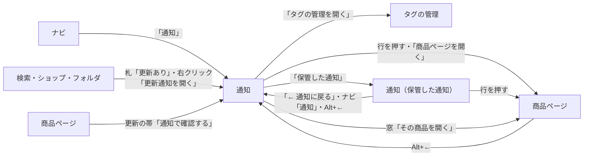

# 通知：目的ごとの操作の経路（2026-11-15・案）

入口はナビの「通知」（未読の数のバッジが付く）。ほかの画面からは、カード・リストの札「更新あり」、右クリックの「更新通知を開く」、商品ページの更新の帯の「通知で確認する」で、その商品を指した形で開く（その商品の行に色と左の縦線、「商品ページの変更」の束を一番上に送る）。
コードを読んで書いた物で、画面で確かめていない。手数はクリック・キー・打つ（1語）・ドラッグをそれぞれ1。右クリックのメニューの子（▸）を開くのも1。
**頻度の列はユーザが付ける**（毎回／時々／まれ）。

場所：
- 上の帯＝画面の一番上の「通知」の見出しと「未読 n 件 / 全 n 件」の行（右に「未読のみ」「読み直す」「すべて既読にする」「保管した通知」）
- 一覧の頭＝上の帯のすぐ下の1行（行のボタンが済んだ結果・画面を開いた時に見つけた事）と、取り込み中に出る青いボタンの帯
- 束の見出し＝種類ごとの枠の一番上（種類の名前・説明・件数の札・「この束を既読にする」）
- 行＝束の中の知らせ1件（左の既読の丸・商品の絵・題・札・日時）。行のボタン＝行に乗せた時か、キーで止まった時だけ日時の右に出る「商品ページを開く」と種類ごとの直すボタン
- 保管の帯＝「保管した通知」を押した後の一番上の行（「← 通知に戻る」・件数・月の欄・「商品名で絞る」欄）。窓＝確かめや選ぶ窓

## 読む

| # | 目的 | 手順（画面の文言で） | 手数 | 場所 | 別の経路 | 頻度 |
|---|---|---|---|---|---|---|
| A1 | 新しい知らせがあるか知る | ナビの「通知」のバッジの数を見る | 0 | ナビ | 上の帯の「未読 n 件 / 全 n 件」 | |
| A2 | 届いた知らせを読む | ナビの「通知」→ 束の見出しと行を読む | 1 | ナビ→一覧 | — | |
| A3 | 未読だけにする | 上の帯の「未読のみ」 | 1 | 上の帯 | （アプリを閉じても覚える） | |
| A4 | 束を開く・畳む | 束の見出しのどこかを押す | 1 | 束の見出し | キーで見出しに止まって Enter・Space | |
| A5 | 知らせの商品を開く | 行を押す | 1 | 行 | 行のボタン「商品ページを開く」（乗せてから押す）・行に止まって Enter | |
| A6 | 何がどう変わったかを見る | 行の札（「前 → 後」、説明文の行の「追加」「削除」）を読む | 0 | 行 | 商品ページの更新の帯 | |
| A7 | いつ起きたかを正確に知る | 行の日時（「3時間前」など）に乗せて吹き出しを読む | 1 | 行 | — | |
| A8 | ある商品の知らせだけを見に行く | ほかの画面でカードの札「更新あり」を押す | 1 | 検索・ショップ・フォルダ | 右クリック →「更新通知を開く」（2）・商品ページの「通知で確認する」（1）。指した商品は色付きの行と束の札「この商品 n」で見分ける | |
| A9 | 一覧を最新にする | 上の帯の「読み直す」 | 1 | 上の帯 | ナビの「通知」を押し直す（保管の見方の時だけ効く） | |
| A10 | 取り込み中に増えた商品を反映する | 一覧の頭の「取り込み中に n 件増えました。押すと一覧に反映します。」 | 1 | 一覧の頭 | 「読み直す」と同じ命令 | |

## 既読にする

| # | 目的 | 手順（画面の文言で） | 手数 | 場所 | 別の経路 | 頻度 |
|---|---|---|---|---|---|---|
| A11 | 1件を既読にする・未読に戻す | 行の左の丸を押す（吹き出し「既読にする」／「未読に戻す」） | 1 | 行 | 丸に止まって Enter・Space。ほかの画面のカードの右クリック「既読にする」（2）・商品ページの更新の帯の「既読にする」（1） | |
| A12 | 種類ごとにまとめて既読にする | 束の見出しの「この束を既読にする」 | 1 | 束の見出し | — | |
| A13 | 全部を既読にする | 上の帯の「すべて既読にする」 | 1 | 上の帯 | （未読が無い時は押せない） | |
| A14 | 選んだ何件かの商品の知らせを既読にする | 検索・フォルダで商品を選ぶ → 帯の「既読にする」 | 2〜 | ほかの画面 | この画面には行を選ぶ仕組みは無い | |

## 直す（知らせの種類ごと）

| # | 目的 | 手順（画面の文言で） | 手数 | 場所 | 別の経路 | 頻度 |
|---|---|---|---|---|---|---|
| A15 | 消えたユーザータグを作り直す・外す（タグの参照切れ） | 行に乗せる → 行のボタン「タグの管理を開く」→ タグの管理で直す | 2〜 | 行のボタン→タグの管理 | ナビの「タグの管理」 | |
| A16 | 展開したフォルダの代わりに zip で数える（zipを入手した） | 行に乗せる →「zipで登録しなおす」 | 2 | 行のボタン | zip を除外していた時は窓「除外を解除して…」→ OK（+1）。ほかの商品が持つ zip なら選ぶ窓（「その商品を開く」「この商品に付け直す」「両方に付ける」）（+1） | |
| A17 | 消えた・戻ったバリエーション、非公開から戻った商品の情報を取り直す | 行に乗せる →「商品情報を取り直す」 | 2 | 行のボタン | 商品ページの取り直し | |
| A18 | 読めなくなった商品の記録を直す | 行に乗せる →「1つ前の版に戻す」か「BOOTHから作り直す」→ 窓「OK」 | 3 | 行のボタン→窓 | 自分で JSON を開いて直す（画面に道は無い） | |
| A19 | 手で直した JSON の食い違いを直す | 束の説明「JSONを開いて直してください。」を読み、自分でファイルを開く | — | 束の見出し | 画面には直すボタンも、ファイルを開く道も無い | |
| A20 | 展開先から取り込んだファイルを、元の zip で持ち直す | 束の説明「元のzipの方で持ち直せます。」を読み、取り込み画面などで自分で行う | — | 束の見出し | 行に直すボタンは無い [推測] | |
| A21 | 途中で止まった ID・名前の変更を片付ける | 行を読む | — | 行 | 行に直すボタンは無い [推測] | |
| A22 | 直した後に結果を確かめる | 一覧の頭の1行（成功）か、押した行の日時の右（途中と失敗）を読む | 0 | 一覧の頭・行 | — | |

## 保管した古い知らせ

| # | 目的 | 手順（画面の文言で） | 手数 | 場所 | 別の経路 | 頻度 |
|---|---|---|---|---|---|---|
| A23 | 前に消えた（保管した）古い知らせを読む | 上の帯の「保管した通知」→ いちばん新しい月が新しい順に出る | 1 | 上の帯→一覧 | 流すと続きの100件を読む | |
| A24 | 別の月を見る | 保管の帯の月の欄 → 月を選ぶ | 2 | 保管の帯 | — | |
| A25 | 商品名で絞る | 保管の帯の「商品名で絞る」に打つ | 1 | 保管の帯 | — | |
| A26 | 保管した知らせの商品を開く | 行を押す | 1 | 行 | 商品ページから Alt+← で同じ月と絞りに戻る | |
| A27 | 今の通知に戻る | 保管の帯の「← 通知に戻る」 | 1 | 保管の帯 | ナビの「通知」・Alt+← | |

## 画面の間の行き来

「取得できる情報の形式の変化」「変換ツールのプロファイルの読み取り」の知らせはこの画面に出ず、ナビの「設定」の上の帯に出る（押すと説明の窓）。

## 見るだけの部品

上の帯の「通知」・「未読 n 件 / 全 n 件」（「全 n 件・未読なし」）・「既読にしても消えません」／一覧の頭の結果の1行と、開いた時の検出の文（「一覧に無いユーザータグを参照している商品を n 件見つけました。」）／束の見出しの種類の名前と説明・件数の札「重要 n」「この商品 n」（吹き出し「開いた商品の通知が、この束に n 件あります。」）「未読 n」「解消済み n」「n 件」・開閉の印／行の商品の絵・題・「重要」「解消済み」の札・変化の札（「前 → 後」・「追加」「削除」・「ほか n 行」）・日時・薄くした既読の行・指した商品の色と縦線／押した行の途中と失敗の文（「商品情報を取り直しています…」「取り直せませんでした。…」ほか）／空の時「通知はありません」「未読はありません」と「商品の更新、一覧との食い違い、BOOTH側の構造変化などがここに表示されます。」／保管の帯の「保管した通知」・「n 件」「n 件中 m 件」・月の見出しと「新しい順」・「この月の一部を読めなかったため、その分は表示していません。」・「読み込んでいます…」・空の時の文（「保管した通知はありません」「当てはまる通知はありません」ほか）・保管の行の「種類・日付」

## 部品の一覧

IV＝`Chmonos.App/Views/InboxView.xaml`、VM＝`Chmonos.App/ViewModels/InboxViewModel.cs`、AV＝`Chmonos.App/ViewModels/InboxArchiveViewModel.cs`。行番号は a9084801。

| 部品（画面の文言） | 場所 | 操作 | 起きる事 | 出る条件 | ID・ファイル:行 |
|---|---|---|---|---|---|
| ナビ「通知」（未読のバッジ） | ナビ | 押す | 今の通知を開く。保管の見方の時も今の通知へ | いつも | Nav.Inbox・MainWindow.xaml:528・MainViewModel.cs:101 |
| 「未読のみ」 | 上の帯 | 切り替え | 未読で未解消の行だけ。覚える（ui-state の inboxUnreadOnly） | 今の通知の時 | —・IV:267 |
| 「読み直す」 | 上の帯 | 押す | 知らせを読み直す | 今の通知の時 | —・IV:269・VM:381 |
| 「すべて既読にする」 | 上の帯 | 押す | 全部を既読に（確かめの窓は出ない） | 未読がある時だけ押せる | —・IV:270・VM:380 |
| 「保管した通知」（吹き出し「通知に残す件数を超えて保管した古い通知を、月ごとに表示します。」） | 上の帯 | 押す | 保管の見方で開き直す（画面の履歴に積む） | 今の通知の時 | InboxShowArchive・IV:273・VM:384 |
| 「取り込み中に n 件増えました。押すと一覧に反映します。」 | 一覧の頭 | 押す | 読み直す（「読み直す」と同じ） | 取り込み中に商品が増えた時 | —・IV:403-408 |
| 束の見出し（種類の名前・説明・件数の札） | 束の見出し | 押す | 束を開く・畳む（アプリを閉じるまで覚える） | 知らせがある種類ごと | InboxGroupToggle・IV:463 |
| 「この束を既読にする」（吹き出し「この種別の未読を、まとめて既読にします。」） | 束の見出し | 押す | その種類の未読を既読に | 束に未読がある時 | InboxGroupMarkRead・IV:537 |
| 行 | 行 | 押す・Enter | 商品ページを開く（既読にはしない）。商品が無ければ一覧の頭で言い、解消済みに | 商品を指す行だけ押せる（手の形） | InboxRow・IV:29-41・VM:1104 |
| 既読の丸（吹き出し「既読にする」／「未読に戻す」） | 行の左 | 押す | 既読⇄未読 | 今の通知の行（保管の行には無い） | InboxRowRead・IV:80-85 |
| 題・札の文字 | 行 | 選ぶ・押す | 文字を選んで写せる。空いた所を押すと商品を開く | いつも | SelectableLink・IV:137・153 |
| 「商品ページを開く」（吹き出し「このアプリの中で商品ページを開きます。」） | 行のボタン | 押す | 行を押すのと同じ | 乗せた時・行に止まった時、商品を指す行 | InboxRowOpenItem・IV:200 |
| 種類ごとの直すボタン：「タグの管理を開く」「zipで登録しなおす」「商品情報を取り直す」「1つ前の版に戻す」「BOOTHから作り直す」 | 行のボタン | 押す | タグの管理へ／zip を付けて展開フォルダを外す（窓が出る事あり）／BOOTH から取り直す（ファイルは落とさない）／控えに戻す・作り直す（窓） | 乗せた時・行に止まった時、その種類で未解消の行 | InboxRowAction・IV:206・VM:696-730 |
| 窓「zipで登録し直す」（除外の解除の確かめ・持ち主を選ぶ） | 窓 | 押す | OK で除外を解いて付ける／「その商品を開く」「この商品に付け直す」「両方に付ける」 | zip が除外中・ほかの商品が持つ時 | VM:934-951 |
| 窓「1つ前の版に戻す」「BOOTHから作り直す」 | 窓 | 押す | OK で実行 | 読めない商品の記録 | VM:762-782 |
| 「← 通知に戻る」 | 保管の帯 | 押す | 今の通知を開く（履歴に積む） | 保管の見方の時 | InboxLeaveArchive・IV:287・VM:385 |
| 月の欄（「2026年10月」など） | 保管の帯 | 選ぶ | その月を新しい順に読む | 保管した月がある時 | InboxArchiveMonth・IV:300 |
| 「商品名で絞る」の欄 | 保管の帯 | 打つ | 題で絞る（0.2秒待って） | 保管した月がある時 | InboxArchiveFilter・IV:305 |
| 保管の行 | 一覧 | 押す | 商品ページを開く。無ければ一覧の頭で「この商品は見つかりませんでした。…」 | 保管の見方の時 | InboxRow・VM:656・674 |
| 一覧を流す（保管の見方） | 一覧 | ホイール | 終わり近くで続きの100件を読む | 保管の見方の時 | InboxView.xaml.cs:29 |
| ↑↓・←→・Tab | 一覧 | キー | ↑↓ で行と束の見出しを渡る、←→ で行の中の丸とボタンへ | — | docs/spec/ui-keyboard.md:52・103 |
| Alt+← | どこでも | キー | 前の画面へ（保管の見方なら今の通知へ） | — | MainViewModel.History.cs:327 |

## 気付いた事

- 同じ事に経路が2つ以上ある物
  - 商品を開く：行を押す・Enter・行のボタン「商品ページを開く」の3つ。行のボタンは乗せないと出ないが、行そのものを押せば同じ事が起きる。
  - 既読：行の丸・束の「この束を既読にする」・上の帯の「すべて既読にする」に加え、ほかの画面のカードの右クリック「既読にする」・選択の帯の「既読にする」・商品ページの更新の帯の「既読にする」。
  - 今の通知へ戻る：「← 通知に戻る」・ナビの「通知」・Alt+←。「取り込み中に n 件増えました」と「読み直す」は同じ命令。
- 隠れて見つけにくい物
  - 直すボタン（「タグの管理を開く」「zipで登録しなおす」「商品情報を取り直す」など）は、行に乗せるかキーで止まった時だけ出る。
  - 行を押して商品を開いても既読にはならない。既読は左の小さな丸か束・全体のボタンだけ。
  - 「取得できる情報の形式の変化」など一部の知らせは、この画面ではなくナビの「設定」の上の帯に出る。
  - 保管した通知は上の帯の小さなボタンからだけ入れる。
- 手数が多い・端と端を行き来する物
  - 種類ごとの直すボタンは行の日時の右、束を既読は束の見出しの右、全部を既読は上の帯の右と、既読と直すの操作が縦に離れている。
  - 「手で直したJSONの食い違い」「読めない商品の記録」は、自分でファイルを開いて直すしかない場合があり、画面からファイルの場所を開く道が無い。「展開先のファイルを取り込んだ」「途中で止まった操作」も行に直すボタンが無い [推測]。
- 文言の揺れ
  - 行のボタン「zipで登録しなおす」と、窓の題「zipで登録し直す」（ひらがなと漢字）。
  - 同じ行き先の入口が「更新あり」（札）・「更新通知を開く」（右クリック）・「通知で確認する」（商品ページ）の3通り。カードの札のコメントにはまだ旧名の「要確認」が残る（画面には出ない）。
  - 種類の名前「消えたバリエーション」と、説明文の「バリエーションが、BOOTH側から消えました」、束の見出しの「種別」（「この種別の未読を…」）と「束」「種類」。
  - 上の帯の「既読にしても消えません」と、保管の説明「通知に残す件数を超えた古い既読の通知が、ここに月ごとに保管されます」（既読は件数を超えると一覧から消える）。
