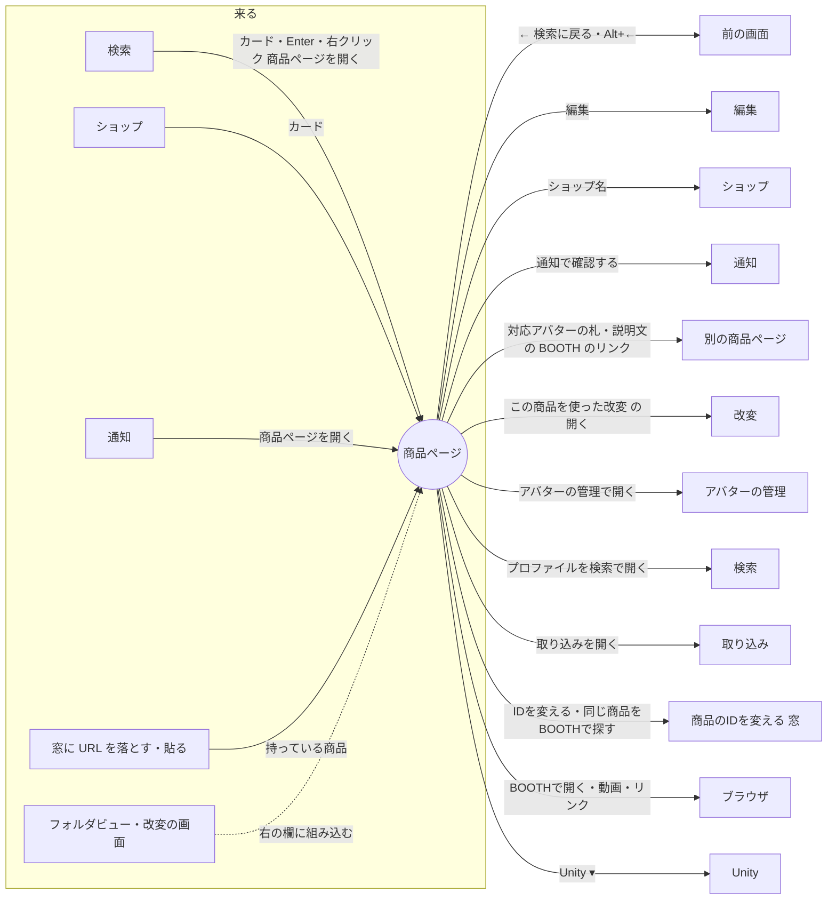

# 商品ページ：目的ごとの操作の経路（2026-11-15・案）

入口：検索のカード（押す・Enter・右クリック「商品ページを開く」）、ショップの画面のカード、通知の「商品ページを開く」、ほかの商品ページの対応アバターの札、BOOTH の商品 URL を窓に落とす・貼る（持っている商品）など。フォルダビューと改変の画面では、同じ画面が右の欄に組み込まれる（その時は「← …に戻る」が無い）。編集画面の左にも組み込まれる（その時メモは読むだけ）。
コードを読んで書いた物で、画面で確かめていない。手数はクリック・キー・打つ（1語）・ドラッグをそれぞれ1。右クリックのメニューの子（▸）を開くのも1。
**頻度の列はユーザが付ける**（毎回／時々／まれ）。

場所：
- 上の帯＝画面の一番上の行。左に「← 検索に戻る」（前の画面の名前が入る）とカテゴリ、右に「商品情報を取り直す」「ほかのソフト ▾」「編集」「BOOTHで開く」
- 更新の帯＝上の帯のすぐ下に出る1行。「BOOTHで変わったところ：」の帯と、使っている商品に新しい版が出た時の帯の2種類（無い時は出ない）
- 小さな見出し＝下へ流して商品名が見えなくなると上に重なる1行（小さな絵・星・商品名・ショップ名）
- 左の列＝ギャラリー（大きな絵・その下の小さな絵の並び）→「商品説明」→「動画」
- 名前の枠＝右の列の一番上の枠（星・商品名・ショップ名・ID・「IDを変える」・「ユーザータグ」・「BOOTHのタグ」）
- 右の列＝名前の枠から下の欄の重なり。上から「バリエーション」→「対応アバター」→「属性」→「メモ」→「ローカルファイル」→「この商品を使った改変」→「記録していること」
- 右クリック＝大きな絵・説明文とメモの字・対応アバターの札・変換の向きの字の右クリック
- 窓＝押した後に開く確かめや選ぶ窓

## 見る・読む

| # | 目的 | 手順（画面の文言で） | 手数 | 場所 | 別の経路 | 頻度 |
|---|---|---|---|---|---|---|
| A1 | 画像を順に見る | 大きな絵の左右の「‹」「›」 | 1 | 左の列 | 小さな絵を押す／← → キー（入力欄・リンクの上では効かない） | |
| A2 | 説明を読みやすく畳む・開く | 説明の見出しを押す | 1 | 左の列 | 「すべて折りたたむ」「すべて広げる」（見出しの右上）／「商品説明」の三角で欄ごと畳む | |
| A3 | 紹介の動画を見る | 「動画」の三角を押す → 動画の絵を押す → ブラウザ | 2 | 左の列 | 動画が無い商品は見出しに「…YouTube の動画はありません」と出て開けない | |
| A4 | 説明文のリンク先を見る | 説明文のリンクを押す（BOOTH の商品なら手元の商品ページか登録の問い。ほかはブラウザ） | 1 | 左の列 | 右クリック →「BOOTHで開く」「ブラウザで開く」「商品ページを開く」（2） | |
| A5 | ページの中の言葉を探す | Ctrl+F → 打つ → Enter（次へ） | 3 | どこでも | 畳んだ説明の中の一致は開いて見せる | |
| A6 | BOOTH のページで見る | 上の帯の「BOOTHで開く」 | 1 | 上の帯 | 手元だけの商品（仮ID）では押せない（吹き出しに理由） | |
| A7 | 同じショップの商品を見る | 名前の枠のショップ名を押す | 1 | 名前の枠 | 小さな見出しのショップ名 | |
| A8 | 対応アバター（共通素体）の商品を見る | 「対応アバター」の札を押す | 1 | 右の列 | 札の右クリック →「開く」（2）。札が多い商品は「アバター名で絞る（n 体）」に打ってから | |
| A9 | この商品を使った改変を見る | 「この商品を使った改変」の行の「開く」 | 1 | 右の列 | — | |
| A10 | 前の画面へ戻る | 上の帯の「← 検索に戻る」（前の画面の名前） | 1 | 上の帯 | Alt+← ・マウスの戻るボタン | |
| A11 | 見え方を整える（左右の幅・欄を畳む） | 左の列と右の列の境目をドラッグ | 1 | 左右の間 | 境目のダブルクリックで既定へ戻す。「ユーザータグ」「BOOTHのタグ」「属性」「バリエーション」「ローカルファイル」はそれぞれ三角で畳む。BOOTHのタグが多い時は「残り n を表示」 | |
| A12 | 商品名・説明の字を写す | 字をなぞって選ぶ → Ctrl+C | 2 | 名前の枠・左の列 | 右クリック →「コピー」。ファイルの場所は A26 | |

## 更新を確かめる

| # | 目的 | 手順（画面の文言で） | 手数 | 場所 | 別の経路 | 頻度 |
|---|---|---|---|---|---|---|
| A13 | BOOTH で変わった所へ飛ぶ | 更新の帯の変わった所の札（商品名・画像・「説明文：見出し」など）を押す | 1 | 更新の帯 | 入り切らない分は「ほか n 件 ▾」→ 項目（2） | |
| A14 | 変わる前と後を見比べる | 更新の帯の「通知で確認する」 | 1 | 更新の帯→通知 | — | |
| A15 | 変わった印を消す | 更新の帯の「既読にする」 | 1 | 更新の帯 | 開いただけでは消えない | |
| A16 | 使っている商品の新しい版を確かめる | 更新の帯の「更新履歴を見る」（説明の更新履歴まで流す）→ 読んで「確認した」 | 2 | 更新の帯 | 新しい版を取り込むと帯が消える | |
| A17 | 今の BOOTH の情報に取り直す | 上の帯の「商品情報を取り直す」 | 1 | 上の帯 | 結果はボタンの左の文。仮IDの商品は押せない | |
| A18 | 取れていない画像を先に取る | ギャラリーの下の「画像取得を優先」 | 1 | 左の列 | 画像が足りない時だけ出る | |
| A19 | BOOTH の変更を通知で受ける・受けない | 「記録していること」の「更新通知」のチェック | 1 | 右の列（一番下） | — | |

## 自分の記録を付ける

| # | 目的 | 手順（画面の文言で） | 手数 | 場所 | 別の経路 | 頻度 |
|---|---|---|---|---|---|---|
| A20 | お気に入りにする・外す | 商品名の前の星 | 1 | 名前の枠 | 小さな見出しの星 | |
| A21 | メモを書く | 「メモ」の欄を押す → 打つ（「押さなくても保存されます。」） | 2 | 右の列 | 編集画面の右の欄 | |
| A22 | タグ・属性・カテゴリ・購入記録を直す | 上の帯の「編集」→ 編集画面 | 1 | 上の帯→編集 | 取り込みの途中は押せず、上の帯に「取り込みの途中です。…」と出る。空の欄には「未設定。編集画面で付けられます。」 | |
| A23 | 検索とショップに出さない | 「記録していること」の「検索から除く」のチェック | 1 | 右の列（一番下） | 検索のカードの右クリック | |
| A24 | 改変に使ったと記録する | 「この商品を使った改変」の「改変に追加」→ 窓で改変を選ぶ | 2〜3 | 右の列→窓 | Unity へ送る時に A28 で一緒に | |

## 画像

| # | 目的 | 手順（画面の文言で） | 手数 | 場所 | 別の経路 | 頻度 |
|---|---|---|---|---|---|---|
| A25 | 自分の画像を足す | 小さな絵の並びの末尾の「＋」→ ファイルを選ぶ窓 →「開く」 | 3 | 左の列→窓 | 大きな絵の右クリック →「画像を追加…」／画像をページに落とす（BOOTH の画像なら「商品を開く」「画像として追加」を聞かれる）／貼り付け | |
| A26 | 一覧の絵（サムネイル）を決める | 大きな絵の右クリック →「この画像をサムネイルにする」 | 2 | 右クリック | 戻すのは「サムネイルの指名を外す」 | |
| A27 | 画像を並べ替える・役割を付ける・消す | 大きな絵の右クリック →「前へ移動」「後ろへ移動」／「役割：… ▸」→「BOOTH」「改変例」「その他」 | 2／3 | 右クリック | 消すのは大きな絵の下の「削除」か、右クリック →「この画像を削除」（確認あり）。並べ替えは自分で足した画像だけ | |

## ファイルと Unity

| # | 目的 | 手順（画面の文言で） | 手数 | 場所 | 別の経路 | 頻度 |
|---|---|---|---|---|---|---|
| A28 | Unity へ入れる | 「ローカルファイル」の unitypackage の行の「Unity ▾」→「Unityへ送る」 | 2 | 右の列 | 改変にも残すなら「改変に追加して送る」→ 窓（3）。送り先は欄の下の文（「送り先：Unityの「…」」）。止めるのは「中止」 | |
| A29 | Unity の中で入った場所を見る | 「Unity ▾」→「Unityで選択」 | 2 | 右の列 | 画像は「ローカルファイル」の見出しの「Unityで画像を選択…」 | |
| A30 | 手元のファイル・フォルダを開く | ファイル名・フォルダ名を押す（エクスプローラ） | 1 | 右の列 | 「開く ▾」→「エクスプローラで開く」（2）。同じ中身が別の場所にもある時は下の「同じ中身がある、ほかの場所」の「エクスプローラで開く」 | |
| A31 | zip の中を開く | 「開く ▾」→「一時的に展開して開く」 | 2 | 右の列 | — | |
| A32 | ファイルの場所をコピーする | 「開く ▾」→「パスをコピー」 | 2 | 右の列 | 名前に乗せると場所が吹き出しで出る（字は写せない） | |
| A33 | 別に持っているファイルをこの商品に付ける | 「ローカルファイル」の見出しの「追加…」→ 選ぶ窓 →「開く」 | 3 | 右の列→窓 | ファイルをページに落とす →「この商品に紐付ける」（2）。ほかの商品が持つ物なら窓で選び直す | |
| A34 | 違うファイルを外す・戻す | ファイルの行の「外す」／外した行の「この商品に戻す」 | 1 | 右の列 | フォルダの行の「外す」は登録を外す。上書きされた行は「古い版の記録を片付ける」 | |
| A35 | 見つからなくなったファイルを付け直す | 「見つかりません」の札の横の「取り込みを開く」→ 移した先のフォルダを取り込む | 1+ | 右の列→取り込み | — | |

## 対応アバター・変換

| # | 目的 | 手順（画面の文言で） | 手数 | 場所 | 別の経路 | 頻度 |
|---|---|---|---|---|---|---|
| A36 | 推定の対応アバターを確かめる | 札の ✓ | 1 | 右の列 | 全部なら「すべて確認済みにする」／札の右クリック →「確認済みにする」 | |
| A37 | 違う対応アバターを外す・戻す | 札に乗せて出る × → 押す | 1 | 右の列 | 札の右クリック →「外す」。戻すのは「消したもの n 件」→「戻す」（2） | |
| A38 | 対応アバターを手で足す | 「＋ 追加」→ 名前を打つ → 選ぶ | 3 | 右の列 | 説明文に名前がある共通素体は「説明文にある共通素体」の「追加」（1）。やめるのは「閉じる」 | |
| A39 | 判定し終えた対応アバターを出す | 説明の文の横の「表示する」 | 1 | 右の列 | 開いている間に裏の判定が終わった時だけ出る | |
| A40 | この商品をアバターとして扱う | 「記録していること」の「アバター」の「アバターとして登録」 | 1 | 右の列（一番下） | 登録済みなら「アバターの管理で開く」「プロファイルを検索で開く」。手で登録した物は「登録を外す」 | |
| A41 | 変換（プロファイル）の扱いを決める | 「変換扱い」の「自動の判定」「扱う」「扱わない」 | 1 | 右の列（一番下） | つなぎ先の ✓・×、向きの字の右クリック →「順方向」「逆方向」「両方向」、つなぎ先が無ければ入力欄で選ぶ。プロファイルを持つ商品だけ出る | |

## 商品そのもの

| # | 目的 | 手順（画面の文言で） | 手数 | 場所 | 別の経路 | 頻度 |
|---|---|---|---|---|---|---|
| A42 | 商品IDをコピーする | 名前の枠の「ID …」を押す | 1 | 名前の枠 | — | |
| A43 | 中身を別のIDの商品へ移す | 「IDを変える」→ 窓で ID か URL を打つ →「調べる」→「この内容で移す」 | 4 | 名前の枠→窓 | — | |
| A44 | BOOTH から消えた商品の出し直しを探す | 「同じ商品をBOOTHで探す」→ 窓（自動で探す）→ 候補の「これで調べる」→「この内容で移す」 | 3 | 名前の枠→窓 | BOOTH で見つからない商品だけ出る。窓の「自動検索」でやり直し | |
| A45 | 説明文に並んだ商品をまとめて登録する | 説明の字をなぞって選ぶ → 右クリック →「選んだ範囲の商品をまとめて登録…」→ 窓で「n 件を登録」 | 4 | 左の列→右クリック→窓 | リンク1つなら、リンクの右クリック →「商品として登録…」→ 窓 | |
| A46 | ほかのソフトに渡す | 上の帯の「ほかのソフト ▾」→ 項目 | 2 | 上の帯 | ほかのソフトが足した時だけ出る | |

## 画面の間の行き来

## 見るだけの部品

カテゴリ（上の帯）・「商品情報を取り直す」の結果の文・取り込み中の理由の文・更新の帯の文・小さな見出し・画像の何枚目か・画像の札（「サムネイル」「自分」「削除済」・★・役割）・自分の画像や消えた画像の説明文・前の商品名の帯・変わった所の札（色の帯）・手元だけの商品の注意・「BOOTHで見つからない」注意・ユーザータグとBOOTHのタグの札・バリエーションと価格と購入の札・属性の値の棒・メモの「保存しました」の文・ファイルの札（「フォルダ」「壊れたzip」「外したファイル」「見つかりません」「取り外しているドライブ」「確かめられません」「古い版」・バリエーション・容量・重複）・zip が入ったフォルダの注意・「同じ中身のファイルは1件として数え…」・Unity の送り先の文・「記録していること」の入手日・最終取得・次回更新予定・アバター検出・BOOTHでの販売・アバターの登録の状態・変換扱いの状態と出どころ・欄ごとの結果の1行（ID・ファイル・ギャラリー・対応アバター・検索から除く）。

## 部品の一覧

| 部品（画面の文言） | 場所 | 操作 | 起きる事 | 出る条件 | ID・ファイル:行 |
|---|---|---|---|---|---|
| 「← 検索に戻る」（前の画面名） | 上の帯 | クリック | 前の画面へ | 組み込みでない時 | —・ItemView.xaml:109 |
| 「商品情報を取り直す」 | 上の帯 | クリック | BOOTH から取り直す | いつも（仮IDは押せない） | ItemRefresh・ItemView.xaml:126 |
| 「ほかのソフト ▾」 | 上の帯 | クリック → 項目 | ほかのソフトの操作 | 足したソフトがある時 | ItemPluginMenu・ItemView.xaml:133 |
| 「編集」 | 上の帯 | クリック | 編集画面へ | いつも（取り込み中は押せない） | ItemEdit・ItemView.xaml:137 |
| 「BOOTHで開く」 | 上の帯 | クリック | ブラウザ | いつも（仮IDは押せない） | ItemOpenBooth・ItemView.xaml:140 |
| 「更新履歴を見る」 | 更新の帯（新しい版） | クリック | 説明の更新履歴まで流す | 使っている商品に新しい版 | ItemShowUpdateHistory・ItemView.xaml:162 |
| 「確認した」 | 更新の帯（新しい版） | クリック | 帯を消す | 同上 | ItemCheckContentUpdate・ItemView.xaml:168 |
| 変わった所の札 | 更新の帯（BOOTH の変更） | クリック | その所へ流す | 未読の変更がある時 | ItemChangeTarget・ItemView.xaml:225 |
| 「ほか n 件 ▾」 | 更新の帯 | クリック → 項目 | その所へ流す | 札が入り切らない時 | ItemMoreChanges・ItemView.xaml:245 |
| 「通知で確認する」 | 更新の帯 | クリック | 通知の画面へ | 未読の変更がある時 | ItemShowChangesInInbox・ItemView.xaml:265 |
| 「既読にする」 | 更新の帯 | クリック | 印を消し通知も既読 | 同上 | ItemMarkChangesRead・ItemView.xaml:271 |
| 左右の境目 | 左右の列の間 | ドラッグ・ダブルクリック | 左の列の幅 | 幅を変えられる時 | —・ItemView.xaml:330 |
| 大きな絵 | 左の列 | 右クリック | 画像のメニュー | 画像がある時 | —・ItemGalleryPanel.xaml:88 |
| 「前へ移動」「後ろへ移動」 | 大きな絵の右クリック | クリック | 自分の画像の順 | 自分の画像（ほかは押せない） | —・ItemGalleryPanel.xaml:92,94 |
| 「この画像をサムネイルにする」「サムネイルの指名を外す」 | 大きな絵の右クリック | クリック | 一覧の絵の指名 | いつも | —・ItemGalleryPanel.xaml:102,105 |
| 「役割：… ▸」→「BOOTH」「改変例」「その他」 | 大きな絵の右クリック | クリック | 画像の役割 | いつも | —・ItemGalleryPanel.xaml:122-133 |
| 「この画像を削除」 | 大きな絵の右クリック | クリック → 確認 | 画像を消す | いつも | —・ItemGalleryPanel.xaml:138 |
| 「画像を追加…」 | 大きな絵の右クリック | クリック → 窓 | 画像を足す | いつも | —・ItemGalleryPanel.xaml:143 |
| 「‹」「›」 | 大きな絵の左右 | クリック | 前・次の画像 | 前・次がある時 | GalleryPrevious／GalleryNext・ItemGalleryPanel.xaml:187,194 |
| 「＋」 | 小さな絵の並びの末尾 | クリック → 窓 | 画像を足す | いつも | GalleryAdd・ItemGalleryPanel.xaml:214 |
| 小さな絵 | 左の列 | クリック | その画像を大きく | 画像がある時 | GalleryTile・ItemGalleryPanel.xaml:232 |
| 「削除」 | 大きな絵の下 | クリック → 確認 | 画像を消す | 画像がある時 | GalleryRemoveImage・ItemGalleryPanel.xaml:303 |
| 「画像取得を優先」 | ギャラリーの下 | クリック | この商品の画像を先に取る | 取れていない画像がある時 | GalleryFetchImages・ItemGalleryPanel.xaml:325 |
| 「商品説明」の三角 | 左の列 | クリック | 欄を畳む | いつも | ItemDescriptionExpander・ItemView.xaml:352 |
| 説明の見出し | 左の列 | クリック | その節を畳む | 見出しのある説明 | ItemSectionHeader・ItemView.xaml:409 |
| 「すべて折りたたむ」「すべて広げる」 | 「商品説明」の右上 | クリック | 全部の節 | 見出しのある説明 | ItemToggleAllSections・ItemView.xaml:501 |
| 説明文・メモの字とリンク | 左の列・右の列 | クリック・なぞる・右クリック・中クリック | リンクを開く（中クリックはいつもブラウザ）・コピー・登録 | 説明・メモがある時 | —・Controls/TextMenu.cs |
| 「動画」の三角・動画の絵 | 左の列 | クリック | 欄を開く・ブラウザで YouTube | 動画がある時 | ItemVideosExpander／ItemVideoOpen・ItemVideosPanel.xaml:25,41 |
| 星 | 名前の枠 | クリック・Enter | お気に入り | いつも | ItemFavorite・ItemView.xaml:570 |
| 商品名 | 名前の枠 | なぞる | 選んで写す | いつも | ItemName・ItemView.xaml:590 |
| ショップ名 | 名前の枠 | クリック・なぞる・中クリック | ショップの画面へ（中クリックは BOOTH のショップのページ） | いつも | ItemShopLink・ItemView.xaml:610 |
| 「ID …」 | 名前の枠 | クリック・中クリック | ID をコピー（中クリックは BOOTH の商品ページ） | いつも | ItemIdCopy・ItemView.xaml:624 |
| 「IDを変える」 | 名前の枠 | クリック → 窓 | 商品のIDを変える窓 | いつも | ItemChangeId・ItemView.xaml:632 |
| 「同じ商品をBOOTHで探す」 | 名前の枠 | クリック → 窓 | 自動で探す | BOOTH で見つからない商品 | ItemFindOnBooth・ItemView.xaml:667 |
| 「ユーザータグ」「BOOTHのタグ」の三角 | 名前の枠 | クリック | 畳む | いつも | ItemUserTagsExpander／ItemBoothTagsExpander・ItemView.xaml:681,715 |
| 「残り n を表示」 | BOOTHのタグ | クリック | 全部出す・戻す | タグが多い時 | —・App.xaml:629 |
| 「バリエーション」の三角 | 右の列 | クリック | 畳む | バリエーションがある時 | ItemVariationsToggle・ItemView.xaml:746 |
| 「対応アバター」の三角 | 右の列 | クリック | 畳む | いつも | ItemAvatarsExpander・ItemAvatarsPanel.xaml:79 |
| 「すべて確認済みにする」 | 対応アバター | クリック | 全部確認済み | 確認待ちがある時 | ItemAvatarConfirmAll・ItemAvatarsPanel.xaml:100 |
| 「表示する」 | 対応アバター | クリック | 判定した結果を出す | 開いている間に判定が終わった時 | ItemShowDetectedAvatars・ItemAvatarsPanel.xaml:119 |
| 「アバター名で絞る（n 体）」 | 対応アバター | 打つ | 札を絞る | 札が多い時 | —・ItemAvatarsPanel.xaml:141 |
| 対応アバターの札・✓・× | 対応アバター | クリック・右クリック（「開く」「確認済みにする」「外す」） | 開く・確かめる・外す | 対応アバターがある時。× は乗せた時 | ItemAvatarChip／ItemAvatarConfirm／ItemAvatarReject・ItemAvatarsPanel.xaml:202,36,48,57-65 |
| 共通素体の札・× | 対応アバター | クリック | 開く・外す | 共通素体がある時 | ItemAvatarViaBaseChip／ItemAvatarBaseReject・ItemAvatarsPanel.xaml:215,336 |
| 変換経由の札 | 対応アバター | クリック・右クリック「開く」 | 開く | 変換経由がある時 | ItemAvatarViaConversionChip・ItemAvatarsPanel.xaml:364 |
| 「＋ 追加」・入力欄・「閉じる」 | 対応アバター | クリック → 打つ | 手で足す | いつも | ItemAvatarAdd／ItemAvatarAddInput／ItemAvatarAddClose・ItemAvatarsPanel.xaml:279,298,304 |
| 「説明文にある共通素体」の「追加」・× | 対応アバター | クリック | 足す・候補を消す | 説明文に候補がある時 | ItemBaseMentionAdd／ItemBaseMentionDismiss・ItemAvatarsPanel.xaml:422,430 |
| 「消したもの n 件」・「戻す」 | 対応アバター | クリック | 外した物を戻す | 外した物がある時 | ItemRejectedAvatarsExpander／ItemRejectedAvatarRestore・ItemAvatarsPanel.xaml:445,462 |
| 「属性」の三角 | 右の列 | クリック | 畳む | いつも | ItemAttributesExpander・ItemView.xaml:851 |
| 「メモ」の欄 | 右の列 | 打つ | 自動で保存 | 商品ページの時（編集画面の中では読むだけ） | ItemMemo・ItemView.xaml:904 |
| 「ローカルファイル」の三角 | 右の列 | クリック | 畳む | いつも | ItemFilesToggle・ItemFilesPanel.xaml:177 |
| 「Unityで画像を選択…」 | ローカルファイルの見出し | クリック | Unity で画像を選ぶ | 選べる画像がある時 | ItemSelectImageInUnity・ItemFilesPanel.xaml:192 |
| 「追加…」 | ローカルファイルの見出し | クリック → 窓 | ファイルを紐付ける | いつも | ItemAttachFiles・ItemFilesPanel.xaml:199 |
| フォルダ名・「開く ▾」（「エクスプローラで開く」「パスをコピー」） | フォルダの行 | クリック | 開く・コピー | フォルダがある時 | ItemFolderName／ItemFolderOpenMenu・ItemFilesPanel.xaml:231,240 |
| 「取り込みを開く」 | フォルダ・ファイルの行 | クリック | 取り込みの画面へ | 見つからない時 | ItemFolderImportLink／ItemFileImportLink・ItemFilesPanel.xaml:268,361 |
| フォルダの「外す」 | フォルダの行 | クリック | フォルダの登録を外す | フォルダがある時 | ItemFolderUnregister・ItemFilesPanel.xaml:286 |
| ファイル名・「開く ▾」（「エクスプローラで開く」「パスをコピー」「一時的に展開して開く」） | ファイルの行 | クリック | 開く・コピー・展開 | ファイルがある時（展開は zip） | ItemFileName／ItemFileOpenMenu・ItemFilesPanel.xaml:315,414-441 |
| 「外す」「この商品に戻す」 | ファイルの行 | クリック | 未確定へ戻す・付け直す | 外せる時／外した行 | ItemFileDetach／ItemFileReattach・ItemFilesPanel.xaml:456,472 |
| 「古い版の記録を片付ける」 | ファイルの行 | クリック | 行を消す | 古い版の行 | ItemFileForgetOldVersion・ItemFilesPanel.xaml:464 |
| ほかの場所の「エクスプローラで開く」「パスをコピー」 | ファイルの行の下 | クリック | 開く・コピー | 同じ中身が別の場所にある時 | ItemFileOtherPathOpen／ItemFileOtherPathCopy・ItemFilesPanel.xaml:498,504 |
| 「Unity ▾」（「Unityへ送る」「改変に追加して送る」「Unityで選択」） | unitypackage の行 | クリック → 項目 | Unity へ送る・選ぶ | unitypackage がある時 | ItemPackageUnityMenu・ItemFilesPanel.xaml:121-142 |
| 「中止」 | ローカルファイルの下 | クリック | 送るのをやめる | 送っている間 | ItemUnityStop・ItemFilesPanel.xaml:546 |
| 「改変に追加」 | この商品を使った改変 | クリック → 窓 | 改変に記録 | いつも | ItemAddToModification・ItemView.xaml:958 |
| 改変の行の「開く」 | この商品を使った改変 | クリック | 改変の画面へ | 記録がある時 | ItemUsedInModificationOpen・ItemView.xaml:989 |
| 「検索から除く」 | 記録していること | チェック | 検索・ショップに出さない | いつも | ItemHidden・ItemView.xaml:1045 |
| 「更新通知」 | 記録していること | チェック | 変更を通知に出す | いつも | ItemNotifyOnUpdate・ItemView.xaml:1057 |
| 「アバターとして登録」「アバターの管理で開く」「プロファイルを検索で開く」「登録を外す」 | 記録していること | クリック | 登録・画面へ | 登録の状態による | ItemRegisterAvatar／ItemOpenInAvatars／ItemShowProfiles／ItemUnregisterAvatar・AvatarRegistrationPanel.xaml:34-51 |
| 「自動の判定」「扱う」「扱わない」 | 変換扱い | クリック | 変換の扱い | プロファイルを持つ商品 | ItemConversionMode.Auto／.Profile／.NotProfile・ItemConversionPanel.xaml:35-48 |
| 向きの字（右クリック「順方向」「逆方向」「両方向」「既定に戻す」） | 変換扱い | 右クリック | つなぐ向き | つなぎ先がある時 | ItemConversionDirection・ItemConversionPanel.xaml:73-87 |
| つなぎ先（右クリック「確認済みにする」「外す」）・✓・× | 変換扱い | クリック・右クリック | 確かめる・外す | つなぎ先がある時 | ItemConversionTarget／ItemConversionConfirm／ItemConversionRemove・ItemConversionPanel.xaml:97-128 |
| つなぎ先を選ぶ入力欄 | 変換扱い | 打つ → 選ぶ | つなぎ先を決める | つなぎ先が無い時 | ItemConversionChoose・ItemConversionPanel.xaml:134 |
| 外したつなぎ先の「戻す」 | 変換扱い | クリック | 戻す | 外した物がある時 | ItemConversionRejectedExpander／ItemConversionRestore・ItemConversionPanel.xaml:160,174 |
| 小さな見出しの星・ショップ名 | 小さな見出し | クリック・中クリック | お気に入り・ショップへ（ショップ名の中クリックは BOOTH） | 商品名が流れ去った時 | ItemCompactFavorite／ItemCompactShopLink・ItemCompactBar.xaml:31,64 |
| キー：Ctrl+F・← →・Alt+← | どこでも | キー | ページ内検索・画像送り・戻る | いつも | —・docs/spec/ui-keyboard.md |
| ページにファイル・画像・URL を落とす | どこでも | ドラッグ | 紐付けるか取り込むか・画像として足すかを聞く | いつも | —・ViewModels/MainViewModel.Drop.cs:166,290 |

## 気付いた事

- 同じ事に経路が2つ以上ある物
  - 画像を消す：大きな絵の下の「削除」と、右クリックの「この画像を削除」。ほかの画像の操作（サムネイル・並べ替え・役割）は右クリックだけなのに、削除だけが常に見えるボタンになっている
  - 画像を足す：小さな絵の「＋」・右クリックの「画像を追加…」・落とす・貼り付けの4つ
  - ファイルを開く：名前を押す と「開く ▾」→「エクスプローラで開く」（同じ動き）
  - 改変に記録する：「この商品を使った改変」の「改変に追加」と、「Unity ▾」→「改変に追加して送る」
  - 星とショップ名：名前の枠と小さな見出しの2か所
  - 対応アバターの確認・外す：札の ✓・×、右クリック、「すべて確認済みにする」
- 隠れて見つけにくい物
  - 画像のサムネイル指名・並べ替え・役割は大きな絵の右クリックだけ（絵の上に何も書いていない）
  - 説明文から商品をまとめて登録する（A45）は、字をなぞってから右クリックしないと出ない
  - 対応アバターの札の × は乗せた時（または Tab で止まった時）だけ出る
  - 変換の向きは字の右クリックだけで変えられる
  - 境目のダブルクリックで幅が戻る事・← → で画像が送れる事は画面に書いていない
  - 「動画」は既定で畳んであり、開くまで何本あるかだけが見出しに出る [推測]
- 手数が多い・端と端を行き来する物
  - 「記録していること」（検索から除く・更新通知・アバターとして登録・変換扱い）は右の列の一番下で、長い商品ではファイルの欄と改変の欄を越えて流す必要がある。更新の帯（一番上）と「更新通知」のチェック（一番下）が離れている
  - 画像の操作は左の列、Unity で画像を選ぶ（「Unityで画像を選択…」）は右の列の「ローカルファイル」の見出しにある
  - IDを変える（A43）・出し直しを探す（A44）・まとめて登録（A45）は窓を通って4手前後
  - Unity へ送る（A28）は「Unity ▾」の中で2手。検索のカードからだと右クリック → ▸ → 窓で5手なので、商品ページの方が短い
- 文言の揺れ
  - 外す系の名前：ファイルの「外す」（未確定へ戻す）・フォルダの「外す」（登録を外す）・対応アバターの「外す」（違う対応として除く）・アバターの「登録を外す」・変換の「外す」が同じ語で違う事をする
  - 戻す系：「この商品に戻す」・「戻す」（消したもの・外したつなぎ先）・「サムネイルの指名を外す」
  - 隠す：商品ページは「検索から除く」、検索の右クリックは「非表示」系 [推測：検索画面の文言は search.md の R16 を参照]。吹き出しは「検索とショップに表示しなくなります。」で、名前より範囲が広い
  - 消した物の見出し：対応アバターは「消したもの n 件」、ボタンの吹き出しは「外します」「違う候補として消します」で、外す・消すが混ざる