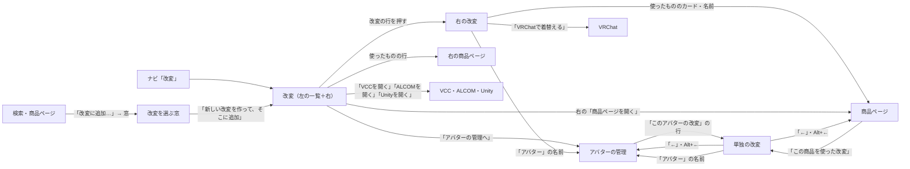

# 改変：目的ごとの操作の経路（2026-11-15・案）

入口はナビの「改変」（検索の下）。改変1件の詳しい内容は、この画面の右に組み込んで出す（以下「右の改変」）。同じ中身を単独の画面（以下「単独の改変」）でも開ける。単独の改変へは、アバターの管理の「このアバターの改変」の行と、商品ページの「この商品を使った改変」から来る。
コードを読んで書いた物で、画面で確かめていない。手数はクリック・キー・打つ（1語）・ドラッグをそれぞれ1。右クリックのメニューの子（▸）を開くのも1。
**頻度の列はユーザが付ける**（毎回／時々／まれ）。

場所：
- 左の上＝左の欄の一番上の「改変」の字の下の、「Unityプロジェクト｜アバター｜改変」の切り替えと、その下の探す欄・「すべて畳む」「すべて広げる」・「新しい版が出たものだけ（n）」
- 左の一覧＝その下の木の形の一覧（見出し＝プロジェクトかアバター、その中に改変、その中に使ったもの）
- 右＝左で押した物の詳細（プロジェクト・アバター・右の改変・使ったものの商品ページ）
- 改変の上の帯＝右の改変（単独の改変）の一番上の行。日付と、組み込んだ時だけ「複製…」「削除」、単独の時だけ左に「←」
- 改変の左の列＝写真の大きな絵と並び、「使ったものを追加」の欄（「使ったものを商品名で探して追加」と「紐付けたプロジェクトの中から探す」）、「使ったもの」の欄（見出しで畳める）
- 改変の右の列＝「アバター」「改変の名前」「VRChatのblueprint ID」「Unityプロジェクト」「紐付ける先」「記録した時のVPM」「メモ」
- 右クリック＝行・写真・カードの右クリックのメニュー
- 窓＝確かめの窓・ファイルを選ぶ窓・送る先を選ぶ窓

## 探す・見る

| # | 目的 | 手順（画面の文言で） | 手数 | 場所 | 別の経路 | 頻度 |
|---|---|---|---|---|---|---|
| A1 | プロジェクトごと・アバターごと・改変だけで並べ替えて見る | 「Unityプロジェクト」「アバター」「改変」のどれかを押す | 1 | 左の上 | 前の見方を覚えていて、次に開いた時もその見方 [推測] | |
| A2 | 名前で改変を探す | 探す欄（例「改変名・アバター名・プロジェクト名から探す」）に打つ | 1 | 左の上 | 欄の文言は見方で替わる | |
| A3 | 新しい版が出た物を使っている改変だけ見る | 「新しい版が出たものだけ（n）」にチェック | 1 | 左の上 | 行の「新しい版あり」の札を見て回る。該当が0件の時はチェックが出ない | |
| A4 | 一覧を畳む・広げる | 「すべて畳む」／「すべて広げる」（押すたび1段ずつ） | 1〜 | 左の上 | 行ごとは左の三角 | |
| A5 | 改変の中身を見る | 改変の行（絵か名前）を押す | 1 | 左の一覧→右 | 単独の改変：アバターの管理の改変の行、商品ページの「この商品を使った改変」 | |
| A6 | 改変に使った物を覗く | 改変の行の左の三角 → 使ったものの行を押す | 2 | 左の一覧→右 | 右の改変の「使ったもの」のカード・行を押す（商品ページへ移る） | |
| A7 | 使った商品のページを見る | 左の一覧の使ったものの行を押す（右に商品ページが組み込まれる） | 1〜2 | 左の一覧→右 | 手元に無い商品は右に要約。そこの「商品ページを開く」 | |
| A8 | その商品を使った別の改変を探す | 使ったものの行を押す →「この商品を使った改変（n）」を広げる | 2 | 左の一覧→右 | 手元に無い商品は「この商品を使った改変」の欄がはじめから見えている | |
| A9 | プロジェクトの状態（版・VPM・最後に触った日）を見る | 「Unityプロジェクト」→ プロジェクトの見出しを押す | 2 | 左の上→左の一覧→右 | 改変の行のプロジェクトの名前を押す（右に出る） | |
| A10 | アバターごとの改変の数・所有を見る | 「アバター」→ アバターの見出しを押す | 2 | 左の上→左の一覧→右 | 改変の行のアバターの名前を押す | |
| A11 | 左の一覧の幅を替える | 左と右の境目をドラッグ | 1 | 境目 | 境目のダブルクリックで戻す [推測] | |

## 改変を作る・消す

| # | 目的 | 手順 | 手数 | 場所 | 別の経路 | 頻度 |
|---|---|---|---|---|---|---|
| A12 | 改変を作る | 「アバター」→ アバターの見出しの「改変を作る…」→ 窓に名前を打って Enter | 3 | 左の上→左の一覧→窓 | 右のアバターの「新しい改変…」（同じ窓）。アバターの管理の「このアバターの改変」に打って「作る」。検索・商品ページの「改変に追加…」の窓の「新しい改変を作って、そこに追加」 | |
| A13 | 似た改変を写して作る | 改変の行を右クリック →「複製…」→ 元の名前が選ばれた窓で名前を打って Enter | 3 | 右クリック→窓 | 右の改変の上の帯の「複製…」。単独の改変には無い | |
| A14 | 改変の名前を変える | 右の改変の「改変の名前」に打つ（打ち終えると残る） | 1 | 改変の右の列 | — | |
| A15 | 改変を消す | 改変の行を右クリック →「削除…」→ 窓で OK | 3 | 右クリック→窓 | 右の改変の上の帯の「削除」。単独の改変には「削除」が無い。改変の画面へ移ってから消す | |
| A16 | 改変のアバターの設定（名前・素体）を直しに行く | 右の改変の「アバター」の名前を押す | 1 | 改変の右の列→アバターの管理 | アバターの見出しの「アバターの管理へ」・右の「アバターの管理へ」 | |
| A17 | 次に作る時の注意を残す | 右の改変の「メモ」に打つ（打ち終えると残る） | 1 | 改変の右の列 | — | |

## 使ったものを記録する

| # | 目的 | 手順 | 手数 | 場所 | 別の経路 | 頻度 |
|---|---|---|---|---|---|---|
| A18 | 使った商品を足す（名前で） | 「使ったものを商品名で探して追加」に打つ → 候補を押す →（ファイルが2つ以上なら窓で選ぶ） | 2〜4 | 改変の左の列（写真の下）→窓 | 検索・商品ページの「改変に追加…」→ 窓で改変を選ぶ。Unity へ送りながら足すのは検索の右クリック「Unity」▸「改変に追加して送る…」 | |
| A19 | 使った商品をプロジェクトの中身から拾う | 「プロジェクトの中を調べる」→ 候補の「追加」 | 2 | 改変の左の列（写真の下） | プロジェクトを紐付けている時だけ出る。見つかった商品は見出しで畳める | |
| A20 | 入れた順を並べ替える | 「移動 ▾」→ カードは「前へ移動」「後ろへ移動」、リストは「上へ移動」「下へ移動」 | 2〜 | 改変の左の列 | ドラッグでは動かない [推測] | |
| A21 | 見せる順を逆にする（最後に入れた物を上に） | 「逆の順」 | 1 | 改変の左の列の見出しの右 | 戻すのは「入れた順」。記録と送る順は替わらない | |
| A22 | 使った物の見え方を替える | 見出しの右のカード／リストの切り替え ／ 右下の大きさのつまみをドラッグ | 1 | 改変の左の列・右下 | — | |
| A23 | 使わなくなった物を外す（戻せる） | 行の「外す」 | 1 | 改変の左の列 | 戻すのは同じ行の「戻す」 | |
| A24 | 外した物を完全に消す | 外した行の「削除」→ 窓で OK | 2 | 改変の左の列→窓 | — | |
| A25 | 使ったファイル（zip・unitypackage）を選び直す | 行の「Unity ▾」→「使ったファイルを選び直す…」→ 窓で選ぶ | 3〜 | 改変の左の列→窓 | 左の一覧の使ったものの行を右クリック →「使ったファイルを選び直す…」 | |
| A26 | 使った物に新しい版が出た時に、今の版のまま使うと決める | 「更新 ▾」→「新しい版を確認した」 | 2 | 改変の左の列 | 「新しい版あり」の札がある行だけ | |
| A27 | 使った物を新しい版に替える | 「更新 ▾」→「新しい版を送る…」→（1つに決まらなければ窓で選ぶ）→ 確認の窓で OK → Unity の取り込み画面 | 3〜 | 改変の左の列→窓 | 同上。入った時だけ記録が替わる | |
| A28 | 使った物を手元で開く・編集する・お気に入りにする | カード・行を右クリック → 検索と同じ項目 | 2〜 | 右クリック | カード・名前を押すと商品ページへ | |

## Unity とプロジェクト

| # | 目的 | 手順 | 手数 | 場所 | 別の経路 | 頻度 |
|---|---|---|---|---|---|---|
| A29 | 改変を記録した順に Unity へ入れ直す | 「使ったものを順にUnityへ送る」→（送る先の窓・確かめの窓）[推測] | 1〜3 | 改変の左の列→窓 | 止めるのは「中止」（送っている間だけ出る） | |
| A30 | 使った物を1件だけ Unity へ送る | 行の「Unity ▾」→「Unityへ送る」 | 2〜 | 改変の左の列 | 検索の右クリック「Unity」▸「Unityへ送る…」 | |
| A31 | 使った物がプロジェクトのどこにあるか示す | 左の一覧の使ったものの行の「Unityで選択」 | 1 | 左の一覧 | 行の「Unity ▾」→「Unityで選択」／使ったものを押した右の帯の「Unityで選択」。入っていなければ送るか聞く | |
| A32 | 改変にプロジェクトを紐付ける | 右の改変の「紐付ける先」の行の「紐付ける」（替える時は窓で OK） | 1〜2 | 改変の右の列 | 一覧に無ければ「読み直す」 | |
| A33 | 紐付けを外す | 右の改変の「Unityプロジェクト」の「外す」→ 窓で OK | 2 | 改変の右の列→窓 | — | |
| A34 | プロジェクトの Unity を開く | 「Unityプロジェクト」の見出しの「Unityを開く」 | 1〜2 | 左の一覧 | 見出しの右クリック「Unityを開く」／右のプロジェクトの「Unityを開く」／右の改変の「Unityプロジェクト」の「Unityを開く」 | |
| A35 | プロジェクトのフォルダを開く | プロジェクトの見出しを右クリック →「エクスプローラで開く」 | 2 | 右クリック | 見出しを押して右の「エクスプローラで開く」／右の改変の「Unityプロジェクト」の「エクスプローラで開く」 | |
| A36 | 移したプロジェクトの場所を付け替える | プロジェクトの見出しを右クリック →「場所を付け替える…」→ フォルダを選ぶ窓 | 3〜 | 右クリック→窓 | 見つからない時だけ、見出しと右に「場所を付け替える…」のボタン。右の改変の「紐付ける先」から指し直す | |
| A37 | VCC か ALCOM を開く | 「VCCを開く」か「ALCOMを開く」 | 1 | 左の上 | 「Unityプロジェクト」の見方の時だけ出る | |
| A38 | 記録した時の VPM と今を比べる | 右の改変の「記録した時のVPM」を見る | 0 | 改変の右の列 | 今の VPM はプロジェクトの見出しを押した右の「VPM」 | |

## 写真・VRChat

| # | 目的 | 手順 | 手数 | 場所 | 別の経路 | 頻度 |
|---|---|---|---|---|---|---|
| A39 | 改変の写真を足す | 並びの末尾の「＋」→ ファイルを選ぶ窓 | 2〜 | 改変の左の列（上）→窓 | 写真を窓に落とす／Ctrl+V で貼る／写真の右クリック →「画像を追加…」 | |
| A40 | 写真を見て回る | 「‹」「›」／小さな絵を押す | 1 | 改変の左の列（上） | ← → キー | |
| A41 | 写真の順を替える・サムネイルにする | 写真を右クリック →「前へ移動」「後ろへ移動」／「この画像をサムネイルにする」 | 2 | 右クリック | 外すのは「サムネイルの指名を外す」 | |
| A42 | 写真を消す | 大きな絵の下の「削除」→ 窓で OK | 2 | 改変の左の列（上）→窓 | 写真の右クリック →「この画像を削除」 | |
| A43 | VRChat をこの改変のアバターに着替える | 「VRChatのblueprint ID」に avtr_… を貼る（初回だけ）→「VRChatで着替える」 | 1（2回目から） | 改変の右の列 | ID が空の時は押せない | |

## 戻る

| # | 目的 | 手順 | 手数 | 場所 | 別の経路 | 頻度 |
|---|---|---|---|---|---|---|
| A44 | 単独の改変から元の画面へ戻る | 改変の上の帯の「←（元の画面）」 | 1 | 改変の上の帯 | Alt+←・マウスの戻る | |

## 画面の間の行き来

（「改変を選ぶ窓」から改変の画面へ移るかは確かめていない [推測]）

## 見るだけの部品

右が空の時の文「左の一覧から、プロジェクト・アバター・改変・使ったものを押すと、ここに表示されます。」／一覧が空の時の文（見方ごと・探して0件・新しい版の絞り込み）／左の欄の下の状態の1行（「Unityで選択」の途中経過など）／VCC・ALCOM の結果の行／見出しの「開いている」・件数・所有の文・「新しい版が出た物を使っている数」の札／改変の行のメモの1行・件数／使ったものの行のファイル名・「新しい版あり」「手元にありません」／右のプロジェクトの「状態」「バージョン」「情報元」「最後に触った日」／右のアバターの所有と素体の札／右の商品ページの上の帯の「「…」で使ったファイル：」・種類・入る場所／改変の上の帯の作った日・更新日と失敗の文／「使ったもの」の並びの説明の文と結果の知らせ／Unity へ送っている間の文／番号・「外した」の札／blueprint ID の説明と警告／「このフォルダが見つかりません。…」／紐付ける先の「開いています」「見つかりません」「紐付け中」／写真の「サムネイル」の札・枚数

## 部品の一覧

左の一覧と右のプロジェクト・アバター・商品は ModificationHubView.xaml、右の改変と単独の改変は ModificationView.xaml、写真は ItemGalleryPanel.xaml。

| 部品（画面の文言） | 場所 | 操作 | 起きる事 | 出る条件 | ID・ファイル:行 |
|---|---|---|---|---|---|
| Unityプロジェクト／アバター／改変 | 左の上 | 押す | 見方を替える | いつも | ModificationHubLevel.*・Hub:853-867 |
| VCCを開く／ALCOMを開く | 左の上 | 押す | VCC・ALCOM を起動 | プロジェクトの見方で、入っている方 | Hub:883・888 |
| 探す欄 | 左の上 | 打つ | 一覧を絞る | いつも | Hub:919 |
| すべて畳む／すべて広げる | 左の上 | 押す | 全部畳む／1段ずつ広げる | いつも。広げ切ると「すべて広げる」は押せない | ModificationsCollapseAll・ModificationsExpandAll・Hub:926-929 |
| 新しい版が出たものだけ（n） | 左の上 | チェック | 新しい版の出た改変だけ | 該当がある時・入れている間 | ModificationsOnlyBehind・Hub:948 |
| 左右の境目 | 境目 | ドラッグ | 左の幅を替える | いつも | Hub:838 |
| 左の一覧を畳むつまみ（‹ ›） | 境の線の右上 | クリック | 左の一覧を畳む（縦の見出しの帯だけ）・広げる。畳んだかは次の起動にも残る（次のバージョンから） | いつも | ModificationHubView.xaml・PaneCollapseToggle |
| プロジェクトの見出し（行・名前） | 左の一覧 | 押す | 右にプロジェクト | プロジェクトの見方 | ModificationsProjectLink・Hub:339 |
| プロジェクトの見出しの三角 | 左の一覧 | 押す | 畳む・広げる | 同上 | ModificationsProjectToggle・Hub:327 |
| Unityを開く（見出し） | 左の一覧 | 押す | Unity を開く・手前に出す | 同上・プロジェクトの見出し | ModificationsProjectOpenUnity・Hub:330 |
| 場所を付け替える…（見出しのボタン） | 左の一覧 | 押す | フォルダを選ぶ窓 | フォルダが見つからない時 | ModificationsProjectRelocate・Hub:369 |
| 見出しの右クリック「Unityを開く」「エクスプローラで開く」 | 右クリック | 押す | Unity・フォルダを開く | プロジェクトの見出し。見つからないと押せない | ProjectRowMenu.OpenUnity・ProjectRowMenu.OpenFolder・Hub:318 |
| 見出しの右クリック「場所を付け替える…」 | 右クリック | 押す | 同上 | プロジェクトの見出し | ProjectRowMenu.Relocate・Hub:315 |
| アバターの見出し（絵・名前） | 左の一覧 | 押す | 右にアバター | アバターの見方 | ModificationsAvatarImage・ModificationsAvatarLink・Hub:408・449 |
| アバターの見出しの三角 | 左の一覧 | 押す | 畳む・広げる | 同上 | ModificationsAvatarToggle・Hub:406 |
| 改変を作る…（見出し） | 左の一覧 | 押す | 右にアバターを出し、名前を窓で聞いて作り、右に開く | 同上 | ModificationsAvatarCreate・ModificationNameDialog |
| アバターの管理へ（見出し） | 左の一覧 | 押す | アバターの管理へ | 同上 | ModificationsAvatarManage・Hub:444 |
| 改変の行（行・絵・名前） | 左の一覧 | 押す | 右の改変 | いつも | ModificationsModImage・ModificationsModLink・Hub:218-254 |
| 改変の行の三角 | 左の一覧 | 押す | 使ったものを畳む・広げる | いつも | ModificationsModToggle・Hub:223 |
| 改変の行のアバター名／プロジェクト名 | 左の一覧 | 押す | 右にアバター／プロジェクト | その見方でない時 | ModificationsModAvatarLink・ModificationsModProjectLink・Hub:261・268 |
| 改変の行の右クリック「複製…」 | 右クリック | 押す | 元の名前を入れた窓で名前を聞き、写した改変を作って右に開く | いつも | ModificationRowMenu.Duplicate |
| 改変の行の右クリック「削除…」 | 右クリック | 押す | 窓で確かめて消す（写真も消える） | いつも | ModificationRowMenu.Delete・Hub:215 |
| 使ったものの行（行・絵・名前） | 左の一覧 | 押す | 右に商品ページか要約 | 改変を広げた時 | ModificationsMemberImage・ModificationsMemberLink・Hub:122-174 |
| Unityで選択（左の行） | 左の一覧 | 押す | プロジェクトで場所を示す。無ければ送るか聞く | 同上 | ModificationsMemberSelectInUnity・Hub:133 |
| 使ったものの行の右クリック「使ったファイルを選び直す…」 | 右クリック | 押す | ファイルを選ぶ窓 | 同上 | ModificationsMemberMenu.Repick・Hub:116 |
| 右のプロジェクトの「VPM」の三角・「外したもの」 | 右 | 押す | 前の版・外した物を広げる | プロジェクトを押した時 | ModificationsDetailVpm・Hub:578・613 |
| Unityを開く／エクスプローラで開く／場所を付け替える…（右のプロジェクト） | 右 | 押す | 開く・付け替える | プロジェクトを押した時。見つからないと前の2つは押せず、3つ目が出る | ModificationsDetailOpenUnity・ModificationsDetailOpenFolder・ModificationsDetailRelocate・Hub:627-636 |
| アバターの管理へ／商品ページを開く（右のアバター） | 右 | 押す | アバターの管理へ／商品ページへ | アバターを押した時（商品ページは手元にある時） | ModificationsDetailAvatarManage・ModificationsDetailOpenItemPage・Hub:690・694 |
| 新しい改変…（右のアバターの「このアバターの改変」の上） | 右 | 押す | 名前を窓で聞いて作り、右に開く（窓の欄で Enter） | アバターを押した時 | ModificationsDetailCreate・ModificationNameDialog |
| Unityで選択（右の商品の帯） | 右 | 押す | 場所を示す | 手元にある使ったものを押した時 | ModificationsItemSelectInUnity・Hub:738 |
| この商品を使った改変（n） | 右 | 押す | 広げる | 同上 | Hub:751 |
| 商品ページを開く／Unityで選択（手元に無い商品） | 右 | 押す | 商品ページへ／場所を示す | 手元に無い使ったものを押した時 | ModificationsMissingOpenItemPage・ModificationsMissingSelectInUnity・Hub:786・789 |
| ←（元の画面の名前） | 改変の上の帯 | 押す | 前の画面へ | 単独の改変だけ | ModificationView.xaml:69 |
| 複製… | 改変の上の帯 | 押す | 元の名前を入れた窓で名前を聞き、写した改変を作って右に開く | 右の改変だけ | ModificationDuplicate |
| 削除（改変） | 改変の上の帯 | 押す | 窓で確かめて消す（写真も消える） | 右の改変だけ | ModificationView.xaml:102 |
| ‹ ／ › ／小さな絵／＋ | 改変の左の列（上） | 押す | 写真を送る・選ぶ・足す | いつも（写真が無い時は案内） | GalleryPrevious・GalleryNext・GalleryTile・GalleryAdd・ItemGalleryPanel.xaml:187-232 |
| 削除（写真） | 改変の左の列（上） | 押す | 窓で確かめて消す | 写真がある時 | GalleryRemoveImage・ItemGalleryPanel.xaml:303 |
| 写真の右クリック（前へ移動・後ろへ移動・この画像をサムネイルにする・サムネイルの指名を外す・役割 ▸ BOOTH／改変例／その他・この画像を削除・画像を追加…） | 右クリック | 押す | 並べ替え・サムネイル・役割・削除・追加 | 写真がある時 [推測：役割は改変でも出るか未確認] | ItemGalleryPanel.xaml:92-143 |
| 窓への落とし込み／Ctrl+V | 窓全体 | ドラッグ・キー | 写真を足す | いつも | ModificationView.xaml:10・ModificationView.xaml.cs:93 |
| カード／リスト | 使ったものの見出しの右 | 押す | 形を替える | 使ったものがある時 | ModificationView.xaml:168 |
| 入れた順／逆の順 | 同上 | 押す | 見せる順だけ替える | 同上 | MemberOrder.Insert・MemberOrder.Reverse・ModificationView.xaml:179・187 |
| 使ったものを順にUnityへ送る | 同上 | 押す | 入れた順に1件ずつ取り込み画面を出す | いつも | ModificationView.xaml:200 |
| 中止 | 使ったものの見出しの下 | 押す | 送るのをやめる | 送っている間 | ModificationView.xaml:209 |
| 使ったもののカード・名前 | 改変の左の列 | 押す・中クリック・右クリック | 商品ページ・BOOTH・検索と同じメニュー | いつも | ModificationMemberLink・ModificationView.xaml:240・423 |
| 移動 ▾（カードは前へ移動・後ろへ移動、リストは上へ移動・下へ移動） | 改変の左の列 | 押す | 入れた順を動かす（端では押せない方が灰色） | 使ったものがある時 | ModificationMemberMoveMenu・MemberMoveBack・MemberMoveForward |
| Unity ▾（Unityへ送る・Unityで選択・使ったファイルを選び直す…） | 改変の左の列 | 押す | 送る・示す・選び直す（外した行は選び直しだけ） | いつも | ModificationMemberUnityMenu.*・ModificationView.xaml:315-328・490-503 |
| 外す／戻す／削除（使ったもの） | 改変の左の列 | 押す | 外す（戻せる）／戻す／窓で確かめて消す | 外すは使っている行、戻す・削除は外した行 | ModificationMemberRemove・ModificationMemberRestore・ModificationMemberDelete・ModificationView.xaml:332-345・507-519 |
| 更新 ▾（新しい版を送る…・新しい版を確認した） | 改変の左の列 | 押す | 新しい版を確認して送り、入った時だけ記録を替える／今の版のまま使う | 新しい版がある行（カード・リスト） | ModificationMemberUpdateMenu・ModificationMemberSendNewVersion・ModificationMemberCheckUpdate |
| リストの列の見出し（順・★・名前・操作） | 改変の左の列 | ドラッグ | 列の幅を替える | リストの時 | ModificationView.xaml:381-470 |
| 大きさのつまみ | 右下 | ドラッグ | カード・行の大きさ | 使ったものがある時 | ModificationView.xaml:115 |
| 左の列と右の列の境目 | 改変 | ドラッグ | 左の列の幅 | 広げられる時 | ModificationView.xaml:136 |
| 使ったものを商品名で探して追加 | 改変の左の列（写真の下・「使ったもの」の上） | 打つ・選ぶ | 足す（ファイルが2つ以上なら窓） | いつも | ModificationAddMember |
| 使ったもの（見出しの山形）・見つかった商品 n 件 | 改変の左の列 | 押す | 一覧を畳む・開く（アプリを閉じるまで覚える） | 使ったもの：いつも、見つかった商品：調べて1件以上の時 | ModificationMembersToggle・ModificationFoundToggle |
| プロジェクトの中を調べる／候補の「追加」 | 改変の左の列（下） | 押す | プロジェクトのファイルと手元を比べる／足す | プロジェクトを紐付けた時 | ModificationCandidateAdd・ModificationView.xaml:549・595 |
| アバターの名前 | 改変の右の列 | 押す | アバターの管理で開く | いつも | ModificationOpenAvatar・ModificationView.xaml:620 |
| 改変の名前 | 改変の右の列 | 打つ | 打ち終えると残る | いつも | ModificationView.xaml:648 |
| VRChatのblueprint ID／VRChatで着替える | 改変の右の列 | 打つ・押す | ID を残す／VRChat へ着替えの合図 | いつも。ID が空なら押せない | ModificationView.xaml:664-670 |
| Unityを開く／エクスプローラで開く／外す（Unityプロジェクト） | 改変の右の列 | 押す | 開く／窓で確かめて紐付けを外す | 紐付けている時 | ModificationView.xaml:714-719 |
| 読み直す／紐付ける | 改変の右の列 | 押す | 候補を読み直す／紐付ける（替える時は窓） | いつも（紐付けは今のと違う行） | ModificationProjectLink・ModificationView.xaml:733・815 |
| メモ | 改変の右の列 | 打つ | 打ち終えると残る | いつも | ModificationView.xaml:875 |

## 気付いた事

- **同じ事に経路が2つ以上ある物**
  - 改変を作る：左のアバターの見出しの「改変を作る…」と右のアバターの「新しい改変…」（同じ名前の窓）、アバターの管理の「作る」、「改変に追加…」の窓の「新しい改変を作って、そこに追加」の4つ。
  - 複製：改変の行の右クリックと、改変の上の帯の「複製…」。
  - Unityで選択：左の使ったものの行、右の商品の帯、手元に無い商品の右、改変の「Unity ▾」の中の4か所。
  - 使ったファイルを選び直す：左の使ったものの行の右クリックと、改変の「Unity ▾」の中。
  - Unity を開く：左のプロジェクトの見出し、右のプロジェクト、右の改変の「Unityプロジェクト」の3か所。
  - 場所を付け替える：見出しの右クリック、見つからない時の見出しと右のボタン、右の改変の「紐付ける先」（指し直し）。
- **隠れて見つけにくい物**
  - 単独の改変（アバターの管理・商品ページから開いた時）には「複製」「削除」が無い。消すには改変の画面へ移って同じ改変を探し直す。
  - 使ったファイルの選び直しは、右クリックか「Unity ▾」の中だけ。「Unity ▾」の中にあるのは名前から読めない。
  - 写真の足し方のうち、窓に落とす・Ctrl+V は、写真が0枚の時の案内（「…ここへドロップするか、Ctrl+Vで貼ってください。」）にだけ書いてある。1枚入った後は見えない。
  - 「新しい版が出たものだけ（n）」は、該当が1件以上の時だけ出る。
  - プロジェクトの見出しの「場所を付け替える…」は右クリックの中（見つかる時はここにしか無い）。
- **手数が多い・画面を行き来する目的**
  - 改変を作る（A12）は「改変」の見方からは作れない（空の時の文も「アバター」の見方へ誘う）。
  - 改変を消す（A15）は、単独の改変からだと、改変の画面へ移る → 探す → 押す → 削除 → 窓、と長い。
  - 使った物を足す時、検索から来るなら「改変に追加…」の窓（窓で改変を選ぶ）、改変から足すなら写真の下の「使ったものを追加」の欄（2026-11-18 に使ったものの一覧の下から上へ移した）。
  - プロジェクトの紐付けは右の列の下の方、写真は左の列の上、使ったものは左の列の中ほど。1つの改変を作り終えるまでに、左右と上下を何度も行き来する。
- **文言の揺れ**
  - 「改変」が、ナビの名前・左の上の字・切り替えの1つ・行の種類の4か所で同じ語。
  - 改変を作るボタン：「改変を作る…」（左の見出し）・「新しい改変…」（右）と「作る」（アバターの管理）。
  - 外す：使ったものの「外す」（戻せる）、プロジェクトの「外す」（紐付けを外す）。
  - 削除：改変の「削除」（上の帯）と、使ったものの「削除」（外した行だけ）、写真の「削除」。
  - 「手元にありません」（左の一覧の行）、「手元に無い」（リストの札）、「手元にありません。記録は残っています。」（カードと右）。
  - プロジェクトの状態：「開いている」（見出し）、「開いています」（紐付ける先）。
  - 新しい版：「新しい版あり」（札）、「新しい版が出たものだけ」（チェック）、「更新 ▾」の「新しい版を送る…」「新しい版を確認した」（メニュー）。「出た物」と「出たもの」の書き分けも揺れる（吹き出し「新しい版が出た物を使っている数です。」）。
  - 「アバターの管理へ」（ここ）と「アバターの管理で開く」（商品ページ）。
