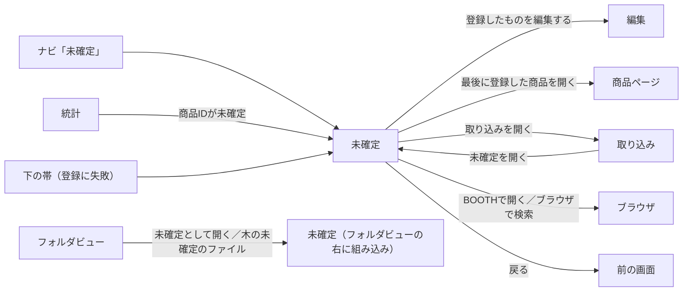

# 未確定：目的ごとの操作の経路（2026-11-15・案）

入口：左のナビの「未確定」（札に件数）／取り込みの結果の「未確定を開く」／統計の「商品IDが未確定」の行／下の帯の「「…」を登録できませんでした。」の「未確定を開く」／起動時に商品が0件で未確定がある時。フォルダビューの「未確定として開く」と、木で未確定のファイルを押した時は、フォルダビューの右に組み込んだ形で出る（上の帯と左の一覧が無い）。
コードを読んで書いた物で、画面で確かめていない。手数はクリック・キー・打つ（1語）・ドラッグをそれぞれ1。右クリックのメニューの子（▸）を開くのも1。
**頻度の列はユーザが付ける**（毎回／時々／まれ）。
確かめの窓のボタン名「OK／キャンセル」はコードの MessageBox の種類から書いた（自前の窓の文言は見ていない [推測]）。OS の選ぶ窓の「開く」・画像の「×」も [推測]。

場所：上の帯＝画面の一番上の「未確定」の題と件数の行（右の端に操作の結果・「外した n 件を戻す」・確定した商品のボタン）／増えた知らせ＝上の帯の下の青い横長のボタン（取り込み中に増えた時だけ）／左の一覧＝左の欄（上に検索欄と「すべて選択」「選択を解除」、下にファイルの行。zip やフォルダごとの束の見出しにボタン）／対象の帯＝右の欄の一番上の「対象」の3行（送っても動かない）／分かっていること＝右の1枚目「このファイルについて分かっていること」／決める欄＝右の2枚目「商品IDで登録」／候補の欄＝右の3枚目「候補」／その他の欄＝右の4枚目「その他」（BOOTHに無い商品・zipの代わりにフォルダ・除外）／右クリック＝左の一覧の行の右クリック／窓＝確かめの窓・選ぶ窓

## 選ぶ・絞る

| # | 目的 | 手順（画面の文言で） | 手数 | 場所 | 別の経路 | 頻度 |
|---|---|---|---|---|---|---|
| A1 | 片付ける1件を選ぶ | 左の一覧の行を押す | 1 | 左の一覧 | ↑↓キー。片付けると次の行が自動で選ばれる | |
| A2 | ファイル名・フォルダ・zipの名前で一覧を絞る | 左の一覧の検索欄に打つ | 1 | 左の一覧 | 欄の右の × で消す | |
| A3 | zipを展開した中身を1つとして扱う | 中身の行を押す（対象の帯が「zipの中身 n 件」になる） | 1 | 左の一覧→対象の帯 | 束の見出しの「まとめて扱う」（1）／束の見出しの文字の所を押す（開いて、元のzipが一覧に無ければ束が対象。あれば zip の行を選ぶ・2026-11-18） | |
| A4 | 同じフォルダのファイルをまとめて扱う | 束の見出しの「このフォルダを選択」（束の全部の行にチェックが入る） | 1 | 左の一覧 | 行を押して、対象の帯で「フォルダの n 件」（1〜2・チェックではなく束を対象にする）。束の見出しの三角で開く・畳む | |
| A5 | 束の中の1ファイルだけを別の商品として扱う | 行を押す → 対象の帯の「このファイルだけ」 | 2 | 左の一覧→対象の帯 | 同じ束の中で選び直しても「このファイルだけ」のまま。別の束へ移ると切れる。束に戻すのは「zipの中身 n 件」か「まとめて扱う」（2026-11-18 まで：選び直すと束に戻った） | |
| A6 | 展開した中身ではなく元のzipで登録する | 対象の帯の右端の「元zipで登録」（一覧のzipの行に選び替わる） | 1 | 対象の帯 | 束の見出しの「元zipで登録」／1行で出ている中身の行の下の「元zipで登録」。元のzipが一覧に無ければ出ない（対象の帯の3行目で言う） | |
| A7 | 何件かを選んでまとめて扱う | 左の一覧の行のチェックを入れる（件数分） | n | 左の一覧 | 「すべて選択」（見えている行だけ・1）。戻すのは左の「選択を解除」か、対象の帯の「選択を解除」 | |
| A8 | 一覧の幅を変える | 左の一覧と右の欄の境目をドラッグ | 1 | 境目 | 境目で既定の幅に戻す操作がある [推測] | |

## 確かめる

| # | 目的 | 手順 | 手数 | 場所 | 別の経路 | 頻度 |
|---|---|---|---|---|---|---|
| A9 | ファイルの場所を開いて中身を見る | 分かっていることの「エクスプローラで開く」 | 1 | 分かっていること | 行の右クリック →「エクスプローラで開く」（2） | |
| A10 | ファイル名をコピーして、BOOTHやブラウザで探す | 分かっていることの「ファイル名をコピー」 | 1 | 分かっていること | 行の右クリック →「ファイル名をコピー」（2） | |
| A11 | ダウンロード元・元のzip・zipの中身を見る | 分かっていることを見る（「ダウンロード元」「展開したときの元のzip」「（中身の件数）」） | 0 | 分かっていること | ある時だけ出る | |
| A12 | このファイル名でBOOTHをブラウザで検索する | 候補の欄の「ブラウザで検索」 | 1 | 候補の欄→ブラウザ | — | |

## 商品IDを決めて登録する

| # | 目的 | 手順 | 手数 | 場所 | 別の経路 | 頻度 |
|---|---|---|---|---|---|---|
| A13 | 商品IDかURLが分かっている物を登録する | 決める欄の「商品IDかURL」の欄に貼る → Enter →（「このIDの商品」を確かめる）→「このIDで登録」 | 3 | 決める欄 | Enter の代わりに「情報を確認」。登録は Ctrl+Enter（既定。編集画面の「保存して次へ」と同じキー）。チェックした物の時は窓「このIDで登録」で「OK」（+1） | |
| A14 | BOOTHの商品ページから登録する | ブラウザの商品ページ（URL）を画面のどこかへドラッグ →「このIDで登録」 | 2 | 画面→決める欄 | ドロップすると決める欄まで画面が送られる | |
| A15 | 自動検索で候補を出して登録する | 候補の欄の「自動検索」→（待つ）→ 候補の欄の候補の「これで確認」→「このIDで登録」 | 3 | 決める欄→候補の欄→決める欄 | 候補の欄の見出しの右にも同じ「自動検索」。前に検索した控えがあれば名前が「再検索」。取り込みが見つけた候補は押さなくても並ぶ（行の札「自動候補:n 件」） | |
| A16 | 候補が目当ての商品かBOOTHで見る | 候補の「BOOTHで開く」 | 1 | 候補の欄→ブラウザ | 「これで確認」で決める欄に商品名を出して見る | |
| A17 | キーボードだけで次々に片付ける | 欄にIDを打つ → Enter → Ctrl+Enter（次の行が選ばれ、欄に戻る） | 3/件 | 決める欄 | ほかの出口（その他の欄）は Tab で届く | |
| A18 | BOOTHで見つからない（非公開になった）IDのまま登録する | 欄にIDを打つ → Enter → 出た枠の「名前」に打つ（画像は任意）→「このIDで登録」→ 窓「このIDのまま登録する」で「OK」 | 5 | 決める欄→窓 | 窓はチェックした物の時だけ（1件・束は窓無しで4）。行の札「BOOTHで非公開」で先に分かる。枠はBOOTHが「無い」と答えた時だけ出る | |
| A19 | 登録の順番待ちをやめる | 決める欄の「登録をやめる」 | 1 | 決める欄 | 行の右クリック →「登録をやめる」（2）。待っている間だけ（走り出したら止められない） | |
## 商品IDで登録できない時

| # | 目的 | 手順 | 手数 | 場所 | 別の経路 | 頻度 |
|---|---|---|---|---|---|---|
| A20 | 商品IDが分からない物を手元の商品として登録する | その他の欄の「名前」に打つ →「この名前で登録する」→ 窓「BOOTHに無い商品として登録する」で「OK」 | 3 | その他の欄→窓 | 「手元の記録にあった名前。」のボタンを押すと欄に入る（打つ代わりに1） | |
| A21 | 手元の商品に画像を付ける | その他の欄の「＋ 画像を追加」→ 選ぶ窓で選ぶ →「開く」 | 3 | その他の欄→窓 | 画像を枠へドラッグ（1）。外すのは画像の × | |
| A22 | zipが無い・落とし直せない時に、展開したフォルダを商品として登録する | 決める欄でIDを確かめる（欄に打つ → Enter）→ その他の欄の「「（フォルダ名）」を商品として登録」→ 窓「フォルダを商品として登録」で「OK」 | 4 | 決める欄→その他の欄→窓 | 先にIDを確かめないと、ボタンの右に「先に「商品IDで登録」で商品IDを確認してください。」。zipの中身かzipが無い束の時だけ出る | |

## 片付ける・戻す

| # | 目的 | 手順 | 手数 | 場所 | 別の経路 | 頻度 |
|---|---|---|---|---|---|---|
| A23 | 商品ではないファイル（自作の物など）を一覧から外す | その他の欄の「除外する」→ 窓「管理対象から除外する」で「OK」 | 2 | その他の欄→窓 | 行の右クリック →「管理対象から除外する」→ 窓（3）。右クリックはチェックに関わらず押した行（束）に効く | |
| A24 | 何件かをまとめて外す | 行のチェック（件数分）→ その他の欄の「除外する」→ 窓 | n+2 | 左の一覧→その他の欄→窓 | 束なら束の行を選んで「除外する」（中身全部） | |
| A25 | 外した直後に戻す | 上の帯の「外した n 件を戻す」 | 1 | 上の帯 | 一覧が空になった時は真ん中の空表示に同じボタン。後からは設定の「隠したもの」 | |
| A26 | 取り込み中に増えた物を一覧に入れる | 増えた知らせ「取り込み中に n 件増えました。押すと一覧に反映します。」を押す | 1 | 増えた知らせ | 画面を離れて戻ると黙って最新になる | |

## 確定の後

| # | 目的 | 手順 | 手数 | 場所 | 別の経路 | 頻度 |
|---|---|---|---|---|---|---|
| A27 | 確定した商品のタグ・属性をまとめて入れる | 上の帯の「登録したものを編集する」 | 1 | 上の帯→編集 | 一覧が空になった時は空表示に同じボタン | |
| A28 | 正しい商品に結び付いたか確かめる | 上の帯の「最後に登録した商品を開く」 | 1 | 上の帯→商品ページ | 登録した商品は検索にもすぐ出る | |
| A29 | 全部片付いた後に、次の取り込みをする | 空表示の「取り込みを開く」 | 1 | 真ん中→取り込み | ナビの「取り込み」 | |
| A30 | 元の画面へ戻る | 上の帯の戻るのボタン | 1 | 上の帯 | Alt+←・マウスの戻るボタン | |
| A31 | 時間のかかる自動検索を途中で止める | 窓の下の作業の帯「候補を検索しています」の「中止」 | 1 | 下の帯 | 未確定の画面の中には止めるボタンが無い | |

## 画面の間の行き来

## 見るだけの部品

上の帯の「未確定 n 件」（乗せるとファイルの数）・「登録済みのzipを展開したファイル n 件は出していません」・説明「商品IDが決まらなかったファイルです。…」・操作の結果の1行・「登録して、まだ編集へ送っていない商品 n 件」／「読み込んでいます…」・空表示「未確定のファイルはありません」／束の見出し（名前・札「zipから展開」「zipが無い」・「n 件」）／行の札「登録待ち n番目」「登録中」「登録に失敗」「検索中」「壊れたzip」「候補 n 件」「非公開」（この2つは名前と同じ行）「展開」・展開元の名前・大きさ／対象の帯の1行目「対象 …」と3行目の知らせ・「一覧でチェックを入れると、まとめて扱えます。」／分かっていること（壊れたzipの赤い枠・保存場所・コピーした知らせ・ダウンロード元・元のzip・中身の一覧）／決める欄の説明・「このIDの商品」（商品名・詳細・札「ライブラリにあり」）・欄の下の途中経過の1行・「登録すると：」の1行・「登録しています…」の帯・順番待ちの見込み／候補の欄の「元のzipの名前「…」で探します」・検索の進みとバー・候補の理由と出どころ・候補が無い時の文／その他の欄の「仮のID（local-…）として登録します。」「名前も画像も自動では増えません。」・登録するフォルダの場所・ボタンの右の誤り

## 部品の一覧

| 部品（画面の文言） | 場所 | 操作 | 起きる事 | 出る条件 | ID・ファイル:行 |
|---|---|---|---|---|---|
| 戻る（前の画面の名前） | 上の帯 | クリック | 前の画面へ | 戻れる時・組み込みでない時 | —・ResolveView.xaml:114 |
| 外した n 件を戻す | 上の帯 | クリック | 直前に除外した物を戻す | 除外した後、次に除外するまで | —・ResolveView.xaml:139（空表示 202・組み込み 660） |
| 最後に登録した商品を開く | 上の帯 | クリック | 商品ページへ | 確定して編集へ送っていない商品がある時 | —・ResolveView.xaml:148 |
| 登録したものを編集する | 上の帯 | クリック | 確定した商品をまとめて編集画面へ | 同上 | —・ResolveView.xaml:151（空表示 205） |
| 取り込み中に n 件増えました。押すと一覧に反映します。 | 増えた知らせ | クリック | 一覧を読み直す | 取り込みで増えた時 | —・ResolveView.xaml:161 |
| 取り込みを開く | 空表示 | クリック | 取り込み画面へ | 未確定が0件の時 | —・ResolveView.xaml:208 |
| 検索欄（ファイル名・フォルダ・zipの名前で探す） | 左の一覧 | 打つ | 一覧を絞る | 組み込みでない時 | ResolveFilter・ResolveView.xaml:248 |
| ×（打った文字を消す） | 左の一覧の検索欄 | クリック | 欄を空に | 打った時 | —・ResolveView.xaml:264 |
| すべて選択 | 左の一覧 | クリック | 見えている行にチェック | いつも | —・ResolveView.xaml:270 |
| 選択を解除 | 左の一覧 | クリック | チェックを全部外す | いつも | —・ResolveView.xaml:271 |
| （行） | 左の一覧 | クリック・↑↓ | 選ぶ（右の欄が替わる） | 行がある時 | ResolveFileRow・ResolveView.xaml:288 |
| （行のチェック） | 左の一覧の行 | クリック | まとめて扱う物に入れる | 同上 | ResolveRowSelect・ResolveView.xaml:445 |
| 右クリック：エクスプローラで開く／ファイル名をコピー／管理対象から除外する／登録をやめる | 左の一覧の行 | 右クリック | 押した行を選んでから、右の欄の同じ操作 | 「登録をやめる」は順番待ちの時押せる | ResolveRowMenu.Reveal・.CopyName・.Exclude・.CancelQueued・ResolveView.xaml:297〜317 |
| 束の見出し（三角） | 左の一覧 | クリック | 開く・畳む（zipから展開した束の文字の所は、開いて「元zipで登録」か「まとめて扱う」の先に当たる方を効かせる・2026-11-18） | 2件以上の束 | ResolveGroup・ResolveView.xaml:337 |
| まとめて扱う | 束の見出し | クリック | 束の全部を1つの対象に | zipの中身の束 | ResolveGroupSelect・ResolveView.xaml:377 |
| 元zipで登録 | 束の見出し | クリック | 元のzipの行を選ぶ | 元のzipが一覧にある束 | ResolveGroupTreatAsOriginZip・ResolveView.xaml:386 |
| このフォルダを選択 | 束の見出し | クリック | フォルダの束を選ぶ | zipの中身でない束 | ResolveGroupSelectFolder・ResolveView.xaml:396 |
| 元zipで登録（小） | 1行で出ている中身の行の下 | クリック | 元のzipの行を選ぶ | 元のzipが一覧にある時 | ResolveRowTreatAsOriginZip・ResolveView.xaml:560 |
| 境目 | 左の一覧と右の欄の間 | ドラッグ | 一覧の幅を変える | 組み込みでない時 | —・ResolveView.xaml:235 |
| 左の一覧を畳むつまみ（‹ ›） | 境の線の右上 | クリック | 左の一覧を畳む（縦の見出しの帯だけ）・広げる。畳んだかは次の起動にも残る（次のバージョンから） | 組み込みでない時 | ResolveView.xaml・PaneCollapseToggle |
| 元zipで登録 | 対象の帯の右端 | クリック | 元のzipの行を選ぶ | 元のzipがディスクと一覧にある中身を選んだ時 | ResolveTargetOriginZip・ResolveView.xaml:614 |
| zipの中身 n 件／フォルダの n 件 ・ このファイルだけ | 対象の帯 | クリック | 束で扱うか1件だけか | 束の行を選び、チェックが無い時 | ResolveTargetUnit・ResolveTargetSingle・ResolveView.xaml:622・625 |
| 選択を解除 | 対象の帯 | クリック | チェックを外して選んだ1件に戻す | チェックがある時 | ResolveTargetClearChecks・ResolveView.xaml:630 |
| ファイル名をコピー | 分かっていること | クリック | ファイル名をコピー | 選んだ時 | ResolveCopyFileName・ResolveView.xaml:695 |
| エクスプローラで開く | 分かっていること | クリック | 場所を開く | 選んだ時 | ResolveReveal・ResolveView.xaml:698 |
| 商品IDかURL（欄） | 決める欄 | 打つ・貼る・Enter | Enter で情報を確認。ドロップは窓と同じ振り分け | 選んだ時 | ResolveItemId・ResolveView.xaml:790 |
| 情報を確認 | 決める欄 | クリック | BOOTHから商品を取って「このIDの商品」に出す | 欄が読める時 | ResolvePreview・ResolveView.xaml:802 |
| 名前（非公開のID） | 決める欄の枠 | 打つ | 登録する名前 | BOOTHが「無い」と答えた時 | ResolveUnpublishedName・ResolveView.xaml:862 |
| このIDで登録 | 決める欄 | クリック・Ctrl+Enter | 今の対象を登録（チェックした物の時は窓） | 確かめた商品がある時 | ResolveAssign・ResolveView.xaml:878 |
| 登録をやめる | 決める欄 | クリック | 順番待ちから外す | 対象が順番待ちの時 | ResolveCancelQueued・ResolveView.xaml:890 |
| 自動検索（控えがあれば「再検索」） | 候補の欄の見出しの右 | クリック | ファイル名・元のzipの名前でBOOTHを探す。畳んでいれば開く | 選んだ時・長い作業の最中は押せない | ResolveProposeInCandidates |
| 候補（三角） | 候補の欄の見出しの左 | クリック | 候補の欄を開く・畳む（アプリを閉じるまで覚える・2026-11-18） | いつも | ResolveCandidatesExpander |
| ブラウザで検索 | 候補の欄 | クリック | ファイル名でBOOTHをブラウザで検索 | 選んだ時 | ResolveSearchInBrowser・ResolveView.xaml:912 |
| BOOTHで開く | 候補の行 | クリック | 候補の商品ページをブラウザで | BOOTHの商品の候補 | ResolveCandidateOpenBooth・ResolveView.xaml:955 |
| これで確認 | 候補の行 | クリック | 欄に入れて確かめ、決める欄まで送る | 候補がある時 | ResolveCandidateUse・ResolveView.xaml:961 |
| 名前（BOOTHに無い商品） | その他の欄 | 打つ | 登録する名前 | 選んだ時 | ResolveLocalName・ResolveView.xaml:1013 |
| （手元の記録にあった名前のボタン） | その他の欄 | クリック | 名前の欄に入れる | 記録に名前がある時 | —・ResolveView.xaml:1027 |
| ＋ 画像を追加・画像の × | その他の欄・決める欄の枠 | クリック・ドラッグ | 画像を選ぶ・外す | 名前を入れる枠の中 | ResolveLocalImageAdd・ResolveLocalImageRemove・ResolveView.xaml:67・56 |
| この名前で登録する | その他の欄 | クリック | 窓で聞いて仮のIDで登録 | 名前がある時押せる | ResolveRegisterLocal・ResolveView.xaml:1047 |
| 「（フォルダ名）」を商品として登録 | その他の欄 | クリック | 窓で聞いて、確かめたIDの商品にフォルダを登録 | zipの中身・zipが無い束の時 | ResolveRegisterFolder・ResolveView.xaml:1074 |
| 除外する | その他の欄 | クリック | 窓で聞いて管理対象から除外 | 選んだ時 | ResolveExclude・ResolveView.xaml:1095 |
| （画面へのドロップ：商品ページのURL） | どこでも | ドラッグ | 選んだファイルの商品IDとして入れて確かめる | ファイルを選んでいる時 | —・DropRouting.cs:115 |

## 気付いた事

- 同じ事に経路が2つ以上ある物
  - 「元zipで登録」が3か所（対象の帯の右端・束の見出し・1行で出ている中身の行の下）。出る条件が少しずつ違う（帯は元のzipがディスクにもある時）。
  - 済み（2026-11-18）：「自動検索」が2か所（決める欄と候補の欄の見出しの右）だったのを、候補の欄だけにした。
  - 「選択を解除」が2か所（左の一覧の上と対象の帯）。
  - 「エクスプローラで開く」「ファイル名をコピー」「管理対象から除外する」「登録をやめる」は、右の欄のボタンと行の右クリックの両方。
  - 「外した n 件を戻す」「登録したものを編集する」は、上の帯と空表示（組み込みの時は右の欄の上）の2〜3か所に出し分け。
  - 束をまとめるのが、束の見出しの「まとめて扱う」（zipの中身を1つの対象に）・「このフォルダを選択」（束の行に全部チェック）と、行を押した時の対象の帯の「zipの中身 n 件」「フォルダの n 件」で、似た事に効き方の違う道が3つある。
- 隠れて見つけにくい物
  - 登録の Ctrl+Enter は「このIDで登録」の吹き出しだけが言う。
  - 自動検索を止める「中止」は、未確定の画面ではなく窓の下の作業の帯にある。
  - 商品ページのURLを画面のどこに落としても欄に入るが、書いてあるのは決める欄の説明だけ。
  - 「BOOTHで見つからないIDのまま登録する」枠は、IDを確かめてBOOTHが「無い」と答えた時だけ決める欄の中に出る。
  - 「zipの代わりにフォルダを登録する」は、条件がある時だけその他の欄に出て、しかも先に決める欄でIDを確かめておく必要がある。
  - 右クリックの「管理対象から除外する」はチェックに関わらず押した行に効き、その他の欄の「除外する」はチェックした物に効く。同じ名前で効く範囲が違う。
- 手数が多い目的・端と端を行き来する目的
  - 自動検索から登録（A15）は、候補の欄の「自動検索」→ 同じ欄の「これで確認」→ 上の決める欄の「このIDで登録」と、上下を往復する（ボタンを押すと画面は送られる）。
  - フォルダを商品として登録（A22）は、決める欄でIDを確かめてから、その下の候補の欄を越えてその他の欄のボタンへ行く。
  - まとめて登録・除外（A7・A24）は、左の一覧の端のチェックと、右の欄の決める欄・その他の欄のボタンを行き来する。
  - BOOTHで見つからないIDのまま登録（A18）は4手（チェックした物なら窓が入って5手）。
- 文言の揺れ
  - 登録のボタンが「このIDで登録」（決める欄）・「この名前で登録する」（その他の欄）・「「…」を商品として登録」で、「する」の有無が揃っていない。窓の題は「このIDで登録」「このIDのまま登録する」「BOOTHに無い商品として登録する」「フォルダを商品として登録」。
  - 除外の言い方が「管理対象から除外する」（見出し・右クリック・窓）・「除外する」（ボタン）・「外した n 件を戻す」（戻すボタン）。説明は「設定の「隠したもの」から戻せます」で、場所の名前がまた別。
  - 済み（2026-11-18）：上の帯の「確定」を「登録」に揃えた（「登録したものを編集する」「最後に登録した商品を開く」）。
  - 「選択を解除」はチェックを外す意味だが、一覧の行を「選ぶ」（選んでいる1件）とチェックの「選択」が別の物で、同じ語を使う。「すべて選択」もチェックの意味。
  - 「非公開」（行の札。2026-11-18 までは「BOOTHで非公開」）・「BOOTHで見つかりませんでした」（吹き出し）・「BOOTHに無い商品」（その他の欄）が近い物を別の言い方で言う。
  - 取り込みの画面の題の説明「zipから商品IDを特定します」と、この画面の「商品IDで登録」。
  - 対象の帯の「このファイルだけ」の吹き出しが「同じフォルダやzipの中身に、別々の商品があるときに使います。」で、左の札は「zipから展開」（2026-11-18 に「zipの中身」から）、右の分かっていることは「展開したときの元のzip」、行の札は「展開」と、展開した中身の呼び方が4通り。
