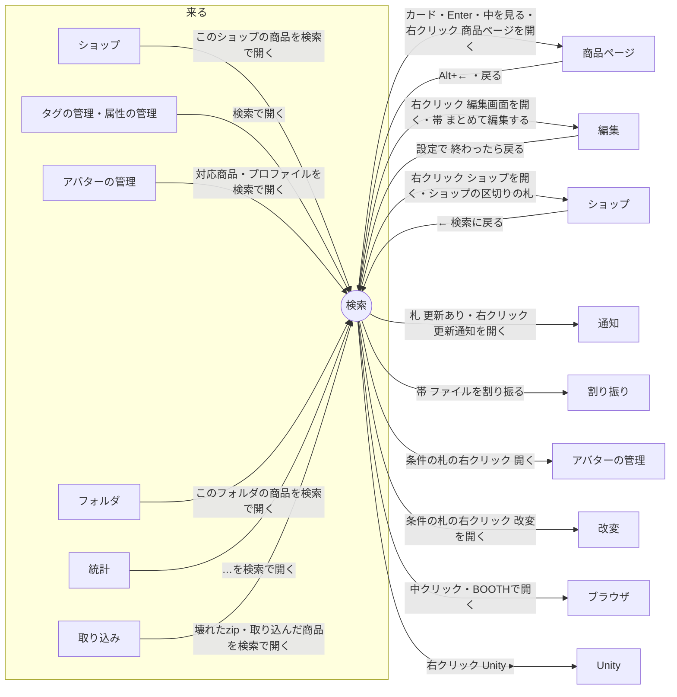

# 検索：目的ごとの操作の経路（2026-11-15・案）

入口はナビの「検索」（起動した時の画面）。他の画面の「…を検索で開く」からも、条件を入れた状態で来る（下の「画面の間の行き来」）。
コードを読んで書いた物で、画面で確かめていない。手数はクリック・キー・打つ（1語）・ドラッグをそれぞれ1。右クリックのメニューの子（▸）を開くのも1。
**頻度の列はユーザが付ける**（毎回／時々／まれ）。

場所：
- 上の帯＝画面の一番上の行（検索欄・「対象 ▾」・「オプション ▾」・スイッチ「開いているUnity」）と、その下の検索履歴のチップの行
- 並びの帯＝一覧のすぐ上の行（「n 件」・「表示順」のボタン・新しい順／古い順・カード／リスト・右端の大きさのスライダー）
- 左の欄＝絞り込みの欄（見出しの「…」・「条件をクリア」・「＋ 条件を追加 ▾」・「保存した検索 ▾」・条件の枠の並び）。畳むと細い縦の帯になる
- 一覧＝カード／リストの行。選ぶと一覧の下に選択の帯（「n 件を選択中」）が出る
- 右クリック＝カード／行の右クリックのメニュー
- 小窓・窓＝保存した検索の小窓、確かめや選ぶ窓

前提：左の欄を畳んでいると、欄の中の物（条件・保存した検索・条件をクリア）は先に左端の「絞り込みを開く」のつまみを押す（+1 手）。

## 探す

| # | 目的 | 手順（画面の文言で） | 手数 | 場所 | 別の経路 | 頻度 |
|---|---|---|---|---|---|---|
| A1 | 名前の一部で探して開く | 検索欄に打つ → 一覧のカードを押す | 2 | 上の帯→一覧 | カードの所で Enter | |
| A2 | 探す所を変える（ファイル名・zip の中・本文など） | 「対象 ▾」→ 項目のチェックを切り替える → Esc → 検索欄に打つ | 4 | 上の帯 | 検索欄に `name:` のような前置きを付けて打つ（検索欄の右の書き方の見本に乗せると説明） | |
| A3 | 書き方の違い（読み・漢字・英語）でも当てる | 「オプション ▾」→「別表記でも検索」 | 2 | 上の帯 | 0件の時に一覧の中央に出る「別表記でも検索する」 | |
| A4 | 照らし方を細かく決める（大文字・全角・かなの区別／変換の種類） | 「オプション ▾」→「…を区別する」か「ローマ字変換」などのチェック | 2 | 上の帯 | — | |
| A5 | 条件で絞る（カテゴリ・対応アバター・タグ・価格など） | 「＋ 条件を追加 ▾」→ 種類を選ぶ → 足された枠の欄に打つ・選ぶ | 3〜4 | 左の欄 | 他の画面の「…を検索で開く」で、値が入った状態で来る | |
| A6 | 条件を一時的に効かせない・逆に除く | 枠の見出しのチェックを切る ／ 枠を右クリック →「当てはまる商品を除く」 | 1／2 | 左の欄 | 除くをやめるのは枠の札「除く」を押す | |
| A7 | 条件を全部やめて最初から | 「条件をクリア」 | 1 | 左の欄 | 欄の見出しの「…」→「条件をクリア」／見出しの右クリック →「条件をクリア」。0件の時の文「「条件をクリア」で全件に戻ります」はここを指す | |
| A8 | 前の検索に戻る | 検索履歴のチップを押す | 1 | 上の帯 | Alt+← ・マウスの戻る。履歴が多い時はチップの行の ‹ › かホイールで送る | |
| A9 | よく使う検索を保存する | 「保存した検索 ▾」→「＋ 今の検索を保存」→ 名前を打つ →「保存」 | 4 | 左の欄→小窓→窓 | — | |
| A10 | 保存した検索を呼び出す | 「保存した検索 ▾」→ 行を押す | 2 | 左の欄→小窓 | 6件以上なら小窓の「保存した検索を探す」で絞る | |
| A11 | 保存した検索を直す・並べる・消す | 「保存した検索 ▾」→ 行の右端の「…」（いつも出る）→「条件を上書き」「名前を変更…」「上へ移動」「下へ移動」「削除」→ 窓 | 4 | 左の欄→小窓→窓 | 行の右クリック | |
| A12 | 今開いている Unity のプロジェクトの物だけ見る | スイッチ「開いているUnity」 | 1 | 上の帯 | 中身が変わったら並びの帯の「読み直す」。条件「Unityプロジェクト」の中のスイッチ「今開いているプロジェクト」は同じ切り替えの写し（2026-11-25。押せない時も同じ） | |
| A37 | 条件に積んだアバター・改変・ショップを見に行く | 札を右クリック →「開く」（対応アバター・プロファイル）／「改変を開く」（アバター・改変）／「ショップを開く」（ショップ）。アバター・改変のアバターの枠の見出しも右クリック →「開く」 | 2 | 左の欄 | Alt+← で今の条件の検索へ戻る。カテゴリなどの札には右クリックが無い（次のバージョンから） | |

## 並べる・見え方

| # | 目的 | 手順 | 手数 | 場所 | 別の経路 | 頻度 |
|---|---|---|---|---|---|---|
| A13 | 並べ替える | 「表示順」のボタン（今の項目名が書いてある）→ 項目 | 2 | 並びの帯 | 向きは隣の「新しい順」「古い順」など（1）。最近の記録の順は条件「最近」の「新しい順に並べる」 | |
| A14 | カードとリストを替える・大きさを替える | カード／リストのボタン ／ 右端のスライダーをドラッグ | 1 | 並びの帯 | — | |
| A15 | 取り込み中に増えた商品を一覧に入れる | 「取り込み中に n 件増えました。押すと一覧に反映します。」 | 1 | 並びの帯 | — | |
| A16 | 左の欄を畳む・幅を替える | 欄の左端のつまみ ／ 欄と一覧の境目をドラッグ（ダブルクリックで元の幅） | 1 | 左の欄 | 欄の見出しの「…」→「絞り込みを折りたたむ」 | |
| A17 | 条件の並びを整える | 枠の左上の ⋮⋮ をドラッグ | 1 | 左の欄 | 枠の右クリック・枠の「…」→「上へ移動」「下へ移動」／見出しの「…」→「同じ種類の条件を隣に並べる」／枠の ⌃ で畳む | |
| A18 | 検索履歴を消す | 履歴のチップの ✕ | 1 | 上の帯 | — | |

## 1件に対して

| # | 目的 | 手順 | 手数 | 場所 | 別の経路 | 頻度 |
|---|---|---|---|---|---|---|
| A19 | 商品の中身（商品ページ）を見る | カードを押す | 1 | 一覧 | Enter・右クリック →「商品ページを開く」。選んでいる最中はカードに乗せると出る「中を見る」だけ | |
| A20 | お気に入りにする・外す | カードの星 | 1 | 一覧 | 右クリック →「お気に入りに追加」 | |
| A21 | BOOTH のページを見る | カードを中クリック | 1 | 一覧 | 右クリック →「BOOTHで開く」（2）。中クリックは画面のどこにも書いていない | |
| A22 | リンクをコピーする | 右クリック →「リンクをコピー」 | 2 | 右クリック | — | |
| A23 | Unity へ入れる | 右クリック →「Unity ▸」→「Unityへ送る…」→ 窓で unitypackage を選ぶ → 送る | 5 | 右クリック→窓 | 改変に記録して送るなら「改変に追加して送る…」。商品ページからも送れる | |
| A24 | Unity の中でその商品の物を選ぶ | 右クリック →「Unity ▸」→「Unityで選択…」 | 3 | 右クリック | — | |
| A25 | 手元のファイル・フォルダを開く | 右クリック →「開く ▸」→「エクスプローラで開く…」（2つ以上なら選ぶ） | 3〜4 | 右クリック | zip の中を見るなら「一時的に展開して開く…」 | |
| A26 | 編集する（タグ・属性・メモ） | 右クリック →「編集画面を開く」 | 2 | 右クリック | 商品ページから | |
| A27 | 更新を見る・既読にする | カードの札「更新あり」 ／ 右クリック →「既読にする」 | 1／2 | 一覧・右クリック | 右クリック →「更新通知を開く」 | |
| A28 | 改変に追加する | 右クリック →「改変に追加…」→ 窓で改変を選ぶ | 3 | 右クリック→窓 | 選んでから選択の帯の「改変に追加…」 | |
| A29 | ショップの物を見る | 右クリック →「ショップを開く」 | 2 | 右クリック | ショップ順の時は区切りの札（ショップ名）を押す | |
| A30 | 見たくない商品を隠す | 右クリック →「非表示にする」 | 2 | 右クリック | 戻すのは直後に下に出る帯の「非表示を解除」か、設定の「非表示にした商品」 | |
| A31 | プラグインへ渡す | 右クリック → 追加したソフトの項目 | 2 | 右クリック | 選んでから選択の帯の「プラグイン ▾」 | |

## まとめて

| # | 目的 | 手順 | 手数 | 場所 | 別の経路 | 頻度 |
|---|---|---|---|---|---|---|
| A32 | いくつか選ぶ | カードに乗せると左上に出る選ぶ箱を押していく（リストは左の列）→ 下に選択の帯 | 件数 | 一覧→選択の帯 | Ctrl・Shift+クリック（どこにも書いていない）・右クリック →「選ぶ」・Ctrl+A・帯の「すべて選択（Ctrl + A）」 | |
| A33 | まとめて編集する | 選ぶ → 帯の「まとめて編集する」 | 件数+1 | 選択の帯 | — | |
| A34 | まとめて Unity へ送る | 選ぶ → 帯の「Unityへ送る…」→ 窓 | 件数+2 | 選択の帯→窓 | 止めるのは帯の「中止」 | |
| A35 | まとめてお気に入り・改変に追加・既読・ファイルの割り振り | 選ぶ → 帯の「お気に入りに追加」「改変に追加…」「既読にする」「ファイルを割り振る」 | 件数+1 | 選択の帯 | お気に入りを外すのは帯に無い（1件ずつ） | |
| A36 | 選ぶのをやめる | 帯の「選択を解除（Esc / Ctrl + Shift + A）」 | 1 | 選択の帯 | Esc・Ctrl+Shift+A | |

## 画面の間の行き来

他の画面から来る時は、条件の値を戻してから、その種類の一番上の条件に値を入れ、履歴を積む。

## 見るだけの部品

「n 件」・別表記の札「「x」を a・b としても探しました。」・開いている Unity の状態の文と条件の要約・畳んだ欄のバッジ・カードの状態の札（所持・未編集・取り込み中・見つからない・未所持の襷・R-18）・タグと属性の札（乗せて待つと全部重ねて出る）・カードの絵（横に動かすと切り替わる）・区切りの札・検索欄の右の書き方の見本・0件の時の文。

## 目的の表から見た事

- 1件への操作の多く（A22〜A31）は右クリックが唯一の入口で、カードの上には星と「更新あり」の札しか出ていない
- 左の欄を畳むと、A7・A9〜A11 が1手ずつ増える。畳んだ姿からは保存した検索に届かない
- Unity へ入れる（A23）は5手で、表の中で最も長い。まとめて送る（A34）は選択の帯から1手で入れる

## 部品の一覧

目的の表を書くための元。ID と行番号は ca44bb5c の時点。略：SV＝`Chmonos.App/Views/SearchView.xaml`、ICR＝`Chmonos.App/Views/ItemCardResources.xaml`、VM＝`Chmonos.App/ViewModels/`。

### 上の帯

| 部品（画面の文言） | 操作 | 起きる事 | 出る条件 | AutomationId・場所（ファイル:行） |
|---|---|---|---|---|---|
| 検索欄（プレースホルダ「商品名・ショップ名・メモから探す」など。対象が空なら「「対象」で探す所を選ぶか、name: のように前置きを付けて探す」） | 文字を打つ | 200ms 待って一覧を絞る。記法が効かない時は枠が赤くなり吹き出しで理由（QueryNotice）。500字まで | いつも | SV:1892 |
| 検索欄の × 「打った文字を消す」 | 押す | 打った文字だけ消える（条件は残る） | 文字がある時 | SearchClearQuery・SV:1892付近 |
| 書き方の見本（衣装 -無料 "夏セット"／衣装 (夏 OR 冬)／path:ring／説明文） | 乗せる | 長い吹き出しで記法の説明。押しても何もしない [推測] | いつも | SV:1987-2020 |
| 「対象 ▾」 | 押す | 探す項目の一覧が開く（吹き出し「探す項目を選びます。name: などを付けた語は、その項目を探します。」） | いつも | SearchTargets・SV:1920 |
| 対象の項目「商品名　name:」・ショップ名・メモ・サブドメイン・説明とセクション・BOOTHタグ・バリエーション名・商品ID・ファイル名・ファイルの場所・zipの中のファイル名 | チェックを切り替える | 探す所が変わり一覧が絞り直る。メニューは開いたまま。設定として覚える [推測] | 対象 ▾ を開いた時 | SV:1920付近 |
| 「オプション ▾」 | 押す | 区別と別表記の一覧が開く | いつも | SV:1932 |
| オプション：大文字と小文字を区別する／全角と半角を区別する／ひらがなとカタカナを区別する | 切り替える | 照らし方が変わり一覧が絞り直る | オプション ▾ を開いた時 | SV:1932付近 |
| オプション：別表記でも検索（「読み・漢字・英語などの別の書き方でも探します。」） | 切り替える | 読み・漢字・英語の別の書き方でも当てる。件数の下に「「x」を a・b としても探しました。」 | オプション ▾ を開いた時 | SV:1932付近 |
| オプション：ローマ字変換（tori → とり・トリ）／漢字変換（とり → 鳥）／英日変換（shark → サメ）／日英変換（リボン → ribbon）／造語変換（nadeoto → 撫で音） | 切り替える | 別表記の広げ方を1種ずつ切る | 「別表記でも検索」が入の時だけ押せる | SV:1932付近 |
| スイッチ「開いているUnity」 | 切り替える | 開いている Unity のプロジェクトに入っている商品だけに絞る。件数の横に「読み直す」と状態の文 | Unity が開いていない時は押せず「Unityが開いていません。」／場所が分からない時「開いているUnityのプロジェクトの場所が分かりません。」 | SearchOpenUnitySwitch・SV:1968 |
| 検索履歴の帯：見出し「検索履歴」と履歴のチップ（名前付きは★） | 押す | その時の文字・条件に戻す（表示順は替えない）。名前は「…の条件に戻す」 | 履歴が1件以上ある時 | SearchHistoryApply・SV:1788-1858 |
| 履歴のチップの ✕ | 押す | その履歴だけ消す（UiCommand.ChangeSearchHistory で履歴を保存）。吹き出し「この履歴を削除します。検索の条件は変わりません。」 | 履歴がある時 | SearchHistoryRemove・SV:1840付近 |
| 履歴の ‹ › | 押す | 履歴を横に送る（「前の履歴へ送ります。ホイールでも送れます。」／「続きの履歴へ送ります。…」） | その側に続きがある時だけ | SV:1850付近・SearchView.xaml.cs |
| 履歴の帯の上 | ホイール | 履歴を横に送る | 履歴がある時 | SearchView.xaml.cs |

履歴が積まれるのは「商品を開いた時」「条件をクリアの前」「他画面から絞って来た時」（VM/SearchViewModel.cs:238・ShowOnly.cs の RecordBeforeShowOnly と ClearFiltersKeepingHistoryAsync。同じ条件・何も絞っていない時は積まない）。保存した検索の呼び出しでは積まない（docs/spec/search-saved.md）。

### 並びの帯

| 部品（画面の文言） | 操作 | 起きる事 | 出る条件 | AutomationId・場所（ファイル:行） |
|---|---|---|---|---|---|
| 件数「n 件」／「n 件（+m 件非表示）」 | 見るだけ | 今の件数。非表示の数は設定で出す時だけ | いつも（読み込み中は「読み込み中…」） | ResultSummary・SV:2033 |
| 別表記の札「「x」を a・b としても探しました。」 | 見るだけ | 何として探したかを言う | 別表記で広げた時 | WidenedText・SV:2040付近 |
| 「読み直す」（吹き出し「開いているUnityの中を調べ直します」） | 押す | 開いている Unity の中を調べ直して絞り直す | 「開いているUnity」で絞っている時 | SearchOpenUnityReload・SV:2045付近 |
| 開いている Unity の状態の文／条件の要約（FilterSummary） | 見るだけ | 今どの Unity を見ているか・効いている条件の要約 | Unity スイッチ時／条件が効いている時 | SV:2050-2070 |
| 「表示順」のボタン（今の項目名） | 押す／Enter・Space・↓ | 項目のメニューが開き、今の項目に止まる。「属性 ▸」は → で子。一番下に線で分けたチェック付きの「まとまりごとに区切りを表示」（設定の「並べ替えたとき、まとまりごとに区切りを表示」と同じ1つを切り替える。UiCommand.ChangeSettings）。選ぶと並べ替え、次の起動へ引き継ぐ（UiCommand.ChangeUiState で searchSort を保存） | いつも。選べない項目は押せず吹き出し | SearchSortField・SV:2076・SearchView.Sort.cs |
| 向きの2つ（「新しい順」「古い順」など。文言は項目で変わる） | 押す | 昇降を替える（同上で保存） | いつも | SearchSortDescending／SearchSortAscending・SV:2100付近 |
| カード／リストの切替（吹き出し「絵の大きなカードで並べます」／「1行ずつ並べます。列の幅は見出しの境目をドラッグで変えられます」） | 押す | 一覧の形を替える。画面ごとに覚える（ui-state の itemListScreens） | いつも | ItemViewMode.Cards／ItemViewMode.List・SV:2120付近 |
| 右下の大きさのスライダー（「カードの大きさ」／「行の高さ」） | ドラッグ | カードの大きさ・リストの行の高さを替える（画面ごとに覚える。設定で全画面で1つにもできる） | いつも（形で名前が替わる） | ItemCardSize／ItemListRowHeight・SV:2154・ICR:800 |
| 「取り込み中に n 件増えました。押すと一覧に反映します。」 | 押す | 取り込みで増えた商品を一覧に入れる | 取り込み中に増えた分がある時 | SearchApplyPending・SV:2168 |

### 絞り込みの欄

| 部品（画面の文言） | 操作 | 起きる事 | 出る条件 | AutomationId・場所（ファイル:行） |
|---|---|---|---|---|---|
| つまみ（吹き出し「絞り込みを折りたたむ」／畳んだ時「絞り込みを開く」） | 押す | 欄を畳む・開く。畳んだかを保存（UiCommand.ChangeUiState・FilterPanelCollapsed） | いつも。Tab では画面の最初（ナビの次）に止まる | SearchToggleFilterPanel・SV:295-314 |
| 畳んだ姿：効いている数のバッジ・縦書き「絞り込み」 | 乗せる | 吹き出しで条件の要約 | 畳んだ時 | SV:325-337 |
| 欄と一覧の境目 | ドラッグ／ダブルクリック | 欄の幅を替える／元の幅に戻す | 開いている時（畳んだ間は出ない） | PaneSplitter・SV:278 |
| 見出しの「…」（吹き出し「絞り込みの操作」） | 押す | 下にメニュー：同じ種類の条件を隣に並べる／条件をクリア／絞り込みを折りたたむ | 開いている時（いつも見える） | SearchFilterMenu・SV:385 |
| 見出しの行 | 右クリック | 「…」と同じメニュー | 開いている時 | SearchFilterMenuList・SV:346-375 |
| メニュー「同じ種類の条件を隣に並べる」 | 押す | 条件の並びを種類ごとにまとめる | 既に並んでいる時は押せず「同じ種類の条件はもう隣に並んでいます。」 | SearchFilterMenu.GroupKinds・SV:350付近 |
| メニュー「条件をクリア」／ボタン「条件をクリア」（吹き出し「入力と条件の値をクリアします。前の条件は検索の履歴から戻せます。」） | 押す | 前の検索を履歴に積んでから、打った文字・値・除くを戻す（条件の枠は残る） | いつも | SearchFilterMenu.Clear・SearchClearFilters・SV:394 |
| メニュー「絞り込みを折りたたむ」 | 押す | つまみと同じ | 開いている時 | SearchFilterMenu.Collapse |
| 「＋ 条件を追加 ▾」 | 押す | 見出し（BOOTHの情報・商品の情報・ファイルの情報・改変登録・カレンダー・スライダー・利用状況）ごとに条件の一覧。選ぶと条件の枠が足され、画面を送って最初の入力欄に止まる | いつも。1つしか置けない種類は追加済みなら押せない | SearchAddModule／SearchAddModule.{Kind}・SV:411・SearchView.Modules.cs |
| 「保存した検索 ▾」（吹き出し「保存した検索を開いて、今の検索を置き換えます。」） | 押す／↓ | 小窓が開き、先頭の行（無ければ「＋ 今の検索を保存」）に止まる。今と同じ物があればボタンの末尾に点 | 欄が開いている時だけ（畳むと届かない） | SavedSearchesButton・SV:481・SearchView.Saved.cs |
| 小窓「＋ 今の検索を保存」（吹き出し「今の検索に名前を付けて保存します」） | 押す | 窓「今の検索を保存」：名前（要約で始まる）・「条件、検索文字列、表示順などが保存されます。」・［保存］。同名は「既にあります」。UiCommand.ChangeSavedSearches で保存 | 小窓を開いた時 | SavedSearchSave・SV:530付近・VM/SavedSearchNameDialogViewModel.cs:31 |
| 小窓の探す欄「保存した検索を探す」 | 打つ／↓ | 行を名前で絞る。↓で先頭の行へ。0件は「見つかりません。探す語を変えてください。」 | 保存が6件以上の時 | SavedSearchFilter・SV:550付近 |
| 保存した検索の行（今と同じ行は地の色と✓、吹き出しに要約） | 押す／Enter | 今の検索を置き換えて閉じる（文字・条件・表示順・カードかリスト）。表示順が無くなっていれば警告。履歴には積まない | 小窓を開いた時 | SavedSearch.Row／SavedSearch.Apply・SV:565 |
| 行の「…」（吹き出し「この保存した検索の操作」）／行の右クリック | 押す | メニュー：条件を上書き・名前を変更…・上へ移動・下へ移動・削除 | 「…」はどの行にもいつも出る（ユーザ判断 2026-11-20） | SavedSearch.Menu・SV:600付近 |
| 「条件を上書き」 | 押す | 確かめの窓「「{name}」の条件を上書きします。上書きすると、前の内容には戻せません。」の後に今の検索で上書き | 今と同じなら押せず「今の検索と同じです」 | SV:610付近 |
| 「名前を変更…」 | 押す | 窓「名前を変更」・「名前は同じ手順で戻せます。」・［変更］ | 同上 | SV:615付近 |
| 「上へ移動」「下へ移動」 | 押す | 保存した検索の並びを1つ動かす | 端では押せない [推測] | SV:620付近 |
| 「削除」（赤） | 押す | 窓「保存した検索「{name}」を削除します。削除すると元に戻せません。」の後に消す | 同上 | SV:625付近 |
| 小窓 | Esc | 閉じてボタンへ戻る | 小窓を開いた時 | SearchView.Saved.cs:58 |
| 空の並び「条件がありません。「＋ 条件を追加」から追加できます。」 | 見るだけ | — | 条件が0の時 | SV:642 |
| 条件の枠の ⋮⋮（吹き出し「ドラッグで順番を変えられます」） | ドラッグ | 並びの中で位置を替える（落とし先に線）。並びは ui-state の searchModules に保存 | いつも | SV:651・RowReorder |
| 枠のチェック＋条件名（吹き出し「切ると、値を残したままこの条件を効かせません」） | 切り替える | 値を残したまま効かせない／効かせる | いつも | SearchModule.{IdKey}.Enabled |
| 札「除く」 | 押す | 除くのをやめる（その後「…」に止まる） | 除くにしている時 | SearchModule.{IdKey}.Excluded |
| 枠の「…」 | 押す | 枠の右クリックと同じメニューを下に開く | 乗せた時・キーで止まった時 | SearchModule.{IdKey}.Menu |
| 枠の ⌃ | 押す | 畳む・開く（畳んでも効いたまま、中身は1行の要約） | いつも | SV:1700付近 |
| 枠の × （吹き出し「この条件を外す」） | 押す | 枠ごと外す。無くなれば「条件をクリア」に止まる | いつも | SearchModule.{IdKey}.Remove |
| 枠 | 右クリック | 「当てはまる商品を除く」（チェック）・「折りたたむ」／「広げる」・「上へ移動」・「下へ移動」・「この条件を外す」 | 除くを持たない種類は「除く」が押せず「この条件では「除く」を使えません」 | SearchModule.{IdKey}.Frame・SV:1652- |
| 条件の並び | ↑↓・Home/End・Enter・Esc | 枠の間を動く・Enter か Tab で中へ・Esc で枠へ戻る | キーで並びに止まった時 | FocusFrame/FrameList |
| 候補の札の × | 押す | その値を外す | 値を選んでいる時 | SearchChipRemove・SV:657 |
| 札の並びの右下「ほか n 件」／「折りたたむ」 | 押す | 隠した札を全部出す／2行に戻す。値を足した時、足した札が隠れるなら自分で広がる。隠した札は Tab・矢印でも止まらない（2026-11-20） | 札が2行を超える時（積む形の全部・プロファイルの2欄・ユーザータグの小分類・改変） | SearchChipFoldToggle・SV の Style `FoldingChipList` |

条件の中身（1行ずつ）：

| 部品（画面の文言） | 操作 | 起きる事 | 出る条件 | AutomationId・場所（ファイル:行） |
|---|---|---|---|---|---|
| 選ぶ形（所持・購入・ギフト・R-18・公開状況・非表示・壊れたzip など）・補助のチェック（所持の「ファイルがすべて見つからない商品は未所持とする」・見つからないファイルの「未所持も含める」） | 選ぶ・チェック | 選んだ値で絞る（件数付き） | 補助は効く値を選んだ時（所持は「両方」以外・見つからないファイルは「ある」） | SV:705・補助は SV:712・SearchModule.{IdKey}.Flag |
| 編集状況：項目のチェックとつなぎ方 | 選ぶ | 見る項目（ユーザータグ・属性・購入したバリエーション・バリエーションの対応・入手日・メモ・対応アバターの確認）で絞る | 「両方」の間は押せず薄い | SV:750-807 |
| 更新通知あり：種類のチェック | 選ぶ | 中身の更新・バリエーション・価格・販売の状態・ページ内容の変更で絞る | 条件がある時 | SV:808-860 |
| 候補から積む形（カテゴリ・BOOTHタグ・ショップ・対応アバター・ファイルの場所・Unityプロジェクトなど）：欄・「どれか／すべて」・「★ …」（お気に入りのショップ）・「変換で使える物も含める」・「持っているバリエーションの分だけ」・スイッチ「今開いているプロジェクト」（検索欄の右の「開いているUnity」の写し。吹き出し「検索欄の右の「開いているUnity」と同じ切り替えです。」、押せない時は同じ理由）・Unity プロジェクトの追加・「名前が同じファイルも含める」（吹き出し「手で置いた画像などを、中身が違っても名前が同じなら含めます。」）・「読み直す」・「表示するもの」 | 打つ・選ぶ・チェック | 値を積んで絞る | 種類による | SV:861-1003（SearchModuleOpenProjectAdd など） |
| プロファイル：変換元／変換先・「素体経由を含める」「確認待ちも含める」「組み合わせられるプロファイルも含める」「単体で変換できるものだけ」 | 選ぶ・チェック | 変換できるプロファイルで絞る | 条件がある時 | SV:1004-1090 |
| 数の範囲（スキ数・価格・払った額・容量）：スライダ2本・欄・上下のトグル・×・「外れ値を無視」「すべての価格が範囲内の商品のみ」「価格が設定されていない商品も表示」 | ドラッグ・打つ・切り替え | 範囲で絞る | 条件がある時 | SV:1091-1220 |
| 日付（公開日・入手日）：始まり／終わりのトグル・欄・カレンダー・×（「開始の日を消す」「終わりの日を消す」）・から／まで・入手日の「最初の購入のみ／すべての購入」 | 打つ・選ぶ | 期間で絞る。どう読んだかを欄の下に出す | 条件がある時 | SV:1221-1313 |
| ユーザータグ：「大分類を選んで追加」「小分類を選んで追加」 | 選ぶ | タグで絞る。無い時「ユーザータグがまだ登録されていません。編集画面から追加できます。」 | 条件がある時 | SV:1314-1377 |
| 改変プロジェクト：読む間の「改変を読んでいます…」（空の文「Unityプロジェクトを紐付けた改変がまだありません。」の所） | 見るだけ | 改変を裏で読み終えたら候補が入る | 1回目に足した時・改変が変わった後 | SearchViewModel.ModificationsWaitingText・ListModule.WaitingText |
| 改変：「アバターか改変を選んで追加」「改変を選んで追加」 | 選ぶ | 改変で絞る。「改変を選ばないときは、このアバターのすべての改変が対象です。」／無い時「改変がまだありません。アバターの管理から作れます。」 | 条件がある時 | SV:1378-1453 |
| 属性：「属性を選んで追加」・行ごとの分布の帯とスライダ | 選ぶ・ドラッグ | 評価で絞る。「追加した属性は、評価済みの商品だけが対象になります。」／無い時「属性がまだ登録されていません。編集画面から追加できます。」 | 条件がある時 | SV:1454-1530 |
| 最近：一週間／一か月／一年／全期間・スライダ2本・「表示するもの」・「新しい順に並べる」 | 選ぶ・ドラッグ・押す | 最後にしてからの日数で絞る。「新しい順に並べる」は表示順をその記録の順に替える。記録が無い時「記録が付くと、ここに日数の分布が表示されます。」 | 条件がある時 | SV:1531-1635（.Sort） |

### 一覧

| 部品（画面の文言） | 操作 | 起きる事 | 出る条件 | AutomationId・場所（ファイル:行） |
|---|---|---|---|---|---|
| カード／リストの行 | 押す（左クリック） | 商品ページへ移る（履歴を1件積む）。選んでいる最中は選択の切り替え | いつも | ItemCard・ICR / ItemCardResources.xaml.cs（OnCardClick・ActivateCard） |
| カード／行 | ダブルクリック | 専用の処理は無い。1回目のクリックで商品ページへ移る | — | ItemCardResources.xaml.cs |
| カード／行 | 中クリック | BOOTH の商品ページをブラウザで開く | BOOTH に無い商品は何も起きない | VM/SearchViewModel.CardActions.cs:60 |
| カード／行 | Ctrl+クリック・Shift+クリック | 選ぶ（Explorer と同じ：1件ずつ／範囲） | いつも | ItemCardResources.xaml.cs（SelectByModifiedClick） |
| 選ぶ箱（カードの左上）／リストの選ぶ列（「選ぶと、下の帯からまとめて操作できます」） | 押す | 選ぶ・外す。下に選択の帯が出る | カードは乗せた時か選択中／リストはいつも | ItemCardSelect／ItemListSelect |
| 「中を見る」 | 押す | 商品ページへ移る（選んでいる最中の入口） | 選択中に乗せた時 | ItemCardOpen |
| 星（吹き出し「お気に入りに追加」／「お気に入りから外す」） | 押す | お気に入りを切り替える（UiCommand.SaveItemLocal で IsFavorite だけ保存。失敗なら戻して窓） | いつも | ItemCardFavorite／ItemListFavorite・CardActions.cs:196 |
| 札「更新あり」 | 押す | 通知の画面でその知らせを開く | 未読の更新がある時（丸になっても押せる） | ItemCardUpdate／ItemListUpdate |
| 札（所持・未編集・取り込み中・見つからない／一部見つからない・リストの「未確定あり」）・襷「未所持」・R-18 | 見るだけ | 状態を示す | 状態による | ICR |
| ユーザータグ・属性の札 | 乗せて待つ／キーで止まる | 全部の札を重ねて見せる | 札が入り切らない時など | CardPeek・ICR |
| カードの絵 | マウスを横に動かす | 画像を切り替える（止まった時だけ・150ms） | 画像が2枚以上 | ICR / ItemCardViewModel |
| リストの列の見出し（既定は★・名前・ユーザータグ・属性・払った額・対応・ショップ・状態） | 境目をドラッグ／見出しをドラッグ | 列の幅を替える／列の並びを替える。見出しを押して商品の並べ替えはしない | リストの時 | Controls/ItemListColumnsView.cs |
| リストの列の見出し | 右クリック（見出しに焦点がある時は Shift+F10・メニューキー） | メニュー「この列を左へ」「この列を右へ」「この列を非表示」（次のバージョンから）と、4つの見出し（BOOTHの情報・商品の情報・ファイルの情報・改変登録）のサブメニューで列の出し入れ。最後の1列は非表示にできず吹き出し「ほかの列を表示すると非表示にできます。」 | リストの時。見出しの無い右の余白では「この列を…」は押せない | ItemListColumnsMenu（.MoveLeft／.MoveRight／.Hide）・Controls/ItemListColumnsView.cs |
| 区切りの札（カテゴリ・ショップ・公開日・入手日の順の時） | 見るだけ | まとまりの名前と件数 | それらの表示順の時 | SortDivider・ICR:566 |
| ショップの区切りの札 | 左クリック／中クリック／右クリック | アプリのショップ画面へ／BOOTH のショップを開く／メニュー「ショップを開く」「BOOTHで開く」（BOOTH に無ければ押せず「BOOTHに無いショップなので開けません」） | ショップ順の時。キーでは止まらない | SortDivider.Menu.OpenShop／OpenInBooth・Controls/SortDividerBorder.cs:56 |
| 選択の帯「n 件を選択中」 | — | まとめて操作の入口 | 1件以上選んだ時か Unity へ送っている時 | ICR:652-761 |
| 帯「すべて選択（Ctrl + A）」／「選択を解除（Esc / Ctrl + Shift + A）」 | 押す | 表示中を全部選ぶ／全部外す | 帯が出ている時 | ICR:700付近 |
| 帯「お気に入りに追加」 | 押す | 選んだ全部をお気に入りに（SaveItemLocal） | 同上 | 同上 |
| 帯「改変に追加…」 | 押す | 窓で改変を選び、選んだ商品を足す | 同上 | 同上 |
| 帯「Unityへ送る…」 | 押す | unitypackage を選ばせて順に Unity へ送る | 送信中は押せない | 同上 |
| 帯「ファイルを割り振る」 | 押す | 選んだ商品の間でファイルを割り振る画面へ [推測] | 1件では押せず「2件以上の商品を選ぶと使えます。」 | 同上 |
| 帯「まとめて編集する」（主ボタン） | 押す | 選んだ商品を編集画面へ送る（選択は解除しない。編集の「検索に戻る」で戻ると残っている） | 同上 | 同上 |
| 帯「既読にする」 | 押す | 選んだ商品の未読の更新を既読に（UiCommand.MarkNotificationsRead） | 選んだ物に未読の更新がある時 | 同上 |
| 帯「プラグイン ▾」 | 押す | 追加したソフトの項目 | 追加したソフトがある時 | 同上 |
| 帯「中止」（吹き出し「送るのをやめます。Unityに残った画面は「Cancel」で閉じてください。」） | 押す | Unity への送信を止める | 送信中 | SelectionBarUnityStop |
| 一覧 | スクロール・Shift+ホイール | 縦に流す／横に送る。位置は画面を離れても覚えて戻す | いつも | SearchView.xaml.cs（CardScrollOffset・ListScrollOffset） |

### 右クリック

カードとリストの行で同じメニュー（ICR:16-130）。全部の項目をいつも出し、できない時は押せずに吹き出しで理由を言う。

| 部品（画面の文言） | 操作 | 起きる事 | 出る条件 | AutomationId・場所（ファイル:行） |
|---|---|---|---|---|---|
| BOOTHで開く | 押す | BOOTH の商品ページをブラウザで開く | BOOTH に無い商品は押せない | CardMenu.OpenBooth |
| リンクをコピー | 押す | 商品ページの URL をクリップボードへ（掴まれていれば黙って入らない） | 同上 | CardMenu.CopyLink・CardActions.cs:78 |
| IDをコピー | 押す | 商品IDそのものをクリップボードへ（BOOTHに無い商品は仮のID。商品ページの「IDをコピー」と同じ） | いつも | CardMenu.CopyId |
| 商品ページを開く | 押す | アプリの商品ページへ。キーで開けば戻った時に止まり直す | いつも | CardMenu.OpenItem |
| ショップを開く | 押す | アプリのショップ画面へ | ショップが分かる時 | CardMenu.OpenShop |
| 編集画面を開く | 押す | その1件で編集画面へ | いつも | CardMenu.Edit |
| 選ぶ（チェック） | 押す | 選ぶ・外す | いつも | CardMenu.Select |
| お気に入りに追加／お気に入りから外す | 押す | 星と同じ | いつも | CardMenu.Favorite |
| 改変に追加… | 押す | 窓で改変を選んで足す。選択中にその上で押せば選んだ全部 | いつも | CardMenu.AddToModification |
| 更新通知を開く | 押す | 通知の画面でその知らせを開く | 知らせがある時だけ押せる | CardMenu.ShowUpdate |
| 既読にする | 押す | その1件の未読を既読に（MarkNotificationsRead） | 未読がある時だけ押せる | CardMenu.MarkUpdateRead |
| 開く ▸ エクスプローラで開く… | 押す | 手元のファイルをエクスプローラで開く。2つ以上なら選ぶ一覧 | ファイルが全部見つからない時は「開く ▸」ごと薄く「手元のファイルが見つかりません」 | CardMenu.Reveal・CardActions.cs:116 |
| 開く ▸ 一時的に展開して開く… | 押す | zip を選んで一時フォルダへ展開して開く | 同上 | CardMenu.Unpack |
| Unity ▸ Unityへ送る… | 押す | unitypackage をチェックで選ぶ窓→Unity へ送る。送れた事は設定で Windows の通知 | 同上・unitypackage がある時 | CardMenu.SendToUnity |
| Unity ▸ 改変に追加して送る… | 押す | 改変に足してから送る | 同上 | CardMenu.SendToUnityWithRecord |
| Unity ▸ Unityで選択… | 押す | Unity の中でその商品の物を選ぶ。結果は窓で言う | 同上 | CardMenu.SelectInUnity |
| 非表示にする | 押す | 確かめずに非表示に（SaveItemLocal で IsHidden）。下の帯に「「…」を非表示にしました。設定の「非表示にした商品」から戻せます。」と「非表示を解除」 | いつも | CardMenu.Hide・CardActions.cs:242・VM/MainViewModel.HiddenNotice.cs:24 |
| プラグインの項目 | 押す | 追加したソフトへ渡す | 追加したソフトがある時（開くたびに付ける） | PluginMenuItems |

### キー

| 部品（画面の文言） | 操作 | 起きる事 | 出る条件 | AutomationId・場所（ファイル:行） |
|---|---|---|---|---|---|
| どこでも | Ctrl+F | 画面内検索の帯（検索欄へは行かない） | いつも | MainWindow.Find.cs・docs/spec/ui-keyboard.md:7 |
| どこでも | 割り当て「検索欄へ」（#43） | 検索欄へ入り全部を選ぶ | 設定でキーを割り当てた時 [推測：既定のキーは未確認] | SearchView.xaml.cs:143 |
| 一覧 | Ctrl+A／Ctrl+Shift+A／Ctrl+Shift+I | 全部選ぶ／全部外す／反転 | 入力欄の中では文字の操作に譲る。設定で同じキーを割り当てたらそちらが勝つ | MainWindow.xaml.cs:486・VM/SelectionKeys.cs |
| 一覧 | Esc | 選択を解除 | 選んでいる時。入力欄・プルダウンの中では譲る | MainWindow.xaml.cs:468 |
| カード／行 | Enter・Space | 押したのと同じ（商品ページ／選択中は切り替え） | 修飾キー無し | ItemCardResources.xaml.cs |
| カード | 矢印 | 隣のカードへ | — | ArrowGroup |
| カード／行 | Shift+F10・アプリケーションキー | 右クリックのメニュー | — | ui-keyboard.md |
| どこでも | Alt+←・マウスの戻る | 前の画面へ戻る | — | ui-keyboard.md |
| どこでも | Ctrl+＋／－／0 | 表示の倍率 | — | ui-keyboard.md |
| 表示順のボタン | Enter・Space・↓／→／Esc | メニューを開く／属性の子へ／閉じる | — | SearchView.Sort.cs |
| 保存した検索 | ↓・Enter・Esc | 開いて行へ／呼び出す／閉じてボタンへ | — | SearchView.Saved.cs |
| 条件の並び | ↑↓・Home/End・Enter・Tab・Esc | 枠の間・中へ・枠へ戻る | — | FrameList.cs:350 |
| 全体 | Tab | 順：「…」→条件をクリア→つまみ→条件を追加→保存した検索→条件の並び→検索欄→対象→オプション→表示順→向き2つ→カード→リスト→大きさ→結果（つまみは画面の最初に止まる、との記述もある） | — | ui-keyboard.md・SearchView.xaml.cs（FilterToggleTabTarget） |

### 空の時

| 部品（画面の文言） | 操作 | 起きる事 | 出る条件 | AutomationId・場所（ファイル:行） |
|---|---|---|---|---|---|
| 「該当するものがありません」＋「「取り込み」からフォルダを読み込んでください」 | 見るだけ | 商品が1件も無い | 全体が0件 | SV:2214・EmptyHint |
| 同上＋「「条件をクリア」で全件に戻ります」 | 見るだけ（押せる物は無く、欄の「条件をクリア」を使う） | — | 絞って0件 | SV:2214 |
| 同上＋「開いているUnityの中を調べています。」／「「条件をクリア」で、開いているUnityに入っている商品すべてに戻ります」／「「開いているUnity」と条件「Unityプロジェクト」の両方に入っている商品はありません。」／「開いているUnityのプロジェクトに入っている商品はありません。」 | 見るだけ | — | 「開いているUnity」で絞って0件 | EmptyHint |
| 「別表記でも検索する」 | 押す | 別表記を入にして探し直す（オプションと同じ設定） | 0件・別表記が切・文字がある・辞書がある | SearchWiden・SV:2220付近 |
| 「条件がありません。「＋ 条件を追加」から追加できます。」 | 見るだけ | — | 条件が0 | SV:642 |
| 保存した検索の0件「「＋ 今の検索を保存」で、今の検索に名前を付けて残せます。」 | 見るだけ | — | 保存が0 | SV:543 |

### 画面の間の移動

検索から出る：

| 部品（画面の文言） | 操作 | 起きる事 | 出る条件 | AutomationId・場所（ファイル:行） |
|---|---|---|---|---|---|
| カード・行・「中を見る」・右クリック「商品ページを開く」・Enter | 押す | 商品ページ | — | CardActions / SearchViewModel.cs:233 |
| 右クリック「編集画面を開く」・帯「まとめて編集する」 | 押す | 編集画面（設定「編集が終わったら検索に戻る」で戻る） | — | CardActions.cs:104 |
| 右クリック「ショップを開く」・ショップの区切りの札 | 押す | ショップ画面 | — | CardActions.cs:95 |
| 札「更新あり」・右クリック「更新通知を開く」 | 押す | 通知の画面 | 知らせがある時 | main.ShowInboxFor |
| 帯「ファイルを割り振る」 | 押す | 割り振りの画面 [推測] | 2件以上 | ICR |
| 中クリック・「BOOTHで開く」 | 押す | ブラウザ（外） | BOOTH にある時 | — |

他の画面から検索へ来る（どれも条件の値を戻してから、その種類の一番上の条件に値を入れる。履歴を積む）：

| 部品（画面の文言） | 操作 | 起きる事 | 出る条件 | AutomationId・場所（ファイル:行） |
|---|---|---|---|---|---|
| ショップ画面「このショップの商品を検索で開く」 | 押す | ショップで絞った検索 | — | ShopView.xaml:44・MainViewModel.cs:1062 |
| タグの管理「検索で開く」（ボタン・右クリック・小分類） | 押す | ユーザータグで絞る | — | TagManageView.xaml:107・267・466 |
| 属性の管理「検索で開く」（ボタン・右クリック） | 押す | 属性で絞る | — | AttributeManageView.xaml:139・294 |
| アバターの管理「対応商品を検索で開く」 | 押す | 対応アバター（素体経由も）で絞る | — | AvatarsView.xaml:732 |
| アバターの管理・商品ページ「プロファイルを検索で開く」 | 押す | そのアバターと素体のプロファイルで絞る | — | AvatarsView.xaml:736・AvatarRegistrationPanel.xaml:44 |
| フォルダビュー「このフォルダの商品を検索で開く」 | 押す | ファイルの場所で絞る | — | FolderBrowserView.xaml:102 |
| 統計の項目（名前「…を検索で開く」） | 押す | カテゴリで絞る | — | StatsView.xaml:371・StatsViewModel.cs:775 |
| 取り込みの結果「壊れたzipがある商品を検索で開く」 | 押す | 壊れた zip で絞る（ほかの条件は外す） | 壊れた zip がある時 | ImportView.xaml:766 |
| 取り込みの結果「取り込んだ商品を検索で開く」 | 押す | 絞らずに、最近取り込んだ順に並べる | — | ImportView.xaml:771・ShowOnly.cs:111 |
| 主画面の履歴（戻る） | Alt+← など | 前の検索の条件に戻す | — | MainViewModel.History.cs:573 |
| ナビの「検索」・ショップ画面の「← 検索に戻る」 | 押す | 前の状態のまま検索へ | — | ShopView.xaml:64 |

## 気付いた事

経路が2つ以上ある物：
- 条件をクリア：欄のボタン・見出しの「…」・見出しの右クリック（3つ）。空の時の文も「条件をクリア」を指すが、そこにボタンは無い。
- 商品ページへ：クリック・Enter／Space・「中を見る」・右クリック「商品ページを開く」（4つ）。選んでいる最中はクリックが選択に替わり、「中を見る」だけが入口になる。
- お気に入り：星・右クリック・選択の帯（帯は追加だけで外せない）。
- 選ぶ：選ぶ箱・Ctrl／Shift+クリック・右クリック「選ぶ」・Ctrl+A・帯「すべて選択」。外すのは帯・Esc・Ctrl+Shift+A。
- 条件の並べ替え：⋮⋮のドラッグと、枠の右クリック・「…」の「上へ移動／下へ移動」。条件を外す：× とメニュー。除く：メニューのチェックと札「除く」（札は外すだけ）。
- 絞り込みを畳む：つまみとメニュー。BOOTH を開く：中クリックと右クリック。更新の通知：札と右クリック。既読：右クリック（1件）と帯（選んだ物）。改変に追加：右クリックと帯。
- 「読み直す」が2か所（件数の横の Unity の読み直しと、条件の中の「読み直す」）。別表記もオプションと0件のボタンの2か所。
- 他画面から検索へ来る口が10以上（タグ・属性・アバター・プロファイル・ショップ・フォルダ・統計・取り込み2つ・戻る）。

隠れて見つけにくい物（右クリック・キー・乗せた時だけ）：
- 反転 Ctrl+Shift+I はキーだけ（帯の文言にも出ない）。
- 中クリックで BOOTH、Ctrl／Shift+クリックで選ぶ、はどこにも書いていない。
- 「同じ種類の条件を隣に並べる」は見出しのメニューの中だけ。
- 条件の枠の「…」は乗せるかキーで止まった時だけ見える。保存した検索の行の「…」は、どの行にもいつも出す（ユーザ判断 2026-11-20。前は乗せた時だけで、1行目だけ出たままに見えた）。
- ショップの区切りの札は押せる事が見た目で分かりにくく、キーでは止まらない。
- 履歴のホイール送り・一覧の Shift+ホイール・カードの絵の上の横移動での画像切替・札に乗せて待つ重ね。
- 「検索欄へ」は割り当てのショートカット（#43）で、Ctrl+F は検索欄へ行かない。
- 欄を畳んでいる間は「保存した検索」と「条件をクリア」に届かない（畳んだ姿はつまみとバッジだけ）。
- 非表示にした商品の戻し方は、直後の帯が消えた後は設定の中だけ。

文言の揺れ：
- （2026-11-17 に揃えた）「保存した検索」（ボタン・見出し・削除の窓）と「保存した検索を探す」「この保存した検索の操作」、窓の題「今の検索を保存」。
- （2026-11-17 のユーザ判断：このまま）消す系の動詞：「この条件を外す」「この履歴を削除します」「打った文字を消す」「条件をクリア」「選択を解除」「非表示を解除」。
- （2026-11-17 に揃えた）「Unityへ送る…」（右クリックも帯も。帯は 2026-11-20 に「全て」を外した）。「改変に追加…」と「改変に追加して送る…」。
- 「中を見る」と「商品ページを開く」（同じ行き先）。「編集画面を開く」と「まとめて編集する」。
- （2026-11-17 に揃えた）「更新あり」（札）と条件名「更新通知あり」・メニュー「更新通知を開く」。
- （2026-11-17 のユーザ判断：このまま）「開いているUnity」（スイッチ）と条件「Unityプロジェクト」「改変プロジェクト」、見出し「改変登録」と条件名「アバター・改変」。
- 「変換で使える物も含める」の「物」、括弧の補足（「本文（説明とセクション）」・オプションの変換の例）。吹き出しに40字を超える物が多い。
- 「すべて選択（Ctrl + A）」「選択を解除（Esc / Ctrl + Shift + A）」はキーを文言に入れているが、他のボタンには入っていない。
