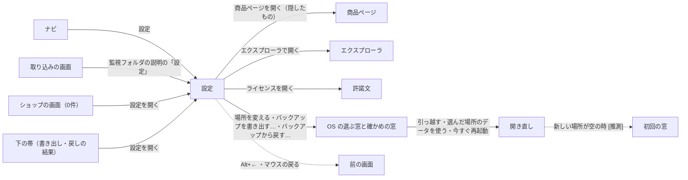

# 設定：目的ごとの操作の経路（2026-11-15・案）

入口：ナビ（左の縦の並び）の一番下の「設定」。ほかに、取り込みの画面の「監視フォルダ」の説明の中の「設定」の文字（起動時に自動で取り込む設定が切の時だけ）、ショップの画面で0件の時の「設定を開く」（非表示か R-18 で隠れた商品がある時だけ）、画面の一番下の帯の「設定を開く」（バックアップの書き出しか戻しが、設定の画面の外にいる間に終わった・やめた時だけ。引越しと戻しの成功は開き直すので帯は出ない）。設定を開いている時にナビの「設定」を押しても何も起きない。
コードを読んで書いた物で、画面で確かめていない。手数はクリック・キー・打つ（1語）・ドラッグをそれぞれ1。右クリックのメニューの子（▸）を開くのも1。スクロールは手数に数えない。数の欄は「打つ」の後に欄から出る（Tab か別の所を押す）まで保存されないので、その1手も数える。
**頻度の列はユーザが付ける**（毎回／時々／まれ）。

場所：上の帯＝画面の一番上の「設定」と「変更するとすぐに保存されます」の行（保存に失敗した時だけ右に文が出る）／節＝三角で畳める7つのまとまり「表示」「操作」「取り込みと取得」「隠したもの」「データ」「API」「Chmonos（クモノス）について」。初めは全部開いている（節の中の「取り込み元の履歴」と「管理対象から除外したファイル」は畳んである）。畳んだ状態はアプリを閉じるまで覚える（設定には書かない）／小見出し＝節の中の灰色の小さな見出し（「表示」なら「共通」「対応アバター」「一覧と検索」「商品ページと編集」）／窓＝押すと開く確かめ・選ぶ窓（OS のフォルダ・ファイルを選ぶ窓を含む）／下の帯＝アプリの画面の一番下に出る知らせの帯
前提：欄が畳んである時は、その節の見出しを押して開く（+1 手）。設定の画面の右クリックは、入力欄の「既定に戻す（既定：…）」だけ（行ごとの一覧には無い）。保存のボタンは無く、変えるとすぐ保存される

## 見え方を変える（節「表示」）

| # | 目的 | 手順（画面の文言で） | 手数 | 場所 | 別の経路 | 頻度 |
|---|---|---|---|---|---|---|
| A1 | 画面の色を明るい・暗いに替える | 「表示の色」の欄 →「明るい」「暗い」「Windows に合わせる」 | 2 | 表示・共通 | — | |
| A2 | 文字と絵をまとめて大きく・小さくする | 「表示の大きさ」の欄 → 90%〜150% | 2 | 表示・共通 | Ctrl+プラス／Ctrl+マイナス／Ctrl+0（どの画面でも。割り当ては A12 で変えられる） | |
| A3 | ドラッグで変えた一覧と詳細の境目の幅を戻す | 「画面の幅」の「すべて元の幅に戻す」 | 1 | 表示・共通 | 1か所だけなら、その画面の境目をダブルクリック | |
| A4 | R-18 の商品を隠す・出す／BOOTH から消えた画像を出す・隠す | 「R-18 の商品を表示する」／「BOOTHから消えた画像も表示する」を切る・入れる | 1 | 表示・共通 | ショップの画面で0件の時の「設定を開く」から来る（この行か A25 を探す） | |
| A5 | 商品ページの対応アバターの札の出し方を変える（共通素体経由・共通素体ごとにまとめる・変換経由・確認していない変換・バリエーションの見分け・買っていないバリエーションの欄） | 「共通素体経由の対応アバターも表示する」〜「買っていないバリエーションにも対応の欄を表示する」の6つのチェックから1つを切る・入れる（「確認していない変換も含める」は変換経由の下に下げてある） | 1 | 表示・対応アバター | — （効くのは商品ページ・検索の候補・編集画面。どれに効くかは乗せた時の吹き出しにだけ書いてある） | |
| A6 | 画面の切り替えを少し速くする（読み上げソフトに画面を伝えない） | 「読み上げソフトや自動操作に画面の内容を伝える」を切る（下に再起動が要る旨の文が出る） | 1 | 表示・共通 | — | |
| A7 | 一覧のカードの見え方を変える（サムネイルの画像・小分類のタグ・属性の札） | 「サムネイルに表示する画像」の欄 →「デフォルト」「BOOTH」「改変例」「その他」／「一覧のカードに小分類のタグも表示」／「一覧のカードに属性の札を表示」を切る・入れる | 1〜2 | 表示・一覧と検索 | — | |
| A8 | カードに出す属性を選ぶ | 「カードに表示する属性」の「属性を追加」の欄に打つ → 候補を押す。外すのは札の「×」 | 2／1 | 表示・一覧と検索 | — （「一覧のカードに属性の札を表示」が切の時は欄が押せない） | |
| A9 | 検索の一覧の区切り・条件の足し方・非表示の件数を変える | 「並べ替えたとき、まとまりごとに区切りを表示」（その下に「入手日で並べたときも区切りを表示」）／「追加する条件を同じ種類の条件のすぐ下に置く」／「非表示にしている件数を検索結果に表示」を切る・入れる | 1 | 表示・一覧と検索 | — （「入手日で…」は上を入れた時だけ押せる） | |
| A10 | 検索の履歴に残す数を変える・履歴を全部消す | 「検索の履歴に残す件数」の欄に打つ（1〜20）→ 欄から出る／「履歴を削除」→ 窓「検索の履歴を削除」の OK | 2／2 | 表示・一覧と検索（→窓） | 範囲の外は欄の下に文が出る。検索の画面にも履歴の消し方がある（search.md A18） | |
| A11 | 商品ページ・編集画面の動きを変える（ファイルの並び・ギャラリー・続く商品の絵） | 「ファイルの表示順」の欄 →「追加した順」「名前順」「バージョンを考えた名前順」「大きさ順」→ 右の向き（2つの丸）／「ギャラリーをマウスを乗せたまま切り替える」／「編集画面の上に、続く商品を小さな絵で並べる」 | 1〜3 | 表示・商品ページと編集 | — | |

## 操作を変える（節「操作」）

| # | 目的 | 手順 | 手数 | 場所 | 別の経路 | 頻度 |
|---|---|---|---|---|---|---|
| A12 | ショートカットのキーを変える・外す・戻す | 「ショートカット」の行のキーの欄を押す → 割り当てたいキーを押す。外すのは欄で Backspace、戻すのは行の「既定に戻す」 | 2／2／1 | 操作・共通 | 同じキーがほかの行に付いていたら、そちらが外れて行の下に知らせが出る | |
| A13 | 編集の後と Unity へ送る時の動きを変える | 「編集が終わったら検索に戻る」／「Unityへ送る前に確認する」「Unityへ送った結果を知らせる」を切る・入れる／その下の「知らせ方」で「ウィンドウ」「Windowsの通知」を選ぶ（親が切れている間は押せない。2026-11-19） | 1 | 操作・編集／Unity | — | |
| A14 | 改変で使うプロジェクトの管理アプリと、着替えの OSC のポートを変える | 「プロジェクトの管理に使うアプリ」の欄 →「vcc:// に合わせる」「VCC」「ALCOM」／「OSC の送信先のポート」に打つ（1〜65535）→ 欄から出る | 2 | 操作・改変 | 見つからないアプリは選べない（欄の下の文） | |

## 取り込みの動きを変える（節「取り込みと取得」の「取り込み」）

| # | 目的 | 手順 | 手数 | 場所 | 別の経路 | 頻度 |
|---|---|---|---|---|---|---|
| A15 | 取り込みを自動で始めるかを決める（起動時・開いている間・ドロップした時） | 「起動したとき、監視フォルダの新しいファイルと前回の続きを取り込む」／「開いている間も、監視フォルダに置かれたファイルを探す」（その下の「見つけたら、そのまま取り込みを始める」は上を入れた時だけ押せる）／「ファイルやフォルダをドロップしたら、そのまま取り込みを始める」 | 1 | 取り込みと取得・取り込み | 取り込みの画面の監視フォルダの説明の「設定」の文字から来る。ウィンドウを出さない起動の分は A37 | |
| A16 | 取り込み元のフォルダを足す | 「取り込み元の履歴」の見出しのすぐ右の「フォルダを追加」→ フォルダを選ぶ窓で選ぶ → 窓の確定 | 3 | 取り込みと取得→窓 | 取り込みの画面で選ぶ・ドロップする。足しただけでは取り込まない（説明の文） | |
| A17 | 取り込み元・監視フォルダを外す（間違えたら戻す） | 「取り込み元の履歴」か「監視フォルダ」の行の「外す」→（戻すなら）下の帯の「取り込み元に戻す」／「監視を再開」 | 1／2 | 取り込みと取得→下の帯 | 「取り込み元の履歴」は三角で畳める（初めは畳んである。行を見るなら +1） | |
| A18 | 監視フォルダを足す | 設定からはできない。取り込みの画面でフォルダを選ぶか、ドロップする | — | 取り込みの画面 | 「監視フォルダ」の小見出しは1件も無い時は出ない | |
| A19 | フォルダの分け方を教えて、未確定の自動検索を当たりやすくする | 「フォルダの置き方」の「置き方を指定するフォルダを選ぶ…」→ 窓でフォルダを選ぶ → 確定 → 行の「商品名のフォルダ」の欄 →「1つ上」〜「使わない」→「ショップ名のフォルダ」の欄 → 選ぶ | 7 | 取り込みと取得→窓 | 行のチェックで一時的に使わない・「外す」で消す。行の下に当てはまりの文 | |

## 取得・通知・画像を変える（節「取り込みと取得」の「取得と更新」「画像と通信」）

| # | 目的 | 手順 | 手数 | 場所 | 別の経路 | 頻度 |
|---|---|---|---|---|---|---|
| A20 | 裏で勝手に通信させない・させる | 「起動したとき、裏で取得を始める」／「未確定の候補を先に検索しておく」／「新しいバージョンを確かめる」を切る・入れる | 1 | 取り込みと取得・取得と更新 | — | |
| A21 | 商品情報・バナー・対応アバターを確かめ直す間隔を変える | 「商品情報を取り直す間隔」「ショップのバナーを確かめ直す間隔」「対応アバターを検出し直す間隔」に日数を打つ（1〜365）→ 欄から出る | 2 | 取り込みと取得・取得と更新 | — | |
| A22 | 更新の通知の既定と、通知を残す量を変える | 「取り込んだ商品の更新を既定で通知する」／「通知に残す件数」（20〜5000）／「通知の保管に使う容量」（MB・0 で保管しない）に打つ → 欄から出る | 1〜2 | 取り込みと取得・取得と更新 | 容量の右に今使っている量 | |
| A23 | 画像を取らずに容量と時間を減らす（または取るように戻す） | 「画像を取って保存する」を切る・入れる → 知らせの窓の OK | 2 | 取り込みと取得・画像と通信→窓 | 初回の窓の「画像を取って保存する（おすすめ）」（A36） | |
| A24 | 画像の大きさ・品質、改変の写真の大きさ、BOOTH への問い合わせ間隔を変える | 「保存する画像の長辺」（128〜2048）・「画像の品質」（40〜100）・「改変の写真の長辺」（128〜4096）・「BOOTHへの問い合わせ間隔」（1500〜10000 ミリ秒）に打つ → 欄から出る／「改変の写真を原寸で保存する」を入れる | 2／1 | 取り込みと取得・画像と通信 | 「改変の写真の長辺」は原寸で保存する時は押せない。変えても今ある画像は作り直さない | |

## 隠した物を戻す（節「隠したもの」）

| # | 目的 | 手順 | 手数 | 場所 | 別の経路 | 頻度 |
|---|---|---|---|---|---|---|
| A25 | 非表示にした商品を戻す（戻す前に中身を見る） | 「非表示にした商品」のカードを右クリック →「非表示を解除」（見るなら先にカードを押して商品ページを開く）。カードとリストは右上の切り替え | 2（1＋戻る） | 隠したもの | ショップの画面で0件の時の「設定を開く」から来る | |
| A26 | 除外したファイル・商品から外したファイルを戻す | 「管理対象から除外したファイル」（または「商品から外したファイル」）の三角を押して開く → 行の「解除」（「戻す」）。まとめてなら、探す欄で絞る →「すべて選択」か行を押して選ぶ →「選んだ n 件の除外を解除」 | 2／3〜 | 隠したもの | どちらの欄も初めは畳んである（共通部品 ExclusionList）。除外は1件も無い時は三角の無い1行（件数だけ）。外したファイルは1件も無い時は欄ごと出ない。除外の解除はその場で未確定に戻す（元の場所に無い物は戻らず、訳を言う）。外したファイルが効くのは次の取り込みで | |

## 保存先とバックアップ（節「データ」）

| # | 目的 | 手順 | 手数 | 場所 | 別の経路 | 頻度 |
|---|---|---|---|---|---|---|
| A27 | 保存先のフォルダを開く・どこかを知る | 節の一番上のパスを読む／右の「エクスプローラで開く」 | 0／1 | データ | — | |
| A28 | データごと別の場所へ引っ越す | 「場所を変える」→ フォルダを選ぶ窓で空のフォルダを選ぶ → 確定 → 窓「データを引っ越しますか」の「引っ越す」→ 終わりの窓「引っ越しました」の OK（自動で開き直す） | 5 | データ→窓 | 選んだ場所の中に「Chmonos」フォルダを作って使う。止まる窓：編集途中の未保存がある時は「先に編集を保存してください」、保存先の中に取り込み元や商品のファイルがある時は「引越しできません」、前に途中で止まったコピーを選んだ時は「コピーが途中で止まった場所です」（「途中のコピーを削除する」「エクスプローラで開く」）。取り込み中・書き出し中などは押せず、理由が下の1行に出る | |
| A29 | 保存先を変えるがデータは移さない（空から始める） | 「場所を変える」→ 空のフォルダを選ぶ → 確定 →「場所だけ変える」→ 枠「次の起動から「…」を使います。…」の「今すぐ再起動」→（新しい場所に設定が無いので）初回の窓 [推測] | 5〜6 | データ→窓 | 再起動を押さなければ、次に起動した時から | |
| A30 | 別の場所にあるライブラリに切り替える・そこへ今のデータを上書きする | 「場所を変える」→ ライブラリのあるフォルダを選ぶ → 確定 → 窓「どちらのライブラリを残しますか」の「選んだ場所のデータを使う」→「今すぐ再起動」／「今のデータで置き換える」→ 終わりの窓の OK | 5 | データ→窓 | 置き換えは向こうの物を「_置き換え前-（日時）」へ移してから。空でもライブラリでもない場所は「この場所は使えません」の窓 | |
| A31 | バックアップを書き出す | 「バックアップを書き出す…」→ 保存の窓で場所と名前 → 保存 → 窓「バックアップを書き出す」の「画像も入れる」か「画像は入れない」→（終わったら）下の「エクスプローラで開く」 | 4〜5 | データ→窓 | 書き出しの間に別の画面へ移ると、終わった時に下の帯に結果と「エクスプローラで開く」「設定を開く」 | |
| A32 | バックアップから戻す | 「バックアップから戻す…」→ zip を選ぶ窓 → 開く → 戻す先の空のフォルダを選ぶ窓 → 確定 → 終わりの窓「バックアップから戻しました」の OK（自動で開き直す） | 6 | データ→窓 | 今のデータは元の場所に残る。空でない場所は「この場所には戻せません」。編集途中の未保存がある時は A28 と同じ窓で止まる | |
| A33 | 書き出し・戻し・引越しを途中でやめる | 画面の一番下の、進み具合の棒のある帯の「中止」 | 1 | 下の帯 | やめた時の結果は設定の画面の1行か下の帯に出る | |
| A34 | 前の版の控え・見つからないファイルの記録を片付ける | 「控え」の「控えを削除…」→ 窓 OK ／「見つからないファイル」の「記録をすべて削除…」→ 窓 OK | 2 | データ→窓 | 控えが無い時は押せない。見つからない物が無い時は窓を出さずに「見つからないファイルはありません。」。統計の「未処理」の「ファイルが見つからない」はフォルダの画面へ行く（別の経路） | |
| A35 | 設定を全部既定に戻す | 「すべての設定を既定に戻す」→ 窓「設定を既定に戻す」（「通知の保管に使う容量はそのままにする」を選べる）→「既定に戻す」 | 2〜3 | データ→窓 | 窓の既定のボタンは「キャンセル」（Enter で取り消し）。取り込み元・監視・非表示・保存先は戻らない | |
| A35b | 1つの設定だけ既定に戻す | 欄（チェック・選ぶ欄・数の欄・2つの丸）を右クリック →「既定に戻す（既定：…）」 | 2 | どの節も | 今が既定なら押せない。数の欄は切り取り・コピー・貼り付けの下。行ごとの一覧（フォルダの置き方・カードに出す属性・API のソフト・許可するページ）には無い | |

## 初回の窓（設定の画面ではないが、決める物が A23・A28 と同じ）

| # | 目的 | 手順 | 手数 | 場所 | 別の経路 | 頻度 |
|---|---|---|---|---|---|---|
| A36 | 初めて起動した時に、保存先と画像の保存を決める | 窓「Chmonos」の「データの保存先」の「選び直す」→ フォルダを選ぶ → 確定 →「画像を取って保存する（おすすめ）」を切る・入れる →「はじめる」 | 1〜5 | 初回の窓 | 何も変えなければ「はじめる」（Enter）の1手。あとから設定の A28・A23 で変えられる。保存先に設定のファイルが無い時に出る（A29 の後にも出る [推測]） | |

## ほかのソフトから使う（節「API」）

| # | 目的 | 手順 | 手数 | 場所 | 別の経路 | 頻度 |
|---|---|---|---|---|---|---|
| A37 | 自作のツールからデータを読めるようにする | 「APIを使う」を入れる →（要るなら）「ポート」に打つ（1024〜65535）→ 欄から出る。「状態」の行で待ち受けを確かめる。ブラウザのページから使うなら「許可するオリジン」に打つ → 追加（Enter）。ウィンドウを出さない起動でも取り込ませるなら「ウィンドウを表示せずに起動したとき、…」を入れる | 1〜5 | API | 使い方はマニュアルの「API」の章（画面からは開けない） | |
| A38 | つないだソフトの許可と止めを管理する（変更を許す・取り消す・止めを外す・トークンを作り直す） | 「api.jsonのトークンからの変更を許す」／「つないでいるソフト」の行の変更・知らせる操作のチェック／「取り消す」→ 窓「許可の取り消し」の OK／メニューを送ったソフトは三角を開いて「メニューから外す」／「止めているソフト」の「止めを外す」・「止めるまでの拒否の回数」に打つ（0 で止めない）／「トークン」の「作り直す」／オリジンの行の「削除」 | 1〜3 | API→窓 | ソフトが許可を求めると確かめる窓が開く（そこで許可する）。「作り直す」は窓無しですぐ作り直す（吹き出しに「今のトークンは使えなくなります。」） | |

## アプリの事を知る（節「Chmonos（クモノス）について」）

| # | 目的 | 手順 | 手数 | 場所 | 別の経路 | 頻度 |
|---|---|---|---|---|---|---|
| A39 | 版を確かめる（不具合の報告に写す）・使っているライブラリの許諾文を読む | 名前の下の版の文を選んでコピー／「ライセンスを開く」 | 2〜3／1 | について | 許諾文が見つからない時はボタンの下に文 | |

## 画面の間の行き来

## 見るだけの部品

上の帯の「変更するとすぐに保存されます」と保存に失敗した時の文／各欄の説明文と範囲（「（1〜20）」など）と範囲外の時の欄の下の文／「画面の幅」の戻した後の文／再起動が要る旨の文／カードに出す属性の下の文／ショートカットの説明と行の下の知らせ／プロジェクトの管理アプリの見つかり具合の文／「取り込み元の履歴」の件数と各行の状態（見つからない等）／監視フォルダの説明と行の状態／フォルダの置き方の当てはまりの文／通知の保管に使っている量／非表示・除外・外したの件数と、戻した後の文／保存先のパス／押せない理由の1行／保存先を変えた後の「次の起動から…」の枠の文／書き出し・戻しの途中経過と結果／画像・商品の情報・控えの容量／記録を消した結果の文／既定に戻した結果の文／「中身はすべて普通のJSONです。…」／API の説明・状態・トークンの知らせ・つないでいるソフトの名前と場所と最後に使った時・止めているソフトの名前と止めた時・オリジンの知らせ／アイコン・名前・非公式の断り・表記をまたぐ検索の説明と辞書の許諾

## 部品の一覧

ファイルは断りの無い限り `Chmonos.App/Views/SettingsView.xaml`。ID の無い物は「（ID 無し）」。

### 上の帯・入口

| 部品（画面の文言） | 場所 | 操作 | 起きる事 | 出る条件 | ID・ファイル:行 |
|---|---|---|---|---|---|
| 設定 | ナビの一番下 | クリック | 設定の画面を開く（開いている時は何もしない） | いつも | Nav.Settings・MainWindow.xaml:592 |
| 設定（文中の文字） | 取り込みの画面の監視フォルダの説明 | クリック | 設定の画面を開く | 起動時に自動で取り込む設定が切の時 | （ID 無し）・Views/ImportView.xaml:237 |
| 設定を開く | ショップの画面の0件の表示 | クリック | 設定の画面を開く | 非表示か R-18 で隠れた商品がある時 | （ID 無し）・Views/ShopView.xaml:274 |
| 設定を開く | 下の帯 | クリック | 設定の画面を開く（帯の知らせは設定の画面の1行へ移る） | 書き出し・戻しが設定の画面の外にいる間に終わった・やめた時 | StoreJobNoticeOpen・MainWindow.xaml:892 |
| 節の見出しの三角（表示・操作・取り込みと取得・隠したもの・データ・API・Chmonos（クモノス）について） | 各節の頭 | クリック | 節を畳む・開く（アプリを閉じるまで覚える） | いつも | Settings.SectionDisplay ほか・:94・:362・:467・:838・:1004・:1161・:1413 |

### 表示

| 部品（画面の文言） | 場所 | 操作 | 起きる事 | 出る条件 | ID・ファイル:行 |
|---|---|---|---|---|---|
| 表示の色 | 共通 | 選ぶ | 明るい・暗い・Windows に合わせる | いつも | Settings.Theme・:108 |
| 表示の大きさ | 共通 | 選ぶ | 90/100/110/125/150% | いつも | Settings.Zoom・:121 |
| すべて元の幅に戻す | 共通「画面の幅」 | クリック | ドラッグで変えた幅を全部戻す | いつも | Settings.ResetPaneWidths・:133 |
| R-18 の商品を表示する | 共通 | 切替 | 検索とショップから R-18 を外す（統計の金額には残る） | いつも | （ID 無し）・:143 |
| BOOTHから消えた画像も表示する | 共通 | 切替 | 作者が外した画像も見せる | いつも | Settings.ShowRemovedBoothImages・:147 |
| 共通素体経由の対応アバターも表示する／対応アバターを共通素体ごとにまとめる／変換経由の対応アバターも表示する／確認していない変換も含める／持っていないバリエーションの分を、名前からも見分ける／買っていないバリエーションにも対応の欄を表示する | 共通 | 切替 | 商品ページ・検索の候補・編集画面の対応アバターの出し方 | いつも（「確認していない変換も含める」も上と関係なく押せる） | Settings.ShowAvatarsViaBase ほか・:152-178 |
| 読み上げソフトや自動操作に画面の内容を伝える | 共通 | 切替 | 再起動の後に効く旨の文が下に出る | いつも | Settings.ExposeScreenToAutomation・:184 |
| サムネイルに表示する画像 | 一覧と検索 | 選ぶ | デフォルト・BOOTH・改変例・その他 | いつも | Settings.ThumbnailRole・:207 |
| 一覧のカードに小分類のタグも表示 | 一覧と検索 | 切替 | | いつも | （ID 無し）・:216 |
| 一覧のカードに属性の札を表示 | 一覧と検索 | 切替 | 切ると下の属性の欄が押せない | いつも | Settings.ShowCardAttributes・:222 |
| 属性の札の「×」 | 「カードに表示する属性」 | クリック | その属性をカードに出さない | 選んだ属性がある時 | Settings.CardAttributeRemove・:255 |
| 属性を追加 | 「カードに表示する属性」 | 打つ・候補を押す | 属性をカードに出す（新しい名前は作れない） | 上の切替が入の時に押せる | Settings.CardAttributeAdd・:266 |
| 非表示にしている件数を検索結果に表示 | 一覧と検索 | 切替 | | いつも | （ID 無し）・:275 |
| 並べ替えたとき、まとまりごとに区切りを表示 | 一覧と検索 | 切替 | | いつも | Settings.ShowSortDividers・:278 |
| 入手日で並べたときも区切りを表示 | 一覧と検索（字下げ） | 切替 | | 上が入の時に押せる | Settings.ShowAcquiredSortDividers・:287 |
| 追加する条件を同じ種類の条件のすぐ下に置く | 一覧と検索 | 切替 | 切ると一番下に足す | いつも | Settings.PlaceNewConditionNearSameKind・:293 |
| 検索の履歴に残す件数 | 一覧と検索 | 打つ | 欄から出ると保存 | いつも | Settings.SearchHistoryCount・:304 |
| 履歴を削除 | 一覧と検索 | クリック | 窓「検索の履歴を削除」→ OK で全部消す | いつも | Settings.ClearSearchHistory・:310・ViewModels/SettingsViewModel.cs:1213 |
| ファイルの表示順 | 商品ページと編集 | 選ぶ | 追加した順・名前順・バージョンを考えた名前順・大きさ順 | いつも | Settings.FileOrder・:329 |
| 向きの2つの丸（文言は表示順で変わる） | 商品ページと編集 | 選ぶ | 並びの向き | いつも | Settings.FileOrderDescending／Ascending・:339・:343 |
| ギャラリーをマウスを乗せたまま切り替える | 商品ページと編集 | 切替 | | いつも | （ID 無し）・:351 |
| 編集画面の上に、続く商品を小さな絵で並べる | 商品ページと編集 | 切替 | | いつも | （ID 無し）・:353 |

### 操作

| 部品（画面の文言） | 場所 | 操作 | 起きる事 | 出る条件 | ID・ファイル:行 |
|---|---|---|---|---|---|
| ショートカットのキーの欄（9行：編集画面で保存して次へ・未確定で登録／編集画面でスキップ／編集画面で前へ／画面の中を探す／直前の画面へ戻る／戻った先から進む／表示を大きくする／表示を小さくする／表示の大きさを100%に戻す） | 共通「ショートカット」 | 押してキー | 割り当てる。Backspace・Delete で外す。Tab・Esc は割り当てない | いつも | Settings.ShortcutKey・:388・SettingsView.xaml.cs・Services/Shortcuts.cs:28 |
| 既定に戻す | ショートカットの各行 | クリック | その行だけ既定のキーへ | いつも | Settings.ShortcutReset・:395 |
| 編集が終わったら検索に戻る | 編集 | 切替 | | いつも | （ID 無し）・:414 |
| Unityへ送る前に確認する | Unity | 切替 | | いつも | Settings.ConfirmUnitySend |
| Unityへ送った結果を知らせる | Unity | 切替 | 切ると下の「知らせ方」が押せず薄くなる（値は残る） | いつも | Settings.NotifyUnitySendResult |
| 知らせ方：ウィンドウ｜Windowsの通知 | Unity | 繋がったボタン | | いつも（親が切れている間は押せない） | Settings.UnitySendResultWindow・Settings.UnitySendResultToast |
| プロジェクトの管理に使うアプリ | 改変 | 選ぶ | vcc:// に合わせる・VCC・ALCOM | 見つからない物は押せない | Settings.ProjectManager・:435 |
| OSC の送信先のポート | 改変 | 打つ | | いつも | Settings.OscPort・:452 |

### 取り込みと取得

| 部品（画面の文言） | 場所 | 操作 | 起きる事 | 出る条件 | ID・ファイル:行 |
|---|---|---|---|---|---|
| 起動したとき、監視フォルダの新しいファイルと前回の続きを取り込む | 取り込み | 切替 | | いつも | （ID 無し）・:476 |
| 開いている間も、監視フォルダに置かれたファイルを探す | 取り込み | 切替 | | いつも | Settings.WatchFoldersWhileOpen・:484 |
| 見つけたら、そのまま取り込みを始める | 取り込み（字下げ） | 切替 | | 上が入の時に押せる | Settings.AutoImportWatchedFiles・:488 |
| ファイルやフォルダをドロップしたら、そのまま取り込みを始める | 取り込み | 切替 | | いつも | （ID 無し）・:495 |
| 取り込み元の履歴（三角） | 取り込み | クリック | 履歴の行を畳む・開く（初めは開いている） | いつも | Settings.FoldersExpander・:505 |
| 外す（取り込み元の履歴の行） | 取り込み | クリック | 履歴から外す。下の帯に「取り込み元に戻す」 | 行ごと | Settings.FolderRemove・:533・SettingsViewModel.cs:1987 |
| フォルダを追加（取り込み元の履歴の右） | 取り込み | クリック | フォルダを選ぶ窓「取り込み元にするフォルダを選んでください」→ 履歴に足す | いつも | Settings.AddFolder・:543・SettingsViewModel.cs:1954 |
| 外す（監視フォルダの行） | 取り込み「監視フォルダ」 | クリック | 監視をやめる。下の帯に「監視を再開」 | 監視が1件以上の時 | Settings.WatchedRemove・:572・SettingsViewModel.cs:1637 |
| 下の帯の「取り込み元に戻す」／「監視を再開」と「×」 | 下の帯 | クリック | 外した物を戻す／知らせを閉じる | 外した直後 | MainWindow.xaml:961-967・MainViewModel.FolderRemovedNotice.cs:31 |
| フォルダの置き方の行のチェック | 取り込み「フォルダの置き方」 | 切替 | その置き方を使う・使わない | 行ごと | Settings.FolderLayoutEnabled・:601 |
| 外す（フォルダの置き方の行） | 同上 | クリック | 置き方を消す | 行ごと | Settings.FolderLayoutRemove・:607 |
| 商品名のフォルダ／ショップ名のフォルダ | 同上 | 選ぶ | 1つ上・2つ上・3つ上・使わない | 行ごと | Settings.FolderLayoutItemLevel／ShopLevel・:615・:623 |
| フォルダを追加（フォルダの置き方の下） | 同上 | クリック | フォルダを選ぶ窓「置き方を指定するフォルダを選ぶ」→ 行を足す | いつも | Settings.AddFolderLayout・:636・SettingsViewModel.FolderLayouts.cs:30 |
| 起動したとき、裏で取得を始める | 取得と更新 | 切替 | | いつも | Settings.ResumeFetchInBackground・:647 |
| 未確定の候補を先に検索しておく | 取得と更新 | 切替 | | いつも | Settings.PrefetchCandidateSearch・:659 |
| 新しいバージョンを確かめる | 取得と更新 | 切替 | | いつも | Settings.CheckForUpdates・:668 |
| 商品情報を取り直す間隔／ショップのバナーを確かめ直す間隔／対応アバターを検出し直す間隔 | 取得と更新 | 打つ | | いつも | Settings.RefreshIntervalDays・ShopBannerRecheckDays・AvatarDetectRecheckDays・:678・:690・:702 |
| 取り込んだ商品の更新を既定で通知する | 取得と更新 | 切替 | | いつも | （ID 無し）・:712 |
| 通知に残す件数／通知の保管に使う容量 | 取得と更新 | 打つ | | いつも | Settings.NotificationRetentionCount・NotificationArchiveMegabytes・:717・:733 |
| 画像を取って保存する | 画像と通信 | 切替 | 知らせの窓「画像を取るようにしました／取らないようにしました」 | いつも | Settings.SaveImages・:761・SettingsViewModel.cs:1044 |
| BOOTHへの問い合わせ間隔 | 画像と通信 | 打つ | | いつも | Settings.FetchIntervalMs・:771 |
| 保存する画像の長辺／画像の品質 | 画像と通信 | 打つ | | いつも | Settings.ImageMaxEdgePixels・ImageQuality・:783・:795 |
| 改変の写真の長辺 | 画像と通信 | 打つ | | 原寸で保存する時は押せない | Settings.ModificationImageMaxEdgePixels・:816 |
| 改変の写真を原寸で保存する | 画像と通信 | 切替 | | いつも | （ID 無し）・:827 |

### 隠したもの

| 部品（画面の文言） | 場所 | 操作 | 起きる事 | 出る条件 | ID・ファイル:行 |
|---|---|---|---|---|---|
| 商品ページを開く | 非表示にした商品の行 | クリック | その商品ページへ | 開ける商品の時 | Settings.HiddenOpen・:867 |
| 解除（非表示） | 同上 | クリック | 非表示を外す（「非表示を解除しました。検索に戻ります。」） | 行ごと | Settings.HiddenRestore・:872 |
| 管理対象から除外したファイル（三角） | 隠したもの | クリック | 行を開く（初めは畳んである） | 1件以上の時（0件は三角の無い行） | Settings.ExcludedExpander・:896 |
| 解除（除外） | 除外の行 | クリック | 除外を外し、元の場所に在ればその場で未確定に戻す | 行ごと | ExclusionList.Lift（Settings.ExcludedList の中）・Controls/ExclusionList.xaml |
| 探す欄・すべて選択・選択を解除・行のチェック | 除外の欄・外したファイルの欄の上 | 打つ／クリック | パス・ファイル名で絞る／見えている行を選ぶ・外す | 欄を開いている時 | ExclusionList.Filter／SelectAll／ClearChecks／Check |
| 選んだ n 件の除外を解除（外したファイルは「選んだ n 件を戻す」） | 欄の下 | クリック | 見えている行のうち選んだ物だけをまとめて解除し、結果を訳ごとの件数で下に言う | 1件以上選んだ時に押せる | ExclusionList.LiftChecked・ExclusionList.Note |
| 商品から外したファイル（三角） | 隠したもの | クリック | 行を開く（初めは畳んである） | 1件以上の時 | Settings.DetachedExpander |
| 戻す（商品から外したファイル） | 外したファイルの行 | クリック | 外した記録を消す。次の取り込みでまた紐付く | 行ごと | ExclusionList.Lift（Settings.DetachedList の中） |

### データ

| 部品（画面の文言） | 場所 | 操作 | 起きる事 | 出る条件 | ID・ファイル:行 |
|---|---|---|---|---|---|
| エクスプローラで開く（保存先） | データの一番上 | クリック | 保存先を開く | いつも | （ID 無し）・:1017 |
| 場所を変える | データの一番上 | クリック | フォルダを選ぶ窓「データの保存先を選ぶ」→ 場所の中身で3通りの窓（「データを引っ越しますか」／「どちらのライブラリを残しますか」／「この場所は使えません」） | 環境変数で指定・取り込み中・書き出し中・戻し中・引越し中・長い作業中は押せない | （ID 無し）・:1019・SettingsViewModel.cs:2228-2340・:2101 |
| 今すぐ再起動 | 枠「次の起動から「…」を使います。…」の中 | クリック | 新しい保存先で開き直す | 「場所だけ変える」「選んだ場所のデータを使う」の後 | （ID 無し）・:1044 |
| バックアップを書き出す… | バックアップ | クリック | 保存の窓 → 窓「画像も入れる／画像は入れない」→ 書き出し | 長い作業中は押せない [推測] | （ID 無し）・:1057・SettingsViewModel.cs:2437-2465 |
| バックアップから戻す… | バックアップ | クリック | zip を選ぶ窓「戻すバックアップを選ぶ」→ 戻す先のフォルダを選ぶ窓 → 戻して開き直す | 書き出し・戻しが走っていない、かつ場所を変えられる時 | （ID 無し）・:1060・SettingsViewModel.cs:2536 |
| エクスプローラで開く（書き出したzip） | 結果の行 | クリック | 書き出した zip を選んだ状態で開く | 書き出した後 | Settings.RevealExportedZip・:1078 |
| 中止 | 画面の一番下の、進み具合の棒のある帯 | クリック | 書き出し・戻し・引越しをやめる（吹き出しにやめた時にどうなるか） | 長い作業が走っていて、やめられる時 | LongJobStop・MainWindow.xaml:639 |
| 控えを削除… | 控え | クリック | 窓「控えを削除」→ OK | 控えがある時 | Settings.DeleteFormatBackups・:1108・SettingsViewModel.cs:1384 |
| 記録をすべて削除… | 見つからないファイル | クリック | 窓「見つからないファイルの記録を削除」→ OK。無ければ窓を出さずに文 | 消している最中は押せない | Settings.ForgetMissingFiles・:1122・SettingsViewModel.cs:1890 |
| すべての設定を既定に戻す | 設定 | クリック | 窓「設定を既定に戻す」（チェック「通知の保管に使う容量はそのままにする」・「既定に戻す」・「キャンセル」が既定） | いつも | Settings.ResetAllSettings・:1140・Views/ResetSettingsDialog.xaml:22-33 |
| 既定に戻す（既定：…）（右クリック） | 各節の入力欄 | 右クリック | その1項目だけを既定にして保存する | 今が既定でない時に押せる（既定なら薄く「今の値が既定です」） | Settings.Menu.ResetToDefault.<欄>・Controls/SettingDefault.cs・ViewModels/SettingsViewModel.Defaults.cs |

### API・について

| 部品（画面の文言） | 場所 | 操作 | 起きる事 | 出る条件 | ID・ファイル:行 |
|---|---|---|---|---|---|
| APIを使う | API | 切替 | すぐ待ち受け・止める | いつも | Settings.ApiEnabled・:1172 |
| api.jsonのトークンからの変更を許す | API | 切替 | | いつも（「APIを使う」と関係なく押せる） | Settings.ApiAllowWrites・:1179 |
| ポート | API | 打つ | | いつも | Settings.ApiPort・:1191 |
| 作り直す | API「トークン」 | クリック | 窓無しで作り直し、下に知らせ | いつも | Settings.RenewApiToken・:1203・SettingsViewModel.Api.cs:461 |
| ウィンドウを表示せずに起動したとき、… | API | 切替 | | いつも | Settings.ApiImportOnHeadlessLaunch・:1217 |
| つないでいるソフトの「すべて許可」「すべて外す」（変更する操作・知らせる操作の組ごと。1回で書く） | API の各ソフトの行 | クリック | 押した組だけを入れる・外す（別の組は残す） | 許可したソフトがある時 | Settings.ApiClientScopeAllow／ScopeClear／WatchAllow／WatchClear |
| つないでいるソフトの変更のチェック／知らせる操作のチェック | API の各ソフトの行 | 切替 | そのソフトに許す範囲 | 許可したソフトがある時 | Settings.ApiClientScope・ApiClientWatch・:1255・:1272 |
| メニューの三角／メニューから外す | 同上 | クリック | 送られたメニューを見る・外す | ソフトがメニューを送った時 | Settings.ApiClientMenu・ApiClientMenuRemove・:1289・:1307 |
| 取り消す | 同上 | クリック | 窓「許可の取り消し」→ OK | 許可したソフトがある時 | Settings.ApiClientRevoke・:1315・SettingsViewModel.Api.cs:331 |
| 止めるまでの拒否の回数 | API「止めているソフト」 | 打つ | | いつも | Settings.ApiRefusalLimit・:1335 |
| 止めを外す | 止めているソフトの行 | クリック | 次に求められたら窓を開く | 止めたソフトがある時 | Settings.ApiUnblock・:1362 |
| 許可するオリジンの欄（追加） | API「許可するオリジン」 | 打つ・追加 | | いつも | Settings.ApiOriginInput・:1377 |
| 削除（オリジンの行） | 同上 | クリック | | 足したオリジンがある時 | Settings.ApiOriginRemove・:1393 |
| 版の文 | について | 選んでコピー | | いつも | Settings.Version・:1426 |
| ライセンスを開く | について | クリック | THIRD-PARTY-NOTICES.txt を開く | いつも | Settings.OpenThirdPartyNotices・:1444 |

### 初回の窓（`Chmonos.App/Views/FirstRunWindow.xaml`）

| 部品（画面の文言） | 場所 | 操作 | 起きる事 | 出る条件 | ID・ファイル:行 |
|---|---|---|---|---|---|
| 選び直す | 「データの保存先」 | クリック | フォルダを選ぶ窓「データの保存先を選ぶ」。既にライブラリがあれば確かめの窓 | 環境変数で指定されていない時 | （ID 無し）・FirstRunWindow.xaml:51・FirstRunWindow.xaml.cs:85 |
| 画像を取って保存する（おすすめ） | 「画像」 | 切替 | | いつも | （ID 無し）・FirstRunWindow.xaml:63 |
| はじめる | 窓の下 | クリック・Enter | 保存先と設定を書いて本体を開く | いつも | （ID 無し）・FirstRunWindow.xaml:35 |

## 気付いた事

- **同じ事に経路が2つ以上**：表示の大きさ（欄とショートカット）。取り込み元を足す（設定の「フォルダを追加」と取り込みの画面）。画面の幅を戻す（「すべて元の幅に戻す」と境目のダブルクリック）。保存先と画像の保存（初回の窓と設定）。見つからないファイル（設定の「記録をすべて削除…」・統計の「未処理」・検索の条件・フォルダの画面）。自動の取り込み（「取り込みと取得」と「API」の2か所に、起動時に取り込むチェックがある）
- **隠れて見つけにくい物**：
  - 監視フォルダを足す経路が設定に無い（小見出しも1件も無い時は出ない）。足すのは取り込みの画面だけ
  - 「外す」を戻す「取り込み元に戻す」「監視を再開」は画面の一番下の帯に出る（押した場所から遠い）
  - 「管理対象から除外したファイル」「商品から外したファイル」は初めは畳んである。ほかの節の中の欄は開いている
  - 対応アバターの6つのチェックは、どの画面に効くかが吹き出しにしか書いていない
  - ショートカットの欄は「押してからキー」で、外すのは Backspace（説明の文にだけ書いてある）
  - API の使い方の章へは画面から行けない（文で「マニュアルの「API」の章」と言うだけ）
- **手数が多い・端と端を行き来する物**：保存先を変える（A28〜A30）とバックアップから戻す（A32）は5手以上で、途中に OS の窓が2つ入る。フォルダの置き方（A19）は7手。設定は縦に長く（7節）、「データ」は下の方、「すべての設定を既定に戻す」は「データ」の末尾にある
- **確かめの出し方が揃っていない**：「控えを削除…」「記録をすべて削除…」「履歴を削除」「取り消す」は窓で確かめるが、トークンの「作り直す」と、取り込み元・監視の「外す」は窓無し（外すは下の帯で戻せる。作り直すは戻せない）。末尾の「…」は窓が出る物に付くが、「履歴を削除」「取り消す」「場所を変える」「すべての設定を既定に戻す」は窓が出るのに付いていない
- **押せない理由が出る所と出ない所**：「場所を変える」は下に理由の1行が出る。「入手日で並べたときも区切りを表示」「見つけたら、そのまま取り込みを始める」「改変の写真の長辺」「属性を追加」は理由を言わずに灰色になる。「確認していない変換も含める」「api.jsonのトークンからの変更を許す」は上の項目が切でも押せる
- **文言の揺れ**：
  - 戻す系の語が4つ：「解除」（非表示・除外）・「戻す」（外したファイル）・「既定に戻す」・「止めを外す」。「外す」も取り込み元（履歴から外す）・フォルダの置き方（消す）・止め（解く）で意味が違う
  - 「監視フォルダ」と「監視するフォルダ」（既定に戻す窓と吹き出し）
  - 「非表示」（表示の節）と「隠したもの」（節の名前）
  - 「確かめる」（新しいバージョンを確かめる・確かめ直す間隔）と「確認」（確認を表示せずに送り・確認していない変換）が同じ画面に並ぶ
  - 「通知」（Windows の通知・更新の通知・通知に残す件数）は、Windows のトーストとアプリの「通知」の画面の両方の意味で使われる
  - 「削除」（履歴を削除・控えを削除…・記録をすべて削除…・オリジンの削除）と「消す」（説明文）
  - 節の名前「データ」の中に「設定」の行がある（設定の画面の中の「設定」）
- 範囲は欄の右の括弧で示す（「（1〜20）」など）。数の欄は欄から出るまで保存されない（Enter で決まるかはこのコードからは分からない [推測]）

- 2026-11-18：「について」の GitHub・マニュアル・辞書の出典と、API の「マニュアルの「API」の章」はリンク（Settings.GitHubLink／ManualLink／DictionaryLicenseLink／ApiManualLink）。非表示にした商品はカード・リスト（Settings.HiddenCards／HiddenList）で、商品ページから戻ると流した位置へ戻る。
