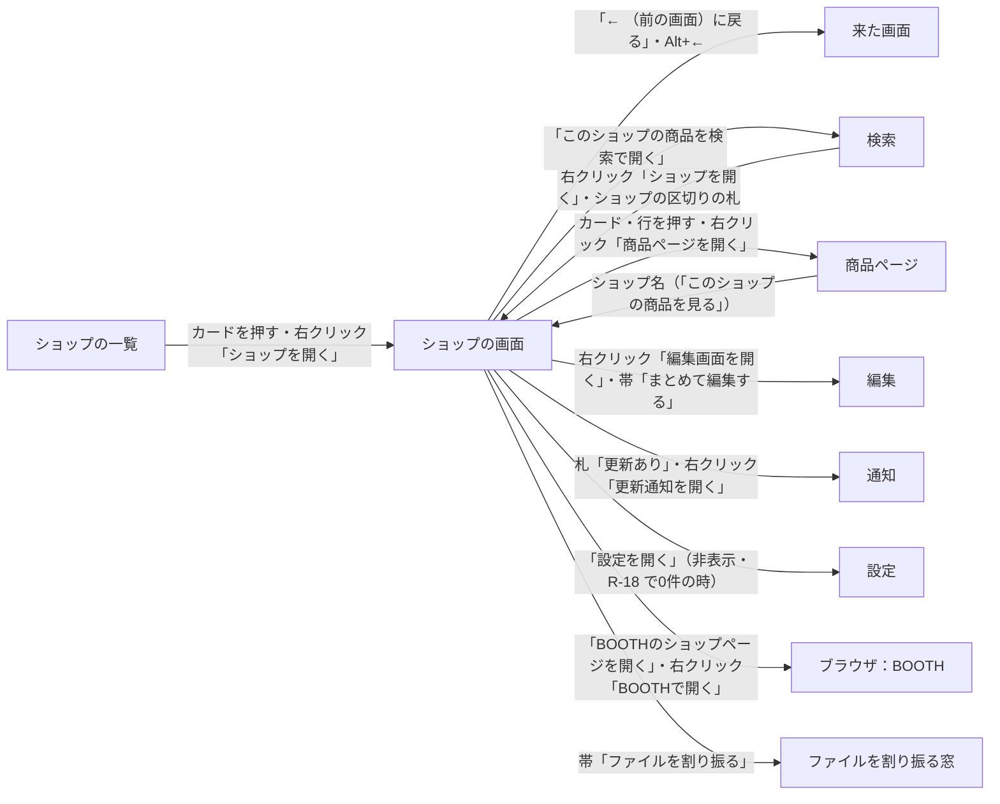

# ショップ（1つのショップの画面）：目的ごとの操作の経路（2026-11-15・案）

入口は、ショップの一覧のカード・商品ページのショップ名（吹き出し「このショップの商品を見る」）・検索などの商品の右クリック「ショップを開く」・検索のショップ順の区切りの札・BOOTH のショップの URL のドロップ [推測：ドロップの判定は Core の DropAction.OpenShop]。ナビには項目が無い。
コードを読んで書いた物で、画面で確かめていない。手数はクリック・キー・打つ（1語）・ドラッグをそれぞれ1。右クリックのメニューの子（▸）を開くのも1。
**頻度の列はユーザが付ける**（毎回／時々／まれ）。

場所：上の帯＝画面の一番上の、左に「← （前の画面）に戻る」、右に「画像を取り直す」「このショップの商品を検索で開く」「BOOTHのショップページを開く」がある行（流しても動かない）／バナー＝その下の「▸ バナー」の三角と絵／名前の段＝アイコン・星・ショップ名・ドメインと、右の「所持」「購入総額」「容量」「最終購入」／メモ＝「メモ」の入力欄／商品の行＝「このショップの商品」「n 件」と、右の「所持しているものだけ」「更新があるものだけ」「カード｜リスト」（流すと上で止まる）／一覧＝商品のカードかリスト／1行の見出し＝流して名前の段が隠れると上に重なる細い帯（アイコン・星・名前・メモの1行目・集計）／右クリック＝商品の右クリックのメニュー／選択の帯＝選んだ時に下に出る「n 件を選択中」の帯／大きさ＝右下のつまみ

## ショップを見る・書き留める

| # | 目的 | 手順（画面の文言で） | 手数 | 場所 | 別の経路 | 頻度 |
|---|---|---|---|---|---|---|
| A1 | ショップの所持数・使った額・容量・最終購入を知る | 名前の段の「所持」「購入総額」「容量」「最終購入」を見る | 0 | 名前の段 | 流した後は1行の見出しにも同じ4つ。ショップの一覧のカード（「支出」） | |
| A2 | バナーを見る・しまう | 「バナー」の三角を押す | 1 | バナー | しまったかは全部のショップで同じで、次も覚える。バナーの無いショップには三角ごと出ない | |
| A3 | ショップのメモを書く（利用規約・問い合わせ先・別名義など） | 「メモ」の欄に打つ（止まると保存） | 1 | メモ | 流した後は1行の見出しにメモの1行目が出て、乗せると全文 | |
| A4 | お気に入りのショップにする・外す | 名前の前の星（☆）を押す | 1 | 名前の段 | 1行の見出しの星・ショップの一覧のカードの星と右クリック | |
| A5 | ショップ名・ドメインを写す | 名前かドメインをなぞって Ctrl+C | 2 | 名前の段 | — | |
| A6 | アイコン・バナーが古い時に取り直す | 「画像を取り直す」→ 左に結果（「アイコンとバナーを取り直しました。」「変わっていませんでした。」など） | 1 | 上の帯 | 取っている間は押せない | |
| A7 | BOOTH のショップのページを見る | 「BOOTHのショップページを開く」 | 1 | 上の帯 | ショップの一覧の右クリック。BOOTH に無いショップでは押せない | |

## 商品を探す・絞る

| # | 目的 | 手順 | 手数 | 場所 | 別の経路 | 頻度 |
|---|---|---|---|---|---|---|
| A8 | 持っている商品だけ見る | 「所持しているものだけ」にチェック | 1 | 商品の行 | — | |
| A9 | 更新のあった商品だけ見る | 「更新があるものだけ」にチェック | 1 | 商品の行 | 更新のある商品が無い時はチェック自体が出ない | |
| A10 | このショップの商品を条件で絞る・並べ替える（名前・タグ・対応アバターなど） | 「このショップの商品を検索で開く」→ 検索で条件を足す | 2〜 | 上の帯→検索 | この画面には探す欄・表示順が無い | |
| A11 | 0件の時に理由を知って戻す | 一覧の「表示する商品がありません」の下の文を読む →（非表示・R-18 なら）「設定を開く」 | 1 | 一覧→設定 | 絞りが理由なら文が外すチェックの名前を言う | |

## 見え方

| # | 目的 | 手順 | 手数 | 場所 | 別の経路 | 頻度 |
|---|---|---|---|---|---|---|
| A12 | カードとリストを切り替える | 「カード」か「リスト」 | 1 | 商品の行 | どちらかはショップの画面として覚える | |
| A13 | カードの大きさ・リストの行の高さを変える | 右下のつまみをドラッグ | 1 | 大きさ | 検索と同じ値 [推測：同じ ItemViewSize.Current] | |
| A14 | リストの列の幅を変える（★・名前・入手日・状態） | 列の見出しの境目をドラッグ | 1 | 一覧 | — | |

## 商品1件に対して

| # | 目的 | 手順 | 手数 | 場所 | 別の経路 | 頻度 |
|---|---|---|---|---|---|---|
| A15 | 商品の中身（商品ページ）を見る | カードか行を押す | 1 | 一覧 | 右クリック →「商品ページを開く」・Enter。選んでいる最中はカードに乗せて「中を見る」 | |
| A16 | 商品をお気に入りにする・外す | カードの星を押す | 1 | 一覧 | 右クリック →「お気に入りに追加」／「お気に入りから外す」 | |
| A17 | 商品の BOOTH のページを見る・リンクを写す | 右クリック →「BOOTHで開く」／「リンクをコピー」 | 2 | 右クリック | 中クリック [推測：検索と同じ命令を借りる] | |
| A18 | 更新を見る・既読にする | 札「更新あり」を押す ／ 右クリック →「既読にする」 | 1／2 | 一覧・右クリック | 右クリック →「更新通知を開く」 | |
| A19 | 手元のファイル・フォルダを開く | 右クリック →「開く ▸」→「エクスプローラで開く…」 | 3 | 右クリック | zip の中は「一時的に展開して開く…」 | |
| A20 | Unity へ入れる | 右クリック →「Unity ▸」→「Unityへ送る…」→ 窓で選ぶ → 送る | 5 | 右クリック→窓 | 「改変に追加して送る…」。選んで帯の「Unityへ送る…」 | |
| A21 | Unity の中でその商品の物を選ぶ | 右クリック →「Unity ▸」→「Unityで選択…」 | 3 | 右クリック | — | |
| A22 | 編集する（タグ・属性・メモ） | 右クリック →「編集画面を開く」 | 2 | 右クリック | 商品ページから | |
| A23 | 改変に追加する | 右クリック →「改変に追加…」→ 窓で選ぶ | 3 | 右クリック→窓 | 選んで帯の「改変に追加…」 | |
| A24 | 見たくない商品を隠す | 右クリック →「非表示にする」 | 2 | 右クリック | その場で一覧から消える。戻すのは下に出る「非表示を解除」か設定の「非表示にした商品」 | |
| A25 | プラグインへ渡す | 右クリック → プラグインの項目 | 2 | 右クリック | 選んで帯の「プラグイン ▾」。ソフトを追加した時だけ | |

## まとめて

| # | 目的 | 手順 | 手数 | 場所 | 別の経路 | 頻度 |
|---|---|---|---|---|---|---|
| A26 | いくつか選ぶ | カードの左上の選ぶ箱（乗せると出る）・リストの選ぶ列を押していく → 下に「n 件を選択中」の帯 | 件数 | 一覧→選択の帯 | Ctrl・Shift+クリック、右クリック →「選ぶ」、Ctrl+A、帯の「すべて選択」 | |
| A27 | このショップの物をまとめて編集する | 選ぶ →「まとめて編集する」 | 件数+1 | 選択の帯 | 全部なら Ctrl+A →「まとめて編集する」 | |
| A28 | まとめてお気に入り・改変に追加・既読にする | 選ぶ →「お気に入りに追加」／「改変に追加…」／「既読にする」 | 件数+1 | 選択の帯 | お気に入りから外すのは帯に無い | |
| A29 | まとめて Unity へ送る | 選ぶ →「Unityへ送る…」→ 窓 | 件数+2 | 選択の帯→窓 | 止めるのは「中止」 | |
| A30 | 選んだ商品の間でファイルを割り振る | 2件以上選ぶ →「ファイルを割り振る」 | 件数+1 | 選択の帯 | 1件では押せず「2件以上の商品を選ぶと使えます。」 | |
| A31 | 選ぶのをやめる | 「選択を解除」 | 1 | 選択の帯 | Esc・Ctrl+Shift+A | |

## 行き来

| # | 目的 | 手順 | 手数 | 場所 | 別の経路 | 頻度 |
|---|---|---|---|---|---|---|
| A32 | 前の画面へ戻る | 「← （前の画面）に戻る」 | 1 | 上の帯 | Alt+←・マウスの戻る。戻ると、ショップの中の位置と絞りを戻す | |
| A33 | 画面の中の文字を探す | Ctrl+F → 打つ | 2 | どこでも | 1行の見出しは探さない | |

## 画面の間の行き来

## 見るだけの部品

名前の段のアイコン（届くまでは頭文字）・「所持」「購入総額」「容量」「最終購入」と※（乗せると「入手日が未入力なので、ファイルの日付を表示しています。」）／バナーの場所の「バナーを確認しています…」「このショップはバナーを設定していません」／上の帯の「画像を取り直す」の結果の文（「ショップの画像を取り直しています…」「取得できませんでした。時間をおいて試してください。」など）／商品の行の「このショップの商品」「n 件」か「n 件 / 全 m 件」「BOOTHの全商品ではなく、ローカルに情報があるものだけです。」（狭いと「…」）／1行の見出しのメモの1行目（乗せると全文）と集計／0件の時の「表示する商品がありません」と理由の文（「「所持しているものだけ」を外すと n 件表示されます。」「非表示にしている商品が n 件あります。…」「R-18 の商品が n 件あります。…」「このショップの商品は、まだ取り込まれていません。」）／カードとリストの札（所持・未編集・取り込み中・見つからない など。検索と同じ）

## 部品の一覧

| 部品（画面の文言） | 場所 | 操作 | 起きる事 | 出る条件 | ID・ファイル:行 |
|---|---|---|---|---|---|
| ← （前の画面）に戻る | 上の帯 | 押す | 画面の履歴を1つ戻る | 戻る先がある時 | Views/ShopView.xaml:31・ViewModels/MainViewModel.History.cs:59 |
| 画像を取り直す（吹き出し「このショップのアイコンとバナーを、普段と同じ手順で取り直します。」） | 上の帯 | 押す | BOOTH からアイコンとバナーを取り直し、左に結果 | 取っている間は押せない | ShopView.xaml:40・ShopViewModel.cs:360 |
| このショップの商品を検索で開く（吹き出し「このショップの商品で絞って、検索を開きます。」） | 上の帯 | 押す | 検索へ移り、このショップの条件だけにする | いつも | ShopView.xaml:44・MainViewModel.cs:1062 |
| BOOTHのショップページを開く（吹き出し「BOOTHのショップページをブラウザで開きます。アプリの外へ出ます。」） | 上の帯 | 押す | ブラウザで BOOTH のショップ | BOOTH に無いショップでは押せない | ShopView.xaml:47・ShopViewModel.cs:41 |
| 「バナー」の三角 | バナー | 押す | バナーを畳む・開く（全部のショップで同じ・覚える） | バナーがあるか、有無を確かめている間 | Name「バナー」・ShopView.xaml:83 |
| 星 ☆／★（吹き出し「お気に入りのショップにする」／「お気に入りのショップから外す」） | 名前の段 | 押す | ショップの星を切り替える | いつも | ShopFavorite・ShopView.xaml:128 |
| ショップ名・ドメイン | 名前の段 | なぞる | 選んで写せる | いつも | ShopView.xaml:158・160 |
| メモの欄（透かし「メモ」） | メモ | 打つ | 止まってから保存 | いつも | Name「ショップのメモ」・ShopView.xaml:204 |
| 所持しているものだけ | 商品の行 | チェック | 所持する商品だけにする。戻ると戻す | いつも | ShopView.xaml:249 |
| 更新があるものだけ | 商品の行 | チェック | 「更新あり」の札の商品だけにする | 更新のある商品がある時 | ShopView.xaml:252 |
| カード｜リスト（吹き出し「絵の大きなカードで並べます」「1行ずつ並べます。列の幅は見出しの境目をドラッグで変えられます」） | 商品の行 | 押す | 見方を替える（ショップの画面として覚える） | いつも | Views/ItemCardResources.xaml:775・783 |
| 設定を開く | 一覧（0件の時） | 押す | 設定へ | 非表示・R-18 で隠れた商品がある時 | ShopView.xaml:273・ShopViewModel.cs:977 |
| リストの見出し（★・名前・入手日・状態）の境目 | 一覧 | ドラッグ | 列の幅を替える（ショップの画面として覚える） | リストの時 | ItemList・ShopView.xaml:282・ShopViewModel.cs:732 |
| 商品のカード・行 | 一覧 | 押す・Enter・Space・矢印・Ctrl/Shift+クリック | 商品ページへ／選んでいる最中は選ぶ切り替え／隣へ／選ぶ | いつも | CardList・ShopView.xaml:295・ItemCardResources.xaml:346 |
| カードの星・選ぶ箱・「中を見る」・札「更新あり」 | 一覧 | 押す | 検索の画面と同じ（search.md の部品の一覧「一覧」） | 検索と同じ | ItemCardResources.xaml |
| 右クリック（BOOTHで開く・リンクをコピー・商品ページを開く・ショップを開く・編集画面を開く・選ぶ・お気に入りに追加／外す・改変に追加…・更新通知を開く・既読にする・開く ▸・Unity ▸・非表示にする・プラグイン） | 右クリック | 押す | 検索と同じ命令を借りる。違うのは「改変に追加…」（選んだ物の上なら選んだ全部）と「非表示にする」（この一覧からもその場で消す） | 検索と同じ | ItemCardResources.xaml:29-128・ShopViewModel.cs:686 |
| （目的なし）右クリック「ショップを開く」 | 右クリック | 押す | 今のショップをもう一度開く [推測：開き直しで位置が先頭に戻る] | いつも | CardMenu.OpenShop・ItemCardResources.xaml:46 |
| 選択の帯（すべて選択・選択を解除・お気に入りに追加・改変に追加…・Unityへ送る…・ファイルを割り振る・まとめて編集する・既読にする・プラグイン ▾・中止） | 選択の帯 | 押す | 検索と同じ（search.md の部品の一覧「一覧」） | 1件以上選んだ時か Unity へ送っている時 | ShopView.xaml:59・ItemCardResources.xaml:652 |
| 大きさのつまみ（「カードの大きさ」／「行の高さ」） | 大きさ | ドラッグ | カードの大きさ・行の高さ | カードの時／リストの時 | ItemCardSize／ItemListRowHeight・ShopView.xaml:56・ItemCardResources.xaml:800 |
| 1行の見出しの星 | 1行の見出し | 押す | 名前の段の星と同じ | 名前の段が隠れるまで流した時 | ShopCompactFavorite・ShopView.xaml:366 |
| 1行の見出しのメモの1行目 | 1行の見出し | 乗せる | メモの全文を吹き出しで | メモに字がある時 | ShopCompactMemo・ShopView.xaml:399 |
| 画面全体 | どこでも | ホイール・Ctrl+A・Ctrl+Shift+A・Ctrl+Shift+I・Esc・Ctrl+F | 1本で流す／全部選ぶ・外す・反転・解除／画面内検索 | いつも | ShopScroll・ShopView.xaml:68・docs/spec/ui-keyboard.md:18 |

## 気付いた事

- 同じ事に経路が2つ以上：ショップの星（名前の段・1行の見出し・ショップの一覧）。BOOTH のショップのページ（ここは上の帯のボタン・一覧は右クリックの中）。商品ページへ（押す・右クリック・Enter・「中を見る」）。
- 右クリックの「ショップを開く」は、この画面では今のショップを開き直すだけ（検索と同じメニューをそのまま借りている）。
- 隠れて見つけにくい物：名前・ドメインはなぞって写せるが見た目は文字のまま。メモは1行の見出しで乗せた時だけ全文。選ぶ箱はカードに乗せた時だけ出る。Ctrl・Shift+クリックでの選び方はどこにも書いていない。
- 手数が多い・端と端を行き来する目的：このショップの中を条件で絞るには検索へ移るしかない（探す欄・表示順がこの画面に無い）。ショップの一覧の「更新があるものだけ」で来ても、ここで「更新があるものだけ」を押し直す。Unity へ入れる（A20）は右クリックから5手。上の帯（画面の一番上）のボタンと選択の帯（画面の一番下）が上下の端に分かれる。
- 文言の揺れ：使った額が、ここでは「購入総額」、ショップの一覧では「支出」。お気に入りが、ショップは「お気に入りのショップにする」、商品は「お気に入りに追加」、一覧のチェックは「★ だけ」。BOOTH を開く項目が、上の帯は「BOOTHのショップページを開く」、商品の右クリックは「BOOTHで開く」。リストの列はショップの列の代わりに「入手日」（検索のリストと列の数・並びが違う。検索は「ユーザータグ」「属性」「払った額」「対応」もある）。
- メモの欄の見出しも透かしも「メモ」で、同じ語が2回並ぶ。
