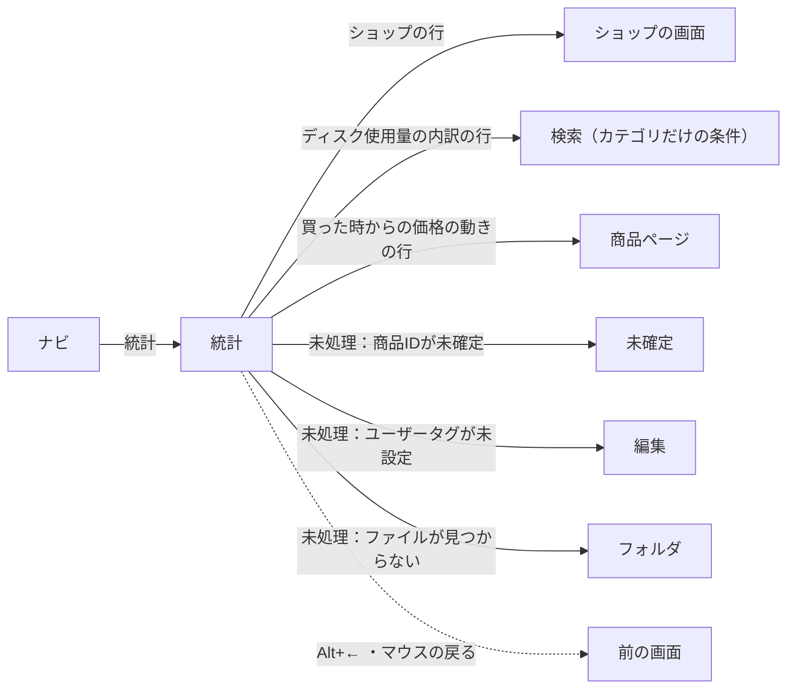

# 統計：目的ごとの操作の経路（2026-11-15・案）

入口はナビ（左の縦の並び）の「統計」だけ。ほかの画面から統計へ来るボタンは無い。統計を開いている時にナビの「統計」をもう一度押しても何も起きない（集計し直すには、別の画面へ移ってから開き直す）。
コードを読んで書いた物で、画面で確かめていない。手数はクリック・キー・打つ（1語）・ドラッグをそれぞれ1。右クリックのメニューの子（▸）を開くのも1。**スクロールは手数に数えない**（代わりに場所の列に「上の方」「下の方」と書く）。
**頻度の列はユーザが付ける**（毎回／時々／まれ）。

場所：上の帯＝画面の一番上の「統計」の見出しと説明文の行。右端に期間の欄（初めは「直近 12 ヶ月」。窓の幅が狭いと説明文の下の段へ送られる）／タイル＝上の帯のすぐ下の、大きな数字の4〜5枚の札（所持商品・累計支出・ディスク使用量・ショップ数。贈答がある時は「贈答に使った額」を足して5枚）／上の方のカード＝タイルの下から「未処理」までのカード（支出の推移・アバター別の所持数・ショップ・ディスク使用量の内訳・未処理）／下の方のカード＝「価格帯」から一番下の「手元の状態」まで（コードの注では「選んで足した項目」）。カードは見出しの文言で指す

統計の画面には右クリックのメニュー・キーの割り当て・窓は無い。押せるのは期間の欄と、カードの中の一部の行だけ。

## 全体をつかむ

| # | 目的 | 手順（画面の文言で） | 手数 | 場所 | 別の経路 | 頻度 |
|---|---|---|---|---|---|---|
| A1 | 持っている商品の数・使った額・ディスクの量をざっと知る | ナビの「統計」→ タイルを読む | 1 | ナビ→タイル | — | |
| A2 | 何を数えているかを知る（未所持は入るか、非表示・R-18 は入るか） | 上の帯の説明文「ファイルを持っている商品だけを集計しています。非表示とR-18も含みます。」を読む | 0 | 上の帯 | 窓の幅が狭いと、説明文を切らずに期間の欄の方を次の段へ送る。さらに狭いと説明文は「…」で切れる | |
| A3 | 月ごとの支出の流れを見る | 「支出の推移」の棒を見る | 0 | 上の方のカード | — | |
| A4 | 見る期間を変える | 上の帯の右端の「直近 12 ヶ月」の欄 → 直近 24 ヶ月・今月・先月・今年・去年・年を選ぶ（右の年の欄）・開始と終了を選ぶ（右の日の欄2つ・カレンダー）・全期間 | 2〜4 | 上の帯 | 変わるのは見出しの横に期間の札がある欄（支出の推移・ショップ・価格帯・カテゴリ・ユーザータグ）と、タイルの2行目。開き直すと「直近 12 ヶ月」に戻る | |
| A5 | ある月（年）の額と件数をちょうどの値で知る | 「支出の推移」の棒にマウスを乗せる → 吹き出し | 1（乗せる） | 上の方のカード | 棒の上の額は一番高い月と最後の月にしか書いていない | |
| A6 | 合計に入っていない分を知る | タイルの下の枠「金額の記録が無い商品が ○ 件あります。その分は総額に入っていません。」（右の「まとめて編集する」でその商品を編集の画面で開ける）と、「支出の推移」の下の小さな文（入手日が無い・日付が分からない件数）を読む | 0 | タイルの下・上の方のカード | 記録が無い時は出ない | |

## 調べて、ほかの画面へ移る

| # | 目的 | 手順 | 手数 | 場所 | 別の経路 | 頻度 |
|---|---|---|---|---|---|---|
| A7 | どのアバター向けを多く持っているかを知る | 「アバター別の所持数」の棒を見る（持っていないバリエーション向けの分は数えない） | 0 | 上の方のカード | 行は押せない（そのアバターの商品を検索で開く経路は無い）。紐付けが1件も無い時は「対応アバターがまだ1件も紐付いていません。…」 | |
| A8 | よく買う・多く持っている・スキ数の多いショップを開く | 「ショップ」の中の右上で「金額」「商品数」「スキ数」を選ぶ → 行を押す → ショップの画面 | 1〜2 | 上の方のカード | ナビの「ショップ」から探す。上位10件だけ。並べる物はアプリを閉じるまで覚える | |
| A9 | ディスクを食っているカテゴリの商品を一覧で見る | 「ディスク使用量の内訳」の行を押す → 検索の画面（そのカテゴリだけの条件。前の条件は消える） | 1 | 上の方のカード | 検索の画面で条件「カテゴリ」を足す | |
| A10 | 同じ中身を二重に持っている場所を知る（空ける場所を探す） | 「ディスク使用量の内訳」の下の「空けられる場所」の組を読む（空く量・どの商品か・置き場所の一覧） | 0 | 上の方のカード | 行は押せない。消す・エクスプローラで開くはここからできない。無い時は「同じ中身を二重に持っているものはありません」 | |
| A11 | 値段が変わった商品を開く | 「買った時からの価格の動き」の行を押す → 商品ページ | 1 | 下の方のカード | 上位10件だけ。無い時は「買った時と今で価格が変わった商品はありません。」 | |

## 残っている作業を片付けに行く（「未処理」）

| # | 目的 | 手順 | 手数 | 場所 | 別の経路 | 頻度 |
|---|---|---|---|---|---|---|
| A12 | 商品が決まっていないファイルを片付ける | 「未処理」の「商品IDが未確定」の行を押す → 未確定の画面 | 1 | 上の方のカード | ナビの「未確定」 | |
| A13 | ユーザータグを付けていない商品に付ける | 「未処理」の「ユーザータグが未設定」の行を押す → 編集の画面 | 1 | 上の方のカード | ナビの「編集」（どちらも、前回の続きが残っていればそこから始まり、無ければ未設定の商品を積む） | |
| A14 | ファイルが見つからない商品を見る | 「未処理」の「ファイルが見つからない」の行を押す → フォルダの画面 | 1 | 上の方のカード | 検索の条件「見つからないファイル」で商品を絞る／記録をまとめて消すのは設定の「データ」の「記録をすべて削除…」 | |
| A15 | 片付ける物が残っていないかを確かめる | 「未処理」に「残っている作業はありません。」が出ているかを見る | 0 | 上の方のカード | 0件の行は出ない（3行のうち残っている物だけ並ぶ） | |

## 細かい内訳を見る（下の方のカード。どれも押せない）

| # | 目的 | 手順 | 手数 | 場所 | 別の経路 | 頻度 |
|---|---|---|---|---|---|---|
| A16 | どの価格帯を多く買っているか・無料とギフトの数を知る | 「価格帯」の棒と、その下の「無料で手に入れたもの」「ギフトで貰ったもの」を読む | 0 | 下の方のカード | — | |
| A17 | カテゴリごと・ユーザータグごとの支出と点数を比べる | 「カテゴリ」「ユーザータグ」のカードの「支出」「点数」の棒を読む | 0 | 下の方のカード | 押せない（上の「ディスク使用量の内訳」のカテゴリの行は押せる） | |
| A18 | 同じショップでまた買っているかを知る | 「ショップ」の下の「また買っているか」を読む | 0 | 上の方のカード | — | |
| A19 | 容量の大きい商品を知る | 「容量の大きい商品」の棒を読む | 0 | 下の方のカード | 押せない。開くには検索の画面で並べ替えを大きさにする | |
| A20 | 自分の付けた属性の傾向を見る | 「属性」の分布と「軸どうしの関係」を読む（区切りを変えるなら「属性」の右上の「区切りの幅」で 5・10・20。値の種類が区切りの数以下の属性は値ごとに1本） | 0〜1 | 下の方のカード | 属性が無い時は「まだ属性を付けた商品がありません。編集画面から付けられます。」 | |
| A21 | 持っているアバターに着られる物がどれだけあるかを知る | 「所有アバターに着られるもの」を読む | 0 | 下の方のカード | 所有アバターが分からない時は「…アバターの管理から検出できます。」（押せない文） | |
| A22 | 仕分けていない物・非表示・もう買えない物の数を知る | 「手元の状態」を読む（「もう買えないもの」は「手元にしか無いものです。」） | 0 | 下の方のカード | 非表示を戻すのは設定の「隠したもの」。バックアップは設定の「データ」 | |
| A23 | 集計を今の状態に合わせ直す | ほかの画面へ移る → ナビの「統計」 | 2 | ナビ | 統計の画面に読み直すボタンは無い。集計は画面を開いた時の1回だけ（取り込みが終わっても読み直さない） | |

## 画面の間の行き来

## 見るだけの部品

上の帯の説明文／タイル（所持商品・累計支出（贈答がある時は「自分用の累計支出」）・ギフトした額・ディスク使用量（うち重複コピー）・ショップ数）／払った額の記録が無い断り／「支出の推移」の但し書きと目盛り・月と年の札／アバター別の所持数（最後に灰色の「対応アバター未設定」）／重複コピーの説明の枠／空けられる場所の組／価格帯・無料・ギフト／カテゴリ・ユーザータグの支出と点数（ユーザータグは灰色の「未設定」と、合計が一致しない断り）／点数の多いショップ・また買っているか／容量の大きい商品／属性の分布・軸どうしの関係（出ない時の理由の文）／所有アバターに着られるもの（「直接 + 素体経由 n」）／手元の状態（買ったまま仕分けていないもの・非表示にしているもの・もう買えないもの・BOOTHに無い商品として登録したもの・スキ数の分布）／集計中の「集計しています…」／0件の時の「集計できる商品がまだありません」

## 部品の一覧

| 部品（画面の文言） | 場所 | 操作 | 起きる事 | 出る条件 | ID・ファイル:行 |
|---|---|---|---|---|---|
| 統計 | ナビ | クリック | 統計の画面を開く（開いている時は何もしない） | いつも | Nav.Stats・MainWindow.xaml:499・MainViewModel.cs:109 |
| 期間の欄「直近 12 ヶ月」（直近 24 ヶ月／今月／先月／今年／去年／年を選ぶ／開始と終了を選ぶ／全期間） | 上の帯の右端 | 選ぶ | 期間で変わる欄とタイルの2行目を集計し直す（全商品は読み直さない）。開き直すと「直近 12 ヶ月」に戻る | 集計できる商品がある時 | StatsRange「集計する期間」・StatsViewModel.Ranges |
| 年の欄 | 期間の欄の右 | 選ぶ | 選んだ年で数える。候補は購入のある年と今年 | 「年を選ぶ」の時 | StatsYear「集計する年」 |
| 開始の日・終了の日 | 期間の欄の右 | 押す → カレンダーで選ぶ | 選んだ日で数える。片方だけなら、もう片方の端は切らない。逆に選ぶと入れ替える | 「開始と終了を選ぶ」の時 | StatsCustomFrom・StatsCustomTo |
| 期間の札（「2025年」など） | 期間で変わる欄の見出しの右 | 乗せる | 吹き出し「この欄は、選んだ期間で数えます。」 | いつも | （ID 無し）・StatsView.xaml の PeriodPill |
| 各欄の見出しの左の三角 | 各カード | クリック | 欄を畳む・開く。欄ごとに次の起動まで覚える（「軸どうしの関係」だけ初めは畳む） | いつも | 名前は欄の見出し・StatsView.xaml・Services/StatsPanels.cs |
| 「区切りの幅：」5／10／20 | 「属性」の見出しの右 | 選ぶ | 全部の属性の分布をその幅で区切り直す（値の種類が区切りの数以下の属性は値ごとに1本）。アプリを閉じるまで覚える | 属性を付けた商品がある時 | StatsAttributeWidth5・10・20・StatsView.xaml・StatsExtras.AttributeBars |
| 「支出の推移」の棒 | 上の方のカード | 乗せる | 吹き出し「（年月）：¥額／n 件」 | 期間に月がある時 | （ID 無し）・StatsView.xaml:248・StatsViewModel.cs:33 |
| 「ショップ」の「金額」／「商品数」／「スキ数」 | 「ショップ」の中の右上（行の上） | 選ぶ | 並べる物を替える（スキ数は持っている商品のスキ数の合計）。アプリを閉じるまで覚える | 欄を開いている時 | StatsShopOrderSpent・Count・Wish・StatsViewModel.RebuildShops |
| 「ショップ」の行 | 上の方のカード | クリック | そのショップの画面を開く。吹き出し「このショップの画面を開きます。」 | 上位10件 | StatsShopRow・StatsView.xaml・StatsViewModel.RebuildShops |
| 「ディスク使用量の内訳」の行 | 上の方のカード | クリック | 検索の条件を消し、そのカテゴリだけで検索の画面を開く。吹き出し「このカテゴリの商品を検索画面で開きます。」 | 上位8件 | StatsCategoryRow・StatsView.xaml:369・StatsViewModel.cs:566・SearchViewModel.ShowOnly.cs:88 |
| 「未処理」の行（商品IDが未確定／ユーザータグが未設定／ファイルが見つからない） | 上の方のカード | クリック | 未確定の画面／編集の画面／フォルダの画面を開く | 件数が1以上の行だけ | StatsBacklogRow・StatsView.xaml:461・StatsViewModel.cs:741-771 |
| 「買った時からの価格の動き」の行 | 下の方のカード | クリック | その商品の商品ページを開く | 上位10件 | StatsPriceChangeRow・StatsView.xaml:546・StatsViewModel.cs:610 |

## 気付いた事

- **同じ見た目の棒で、押せる物と押せない物が混ざる。**「買った時からの価格の動き」は押せるが「容量の大きい商品」は押せない。「ディスク使用量の内訳」のカテゴリは押せるが、「カテゴリ」のカードの支出・点数の棒は押せない。「アバター別の所持数」も押せない。押せる行はマウスを乗せた時に地の色が変わり指の形になるだけで、押せない行との見分けは乗せるまで付かない
- **期間の欄が何を変えるかは、欄ごとの札で示す**（2026-11-19・open.md 104）。期間で変わる欄だけ見出しの右に期間の札が付き、全期間のままの欄には付かない。期間の欄そのものは上の帯の右端で、カードとは離れている
- **読み直す経路が隠れている。**集計は画面を開いた時の1回だけ（StatsViewModel.cs:142）。統計を開いたままナビの「統計」を押しても何も起きず、取り込みが終わっても変わらない。別の画面へ移って戻るしかない
- 「未処理」の「ユーザータグが未設定」は、押すと編集の画面へ行くが、前回の編集の続きが残っていればそちらが出る（未設定の商品だけが並ぶとは限らない。ナビの「編集」と同じ動き。MainViewModel.cs:98・:743）
- 「未処理」の「ファイルが見つからない」はフォルダの画面へ行く。検索には同じ物の条件「見つからないファイル」があるが、そちらへは行かない。まとめて消すのは設定の「データ」にある（3か所に分かれる）
- 「空けられる場所」は置き場所のパスまで出すが、そこから開く・消す操作は無い。エクスプローラを自分で開いてパスを辿ることになる
- 下の方のカードは9枚のうち8枚が読むだけで、画面を下まで送らないと見えない。上の方は押せる物、下の方は読むだけの物にほぼ分かれる
