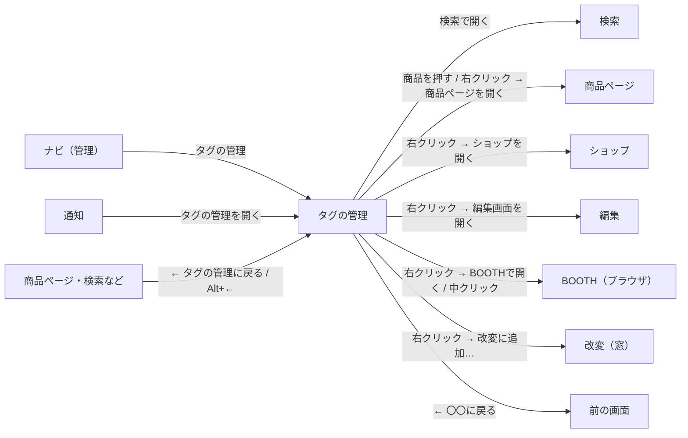

# タグの管理：目的ごとの操作の経路（2026-11-15・案）

入口はナビの「管理」の下の「タグの管理」。ほかに、通知の「タグの管理を開く」（一覧に無いユーザータグの通知）と、戻る・進む（「← タグの管理に戻る」・Alt+←）から来る。
コードを読んで書いた物で、画面で確かめていない。手数はクリック・キー・打つ（1語）・ドラッグをそれぞれ1。右クリックのメニューの子（▸）を開くのも1。確認の窓の「OK」も1。
**頻度の列はユーザが付ける**（毎回／時々／まれ）。

場所：
- 上の帯＝画面の一番上の「ユーザータグの管理」の見出しと、右端の「読み直す」がある行
- 左の欄＝左の「大分類を検索・追加」の欄・「表示順」の3つのボタン・大分類の一覧
- 右の札＝右の上の、選んだ大分類の大きな名前・「名前を変更」・右上の赤い「削除」・メモの欄がある札
- 小分類の札＝その下の「小分類」の見出し・「カード｜リスト」・探す・足す欄・「すべて広げる」と、小分類の行が並ぶ札
- 小分類の行＝小分類1つ分の行（三角・名前・件数・「メモ」の欄・右の4つのボタン）
- 注意の欄＝右の一番上の黄色い「一覧に無いユーザータグ」の欄（そういう名前がある時だけ出る）
- 右下＝右の欄の一番下の大きさのスライダー
- 右クリック＝左の一覧の大分類の行の右クリック／カードの右クリック
- 窓＝「名前を変更」「小分類を移す」「別の大分類の小分類にする」の窓と、確認の窓

右の欄の操作は、先に左の一覧で大分類の行を押して選ぶ（1手）。下の表の手数はこの1手を含む。

## 探す・見る

| # | 目的 | 手順（画面の文言で） | 手数 | 場所 | 別の経路 | 頻度 |
|---|---|---|---|---|---|---|
| A1 | 大分類を名前で探して開く | 「大分類を検索・追加」の欄に打つ → 一覧の行を押す | 2 | 左の欄 | 打った名前とぴったり同じなら Enter で選ばれる（同じ名前が無いと Enter で追加になる。気付いた事） | |
| A2 | 小分類の名前やメモの言葉から、その大分類を探す | 欄に打つ → 行に「・小分類「…」」「・メモ」と出た行を押す | 2 | 左の欄 | 開くと当たった小分類の名前が強調される | |
| A3 | 大分類の中身（件数・小分類・メモ）を見る | 一覧の行を押す | 1 | 左の欄→右 | 一覧の上で ↑↓ [推測] | |
| A4 | 小分類に付いている商品を見る | 行を押す → 小分類の行の三角 | 2 | 左の欄→小分類の行 | 商品の無い小分類は三角が押せない（吹き出し「この小分類はまだどの商品にも付いていません。」） | |
| A5 | 小分類の中身をまとめて見る | 行を押す →「すべて広げる」 | 2 | 左の欄→小分類の札 | 全部開くと「すべて折りたたむ」に変わる。探している間は出ている小分類だけ | |
| A6 | この大分類の中を、商品名・小分類の名前で探す | 行を押す →「この大分類の中を小分類・商品で探す」に打つ | 2 | 左の欄→小分類の札 | 当たった小分類が開き、欄の下に「当たる小分類 n 件・商品 m 件」 | |
| A7 | 中の商品の見え方を替える | 「カード」か「リスト」を押す ／ 右下のスライダーをドラッグ | 1 | 小分類の札・右下 | スライダーは「カードの大きさ」「行の高さ」で、値はこの画面で覚える（設定で全画面で1つにもできる） | |
| A8 | 商品のページを開く | 行を押す → 小分類の三角 → 商品を押す | 3 | 左の欄→小分類の行 | カードで並べた時はカードを押す | |
| A9 | 大分類が付いた商品を検索画面で見る | 行を押す → 名前の下の「検索で開く」 | 2 | 左の欄→右の札 | 一覧の行の右クリック →「検索で開く」（2）。未使用なら押せない | |
| A10 | 小分類が付いた商品を検索画面で見る | 行を押す → 小分類の行の「検索で開く」 | 2 | 左の欄→小分類の行 | — | |
| A11 | 中の商品から BOOTH・ショップ・編集画面・Unity などへ進む | 小分類を開く → カードを右クリック → 項目（「BOOTHで開く」「ショップを開く」「編集画面を開く」「Unity」▸ など） | 4〜5 | 小分類の行→右クリック | BOOTH はカードの中クリック。リストの見方の行にも同じ右クリックと中クリックがある | |

## 作る・書く

| # | 目的 | 手順（画面の文言で） | 手数 | 場所 | 別の経路 | 頻度 |
|---|---|---|---|---|---|---|
| A12 | 大分類を足す | 「大分類を検索・追加」の欄に名前を打つ →「追加」 | 2 | 左の欄 | Enter。同じ名前があると欄の下に「「…」は既にあります。」 | |
| A13 | 小分類を足す | 行を押す → 探す・足す欄に名前を打つ →「追加」 | 3 | 左の欄→小分類の札 | 「追加」の代わりに Enter | |
| A14 | 大分類にメモを書く | 行を押す → 右の札の「メモ」の欄に打つ | 2 | 左の欄→右の札 | 押さずに保存される | |
| A15 | 小分類にメモを書く | 行を押す → 小分類の行の「メモ」の欄に打つ | 2 | 左の欄→小分類の行 | — | |

## 直す

| # | 目的 | 手順（画面の文言で） | 手数 | 場所 | 別の経路 | 頻度 |
|---|---|---|---|---|---|---|
| A16 | 大分類の名前を変える | 行を押す → 名前の横の「名前を変更」→ 窓で新しい名前を打つ →「名前を変える」 | 4 | 右の札→窓 | 一覧の行の右クリック →「名前を変更」（4） | |
| A17 | 2つの大分類を1つにまとめる | 行を押す →「名前を変更」→ 窓で既にある名前を選ぶ（ボタンが「統合する」に変わる）→「統合する」→ 確認の窓で OK | 5 | 右の札→窓 | 右クリック →「名前を変更」から同じ | |
| A18 | 小分類の名前を変える | 行を押す → 小分類の行の「名前を変更」→ 打つ →「名前を変える」 | 4 | 小分類の行→窓 | — | |
| A19 | 2つの小分類を1つにまとめる | 行を押す → 小分類の行の「名前を変更」→ 既にある名前を選ぶ →「統合する」→ 確認で OK | 5 | 小分類の行→窓 | — | |
| A20 | 小分類を別の大分類へ移す | 行を押す →「別の大分類へ移す」→ 窓で移動先を選ぶ →（小分類が1つも残らない商品がある時は「そのまま残す」か「も商品から外す」を選ぶ）→「移す」 | 4〜5 | 小分類の行→窓 | 大分類が1つだけだと押せない（吹き出し「…移すには大分類が2つ以上要ります。」） | |
| A21 | 大分類を、別の大分類の小分類にする | 行を押す → 名前の横の「別の大分類の小分類にする」→ 窓で入れ先を選ぶ →「小分類にする」→ 確認で OK | 5 | 右の札→窓 | 右クリック →「別の大分類の小分類にする」。小分類を持つ大分類・ほかに大分類が無い時は押せない（吹き出しで理由） | |

## 消す

| # | 目的 | 手順（画面の文言で） | 手数 | 場所 | 別の経路 | 頻度 |
|---|---|---|---|---|---|---|
| A22 | 大分類を削除する（小分類も一緒に） | 行を押す → 右上の赤い「削除」→ 確認で OK | 3 | 右の札→窓 | 一覧の行の右クリック →「この大分類を削除」→ OK（3） | |
| A23 | 小分類を削除する | 行を押す → 小分類の行の右端の「削除」→ 確認で OK | 3 | 小分類の行→窓 | — | |

## 並べる・整える

| # | 目的 | 手順（画面の文言で） | 手数 | 場所 | 別の経路 | 頻度 |
|---|---|---|---|---|---|---|
| A24 | 一覧を名前順・件数順で見る | 「表示順」の「名前順」か「件数順」 | 1 | 左の欄 | 選ぶと検索・編集の候補の順も同じに書き換わる（気付いた事） | |
| A25 | 検索と編集の候補に出る大分類の順を決める | 「候補の並べ替え」→ 一覧の行をドラッグ | 2 | 左の欄 | 既定は名前順なので、初めは切り替えの1手が要る。行の頭の「⋮⋮」は印で、行のどこを掴んでもよい | |
| A26 | 小分類の順を決める | 「候補の並べ替え」→ 行を押す → 小分類の行をドラッグ | 3 | 左の欄→小分類の行 | 開いた小分類は見出しの行から掴む | |
| A27 | 左の欄の幅を変える | 左の欄と右の境目をドラッグ | 1 | 境目 | 境目のダブルクリックで既定の幅に戻る [推測] | |

## 一覧に無いユーザータグを直す（注意の欄が出ている時だけ）

| # | 目的 | 手順（画面の文言で） | 手数 | 場所 | 別の経路 | 頻度 |
|---|---|---|---|---|---|---|
| A28 | 商品に残っている名前を、そのまま一覧に戻す | 注意の欄の「一覧に追加」 | 1 | 注意の欄 | — | |
| A29 | 商品に残っている名前を、既にあるタグへまとめる | 注意の欄の「既にある大分類へ統合する」（小分類なら「「…」の既にある小分類へ統合する」）の欄で候補を選ぶ → 確認で OK | 2〜3 | 注意の欄→窓 | — | |
| A30 | 商品に残っている名前を外す | 注意の欄の「外す」→ 確認で OK | 2 | 注意の欄→窓 | — | |

## その他

| # | 目的 | 手順（画面の文言で） | 手数 | 場所 | 別の経路 | 頻度 |
|---|---|---|---|---|---|---|
| A31 | ほかで変えた分を読み直す | 「読み直す」 | 1 | 上の帯 | — | |
| A32 | 来た画面へ戻る | 「← 〇〇に戻る」 | 1 | 上の帯 | Alt+←・マウスの戻る。前の画面が無い時はボタンが出ない | |

## 画面の間の行き来

## 見るだけの部品

見出し「ユーザータグの管理」・「大分類 n 件」・「名前の変更と削除は、付いている商品もすべて書き換えます。」・欄の下の書き方の案内（乗せると詳しく）・「「…」に当たる大分類 n 件」・一覧の行の件数（0なら「未使用」）と「小分類 n 件」「・メモ」「・小分類「…」」・一覧の上の知らせ（削除・統合の結果）・右の札の「大分類」と大きな名前・「n 件の商品に付いています」・名前の下の知らせ・「打ち終えると保存されます。」・「小分類」の見出しと説明「大分類の下に入ります。…」・小分類の札の知らせ・探す・足す欄の下の知らせ・「当たる小分類 n 件・商品 m 件」・小分類の行の件数・「小分類はまだありません。」・空の一覧の文・注意の欄の説明と「n 件の商品が参照」・商品の行の値の札（属性の管理だけ）・行の頭の「⋮⋮」（候補の並べ替えの時だけ）。

## 部品の一覧

| 部品（画面の文言） | 場所 | 操作 | 起きる事 | 出る条件 | ID・ファイル:行 |
|---|---|---|---|---|---|
| 「← 〇〇に戻る」 | 上の帯 | クリック | 前の画面へ | 戻る先がある時 | — `TagManageView.xaml:147` |
| 読み直す | 上の帯 | クリック | 一覧と右の欄を読み直す | いつも | — `TagManageView.xaml:159` |
| 大分類を検索・追加（欄・「追加」） | 左の欄 | 打つ・Enter・クリック | 打つと絞る。「追加」で足す。Enter は同じ名前があれば選び、無ければ足す | いつも（「追加」は空白だけだと押せない） | `TagFilterInput` `TagManageView.xaml:185`・`Controls/SearchAddBox.xaml.cs:102` |
| 名前順・件数順・候補の並べ替え | 左の欄 | クリック | 一覧と小分類の並びを替え、候補の順も書き換える | いつも | — `TagManageView.xaml:209-216` |
| 大分類の行 | 左の欄 | クリック・ドラッグ | 選ぶ／並べ替え（候補の並べ替えの時だけ） | 大分類がある時 | `TagTopRow` `TagManageView.xaml:234` |
| 右クリック「名前を変更」 | 右クリック | クリック | 名前を変える窓 | いつも | `TagTopMenu.Rename` `TagManageView.xaml:260` |
| 右クリック「別の大分類の小分類にする」 | 右クリック | クリック | 入れ先を選ぶ窓 | 小分類なし・大分類2つ以上で押せる | `TagTopMenu.Nest` `TagManageView.xaml:263` |
| 右クリック「検索で開く」 | 右クリック | クリック | 検索画面へ | 使われている時に押せる | `TagTopMenu.ShowItems` `TagManageView.xaml:267` |
| 右クリック「この大分類を削除」 | 右クリック | クリック | 確認して削除 | いつも | `TagTopMenu.Delete` `TagManageView.xaml:272` |
| 境目 | 左右の間 | ドラッグ・ダブルクリック | 左の欄の幅を変える・戻す | いつも | — `TagManageView.xaml:172` |
| 左の一覧を畳むつまみ（‹ ›） | 境の線の右上 | クリック | 左の一覧を畳む（縦の見出しの帯だけ）・広げる。畳んだかは次の起動にも残る（次のバージョンから） | いつも | TagManageView.xaml・PaneCollapseToggle |
| 一覧に追加 | 注意の欄 | クリック | 名前を一覧に足す | 一覧に無い名前がある時 | `TagOrphanAdd` `TagManageView.xaml:412` |
| 外す | 注意の欄 | クリック | 確認して商品から外す | 同上 | `TagOrphanRemove` `TagManageView.xaml:414` |
| 既にある大分類へ統合する（欄） | 注意の欄 | 打つ・選ぶ | 確認してまとめる | 同上 | `TagOrphanMerge` `TagManageView.xaml:418` |
| 名前を変更 | 右の札 | クリック | 名前を変える窓 | 選んでいる時 | — `TagManageView.xaml:446` |
| 別の大分類の小分類にする | 右の札 | クリック | 入れ先を選ぶ窓 | 選んでいる時（押せない時は吹き出しで理由） | — `TagManageView.xaml:453` |
| 検索で開く | 右の札 | クリック | 検索画面へ | 選んでいる時（未使用なら押せない） | — `TagManageView.xaml:466` |
| 削除 | 右の札の右上 | クリック | 確認して大分類と小分類を削除 | 選んでいる時 | — `TagManageView.xaml:478` |
| メモ | 右の札 | 打つ | 打ち止めて保存 | 選んでいる時 | — `TagManageView.xaml:488` |
| カード・リスト | 小分類の札 | クリック | 中の商品の並べ方 | 選んでいる時 | — `TagManageView.xaml:503-508` |
| 小分類を探す・足す欄・「追加」 | 小分類の札 | 打つ・Enter・クリック | 絞り込み・小分類を足す | 選んでいる時 | `TagItemFilterInput`・`SearchAddBoxAdd` `TagManageView.xaml:533` |
| すべて広げる／すべて折りたたむ | 小分類の札 | クリック | 中身のある小分類をまとめて開閉 | 選んでいる時 | — `TagManageView.xaml:633` |
| 小分類の三角 | 小分類の行 | クリック | 中の商品を開閉 | 商品が無いと押せない | `TagSubToggle` `TagManageView.xaml:62` |
| 小分類の行 | 小分類の行 | ドラッグ | 小分類の並べ替え | 候補の並べ替えの時だけ | — `TagManageView.xaml:31`・`TagManageView.xaml.cs` |
| 小分類の「メモ」 | 小分類の行 | 打つ | 打ち止めて保存 | いつも | `TagSubMemo` `TagManageView.xaml:90` |
| 小分類の「検索で開く」 | 小分類の行 | クリック | 検索画面へ | 未使用なら押せない | `TagSubShowItems` `TagManageView.xaml:107` |
| 小分類の「名前を変更」 | 小分類の行 | クリック | 名前を変える窓 | いつも | `TagSubRename` `TagManageView.xaml:112` |
| 別の大分類へ移す | 小分類の行 | クリック | 移動先を選ぶ窓 | 大分類1つだと押せない | `TagSubMove` `TagManageView.xaml:116` |
| 小分類の「削除」 | 小分類の行 | クリック | 確認して削除 | いつも | `TagSubDelete` `TagManageView.xaml:120` |
| 商品の行（リスト） | 小分類の中 | クリック・乗せる | 商品ページ／大きめの絵 | 小分類を開いた時 | `ManageItemOpen` `ManageResources.xaml:250` |
| 商品のカード | 小分類の中 | クリック・中クリック・右クリック | 商品ページ／BOOTH／カードのメニュー（検索画面と同じ項目。「非表示にする」は押すとこの画面も読み直す） | カードの見方で開いた時 | `CardMenu.*` `ItemCardResources.xaml:29-126`・`ItemCardResources.xaml.cs:550` |
| カードの大きさ／行の高さ | 右下 | ドラッグ | 中の商品の大きさ（全画面で共有） | カード／リストで出し分け | `ItemCardSize`・`ItemListRowHeight` `ItemCardResources.xaml:800` |
| 窓「名前を変更」：新しい名前・「名前を変える／統合する」・「キャンセル」 | 窓 | 打つ・選ぶ・クリック | 既にある名前を選ぶと統合 | 名前を変更を押した時 | — `RenameTagDialog.xaml:20-44` |
| 窓「小分類を移す」「別の大分類の小分類にする」：大分類を選ぶ・残す／外す・「移す／小分類にする／統合する」 | 窓 | 選ぶ・クリック | 移す／小分類にする | 各ボタンを押した時 | — `MoveSubDialog.xaml:22-56` |

## 気付いた事

- **同じ事に経路が2つ以上ある物**：大分類の「名前を変更」「別の大分類の小分類にする」「検索で開く」「削除」は、右の札と一覧の行の右クリックの両方にある。小分類の行には右クリックのメニューが無く、ボタンだけ。大分類を足すのは「追加」と Enter、小分類を足すのも「追加」と Enter。商品ページへは商品を押すのとカードの右クリックの「商品ページを開く」。
- **隠れて見つけにくい物**：
  - 左の欄で Enter を押すと、打った名前とぴったり同じ大分類が無ければ**探すのではなく大分類を足す**（`SubmitFilterAsync` → `AddAsync`）。探すつもりで「衣」と打って Enter すると「衣」という大分類ができる。
  - 「名前順」「件数順」を押すと、検索・編集の候補の順も同じに書き換わり、「候補の並べ替え」で手で並べた順はそこで消える。画面ではそれが分からない（吹き出しがあるのは「候補の並べ替え」だけ）。
  - ドラッグで並べ替えられるのは「候補の並べ替え」の時だけ。名前順・件数順では行を掴んでも何も起きない。
  - 一覧の行の右クリックのメニュー・カードの右クリック・カードの中クリック（BOOTH）・境目のダブルクリック。
  - 商品の行は、リストの見方でもカードと同じ右クリックのメニューと中クリック（BOOTH を開く）がある（2026-11-18）。
- **手数が多い目的、端と端を行き来する目的**：大分類や小分類の統合は「名前を変更」の窓で既にある名前を選ぶ流れで、統合という入口が無い（5手）。小分類を開いて中のカードからほかの画面へ進むのは4〜5手。大分類の削除は右の札の右上、名前の変更は名前の横、検索で開くは件数の横と、1つの札の中で離れている。注意の欄は右の一番上で、そこで直した結果は左の一覧の上に出る。
- **文言の揺れ**：
  - 画面の見出しは「ユーザータグの管理」、ナビ・戻るの札・通知のボタンは「タグの管理」。
  - 右の札の削除は「削除」、右クリックは「この大分類を削除」、確認の窓の題は「大分類を削除する」。
  - 小分類の行のボタン「別の大分類へ移す」と、その窓の題「小分類を移す」・決めるボタン「移す」。
  - 名前を変える窓は、題の帯が「名前を変更」、中の見出しが「大分類の名前を変更」（小分類なら「小分類の…」）、決めるボタンが「名前を変える」。spec は「まとめる」と書くが、画面は「統合する」。
  - 「すべて広げる」と、全部開いた時の「すべて折りたたむ」（spec は「すべて畳む」）。三角の吹き出しは「開く」。
  - 件数0の言い方は「未使用」（属性の管理は「未評価」）。
  - 注意の欄のボタンは「外す」、spec は「商品から外す」。
- **[要確認]**：通知の「一覧に無い名前」の説明はタグと属性の両方を言う（「タグの管理・属性の管理から消えたか…」）のに、ボタン「タグの管理を開く」の行き先はタグの管理だけ（`InboxViewModel.cs:705・837・1284`）。
