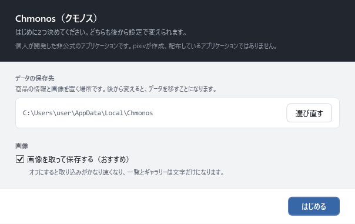

# はじめに

<!-- nav:top -->
[← 目次へ](README.md)
<!-- /nav:top -->

この章では、Chmonos をダウンロードして初めて起動するまでを説明します。終わると空のライブラリが表示された状態になります。

## 用意するもの

- Windows (64bit 版)の PC。 Macやスマートフォンでは使えません
- BOOTH でダウンロードしたアセット（zip など）。ダウンロードしてくるフォルダを決めておくことをおすすめします。ファイルはその場所から動かさなくて構いません
- インターネットへの接続。取り込んだ商品の情報と画像の、BOOTH からの取得に使用します

このアプリの使用自体には BOOTH アカウントは不要です。

開発・動作確認には Windows 11 を使用しています。

## 1. ダウンロードして展開する

1. [GitHub の Releases](https://github.com/kumo-mayu/chmonos/releases) か [BOOTH](https://kumo-mayu.booth.pm/items/8952335) から、`Chmonos-v1.2.0.zip` をダウンロードします
2. zip を右クリックして「すべて展開」を選び、好きな場所に展開します

展開すると `Chmonos-v1.2.0` フォルダの中に `Chmonos.exe` と `assets` フォルダなどが並びます。

> **zip の中から直接開かないでください。**`assets` フォルダには検索に使う辞書が入っています。zip のまま起動すると辞書が正しく読み込まれないことがあります。
> アプリの場所を変える際には `Chmonos-v1.2.0` フォルダごと、中身を変えずに移動してください。

インストール不要です。デスクトップから起動したい場合は `Chmonos.exe` を「右クリック →「その他のオプションを確認」→「ショートカットの作成」」と進んでショートカットを利用してください。

## 2. 起動する

`Chmonos.exe` をダブルクリックします。

初めて起動するときに、Windows の警告が出ることがあります。

- **「Windows によって PC が保護されました」**（SmartScreen）と出たときは、「詳細情報」を押すと「実行」のボタンが出ます。「実行」を押すと起動します
- **「スマート アプリ コントロール」にブロックされた**ときは、警告の画面から起動する方法がありません。起動するには、「Windows セキュリティ」→「アプリとブラウザー コントロール」→「スマート アプリ コントロールの設定」で、スマート アプリ コントロールをオフにします
  - オフにするとほかのアプリにもこの保護が働かなくなります。オフにするかはご自身で判断してください
  - 2026年4月の更新（KB5083769）より前の Windows 11 では、一度オフにすると、Windows を再インストールしないとオンに戻せません

## 3. 保存先と画像を決める

初回起動時に簡単な設定を求める画面が出ます。分からなければそのままで構いません。アプリ内の設定画面から変更できます。

**データの保存先**

商品の情報と画像を保存する場所です。既定は `%LOCALAPPDATA%\Chmonos`（C ドライブのユーザーのフォルダの中）です。

- 他の場所に保存したい場合は、「選び直す」でほかのフォルダを選んでください。選んだフォルダの中に `Chmonos` フォルダが作成され、その中にデータが保存されます
- 前に使っていたデータがある場所を選ぶと、そのデータの続きから始まります

保存されるのは管理用のデータのみで、アセット自体のファイルはコピーされません。

**画像**

「画像を取って保存する（おすすめ）」は、商品の画像を BOOTH から取得して保存する設定です。

- オンのままにすると一覧やギャラリーに商品の画像が出ます
- オフにすると保存する容量が小さくなり、取り込みも速くなりますが、一覧とギャラリーは文字だけになります

決めたら「はじめる」を押します。

## 起動できたかの確かめ

左にナビ（検索・改変・ショップ…）、右に「取り込み」の画面が出れば完了です。なにも取り込んでいないので取り込みの画面から始まります。
商品を取り込むと検索の画面で起動するようになります。

次は [アセットを取り込む](02-import.md) に進みます。

## うまくいかないとき

| 起きたこと | 確かめること |
|---|---|
| ダブルクリックしても何も出ない | スマート アプリ コントロールにブロックされていないか（上の「2. 起動する」）。Windows の通知に出ていることがあります |
| 「既に起動しています。」と出る | 同じ保存先を使う Chmonos は、同時に2つ起動できません。タスクバーに Chmonos が無いかを確かめます |
| 「保存先に書けません」と出る | 選んだ場所に書き込む権限がありません。ドキュメントやほかのドライブなど、書き込める場所を選び直します |
| 「辞書などのファイルが見つかりません。」と出る | zip の中から開いたか、`Chmonos.exe` だけを移しています。zip を「すべて展開」して、展開したフォルダの `Chmonos.exe` を開きます |

<!-- nav:bottom -->

---

[次の記事：アセットを取り込む →](02-import.md)
<!-- /nav:bottom -->

<!-- 画像：first-run-short-path（ViewShot） -->
