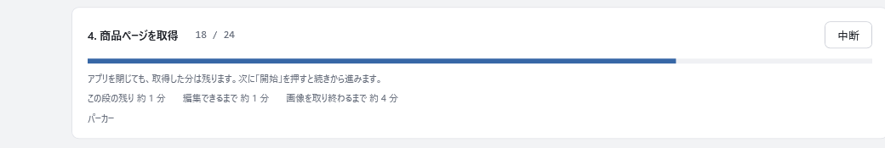
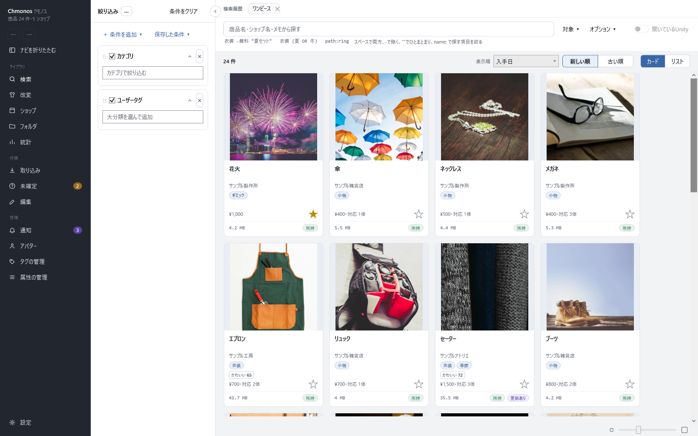
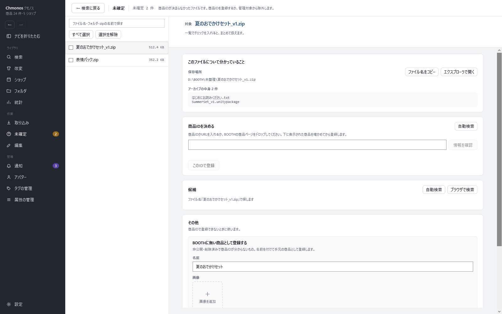

# アセットを取り込む

<!-- nav:top -->
[← 目次へ](README.md)　｜　[← 前の記事：はじめに](01-start.md)
<!-- /nav:top -->

前の章で Chmonos を起動できたら、次は手元のアセットを取り込みます。取り込むとファイルがどの BOOTH の商品かを調べ、商品名・ショップ・説明・画像（任意）を BOOTH から取得して記録します。
アセット自体のファイルは移動もコピーもされず、今のフォルダのまま管理できます。

## 1. ファイルかフォルダをドラッグ＆ドロップする

BOOTH からダウンロードしたファイルかそれを置いているフォルダを、Chmonos のウィンドウにドラッグ＆ドロップします。どの画面に落としても構いません。

- ドロップすると画面は切り替わらずに取り込みが始まります。ウィンドウの下に進み具合と「取り込み画面を開く」ボタンが出ます
- 取り込みの画面では「フォルダを選択」でフォルダを選んでも取り込めます
- 取り込みの最中にドロップした分は今の取り込みに追加されます

フォルダをドロップすると「監視対象に入れますか」と聞かれることがあります。監視対象に入れると起動時に新しいファイルが増えていないかを自動で調べます。BOOTH で買ったアセットを置くフォルダがあれば、それを監視対象にしておくと便利です。
ただし、中身をすべてアセットとして登録しようとするので、Windows の「ダウンロード」フォルダのように BOOTH 以外のファイルも入るフォルダを監視対象にすることは推奨されません。

> ドロップしてすぐ取り込みを始めたくないときは、設定の「取り込みと取得」で「ファイルやフォルダをドロップしたら、そのまま取り込みを始める」をオフにします。オフにするとドロップした物は「取り込み対象」に並び、「開始」を押すまで始まりません。

### 取り込むファイル

フォルダをドロップしたときに取り込むのは、BOOTH で配られる形式（zip・rar・画像・PSD・PDF・音声・動画・VRM・VRoid など）と、unitypackage・7z・blend・fbx です。
それ以外のファイルは商品ページの「追加…」から商品に追加できます（[商品ページ](11-item.md)）。

基本的には展開せずに zip のままで持っておくのがおすすめです。zip を展開してできたフォルダが zip と同じ場所にあるときは、zip と同じ商品として扱います。

## 2. 取り込みが終わるのを待つ

取り込みは段に分かれて進みます。取り込みの画面では今の段と件数、残りの時間の見込みが出ます。

- **「編集できるまで」**：商品名・ショップ・説明がそろうまでの時間です。そろった商品から、検索で探せます
- **「画像を取り終わるまで」**：全部の画像を取得し終わるまでの時間です

時間がかかるのは、BOOTH へのリクエストを1件ずつ、1.5秒以上の間隔を空けて送っているためです。BOOTH を運営するピクシブ株式会社のサーバーに負担をかけないためで、速くする設定はありません。
100商品あたり、少なくとも次の時間がかかります。

| そろう物 | 100商品あたりの時間 |
|---|---|
| 商品名・ショップ・説明 | 約5分以上 |
| 画像（全部） | 約30分以上 |

取り込みの途中でも他の画面で作業できます。途中でアプリを閉じても取得した分は残り、次回起動時に画像は自動で取得を再開し、商品情報の残りは画面の下の「続きから進む」で再開します。

## 3. 結果を確かめる

取り込みが終わると、取り込みの画面の「結果」にスキャンしたファイルの数や、新しく取得した商品の数が出ます。

- 「取り込んだ商品を検索で開く」を押すと、取り込んだ商品が新しい順に並びます
- 商品が決まらなかったファイルがあるときは、「未確定」の数が出ます。次の「4. 商品が決まらなかったファイルを登録する」へ進みます

## 4. 商品が決まらなかったファイルを登録する

どの商品か決まらなかったファイルは左のナビの「未確定」に並びます。ナビの「未確定」の横の数が、残りの件数です。

左の一覧からファイルを選び、右で商品を決めます。

**候補から選ぶ**

1. 「自動検索」を押します。ファイル名で BOOTH を検索して、「候補」に並べます
2. 合っていそうな候補の「これで確認」を押します。上の「商品IDを決める」にその商品の名前・ショップ・カテゴリ・価格が出ます
3. 合っていれば「このIDで登録」を押します

候補の商品ページをブラウザで確かめたいときは、候補の「BOOTHで開く」を押します。

**商品IDか URL を入れる**

候補に無いときは、BOOTH の商品ページの URL（`https://〇〇.booth.pm/items/1234567` など）か商品ID（`1234567`）を入れて「情報を確認」を押します。ブラウザで開いている BOOTH の商品ページのリンクを欄にドラッグ＆ドロップしても入ります。
出てきた商品を確かめて「このIDで登録」を押します。

キーボードだけで進めるときは、欄で Enter を押すと確認、Ctrl+Enter で登録して次のファイルへ進みます。

**そのほかの場合**

| こんなとき | すること |
|---|---|
| アセットではないファイル（自分で作ったメモなど）だった | 「除外する」を押します。一覧から外れます。設定の「隠したもの」から戻せます |
| 1つのフォルダ（zip を展開したフォルダなど）に、別々の商品のファイルが入っている | 同じフォルダのファイルはまとめて1つの対象になります。上の「対象」の帯で「このファイルだけ」に切り替えてから、ファイルごとに登録します |
| BOOTH で非公開・削除済みになっていて、商品IDが分からない | 右の欄の一番下にある「その他」の「BOOTHに無い商品として登録する」で、名前を付けて登録します。画像も追加できます |
| zip を展開したフォルダの中身が、ばらばらに並んだ | 元の zip が一覧にあれば帯の「元zipとして扱う」で zip にまとめて登録します。zip が無いときは「zipの代わりにフォルダを登録する」でフォルダごと登録します |

登録が済んだら未確定の画面の上の「確定したものを編集する」で登録商品にユーザータグなどを入れられます（[整理して記録する](05-record.md)）。入れなくても検索や Unity へのインポートはそのまま使えます。

## 取り込めたかの確かめ

左のナビの「検索」を開き、取り込んだ商品のカードが並んでいれば完了です。画像の取得が終わっていない商品には画像が表示されませんが、しばらくすると表示されるようになります。

次は [探す](03-find.md) に進みます。

## 商品が自動で決まらない理由

Chmonos はダウンロードしたときにブラウザがファイルに記録する「ダウンロード元の情報」（Zone.Identifier）と、zip の中の文書にある商品の URL を手掛かりに、商品を決めます。

- Chrome・Edge でダウンロードした物はダウンロード元から商品を決められることを確かめています
- Firefox や、Chromium ベースのブラウザ（Vivaldi・Opera など）もダウンロード元を記録しますが、商品を決められる形かはまだ確かめていません

次の場合は、ダウンロード元の情報が残らないか、商品を決められない形になります。ファイル名で候補を探して、選んで登録します。

- Brave でダウンロードした（Brave はダウンロード元の URL を記録しません）
- シークレットウィンドウ・InPrivate・プライベートウィンドウでダウンロードした
- 7-Zip などで展開した中身だけを取り込んだ（展開ソフトの設定によっては情報が失われます）
- USB メモリなどにコピーした（FAT32・exFAT ではこの情報が保持されません）

最も確実なのは Chrome か Edge の通常のウィンドウでダウンロードし、zip のまま取り込むことです。

## うまくいかないとき

| 起きたこと | 確かめること |
|---|---|
| 「取り込めなかった」件数が結果に出た | ダウンロード中のファイルや、ほかのアプリが開いているファイルは取り込めません。結果に出る原因を解消してから、もう一度ドロップします |
| OneDrive のフォルダの物が取り込まれない | 「オンラインのみ」のファイルは読み込みません（読むとダウンロードが始まるためです）。フォルダを「常にこのデバイスに保持する」にしてから、取り込み直します |
| 未確定に「壊れたzip」と出る | ダウンロードが途中で切れているなどで、zip を開けません。BOOTH からダウンロードし直して、もう一度取り込みます |
| 未確定に「BOOTHで非公開」と出る | 読み取れた商品IDが BOOTH で見つかりませんでした。そのIDのまま登録すると BOOTH で再び公開されたときに情報を取得します |
| 取り込みの途中で止まった | ネットにつながっていないか、BOOTH が応答していない可能性があります。つながってから、画面の下の「続きから進む」を押します |
| ファイルを移したら「見つかりません」になった | zip などのファイルは移動や名前の変更をしても記録はそのまま使えます（中身で見分けています）。フォルダとして登録した物を移したときは、取り込みの画面の「見つからないファイルを探す…」で紐付け直します |

<!-- nav:bottom -->

---

[次の記事：探す →](03-find.md)
<!-- /nav:bottom -->

<!-- 画像：showcase-import（進み具合を切り抜き）・showcase-search・showcase-resolve（ViewShot） -->
