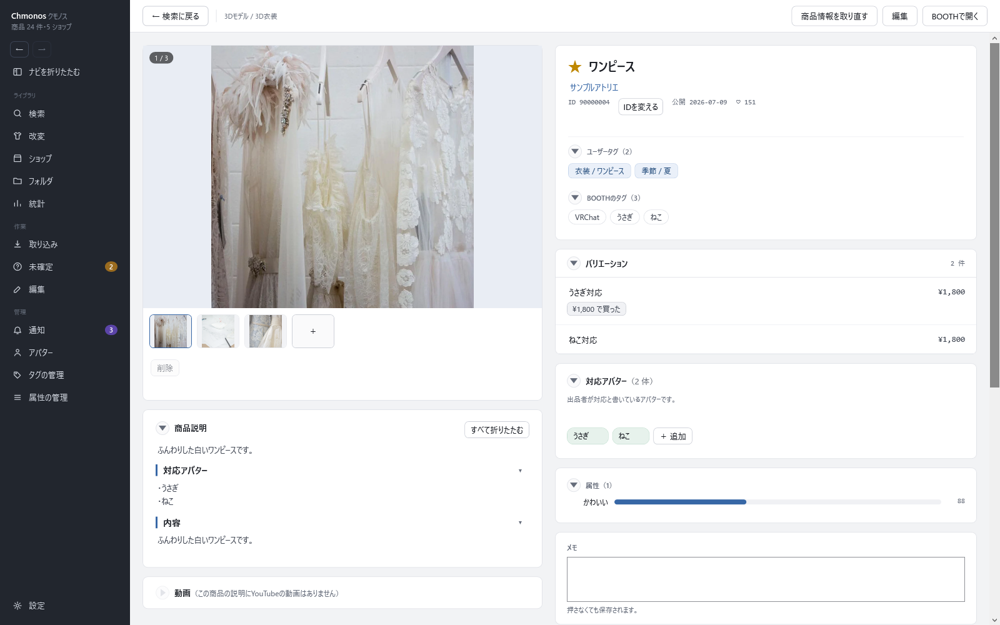
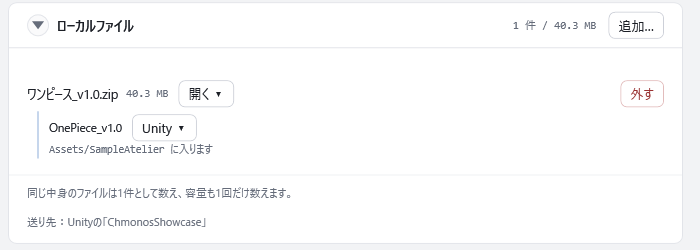

# 商品ページ

<!-- nav:top -->
[← 目次へ](README.md)　｜　[← 前の記事：検索の画面](10-search.md)
<!-- /nav:top -->

検索などでカードを押すと開く、1つの商品の情報をまとめた画面です。左に画像と説明、右に自分の記録と手元のファイルが並びます。

## 上の帯

| ボタン | すること |
|---|---|
| ← 〇〇に戻る | 開く前にいた画面に戻ります。ボタンには戻る先の名前が出ます（「← 検索に戻る」「← フォルダに戻る」など）。Alt+← やマウスの戻るボタンでも戻れます |
| 商品情報を取り直す | BOOTH から商品の情報を取得し直します |
| 編集 | この商品だけを編集の画面で開きます（[編集の画面](12-edit.md)） |
| BOOTHで開く | 商品ページをブラウザで開きます |

## 左：画像と説明

**画像**

- 大きな画像の左上に「1 / 3」のように、何枚目かが出ます。下の小さな画像を押すと切り替わります
- 「＋」で自分の画像を足せます。画像をドラッグ＆ドロップするか、Ctrl+V で貼り付けても足せます。足せる形式は JPEG・PNG・GIF・WebP・BMP です
- 小さな画像を右クリックすると「この画像をサムネイルにする」（カードに出す画像にする）・「前へ移動」「後ろへ移動」（並べ替え）・画像の種類（BOOTH・改変例・その他）を選べます
- 自分で足した画像は「削除」か右クリックの「この画像を削除」で消せます。BOOTH の画像は消せません
- 画像の取得が終わっていないときは、「画像取得を優先」でこの商品の画像を先に取得します

BOOTH から消えた画像は既定では出しません。設定の「BOOTHから消えた画像も表示する」を入れると、「削除済」として並びます。

**商品説明**

BOOTH の商品ページの説明です。見出しごとに畳めます。「すべて折りたたむ」で全部を畳みます。
説明の中の BOOTH の商品へのリンクは、持っている商品なら緑色の文字になり、押すとアプリの中の商品ページへ移ります。それ以外のリンクはブラウザで開きます。

**動画**

説明に載っている YouTube の動画を画像とタイトル付きのリンクで並べます。押すとブラウザで開きます。

## 右：自分の記録

| 欄 | 中身 |
|---|---|
| 名前の行 | 星（お気に入り）・商品名・ショップ名（押すとショップの画面へ）・ID（押すとコピーされます）・公開日・スキ数 |
| IDを変える | 間違った商品に登録したときに、別の商品IDへ移します。記録はそのまま移ります |
| ユーザータグ | 自分で付けたタグ（「大分類 / 小分類」）。付けるのは編集の画面で |
| BOOTHのタグ | BOOTH で付いているタグ |
| バリエーション | BOOTH のバリエーションと価格。買った物には「¥1,800 で買った」のような札が付きます |
| 対応アバター | 対応しているアバター。持っているアバターの札は緑色になります。同じ共通素体のアバターは点線の札で並び、共通素体ごとにまとまります（v1.2.0 から。設定で切り替えられます）。アバターごとにバリエーションで売っている商品では、持っていないバリエーション向けのアバターの札が薄くなります（次のバージョンから）。確認待ちの確かめ方は [Unity で使う](04-unity.md#4-対応アバターを確かめる) |
| 属性 | 自分で付けた属性の値 |
| メモ | 自由に書けます。押さなくても保存されます |

商品名・ショップ名・バリエーションの名前などの字は、マウスでなぞって選び、Ctrl+C でコピーできます（v1.2.0 から）。ショップ名はなぞらずに押すとショップの画面へ移ります。

## ローカルファイル

この商品の手元のファイルです。

| 部分 | すること |
|---|---|
| 追加… | ファイルを選んでこの商品に紐付けます。種類を問わず、何でも紐付けられます |
| 開く ▾ | 「パスをコピー」（v1.2.0 から）・「エクスプローラで開く」（ファイルのある場所を開く）・「一時的に展開して開く」（zip を一時フォルダに展開して開く。アプリを閉じると消えます） |
| Unity ▾ | 中に unitypackage がある行に出ます。「Unityへ送る」「改変に追加して送る」「Unityで選択」（[Unity で使う](04-unity.md)） |
| 外す | このファイルをこの商品から外します。外したファイルは灰色で残り、「この商品に戻す」で戻せます |

商品ページに zip などをドラッグ＆ドロップすると、「この商品に紐付ける」「取り込む」を選べます。

選んだファイルをほかの商品が持っているときは、「その商品を開く」「この商品に付け直す」「両方に付ける」から選びます。「両方に付ける」は、セット商品と中身の商品の両方でファイルを持ちたいときに使います。ほかの商品からは外さず、ディスク使用量などの合計にも1回だけ数えます（次のバージョンから）。

**ファイルの行の札**

| 札 | 意味 |
|---|---|
| 見つかりません | 記録した場所にファイルがありません。移した先のフォルダを取り込むとこの商品に付け直します |
| 取り外しているドライブ | 外付けドライブなどがつながっていません。つなぐと開けます |
| 壊れたzip | zip を開けません。BOOTH からダウンロードし直してください |
| 外したファイル | この商品から外したファイルです。所持や容量には数えません |
| 古い版 | 同じ名前の新しい版で上書きされたファイルです |

## この商品を使った改変

この商品を使った改変が並びます。「開く」でその改変へ、「改変に追加」で今ある改変に足します（[整理して記録する](05-record.md#改変を記録する)）。

## 記録していること

| 項目 | 中身 |
|---|---|
| 入手日・最終取得・次回更新予定・アバター検出 | 手に入れた日・最後に BOOTH から情報を取得した日・次に取得する予定の日・対応アバターを最後に検出した日 |
| BOOTHでの販売 | 販売中か、販売終了・非公開か |
| 検索から除く | 入れると検索とショップに出なくなります（非表示） |
| 更新通知 | 入れていると BOOTH で内容が変わったときに通知に出します |
| アバター | 「アバターとして登録」で3Dキャラクター以外のカテゴリの商品もアバターとして扱います。アバターの管理の一覧に載り、衣装の対応アバターを見分けるのに使います。「登録を外す」で自動の判定に戻します。アバターの商品では「プロファイルを検索で開く」で、このアバターのプロファイルを検索で開けます（次のバージョンから） |
| 変換扱い | 衣装の変換ツールのプロファイルを含む商品にだけ出ます。中のプロファイルごとに、どのアバターか共通素体のプロファイルかを決めます。自動で推した物は「確認待ち」で、「確認済みにする」を押すと、衣装の商品ページの「変換経由」に使われます。決まっていない物は、欄からアバターか共通素体を選びます。どの zip のどの unitypackage に入っているプロファイルかも出ます。「外す」を押したつなぎ先は、次に自動で推すときも使いません。外したつなぎ先は欄の末尾の「外したつなぎ先」に並び、「戻す」で戻せます。つなぎ先に乗せると、アバターか共通素体の絵が出ます。向き（順方向・逆方向・両方向）は、向きの字を右クリックして変えられます（次のバージョンから） |

## BOOTH で変わった所

BOOTH で商品が更新されたとき、まだ通知を読んでいなければ、変わった欄の左に色の線と札が付きます。足された所は緑、消えた所は赤、変わった所は橙です。
価格が変わったバリエーションには「¥前 → ¥今」が出ます。通知の画面で既読にすると消えます（[通知の画面](20-inbox.md)）。

BOOTH で見つからなくなった商品には「同じ商品をBOOTHで探す」が出ます。作者が別の商品IDで出し直したときなどに、BOOTH の検索で出し直した商品を探す手助けをします。押すと「IDを変える」の窓が開き、自動で候補を探し始めます。合う物があれば、その商品IDへ移せます。

## 使っている商品の新しい版（次のバージョンから）

改変で使った商品や、Unity のプロジェクトに入っている商品の更新履歴に新しい版が載ると、上に「改変 2 件で使っています。新しい版が出ています。」のような帯が出ます。
Unity のプロジェクトは、改変に紐付けたプロジェクトと、今開いている Unity のプロジェクトを見ます。対応アバターを足しただけの更新では出ません。「〇〇の瞳を修正」のように特定のアバターだけの更新は、そのアバターの改変で使っているときだけ出ます。

| ボタン | すること |
|---|---|
| 更新履歴を見る | 説明文の更新履歴までスクロールします |
| 確認した | 帯を消します。次に新しい版が出たら、また出ます |

新しい版のファイルを取り込んでも帯は消えます。通知の既読とは別なので、通知を読んでも帯は残ります。

<!-- nav:bottom -->

---

[次の記事：編集の画面 →](12-edit.md)
<!-- /nav:bottom -->

<!-- 画像：showcase-item・showcase-item（--height 1500 でローカルファイルの欄を切り抜き）（ViewShot） -->
