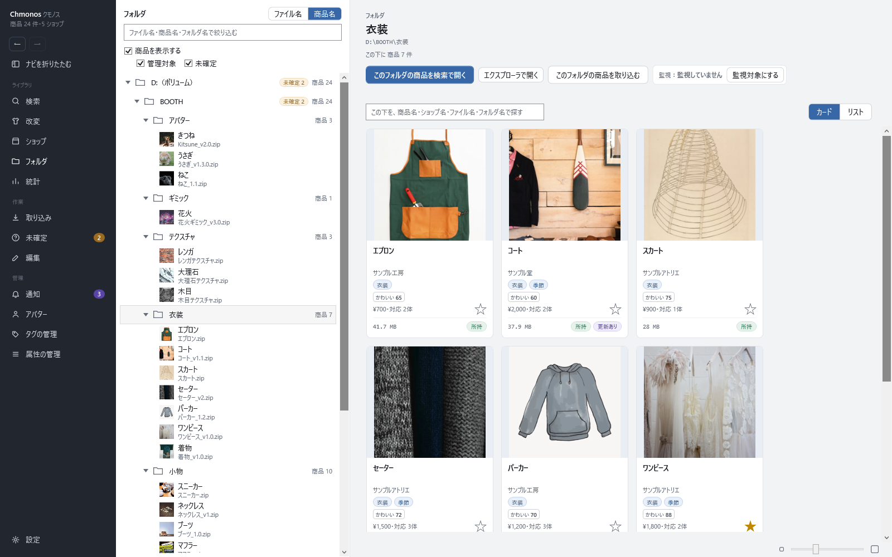

# フォルダの画面

<!-- nav:top -->
[← 目次へ](README.md)　｜　[← 前の記事：取り込みの画面](14-import.md)
<!-- /nav:top -->

取り込んだファイルを PC のフォルダの並びのまま見る画面です。左のナビの「フォルダ」で開きます。

## 左：フォルダの木

（次のバージョンから）左の一覧と右の欄の境目の上にある丸い「‹」を押すと、左の一覧を細い帯に畳めます。「›」で元の幅に戻ります。畳んだかはアプリを閉じても残ります。

取り込んだファイルのあるフォルダがドライブごとに木になって並びます。三角で開閉します。階層は字下げの縦線で分かります（次のバージョンから）。

| 部品 | すること |
|---|---|
| 上の欄 | ファイル名・商品名・フォルダ名で探す（右の × で打った文字を消せます。次のバージョンから） |
| ファイル名・商品名 | ファイルの行をディスク上のファイル名で出すか、商品名で出すか（商品名のときは、ファイル名がその下に出ます） |
| 商品を表示する | 入れると商品に紐付いたファイルも木に出します |
| 管理対象・未確定 | 商品に紐付いたファイル・フォルダと、商品が決まっていないファイル（「?」の印）を木に出すか |

フォルダの行を右クリックすると、広げる・折りたたむ（下の階層までまとめても）・検索で開く・エクスプローラで開く・取り込む・監視のメニューが出ます（次のバージョンから）。

「展開したフォルダあり」の印はその zip を展開したフォルダが隣にあることを示します。押すとそのフォルダをエクスプローラで開きます。
同じ中身のファイルが別の場所にもあるときは、行の右端に「ほかに n か所」の札が出て、押すとそこへ移ります。見つからないファイルの行には「見つかりません」の札が出ます。

## 右：選んだ物

左でフォルダを選ぶとその中の商品がカードで並びます。ファイルを選ぶとそのファイルの商品ページが右に出ます。

| ボタン | すること |
|---|---|
| このフォルダの商品を検索で開く | そのフォルダ（下のフォルダも含む）の商品だけを検索の画面で開く |
| このフォルダの商品を取り込む | そのフォルダを取り込む |
| エクスプローラで開く | そのフォルダを開く |
| 未確定として開く | フォルダの下の未確定のファイルを未確定の画面で開く |
| 監視フォルダにする・監視をやめる | そのフォルダを監視フォルダにするか。今の状態は「監視中」「監視していません」で出ます（[取り込みの画面](14-import.md#監視フォルダ)） |

フォルダの下に未確定のファイルがあるときは、「この下の未確定 n 件を管理対象から除外する」でまとめて除外できます。

カードの操作は検索の画面と同じです（[検索の画面](10-search.md#カード)）。フォルダのカードを右クリックすると、上のボタンと同じ操作のメニューが出ます（次のバージョンから）。

<!-- nav:bottom -->

---

[次の記事：改変の画面 →](16-modifications.md)
<!-- /nav:bottom -->

<!-- 画像：showcase-folder（ViewShot） -->
