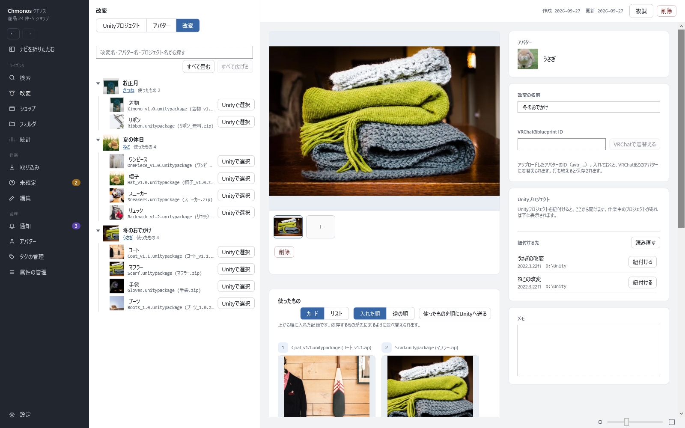

# 改変の画面

<!-- nav:top -->
[← 目次へ](README.md)　｜　[← 前の記事：フォルダの画面](15-folders.md)
<!-- /nav:top -->

改変（着せ替え1つ分の記録）を見る画面です。左のナビの「改変」で開きます。使い方の流れは [整理して記録する](05-record.md#改変を記録する) にあります。

改変は自分で作る記録です。Unity のプロジェクトの中身から自動で作られることはありません。作った改変に Unity のプロジェクトを紐付けると、そのプロジェクトに入っている商品を、使ったものの候補として拾えます。

## 左：一覧

上の3つのボタンで並べ方を切り替えます。

| 見方 | 並び |
|---|---|
| Unityプロジェクト | プロジェクトごとに紐付けた改変 |
| アバター | アバターごとにそのアバターの改変。改変を作るのはここから |
| 改変 | 改変ごとに使ったもの |

- 上の欄で改変名・アバター名・プロジェクト名で探せます
- 欄の右の「すべて畳む」で一覧を見出しだけにします。「すべて広げる」は押すたびに1段ずつ広げます。1回目で見出しの中、2回目で改変の中身まで表示します（v1.2.0 から）
- 使ったものに新しい版が出た改変には、見出しと行に「新しい版 n」「新しい版あり」の札が付きます。探す欄の下の「新しい版が出たものだけ」で、その改変だけを並べられます。新しい版が出たものが無いときは出ません（次のバージョンから）
- 使ったものの行の「Unityで選択」で紐付けたプロジェクトでその商品が入った場所を示します。入っていなければ送るかを聞きます
- 行を押すと右に詳しく出ます
- 改変の行の右クリックの「複製」で使ったものとメモが同じ改変を作ります
- 「Unityプロジェクト」の見方のときは、見方の切り替えの右に「VCCを開く」か「ALCOMを開く」が出ます。入っている方の1つが出て、両方入っているときは設定の「プロジェクトの管理に使うアプリ」で選んだ方です

**「Unityプロジェクト」の見方でプロジェクトを選んだとき**

右に状態（開いているか）・バージョン・情報元（Unity Hub・VCC など）・最後に触った日と、「Unityを開く」「エクスプローラで開く」、このプロジェクトの改変が出ます。

「VPM」の行には、そのプロジェクトにVCCやALCOMで入れたパッケージが、名前とバージョンで並びます（次のバージョンから）。読むだけで、入れたり消したりはしません。Chmonosがまだプロジェクトの中を見ていないときは「Unityで開くと表示されます。」と出ます。改変に紐付けたプロジェクトと、開いているプロジェクトを見ます。

（次のバージョンから）各行の右の「2026-11-11から」は、Chmonosがそのバージョンを見つけた日です。入れた日とは限りません。バージョンが変わったことがあれば、行の頭の三角を押すと前のバージョンと期間が並びます。プロジェクトから外したパッケージは、下の「外したもの」を開くと見られます。記録はChmonosがプロジェクトの中を見るたびに足していき、見直しても消えません。

**プロジェクトのフォルダを移した・名前を変えたとき**（次のバージョンから）

フォルダが見つからないプロジェクトの行には「場所を付け替える…」が出ます。押して新しい場所のフォルダを選ぶと、そのプロジェクトに紐付けた改変と、保存した検索の「Unityプロジェクト」「改変プロジェクト」の条件が、新しい場所に付け替わります。見つかるプロジェクトでも、行の右クリックから同じことができます。

- 選べるのは Unity のプロジェクトのフォルダ（Assets と ProjectSettings がある物）だけです
- 新しい場所にほかの改変が紐付いているときは、統合してよいかを聞きます。統合した後に分けるには、改変ごとに紐付け直します

**「アバター」の見方でアバターを選んだとき**

右にそのアバターと改変に関わる所だけが出ます。名前・共通素体などの設定はナビの「アバター」の画面で変えます（[アバターの画面](17-avatars.md)）。

| 部分 | すること |
|---|---|
| アバターの画像・名前 | 持っているか、共通素体も札で出ます |
| アバターの管理へ | ナビの「アバター」の画面でこのアバターを開く |
| 商品ページを開く | アバターの商品のページを開く |
| このアバターの改変 | このアバターで作った改変の一覧 |
| 新しい改変 | 名前を入れて「改変を作る」を押すとこのアバターの改変を作ります。「普段着」「制服」のように着せ替え1つにつき1つ作ります |

左の一覧のアバターの行にも「改変を作る」と「アバターの管理へ」のボタンがあります。

## 右：改変の詳しい内容

| 欄 | 中身 |
|---|---|
| 上の帯 | 作った日・更新した日・「複製」・「削除」 |
| 写真 | 「＋」で選ぶか、ドラッグ＆ドロップか、Ctrl+V で足します（JPEG・PNG・GIF・WebP・BMP）。自分で足した写真は「削除」で消せます |
| アバター | この改変のアバター |
| 改変の名前 | 打つと保存されます |
| VRChatのblueprint ID | アップロードしたアバターのID（avtr_…）。入れると「VRChatで着替える」が押せます |
| Unityプロジェクト | 紐付ける先を選んで「紐付ける」。「読み直す」でそのプロジェクトに入っている手元の商品を候補に出します |
| メモ | 自由に書けます（次に作るときに要ること・誰とおそろいかなど）。打ち終えると保存されます |

**使ったもの**

この改変に入れた商品が、入れた順に並びます。

| 部品 | すること |
|---|---|
| カード・リスト | 見せ方の切り替え |
| 入れた順・逆の順 | 並べる向き。見せる順が変わるだけで、記録の順は変わりません |
| 使ったものを順にUnityへ送る | 入れた順に1件ずつ Unity へ送る |
| 使ったものを商品名で探して追加 | 商品名を入れて「追加」で最後に足す |
| 番号 | 入れた順。並べ替えると依存する物が先に来るように直せます |

使ったものを外すと薄く残って戻せます。外した行は「削除」で完全に消せます。
手元にファイルが無くなった商品は「手元にありません」と出ます。記録は残ります。

使ったファイルより新しい版が出た商品には「新しい版あり」の札が付きます（次のバージョンから）。新しい版のファイルを Unity へ送り直すと消えます。
今の版のまま使うときは、その行の下の「新しい版を確認した」を押します。この改変だけで札が消え、ほかの改変や商品ページの帯はそのまま残ります。
新しい版に替えたときは「新しい版を選ぶ…」を押します。新しい版のファイルが選ばれた窓が開くので、確かめて「変更」を押します（次のバージョンから）。

**使ったファイルを選び直す**（次のバージョンから）

使ったものの行の「Unity ▾」の「使ったファイルを選び直す…」で、記録したファイルや unitypackage を選び直せます。左の一覧では、使ったものの行を右クリックして「使ったファイルを選び直す…」を選びます。

- 開いたときは、今記録しているファイルが選ばれています
- 「選ばない」にすると、使ったファイルの記録を削除します。手元にあるファイルなら、同じ手順で選び直せます
- 同じ商品からいくつか入れたとき（依存する物と本体など）は、「＋ ファイルを追加」で欄を足してそれぞれ選ぶと、その場所に選んだ数だけ行が並びます。欄は右の「×」で削除できます。同じファイルは2つの欄で選べません
- 記録しているファイルが手元に無いときは、そう出ます。「今の記録のまま」を選んでおけば記録は変わりません
- 外した行も選び直せます。外した行の「Unity ▾」には「使ったファイルを選び直す…」だけが出ます。外したままになります

使ったものを商品名で探して足すときや、商品ページから改変に足すときも、同じく「＋ ファイルを追加」で使ったファイルをいくつか選べます。

<!-- nav:bottom -->

---

[次の記事：アバターの画面 →](17-avatars.md)
<!-- /nav:bottom -->

<!-- 画像：showcase-modification（ViewShot） -->
