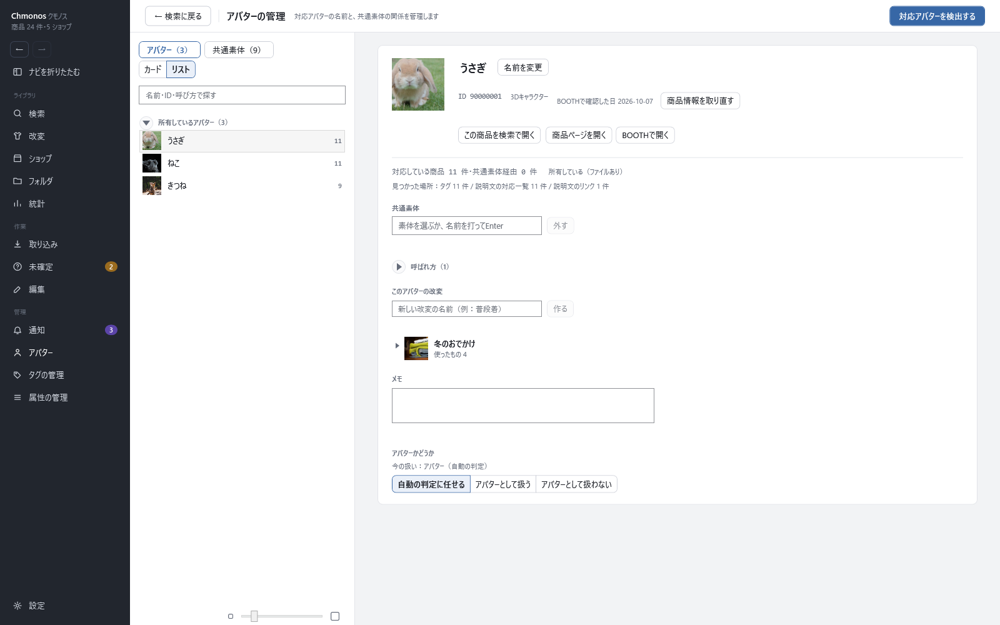

# アバターの画面

<!-- nav:top -->
[← 目次へ](README.md)　｜　[← 前の記事：改変の画面](16-modifications.md)
<!-- /nav:top -->

対応アバターの名前と、共通素体の関係を管理する画面です。左のナビの「アバター」で開きます。

対応アバターは取り込んだ商品の説明文やタグから見つけます。ここで名前の呼び方や共通素体を整えると見つけ方が良くなります。

## 上の帯

「対応アバターを検出する」で取り込んだ商品全部の説明文などから、対応アバターを今すぐ見つけ直します。

普段は押さなくて構いません。BOOTH から新しく商品の情報を取った取り込みのたびと、起動したときに前の検出から90日たっていれば（設定の「対応アバターを検出し直す間隔」）、自動で見つけ直します。新しいアバターを買って取り込んだときも、自動です。
押すのが向いているのは、次のようなときです。

- 呼ばれ方・共通素体・名前を手で直して、結果をすぐに反映したい
- 設定で対応アバターを読む見出し・読まない見出しを変えた

## 左：一覧

| 部品 | すること |
|---|---|
| アバター・共通素体・変換 | アバターの一覧と、共通素体の一覧と、変換ツールのプロファイルの一覧（次のバージョンから）を切り替える |
| カード・リスト | 見せ方の切り替え（既定はリスト） |
| 上の欄 | 名前・ID・呼び方で探す |

アバターは「所有しているアバター」（手元にファイルがあるアバター）と、所有していないアバターに分かれて並びます。ファイルを持っていなくても「所有しているものとして扱う」で所有に入れられます（「所有の指定を外す」で戻します）。行の右の数（カードでは右上の数）は、そのアバターに対応している商品の数です。

## 右：アバターを選んだとき

| 部分 | すること |
|---|---|
| 名前を変更 | 一覧に出す名前を変える。「BOOTHの名前に戻す」で戻します |
| 商品情報を取り直す | アバターの商品の情報を BOOTH から取り直す |
| 対応商品を検索で開く | このアバターに対応している商品を、素体経由も含めて検索の画面で開く（次のバージョンから。前の名前は「この商品を検索で開く」） |
| 商品ページを開く・BOOTHで開く | アバターの商品を開く |
| 対応している商品 | 対応している商品の数と、どこで見つけたか（タグ・説明文の対応一覧・説明文のリンク） |
| 共通素体 | このアバターの素体を選ぶか、名前を打って Enter。「外す」で外します |
| 呼ばれ方 | このアバターの別の呼び方。「呼び方を追加」で足すとその呼び方でも対応を見つけます。「検出に使わない呼び方」に入れた物は使いません |
| このアバターの改変 | 名前を入れて「作る」で改変を作ります |
| メモ | 自由に書けます |
| アバターかどうか | 「自動の判定に任せる」「アバターとして扱う」「アバターとして扱わない」 |

## 右：共通素体を選んだとき

共通素体（いくつかのアバターで共通の体）の名前と、その素体を使っているアバターを管理します。
同じ素体のアバター向けに作られた衣装は「素体経由」として一緒に表示されます。

| 部分 | すること |
|---|---|
| 上の欄と「追加」 | 共通素体を足す |
| この素体を使っているアバター | アバターを足す・「この素体から外す」。行の頭のつまみをドラッグすると並べ替えられ、商品ページと検索の候補の並びも変わります。「既定の順に戻す」で持っているアバターが先・ほかは名前の順に戻ります（v1.2.0 から） |
| 素体の名前を含む商品 | 名前に素体の名前が入っている商品 |
| 素体の商品を設定 | 素体そのものの商品の ID か URL を入れる |

## 右：変換を選んだとき（次のバージョンから）

衣装の変換ツールのプロファイルを含む商品を並べ、プロファイルごとに、どのアバターか共通素体の物かを決めます。決めたプロファイルは、衣装の商品ページの「変換経由」に使われます。
左の一覧は「決めていない」「決めた」「扱わない」に分かれ、決めていない商品には確認待ちと未設定の数が出ます。

| 部分 | すること |
|---|---|
| 変換扱い | 商品ページの「変換扱い」と同じです（[商品ページ](11-item.md)） |
| 推した通りに決めて次へ | 確認待ちのつなぎ先を確認済みにして、次の決めていない商品へ進みます。Ctrl+Enter でも押せます |
| プロファイルではない | プロファイルとして扱わないようにして、次へ進みます |
| 後で | 何も変えずに次へ進みます |

<!-- nav:bottom -->

---

[次の記事：ショップの画面 →](18-shops.md)
<!-- /nav:bottom -->

<!-- 画像：showcase-avatars（ViewShot） -->
