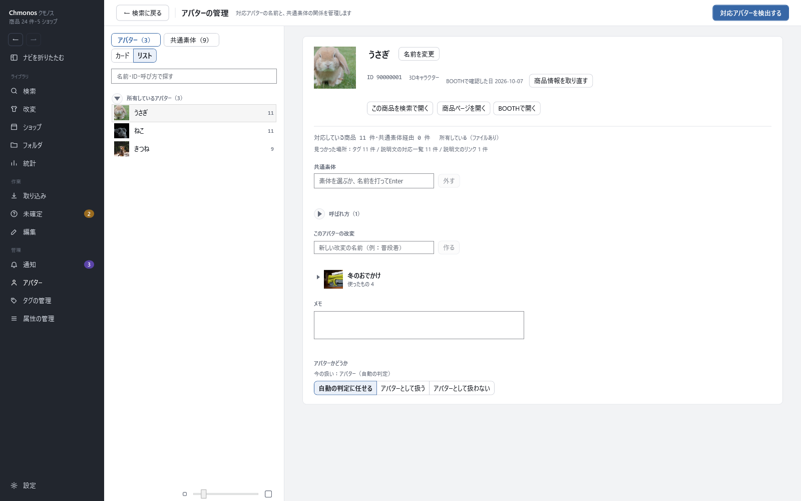

# アバターの画面

<!-- nav:top -->
[← 目次へ](README.md)　｜　[← 前の記事：改変の画面](16-modifications.md)
<!-- /nav:top -->

対応アバターの名前と共通素体、変換ツールのプロファイル（次のバージョンから）を管理する画面です。左のナビの「アバター」で開きます。

対応アバターは取り込んだ商品の説明文やタグから見つけます。ここで名前の呼び方や共通素体を整えると見つけ方が良くなります。

## 上の帯

「対応アバターを検出する」で取り込んだ商品全部の説明文などから、対応アバターを今すぐ見つけ直します。

普段は押さなくて構いません。BOOTH から新しく商品の情報を取った取り込みのたびと、起動したときに前の検出から90日たっていれば（設定の「対応アバターを検出し直す間隔」）、自動で見つけ直します。新しいアバターを買って取り込んだときも、自動です。
押すのが向いているのは、次のようなときです。

- 呼び方・共通素体・名前を手で直して、結果をすぐに反映したい
- 設定で対応アバターを読む見出し・読まない見出しを変えた

## 左：一覧

（次のバージョンから）左の一覧と右の欄の境目の上にある丸い「‹」を押すと、左の一覧を細い帯に畳めます。「›」で元の幅に戻ります。畳んだかはアプリを閉じても残ります。帯には、今見ている一覧の名前（アバター・共通素体・変換）が出ます。

（次のバージョンから）一覧と右の欄の小さな絵にマウスを乗せると、大きな絵が出ます。名前を打つ欄に出る候補の絵も同じです。絵の無い物（頭の字だけの物）には出ません。

| 部品 | すること |
|---|---|
| アバター・共通素体・変換 | アバターの一覧と、共通素体の一覧と、変換ツールのプロファイルの一覧（次のバージョンから）を切り替える。「変換」の数は、プロファイルの商品と追加した組を合わせた数です（次のバージョンから） |
| カード・リスト | 見せ方の切り替え（既定はリスト） |
| 上の欄 | アバターは名前・ID・呼び方で探す。共通素体は素体の名前か入ったアバターで探し、同じ欄から追加する（次のバージョンから）。変換は追加した組を探す（次のバージョンから。下の「右：変換を選んだとき」） |

アバターは「所有しているアバター」（手元にファイルがあるアバター）と、所有していないアバターに分かれて並びます。ファイルを持っていなくても「所有しているものとして扱う」で所有に入れられます（「所有の指定を外す」で戻します）。行の右の数（カードでは右上の数）は、そのアバターに対応している商品の数です。

## 右：アバターを選んだとき

| 部分 | すること |
|---|---|
| 名前を変更 | 一覧に出す名前を変える。「BOOTHの名前に戻す」で戻します |
| 商品情報を取り直す | アバターの商品の情報を BOOTH から取り直す |
| 対応商品を検索で開く | このアバターに対応している商品を、素体経由も含めて検索の画面で開く（次のバージョンから。前の名前は「この商品を検索で開く」） |
| プロファイルを検索で開く | このアバターと、その共通素体の変換ツールのプロファイルを、検索の条件「プロファイル」で開く。変換元と変換先の両方にこのアバターが入ります（次のバージョンから） |
| 商品ページを開く・BOOTHで開く | アバターの商品を開く。商品ページは右に開きます（次のバージョンから）。左はそのままで、右の上の「← 一覧に戻る」か Alt+← で戻ります |
| 対応している商品 | 対応している商品の数と、どこで見つけたか（タグ・説明文の対応一覧・説明文のリンク） |
| 共通素体 | このアバターの素体を選ぶか、名前を打って Enter。「外す」で外します。候補には素体の画像が出ます（次のバージョンから） |
| 変換の組 | （次のバージョンから）このアバターが元か先に入っている「追加した組」を「元 → 先」で表示します。メモは札に乗せると出ます。「変換で編集」を押すと「変換」に移り、そこで組を追加・編集します |
| 呼び方 | このアバターの別の呼び方。「呼び方を追加」で足すとその呼び方でも対応を見つけます。「検出に使わない呼び方」に入れた物は使いません |
| このアバターの改変 | 名前を入れて「作る」で改変を作ります |
| メモ | 自由に書けます |
| アバターかどうか | 「自動の判定に任せる」「アバターとして扱う」「アバターとして扱わない」 |

## 右：共通素体を選んだとき

共通素体（いくつかのアバターで共通の体）の名前と、その素体を使っているアバターを管理します。
同じ素体のアバター向けに作られた衣装は「素体経由」として一緒に表示されます。

| 部分 | すること |
|---|---|
| 上の欄と「追加」 | 打つと一覧を、素体の名前か、素体に入ったアバターの名前・ID・呼び方で絞ります。候補は素体に入ったアバターで、選ぶとそのアバターが入った素体だけに絞ります。同じ名前のアバターは、ショップ名か ID を添えて分けて出ます（次のバージョンから）。候補に無い名前は Enter か「追加」で共通素体として足します。アバターの名前を含む名前は「追加」で足します（次のバージョンから） |
| この素体を使っているアバター | アバターを足す・「この素体から外す」。行の頭のつまみをドラッグすると並べ替えられ、商品ページと検索の候補の並びも変わります。「既定の順に戻す」で持っているアバターが先・ほかは名前の順に戻ります（v1.2.0 から） |
| 素体の名前を含む商品 | 名前に素体の名前が入っている商品 |
| 素体の商品を設定 | 素体そのものの商品の ID か URL を入れる |
| 画像を設定…・画像を変更… | 一覧と右の欄に表示する画像を選ぶ。付けていないときは素体の商品の画像、それも無ければ名前の頭の字を表示します。「画像を外す」で外します（次のバージョンから） |

## 右：変換を選んだとき（次のバージョンから）

衣装の変換ツールのプロファイルを含む商品を並べ、プロファイルごとに、どのアバターか共通素体の物かを決めます。決めたプロファイルは、衣装の商品ページの「変換経由」に使われます。
右の上に商品の絵が大きく出ます（プロファイルの多くは、想定するアバターが商品の絵に写っています）。各つなぎ先の頭にはアバターか共通素体の小さな絵が出ます（次のバージョンから）。各つなぎ先の下には、自動で見つけた理由が出ます。
左の一覧は「決めていない」「途中」「決めた」「扱わない」に分かれ、決めていない商品と途中の商品には確認待ちと未設定の数が出ます。「途中」は、つなぎ先を1つ以上確認済みにしたが、未設定か確認待ちが残っている商品です（次のバージョンから）。行の頭には商品の絵が出ます（次のバージョンから）。

| 部分 | すること |
|---|---|
| 変換扱い | 商品ページの「変換扱い」と同じです（[商品ページ](11-item.md)）。ここでは、つなぎ先を右クリックして「開く」を押すと、そのアバターか共通素体へ移ります。Alt+← で選んでいた商品に戻ります（次のバージョンから） |
| 商品ページを開く・BOOTHで開く | 選んだ商品を開きます。商品ページは右に開き、右の上の「← 一覧に戻る」か Alt+← で変換の欄に戻ります（次のバージョンから） |
| 確認済みにして次へ | 確認待ちのつなぎ先を確認済みにして、次の決めていない商品か途中の商品へ進みます。Ctrl+Enter でも押せます。確認待ちが無い商品では押せません |
| プロファイルではない | プロファイルとして扱わないようにして、次へ進みます |
| 後で | 何も変えずに次へ進みます |
| まとめて確認済みにする | 「決めていない」と「途中」の見出しの右の青いボタン（次のバージョンから。前は一覧の上）。その見出しの商品の確認待ちのつなぎ先をウィンドウに並べ、チェックを外した物を除いて、まとめて確認済みにします。上の欄で絞っている間は、表示されている商品だけが対象です。確認待ちが無い見出しには出ません |
| 追加した組 | （次のバージョンから）一覧の先頭の欄。上に「組を追加」、その下に追加した組が並びます。追加した組とその下のプロファイルの商品は、1つの流れでスクロールします。プロファイルが無くても、「元」のアバター用の衣装を「先」に変換して着せられる組を、自分で追加します。プロファイルの無いツールでも使えます。追加した組は、衣装の商品ページの「変換経由」に出ます |
| 組を追加 | （次のバージョンから）「元」と「先」の欄で、アバターか共通素体を候補から選び、「追加」を押します。欄で Enter を押しても追加されます。候補を選んだだけでは追加されません。追加した組は選ばれて、右に中身が出ます。逆向きにも着せられるときは、元と先を入れ替えたもう1つの組を追加します |
| 組の行 | （次のバージョンから）プロファイルの商品と同じ行に、元と先の絵と「元 → 先」、メモがあればその1行目を表示します。行を選ぶと、右に組の中身が出ます。右クリックの「元を開く」「先を開く」で、そのアバターか共通素体へ移ります。Alt+← で戻ります |
| 元ごとのまとまり | （次のバージョンから）組は元のアバターか共通素体ごとにまとまり、見出しに元の絵・名前・組の数が出ます。見出しを押すと畳めます。キーボードでは見出しで ← を押すと畳み、→ を押すと開きます。畳んだまとまりは次に開いた時も畳んだままです。組を追加すると、その組のまとまりが開きます。見出しの右クリックの「開く」で、元のアバターか共通素体へ移ります |
| 並び | （次のバージョンから）「元の名前順」「元の名前の逆順」「追加が新しい順」「追加が古い順」から選びます。選んだ並びは次に開いた時も使われます |
| 組を探す欄 | （次のバージョンから）一番上の欄。アバターの名前・ID・呼び方か、共通素体の名前で、追加した組を絞ります。下の「両方」「元」「先」で、元と先のどちらで探すかを選びます（既定は両方）。畳んだまとまりも、当たった組があれば開いて見せます（畳んだことは覚えたままです）。下のプロファイルの商品の一覧も同じ語で絞ります（商品名は「両方」の時だけ。つなぎ先は、変換元にする物を「元」、変換先にする物を「先」で探します） |
| 組の右の欄 | （次のバージョンから）「元」「先」には、行と同じ絵と名前が出ます。名前を押すと、そのアバターか共通素体へ移ります。Alt+← で組に戻ります。「メモ」は自由に書けて、押さずに残ります。「この組を外す」で組を外します |

<!-- nav:bottom -->

---

[次の記事：ショップの画面 →](18-shops.md)
<!-- /nav:bottom -->

<!-- 画像：showcase-avatars（ViewShot） -->
