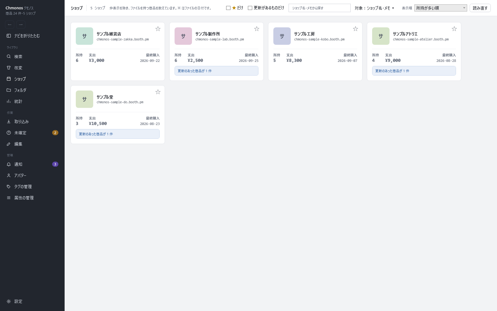

# ショップの画面

<!-- nav:top -->
[← 目次へ](README.md)　｜　[← 前の記事：アバターの画面](17-avatars.md)
<!-- /nav:top -->

持っている商品をショップごとにまとめて見る画面です。左のナビの「ショップ」で開きます。

非表示の商品を除いた、ファイルを持っている商品を数えています。

## 上の帯

| 部品 | すること |
|---|---|
| ★ だけ | 星を付けたお気に入りのショップだけを出す |
| 更新があるものだけ | 更新のあった商品があるショップだけを出す |
| 検索の欄・対象 | ショップ名・メモで探す |
| 表示順 | 所持が多い順など |
| 読み直す | 一覧を作り直す |

## ショップのカード

| 部分 | 意味・操作 |
|---|---|
| 星 | お気に入りのショップにする。上の「★ だけ」と、検索の「ショップ」の条件でお気に入りのショップをまとめて選べます。商品のカードの星（商品のお気に入り）とは別の物で、ショップに星を付けてもそのショップの商品はお気に入りになりません |
| 所持・支出・最終購入 | そのショップの持っている商品の数・払った額の合計・最後に買った日 |
| 更新のあった商品が n 件 | 押すとその知らせを開きます |

カードを押すとそのショップの画面が開きます。

## ショップを開いたとき

ショップのカードを押すとそのショップの画面が開きます。商品ページのショップ名を押しても開きます。
上からバナー・名前と集計・メモ・このショップの商品が、1つの流れで並びます。

**上の帯**

| ボタン | すること |
|---|---|
| ← 〇〇に戻る | 開く前にいた画面に戻る |
| 画像を取り直す | このショップのアイコンとバナーを、BOOTH から取り直す |
| このショップの商品を検索で開く | このショップの商品で絞って、検索の画面を開く |
| BOOTHのショップページを開く | ショップのページをブラウザで開く |

**バナー**

ショップのバナーが出ます。見出しの三角で畳めます。畳んだかどうかは全部のショップで同じように覚えます。バナーの無いショップには出ません。

**名前と集計**

アイコン・星（お気に入りのショップ）・ショップ名と、次の数が並びます。

| 数 | 中身 |
|---|---|
| 所持 | このショップの持っている商品の数 |
| 購入総額 | このショップで払った額の合計 |
| 容量 | このショップの商品のファイルの大きさの合計 |
| 最終購入 | 最後に買った日 |

下へスクロールして名前の段が見えなくなると、アイコン・星・名前・集計が1行にまとまって、上に残ります。

**メモ**

ショップについて自由に書けます（「新作はこの曜日に出る」「おそろいで使っている」など）。メモの1行目は名前の右に薄い文字で出ます。

**このショップの商品**

| 部品 | すること |
|---|---|
| 一覧 | このショップの商品のうち、手元に情報がある物（BOOTH のショップの全商品ではありません） |
| 所持しているものだけ | 持っている商品だけにする |
| 更新があるものだけ | 未読の更新の通知がある商品だけにする |
| カード・リスト | 見せ方の切り替え |

カードとリストの操作は、検索の画面と同じです（[検索の画面](10-search.md#カード)）。

<!-- nav:bottom -->

---

[次の記事：統計の画面 →](19-stats.md)
<!-- /nav:bottom -->

<!-- 画像：showcase-shops（ViewShot） -->
