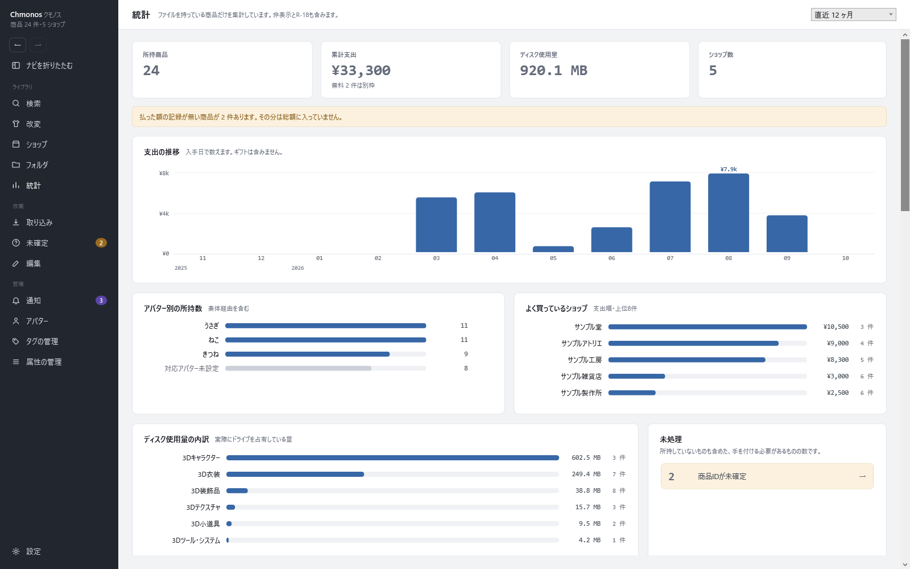

# 統計の画面

<!-- nav:top -->
[← 目次へ](README.md)　｜　[← 前の記事：ショップの画面](18-shops.md)
<!-- /nav:top -->

持っている商品の数・支出・容量などをまとめる画面です。左のナビの「統計」で開きます。

ファイルを持っている商品だけを数えます。右上の「非表示を含む」「R-18を含む」を切ると、その商品を数・金額・容量から外します（次のバージョンから。設定に残ります。検索の「R-18を表示」とは別です）。

右上で数える期間を選びます。期間の左の「↺」を押すと、集計を読み直します（取り込みや編集の後に数字を新しくしたいとき。次のバージョンから）。直近 12 ヶ月・直近 24 ヶ月・今月・先月・今年・去年・年を選ぶ・開始と終了を選ぶ・全期間から選べます（今月から下は次のバージョンから）。「年を選ぶ」は右に年の欄、「開始と終了を選ぶ」は右に日の欄が2つ出て、押すとカレンダーで選べます。片方だけ選ぶと、もう片方の端は切りません。

期間で変わるのは、見出しの横に期間（「2025年」など）が出ている欄です：支出の推移・ショップ・価格帯・カテゴリ・ユーザータグ。上の所持商品・支出・ギフトした額・ギフトで貰った額・ショップ数は、全部の合計の下に期間の値も出ます。ほかの欄（ディスク使用量・アバター・属性など）は、期間に関係なく今の全部を数えます。期間は、商品を手に入れた日（買った日。空なら入手日、それも空ならファイルの日付）で決めます。日付の分からない商品は全期間にだけ入ります。グラフは24ヶ月までは月ごと、それより長いと年ごとに並びます。

## 並ぶもの

| 欄 | 中身 |
|---|---|
| 所持商品・累計支出・ディスク使用量・ショップ数 | 上の4つの数。ギフトを貰った物があると「ギフトで貰った額」（定価の合計）も並びます（次のバージョンから）。金額の記録が無い商品があると、その件数が下に出ます（全期間以外を選んでいる時は、その期間の件数）。右の「まとめて編集する」で、その商品を編集の画面に順に積んで開けます（次のバージョンから）。無料の物・貰った物だけの商品も、金額の記録が無い数に入ります |
| 支出の推移 | 選んだ期間の、月ごと（24ヶ月より長いと年ごと）の支出。入手日で数え、ギフトは含みません |
| アバター別の所持数 | 対応アバターごとの商品の数。「直接 + 素体経由」で出し（素体経由は推定）、持っているアバターには名前の横に点が付きます。「持っているアバターだけ」で絞れます。行を押すと、そのアバターに対応する商品を検索で開きます。「対応アバター未設定」の行は、対応の指定が無い商品を検索で開きます。バリエーションごとに分けて売っている衣装は、持っているバリエーションの分だけを数えます（次のバージョンから。前の「所有アバターに着られるもの」はこの欄に合わせました。次のバージョンから）
| ショップ | 支出・商品数・スキ数の多い順に上位10件。並べる物は欄の中の右上で選びます。スキ数は、そのショップの持っている商品のスキ数の合計です。下に全期間で「また買っているか」も出ます（次のバージョンから） |
| ディスク使用量の内訳 | カテゴリごとの、実際にドライブを使っている量。同じ中身のファイルを2か所以上に置いている分（重複）と、空けられる場所も出ます。空けられる場所の行を押すと、その場所をエクスプローラで選んで開きます。外したドライブの上の場所は押せません。同じ中身のファイルの組には、場所ごとに「ごみ箱へ移す…」が付きます。確認の窓を出し、同じ中身のファイルがほかに残っていると確かめてから移します（ごみ箱の無いドライブでは移せません。zip と展開したフォルダの組には付きません）（次のバージョンから） |
| 未処理 | 未確定など、手を付ける必要がある物の数。押すとその画面へ移ります。「ファイルが見つからない」は、検索の条件「見つからないファイル」を入れて開きます（次のバージョンから） |
| 価格帯 | 価格ごとの数。無料で手に入れた物・ギフトでもらった物も分けて出ます |
| 買った時からの価格の動き | 買った時と今で BOOTH の価格が変わった商品 |
| カテゴリ・ユーザータグ | それぞれの支出と商品数。ユーザータグは右上の「大分類」「小分類」で数え方を切り替えられます。小分類は「大分類 / 小分類」の形で出し、小分類を付けていない物は「大分類 / 小分類なし」にまとめます。多い時は上位10件だけ出し、「すべて表示」で残りも出します（次のバージョンから） |
| 容量の大きい商品 | 容量の大きい順 |
| 属性 | 属性ごとの値の分布。評価した商品だけを数えます。右上の「区切りの幅」で、値を 5・10・20 のどれで区切るかを選べます。付いている値の種類が少ない属性は、値ごとに1本で出します（次のバージョンから） |
| 軸どうしの関係 | 2つの値が一緒に動くかを −1〜+1 で表します |
| 手元の状態 | 買ったまま仕分けていない物・非表示にしている物・もう買えない物（手元にしか無い物）・BOOTH に無い商品として登録した物 |
| スキ数の分布 | BOOTH のスキ数ごとの数 |

各欄は、見出しの左の印を押すと畳めます。畳んだかは、次にアプリを起動した時まで覚えています（次のバージョンから）。「軸どうしの関係」は、初めは畳んであります。

<!-- nav:bottom -->

---

[次の記事：通知の画面 →](20-inbox.md)
<!-- /nav:bottom -->

<!-- 画像：showcase-stats（ViewShot） -->
